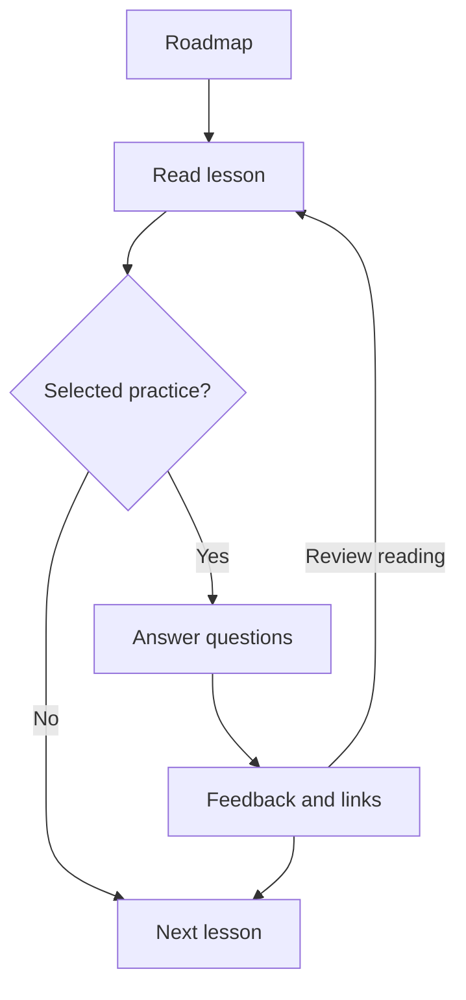

# Study application proposal

Prepared on 22 October 2026; implementation started on 23 October 2026 at the user's request. The user agreed with the overall approach and confirmed study mainly on one computer. Answer explanations have been authored and checked; the user will review them through the graphical interface. That personal review does not block application development. A first local implementation is now available; it has not been published. The scope is networking lectures 01–06. See [app/README.md](app/README.md) for launch instructions, [app/ARCHITECTURE.md](app/ARCHITECTURE.md) for the implemented design, and [app/verification.md](app/verification.md) for current checks and limits. This proposal includes deferred behavior; the architecture guide describes what the code currently does.

## Recommended approach

Build a browser application that runs locally, uses the existing course files, and saves personal study data in that browser. Provide a simple local launch command and a fixed local address. After setup, lessons, rendering libraries, and fonts should be available without an Internet connection while the local app is running.

Use React and TypeScript with Vite for the interface, IndexedDB for personal data, and a small Python content builder that reuses the repository's identity and manifest rules. There is no need for accounts or a server database for the confirmed single-computer use case. The small local process serves static files; it is not a course-editing API. An installable app and automatic device synchronization can be later additions.

The trade-off is that personal data belongs to the browser profile and app address. Include export/restore from the first persistent study milestone, keep the local address stable across launches, and show where progress is saved. Browser storage is not a backup; an exported file lets the user restore progress after changing browsers or computers. Persistent-storage requests may help where supported, but export remains necessary. See the [IndexedDB documentation](https://developer.mozilla.org/en-US/docs/Web/API/IndexedDB_API) and [storage persistence documentation](https://developer.mozilla.org/en-US/docs/Web/API/Storage_API/Storage_quotas_and_eviction_criteria).

| Approach | Fit for this project | Main trade-off |
| --- | --- | --- |
| Local browser app — recommended | Reuses Markdown/JSON, supports the study interface, and fits one-computer use | Personal data needs browser persistence and export/restore |
| Local app with SQLite and an API | Useful if saving directly to a database file becomes a requirement | Adds a writable backend and its maintenance |
| Hosted app with accounts and synchronization | Useful for routine phone/computer switching or several users | Adds authentication, synchronization, hosting, and account management |

The content and storage interfaces should allow a later storage change without rewriting the reader, quiz, or roadmap rules.

## The study experience

The first version has three main views, with backup/settings available from any view:

| View | What the reader does |
| --- | --- |
| Roadmap | Sees topics and lessons, continues the last session, selects priorities/filters, and previews what those choices include |
| Study | Reads a lesson with diagrams, equations, code, and supporting links; marks it read; answers directly related questions; then continues |
| Question library | Searches all questions, inspects coverage/review notes, edits personal tags/flags, and revisits previous answers |

On a desktop, show a collapsible topic/lesson sidebar and one central reading area. Put the lesson before its practice rather than requiring a separate quiz hunt. Keep the active filters visible, and let diagrams expand when needed. Use keyboard-accessible controls and responsive layouts.

Save the current position and submitted attempts so reopening the app can resume the session. A lesson without supplied questions still has a useful read-and-continue path. When questions are hidden by filters, say how many were hidden rather than claiming none exist.

## Flags, tags, and priorities

Keep the existing audit metadata available, with personal choices stored separately from the course files. This preserves both the evidence and the user's control over their roadmap.

| Item | Purpose | Reader controls |
| --- | --- | --- |
| Content flags | Existing findings such as coverage gaps, wording issues, supplementary source, and duplicates | Filter by them, inspect their reasons, and override their display in the personal profile |
| Personal flags | Study actions such as revisit or defer | Add/remove them on lessons or questions |
| Tags | Free-form groups such as `hard`, `revision`, or `ask lecturer` | Add/remove tags on lessons or questions; select tags to focus the roadmap |
| Priority | Relative study order | High, normal, or low; deferral is a separate reversible choice |

Adding/removing a flag or tag updates the personal profile immediately. For imported question tags and content flags, store additions/removals as overrides rather than editing the canonical JSON. The app can show the original audit finding even after a personal display override. Hiding a flag does not resolve its underlying coverage or answer-key finding.

Effective labels combine imported labels with personal additions and removals. Label filters use those effective labels; coverage classification and known-key-issue scoring rules continue to use the canonical audit metadata. Removing a coverage badge alone does not create a lesson assignment.

Provide include/exclude filters for topic, tag, flag, coverage, read status, and attempt status. Within one field, multiple included values mean any selected value; different fields combine together. Exclusions take precedence. Save the selected criteria and recompute the roadmap from current progress rather than freezing a stale list of questions.

Start with one active saved roadmap and a reset-to-default option. Named saved roadmaps can follow once the filtering behavior is useful in practice.

## Roadmap and quiz rules

1. **Retain the complete course.** The default reading roadmap includes every numbered lesson in topic/lesson order. Filtering practice questions does not silently remove lessons. A separate focus action can narrow reading to selected topics, lessons, or tagged questions and their supporting reading. Deferred material remains in the library.
2. **Offer a lecture-linked preset.** It selects questions with actual lesson links and leaves uncovered questions accessible in the library. Describe this as a study filter, without claiming excluded questions cannot appear on the exam.
3. **Use the actual primary lesson.** Show a question after its `lesson_id`, including questions originally filed under another topic. Identify their original quiz without copying them or counting them twice.
4. **Respect additional reading.** Before practice, show explicit `required_lesson_ids` that have not been marked read, including links outside the current focus. Offer to read them or deliberately practice anyway. Keep optional context separate. Do not automatically add every legacy related lesson as mandatory reading.
5. **Represent unknown dependencies honestly.** An absent required-reading field means unclassified. Show that the supporting reading has not been classified, allow practice, and avoid declaring the question fully ready. Resolve those records before introducing strict readiness gates.
6. **Order predictably.** Preserve prerequisite order for included lessons, then favor the user's higher priorities among available choices; use source order as the tie-breaker. If a prerequisite was filtered/deferred, offer it as supporting reading with an explicit override. Apply question priority within practice queues. Explain why an item was recommended.
7. **Treat known wording/key issues separately.** Default ordinary scored practice to linked questions without a `wording_issue` flag. Offer flagged questions as review items with the original key and review note, outside the ordinary score. Personal flag-display overrides must not silently make defective keys trusted. Source corrections require a separate content edit.
8. **Keep quiz feedback grounded.** Preserve option order in version one. Use single selection or multiple selection according to the supplied key, and require an exact selected-set match for ordinary scoring. Show results only after submission. Keep the distinction between supplied-key results and demonstrated mastery.
9. **Use reviewed explanations.** The authoring and agent-review pass for linked questions is complete, as recorded below. The user will review that text through the interface; keep its status distinct from user approval. After submission, show the authored explanation and links to its supporting teaching. Missing explanations on uncovered questions should remain visibly absent; do not generate an answer justification at runtime or relabel a coverage rationale as an answer explanation. Do not reveal answer keys, explanations, or answer-revealing review notes before submission.
10. **Separate reading from practice progress.** Marking a lesson read does not imply its questions were answered correctly. Track reading, submitted attempts, latest ordinary results, and items marked for review separately. Show counts for the active roadmap alongside full-course counts; deferring/filtering an item must not mark it complete.

A question without a primary lesson remains accessible as standalone practice/review in the library, with its coverage finding visible. Do not invent a lesson or a read-completion step for it.

A concrete example: tagging a question `revision` lets the reader focus on its primary lesson, see additional required lessons, answer it, and later find the same canonical question in revision practice. A coverage-gap exclusion can remove a question from that practice queue while its source lesson remains readable.

## Content and personal-data boundaries

Course content stays in `lessons/`, manifests, and `quizzes/`. Generate the app's catalogue from those files at build time; do not maintain a second hand-edited course database. Use stable manifest question/lesson IDs, retain fingerprints and provenance, and resolve internal Markdown links to app views. Preserve glossary, references, source qualifications, and access to original Markdown.

The reader should present lesson front matter as metadata and replace the repository's Practice/navigation scaffolding with app controls. Retain the teaching and relevant qualifications; source-quiz links must not expose raw answer JSON as the normal practice interface.

Keep browser storage behind a small interface, with these records:

- **Lesson state:** lesson ID, marked-read time, current reading position, personal priority, and deferral.
- **Question state:** question ID, personal priority, deferral, and review status.
- **Annotations:** typed target ID (lesson or question), added/removed tags and flags, and update time.
- **Attempts:** question ID, question fingerprint, answer-key revision or snapshot, selected original option indices, result, scoring/review mode, and timestamp.
- **Roadmap/settings:** criteria, ordering preferences, current position, and schema version.

Annotations are the single stored source of personal tag/flag edits; lesson and question views derive their badges from that store. Historical attempts survive content updates. If question text/options or the key changes, distinguish earlier attempts from attempts against the new version; never reattach history using array position alone or silently regrade it.

Export all personal records as a versioned JSON backup. Restore should validate the file and content identities, preview conflicts/unmatched items, and require an explicit choice before replacing current records. Keep unmatched history available for later reconciliation. A failed import must leave current study data intact. Course files are never overwritten by restoring personal data.

## Rendering and implementation

Suggested modules are content loading, the reader, quiz sessions, roadmap selection, personal storage, and backup/restore. Roadmap rules should be deterministic functions testable independently of the interface.

Use [Vite's React/TypeScript tooling](https://vite.dev/guide/), [react-markdown with GFM support](https://github.com/remarkjs/react-markdown), [remark-math/rehype-katex](https://github.com/remarkjs/remark-math), and [Mermaid](https://mermaid.js.org/config/usage.html). Bundle dependencies/fonts locally for studying. Select and lock compatible versions during implementation rather than treating this proposal as a package lockfile.

Strip YAML front matter correctly; support tables, inline/display mathematics, code fences, legitimate line breaks, local links, anchors, and Mermaid. Keep answer data out of pre-submission displays, search snippets, and accessibility labels. A local static app contains its answer data, so this is a self-study interface, not a secure examination system.

Render Mermaid to the available width, offer enlargement, and avoid clipping text. Where a genuine readability defect remains, repair the source-derived lesson diagram under the existing workflow rather than rasterizing it. Rendering errors should leave the rest of the lesson usable and identify the affected figure for repair.

## Content prerequisite: answer explanations

The authoring and agent-review prerequisite is complete. On 22 October 2026, explanations were authored and checked for all 210 linked networking questions and are awaiting user approval (`explanation_status: reviewed`). On 23 October, the user chose to review them through the graphical interface once built, so that approval is not a prerequisite to application coding. Of those questions, 165 have no existing wording flag and 45 have explanations addressing a known wording/key finding. Those flags do not all mean the key is wrong; evaluate each finding rather than applying a generic disclaimer. The 89 unlinked questions remain outside this pass because their lecture coverage is insufficient. Live counts and remaining decisions are in [STATS.md](STATS.md#networking-answer-explanations) and [STATUS.md](STATUS.md).

Work topic by topic, starting with routing and keeping each question in its canonical source quiz. Cross-topic questions use their actual destination lesson and required support; do not duplicate their explanations in another quiz. Inspect the question, every option, the preserved key, the mapped teaching, and review notes together before writing.

Each authored explanation should:

- Explain the relevant mechanism and why the supported answer follows, using a short paragraph unless calculation or several correct answers need more detail.
- Address the most plausible distractor or misconception when that helps understanding. Avoid filler that merely repeats the chosen answer or mechanically lists every wrong option.
- Link to the actual supporting lesson(s), including additional required teaching. Store Markdown in the existing `explanation` string, with lesson links resolved relative to the quiz file; the app must preserve that origin when rendering them.
- Retain assumptions and qualifications from the source. If a question depends on several lessons, explain their connection and recheck the dependency classification.
- For a flagged question, state the specific ambiguity or discrepancy. If the preserved key conflicts with the teaching, say so and explain the supported reasoning; never invent a justification for the faulty key. Keep its review flag and original key intact pending a separate correction.

The explanation is learner-facing authored content. Existing manifest rationales are evidence about coverage and can guide the review, but are not automatically suitable feedback to paste into the field. Supplementary material must remain labelled, and it cannot silently replace missing lecture teaching. If writing reveals an unsupported mapping, reopen the coverage review instead of inventing an explanation to meet a count.

Only explanation fields and necessary review documentation should change in the initial pass. Preserve question text, option order, keys, manual tags, identities, and existing assignments/flags unless a mapping defect is explicitly reviewed and documented. Any answer-key or wording correction remains a separate task. Existing lesson approvals do not establish approval of newly authored explanations.

Check explanation links and identities, compare all other quiz fields against the starting commit, and review the explanation against the teaching. The existing `--baseline` validator deliberately reports explanation edits as content changes: supplement structural validation with a comparison that permits exactly the authored explanation changes. Do not disable key/fingerprint preservation or describe the baseline mismatch as an unchanged-content pass. Record progress in STATUS/STATS and the affected topic's verification notes.

The authoring prerequisite is complete when every still-linked question has an agent-reviewed, sourced explanation, wording/key discrepancies are explicit, and any reopened coverage decisions have been resolved in the records. Uncovered questions may retain empty explanations and existing gap notes. This pass is complete; personal approval of the explanations follows review in the application. Keep `explanation_status: reviewed` until the user approves the text.

## Build order and acceptance

| Stage | Deliverable | Evidence needed before moving on |
| --- | --- | --- |
| 0. Answer explanations | Authored feedback in the existing quiz fields for linked networking questions | Every still-linked question has a sourced, reviewed explanation; flagged keys are not falsely justified; other quiz fields and identities are preserved |
| 1. Content contract | Typed catalogue from all six manifests, quiz data, and lesson/support Markdown | All IDs/fingerprints and links resolve; question content and tags are preserved; cross-topic questions appear once; unknown dependencies stay unknown |
| 2. Complete study session | Roadmap, reader, quiz, basic local persistence, and export/restore | Read → answer → feedback → continue → close/reopen works; a backup round trip restores the same records; an empty-quiz lesson works; known bad keys use review mode |
| 3. Personal roadmap | Editable tags/flags, priorities, include/exclude filters, support-reading prompts, and revision practice | Add/remove changes survive reload; filtering is reversible; dependencies and cross-topic assignments work; hidden/deferred items are not counted as complete |
| 4. Daily-use validation | Clear progress, resume behavior, keyboard operation, and rendered-content review | Representative wide/block/sequence diagrams work at intended widths; all diagrams render; mathematics/code/internal links work; the built app runs locally without Internet requests |

Start the session prototype with a normal lesson, a lesson without practice, a cross-topic or multi-lesson question, and a question with a known key issue. Include TCP's window block diagram, socket API's conversion panels, and SDN's handshake sequence in early rendering checks. Before considering the reader complete, render the full diagram set and inspect readability at desktop and narrower widths; successful parsing alone is insufficient.

Once the complete study session is usable, the user can review explanations alongside the questions and supporting lessons. Keep known review findings visible after submission and allow personal revisit flags. Building the interface does not itself approve explanations or authorize changes to preserved answer keys.

Tests should cover selection/exclusion precedence, stable identity, source-preserving imports, failed-restore behavior, multi-answer scoring, unknown dependencies, cross-topic counting, content-version changes, and persistence. Use browser checks for the full read/quiz/save/restore path and visual inspection for diagrams. Existing strict source-format findings remain documented; do not disable unrelated checks to make an app build appear valid.

## Starting evidence and deferred work

Before explanation authoring on 22 October 2026, the repository snapshot had six approved networking topics, 155 lessons, 299 questions, and 210 actual primary question links. Of the linked questions, 45 had wording flags, leaving 165 initial candidates for the proposed ordinary-practice filter. There were 62 lessons without a primary question assignment, 60 mapped questions without explicit required/optional classification, 81 Mermaid diagrams, and 299 empty quiz explanation fields. These figures are historical planning evidence, not live app totals or an exam-readiness estimate; derive UI totals from current canonical records. The subsequent explanation pass filled the 210 linked entries; see [current explanation statistics](STATS.md#networking-answer-explanations).

Accounts, automatic multi-device synchronization, an embedded-browser desktop wrapper, timed mock exams, spaced-repetition algorithms, question editing, and algorithms content are deferred. The first local implementation provides the read → quiz → save → restore session with real course material, plus basic personal labels, priorities, and practice filters. The user can now review explanations in context and assess that flow. The approved [deployment plan](DEPLOYMENT_PLAN.md) now has [native candidate packaging and GitHub Actions workflows](packaging/README.md), with a locally tested Linux prototype. Windows/macOS CI execution, distribution-specific desktop checks, trusted signing, and publication remain pending. Explicit reading-focus routes and named saved roadmaps remain future work. Implementation evidence and remaining validation limits are in [app/verification.md](app/verification.md).
