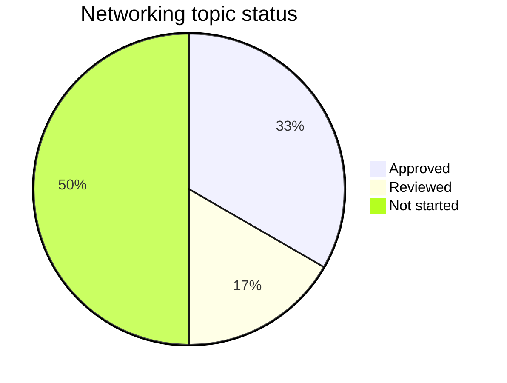
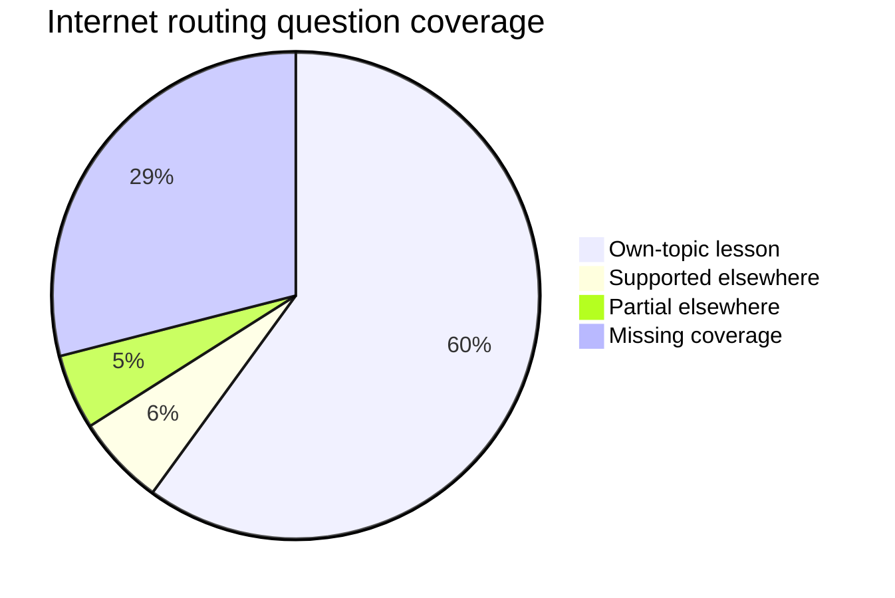
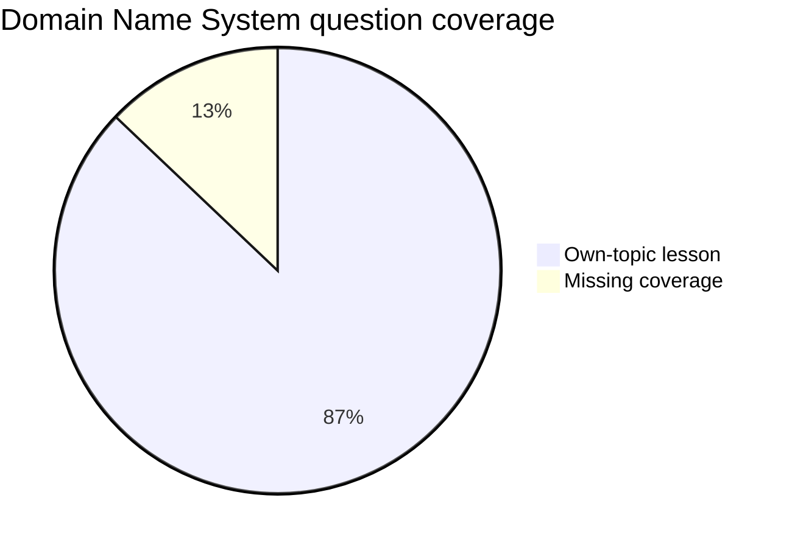
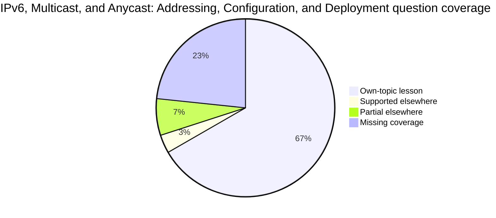
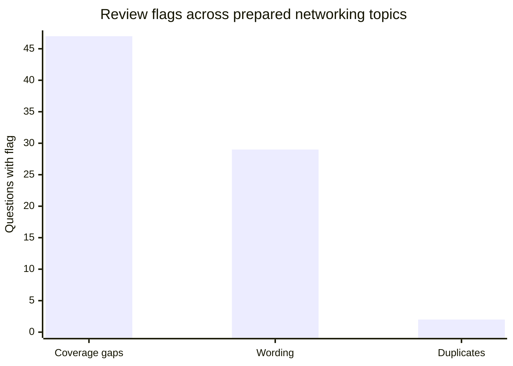
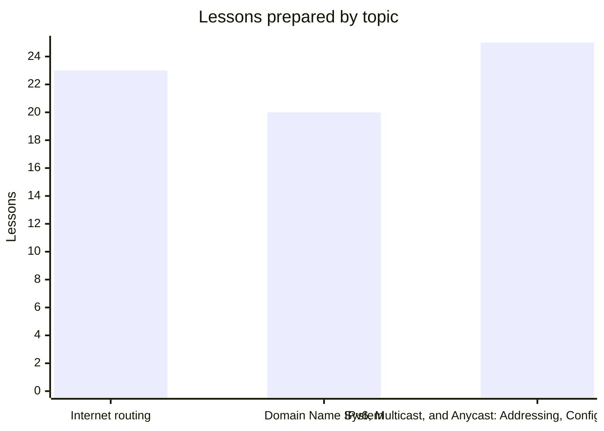

# Work progress

<!-- Generated by tools/generate_progress.py; do not edit counts or charts manually. -->

Quick view of **networking lectures 01–06**. Algorithms (07 onward) are outside this work scope. Charts show the current files, not historical progress or a percentage of work completed.

**3/6 topics have lessons · 68 lessons · 161/299 networking questions accounted for in manifests · 113 questions linked to actual lessons.**

Whole repository inventory: 11 lecture guides, 15 quizzes, 585 questions (including algorithms).

Regenerate with `python3 tools/generate_progress.py`; verify freshness with `python3 tools/generate_progress.py --check`. The script reads canonical question entries and quiz data, not cached manifest totals or STATS.md. It stops on stale fingerprints or conflicting quiz assignments.

## Topic status

Stages are explicit `preparation_status` metadata in each topic manifest: **Drafted** = content assembled; **Reviewed** = content checks performed, awaiting user approval; **Approved** = user approved the content. A topic without a manifest is **Not started**; a manifest missing stage metadata is **Unclassified**. Stages do not imply a commit, push, or app release.

| Topic | Stage | Lessons | Details |
| --- | --- | --- | --- |
| 01. [Internet routing](lectures/lecture_01_internet_routing.md) | Approved | 23 | [Overview](lessons/01_routing/README.md) |
| 02. [Domain Name System](lectures/lecture_02_dns.md) | Reviewed | 20 | [Overview](lessons/02_dns/README.md) |
| 03. [IPv6, Multicast, and Anycast: Addressing, Configuration, and Deployment](lectures/lecture_03_ipv6.md) | Approved | 25 | [Overview](lessons/03_ipv6/README.md) |
| 04. [End-to-End Communication and Congestion Control](lectures/lecture_04_tcp-ip.md) | Not started | 0 | — |
| 05. [Socket API, Network Programming, and High-Performance I/O](lectures/lecture_05_socket-api.md) | Not started | 0 | — |
| 06. [Software-Defined Networking (SDN) and OpenFlow](lectures/lecture_06_sdn.md) | Not started | 0 | — |

## Question coverage by topic

Coverage categories below are mutually exclusive and describe teaching support. **Mapped does not mean ready for scored practice.** Wording issues are tracked separately. Questions supported elsewhere may still await a real lesson link; partial elsewhere support still has a coverage gap.

| Source quiz | Own-topic lesson | Supported elsewhere | Partial elsewhere | Missing coverage | Total | Actual lesson links |
| --- | --- | --- | --- | --- | --- | --- |
| Internet routing | 60 | 6 | 5 | 29 | 100 | 65 |
| Domain Name System | 27 | 0 | 0 | 4 | 31 | 27 |
| IPv6, Multicast, and Anycast: Addressing, Configuration, and Deployment | 20 | 1 | 2 | 7 | 30 | 21 |

**138 networking questions are not yet accounted for in topic manifests.** They are unassessed, not confirmed coverage gaps. External assignments are counted only in the source quiz: the routing questions linked to DNS are not counted again as DNS quiz questions.

## Review backlog

Flags overlap. The bars count flags, not separate populations, and must not be added to estimate unresolved questions. Duplicate entries remain in their quizzes; no questions have been removed.

| Source quiz | Coverage gaps | Wording issues | Duplicate entries | Distinct questions with any of these flags | Review queue |
| --- | --- | --- | --- | --- | --- |
| Internet routing | 34 | 16 | 0 | 43 | [Review](lessons/01_routing/review.md) |
| Domain Name System | 4 | 4 | 2 | 10 | [Review](lessons/02_dns/review.md) |
| IPv6, Multicast, and Anycast: Addressing, Configuration, and Deployment | 9 | 9 | 0 | 14 | [Review](lessons/03_ipv6/review.md) |

Cross-topic and supplementary-source flags describe context, not defects by themselves. These flags are excluded from the backlog chart. The distinct-question column above is a deduplicated review queue, not a count of failed questions or necessarily unaddressed fixes.

## Content prepared

| Topic | Lessons | Without questions from own quiz |
| --- | --- | --- |
| Internet routing | 23 | 5 |
| Domain Name System | 20 | 7 |
| IPv6, Multicast, and Anycast: Addressing, Configuration, and Deployment | 25 | 16 |

Lessons without native quiz questions are retained deliberately. Some support another quiz. Lesson counts describe content organization, not equal amounts of work or exam importance.

See [STATUS.md](STATUS.md) for open decisions and delivery state, [STATS.md](STATS.md) for detailed counts, and each topic's verification report for check limitations. Mermaid diagrams require a compatible Markdown viewer; the tables provide the same counts if charts are unavailable.
