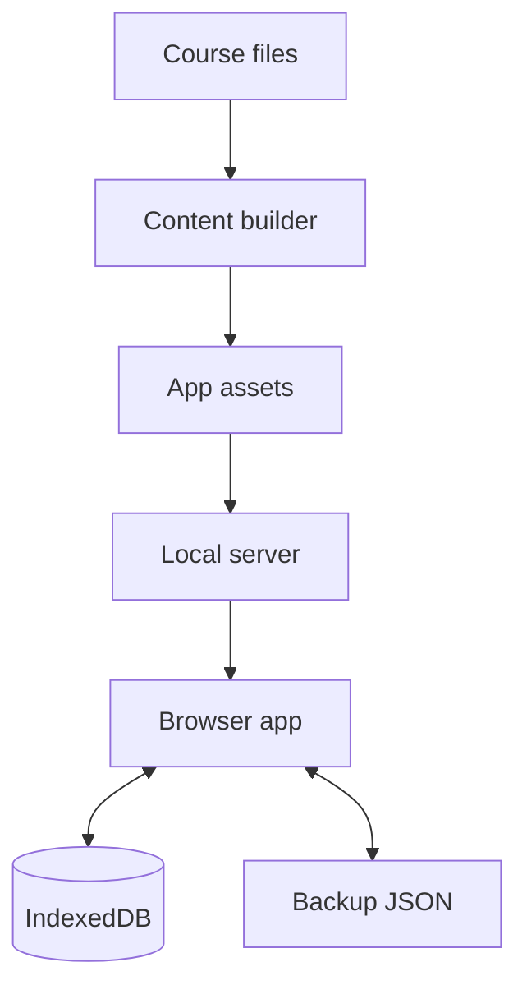
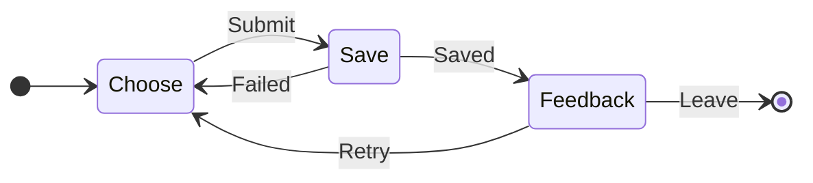
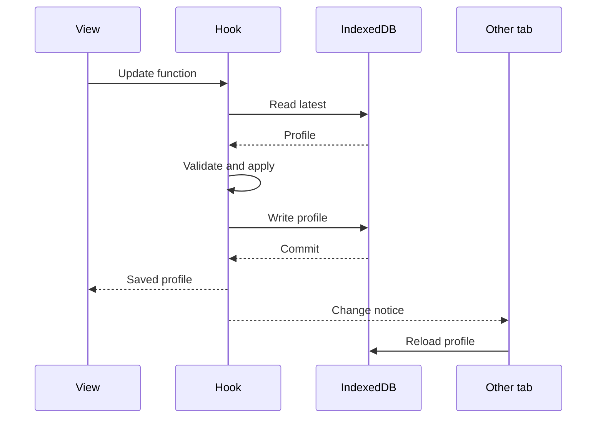

# Application design and implementation

This guide describes the implemented local study app. Start with the technology stack and file map, then read the section relevant to the change. Course statistics and current work belong in [STATS.md](../STATS.md) and [STATUS.md](../STATUS.md); launch commands belong in [README.md](README.md), and test evidence belongs in [verification.md](verification.md). [APP_PLAN.md](../APP_PLAN.md) records design intent and future features, some of which are not implemented.

For the agent workflow, use [maintain-study-app](../skills/maintain-study-app/SKILL.md); for native packaging/CI/publication, use [release-study-app](../skills/release-study-app/SKILL.md). The [tools index](../tools/README.md) lists reusable command entry points and their effects.

## Technology stack

| Area | Technologies | Role |
| --- | --- | --- |
| Browser interface | React, TypeScript, CSS, Lucide React | Study views, interactive controls, styling, and icons. |
| Web development and build | Node.js, npm, Vite, TypeScript compiler | Install locked dependencies, run development/preview servers, type-check, and bundle the interface. |
| Lesson rendering | react-markdown, remark/rehype plugins, KaTeX | Render Markdown tables/code, sanitized HTML, heading links, and mathematical notation. |
| Diagrams | Mermaid | Render lesson diagrams as SVG in the browser, with fitted and enlarged views. |
| Personal data | IndexedDB through idb, BroadcastChannel | Store progress, attempts, comments, and tags transactionally; notify other tabs of saved changes. |
| Runtime data validation | Zod | Validate stored profiles and imported backup JSON against explicit schemas. |
| Content preparation and local server | Python standard library, including http.server | Generate the course catalogue and serve the built interface at the fixed loopback address. |
| Native launcher window | Tkinter, Tcl/Tk | Provide Open, Licenses, and Stop controls for the local server and system browser. |
| Native packaging | PyInstaller and its hooks | Bundle Python, Tcl/Tk, and web assets into platform-specific downloads. |
| Automated tests | Vitest, fake-indexeddb, Playwright, Python unittest | Check app rules/storage, browser study flows and diagrams, content tools, and launcher/package behavior. |
| CI and release preparation | GitHub Actions | Build and test native candidates on Windows, Linux, and both Mac architectures; assemble downloads and optionally create a draft release. |

Declared JavaScript dependencies are in [package.json](package.json); resolved versions are in [package-lock.json](package-lock.json). Python packaging dependencies are pinned in [packaging/requirements.txt](../packaging/requirements.txt). CI runtime versions and platform matrices are defined in [check-app.yml](../.github/workflows/check-app.yml) and [package-app.yml](../.github/workflows/package-app.yml).

## System boundaries

The application serves an exam-study workflow on one computer: read a lesson, answer its directly related questions, inspect feedback, and continue. Course material stays in the repository. Personal study choices stay in the browser and can be exported.

The builder reads lessons, manifests, and quizzes. Vite packages the interface and generated content. The local server serves those files; it has no writable content API. Browser actions update IndexedDB, and restore replaces personal data there. Neither action writes back to course files.

React/TypeScript handles the interface, Python handles content preparation and the standalone launcher, and IndexedDB supplies persistence without accounts or a backend database. Rendering libraries and math fonts are bundled locally. A running build needs no Internet connection for study; opening an external reference is a separate browser action.

## File map

| Responsibility | Entry point | What to inspect |
| --- | --- | --- |
| Build catalogue | [build_app_content.py](../tools/build_app_content.py) | `build_catalogue`, `lesson_body`, generated files |
| Canonical question join | [query_quizzes.py](../tools/query_quizzes.py), [content_data.py](../tools/content_data.py) | `load_questions`, `question_fingerprint` |
| Launch built app | [serve_study.py](../tools/serve_study.py) | Fixed loopback address, browser launch, static serving |
| Native packages and CI | [packaging/README.md](../packaging/README.md), [package_study.py](../tools/package_study.py) | Shared web inventory, native spec, extracted-package checks, candidate assembly |
| Build configuration | [package.json](package.json), [vite.config.ts](vite.config.ts) | Scripts, dependencies; tested versions are in [package-lock.json](package-lock.json) |
| Browser entry | [src/main.tsx](src/main.tsx) | React root and local stylesheet/font imports |
| Shell and pages | [src/App.tsx](src/App.tsx) | `App`, `Roadmap`, `Study`, `QuestionLibrary`, `Document`; routing and resume |
| State coordination | [src/useStudy.ts](src/useStudy.ts) | Startup loading, `update`, save errors, cross-tab notifications |
| Domain rules | [src/model.ts](src/model.ts) | Selection, reading order, labels, grading, version matching, restore summary |
| Data contracts | [src/types.ts](src/types.ts) | `Catalogue`, `Question`, `Profile`, `Attempt`, `Backup` |
| Durable storage | [src/storage.ts](src/storage.ts) | Runtime schemas, `createStore`, `parseBackup`, `makeBackup` |
| Reader | [src/Markdown.tsx](src/Markdown.tsx) | Markdown plugins, `contentRoute`, stable renderers, Mermaid lifecycle |
| Quiz interaction | [src/Quiz.tsx](src/Quiz.tsx) | Local answer state, submission, feedback, question-status notices |
| Personal controls | [src/Controls.tsx](src/Controls.tsx) | `PersonalControls`, contextual study-control help, `Filters`, `BackupDialog` |
| Personal comments | [src/Comments.tsx](src/Comments.tsx) | Shared lesson/question editor, edit/delete actions, saved entries, and failed-save draft retention |
| Visual design | [src/styles.css](src/styles.css) | Theme variables, layout, result colors, responsive rules |

## Interface and navigation

The fixed desktop sidebar contains navigation and topics; the header exposes save status and backup/restore. The main area changes with the hash route. On narrow screens the sidebar becomes an off-canvas menu, the study rail moves below the content, and wide tables/code/diagrams can scroll or enlarge.

| View | Route example | Behavior |
| --- | --- | --- |
| Roadmap | `#/roadmap` | Complete reading list, reading/quiz progress, continuation, practice filters |
| Lesson | `#/lesson/tcp-06` | Lesson first, then selected questions; personal controls and references alongside |
| Question library | `#/library` | Filtered, paginated question list; answers stay concealed |
| Standalone question | `#/question/tcp-q007` | The same `Quiz` component, with a link to its primary lesson when available |
| Supporting document | `#/doc/lessons%2F04_tcp%2Fglossary.md` | Bundled glossary, references, or source Markdown |

`App` uses `location.hash` and `hashchange`; there is no routing-library dependency or server rewrite requirement. `?anchor=learning-goals` inside the hash identifies a heading within the selected document. Route changes update focus and reading position. An explicit URL wins on startup; without a hash, the saved `current_route` is restored. `last_lesson_id` separately supports continuing reading after visiting the roadmap or library.

Route focus/anchor effects also depend on the boolean content/profile readiness state. On a cold start, the loading screen can outlive the navigation timer; waiting for readiness ensures the target heading exists. Keep this dependency boolean rather than the whole personal profile, so scroll-save updates do not repeatedly navigate the page.

The visual palette uses dark green navigation, light reading surfaces, and restrained borders. Correct results use green/check marks; incorrect selections use red/crosses. Text labels carry the same information as color. Amber notices describe content qualifications independently of the verdict. All flags use the same result presentation, as requested by the user.

## Content build and identity

`npm run content` writes `public/content/catalogue.json` and source Markdown downloads under `public/content/source/`. `npm run build` first regenerates content, checks TypeScript, then builds `dist/`; Vite includes the generated public files. `npm run dev` regenerates content at startup; subsequent source-course edits require another content build. Both generated directories are ignored by Git.

The model and storage tests load the generated catalogue during module import. `npm test` regenerates it through the `pretest` hook before starting Vitest, so a clean checkout or stale generated content does not require a preceding production build. Keep this prerequisite in the test command rather than relying on another CI step or an earlier local build.

The builder:

1. Uses `load_questions(scope="networking")` to join canonical quiz entries with manifests and verify fingerprints, assignments, flags, and lesson references.
2. Reads prepared manifests for networking lectures 01–06 and checks lesson front-matter identities against manifest IDs. Manifest entries supply lesson metadata; the builder does not implement a general YAML metadata parser.
3. Produces reader Markdown by removing front matter, repository `## Practice` sections, and the final topic-navigation line. Fence tracking protects code examples. Teaching, learning goals, source qualifications, Mermaid, and source citations remain.
4. Bundles supporting topic documents and source lectures, preserves question text/options/keys/explanations/tags, validates answer indices and reverse lesson assignments, and adds content/key versions.

`Catalogue` contains `topics`, `lessons`, `questions`, and a `documents` map keyed by repository-relative path. Questions remain canonical in their original quiz even when their primary lesson belongs to another topic. Destination manifests' external assignments verify the join; they do not create copied questions. Missing dependency fields remain `null`/unclassified in the app.

| Identity/version | Meaning |
| --- | --- |
| Lesson ID | Stable manifest/front-matter identity, such as `tcp-06` |
| Question ID | Stable canonical manifest identity, such as `routing-q036` |
| `source_index` | Position in the original quiz; valid only after checking the fingerprint |
| `question_sha256` | Fingerprint of question wording and ordered options; excludes answer keys and personal metadata |
| `answer_version` | Hash of the sorted answer indices, generated by the builder |
| `content_version` | Hash of the generated catalogue before adding the version itself |

Reuse the existing hash/join functions rather than recreating their encodings. An answer-key change needs its own version check because the wording/options fingerprint does not cover keys. See [lesson conventions](../lessons/README.md) for the canonical content contract.

The static catalogue contains answers. Concealment is a study-interface rule, not an examination security boundary. Before submission, keys, explanations, and answer-revealing review notes must stay out of visible content, search results, and accessible labels. Generic flag notices may be shown before submission.

## Reading order and practice selection

The pure functions in `model.ts` define the behavior shared by views:

| Function | Rule |
| --- | --- |
| `effectiveLabels`, `labels` | Union imported labels with personal additions, then apply removals |
| `matches` | OR within an included field, AND across fields, exclusions take precedence; honor coverage, attempt/read status, deferral, and text search |
| `selectedQuestions` | Filter questions, then prioritize high/normal/low with source-order ties |
| `orderedLessons` | Keep the complete reading list; order prerequisites before dependents, then apply personal priority among available lessons |
| `nextLesson` | Resume the last unread, nondeferred lesson, or find the next eligible lesson; fall back to earlier unread material when needed |
| `practiceMode` | Review mode when there is no primary lesson or the canonical flags include `wording_issue`; otherwise scored mode |
| `latestAttempt` | Select the latest attempt matching question identity, wording fingerprint, key version, option count, and key snapshot |

Topic filters use the question's **source topic**, while lesson practice uses its **actual primary lesson**. Search examines stems, options, and IDs, never answer explanations. Practice filters do not remove lessons from the reading roadmap. Lesson deferral affects continuation; question deferral affects practice selection. Required additional reading produces prompts, not hard completion gates. Optional context and unclassified related reading remain distinct.

The root [user guide](../README.md#make-the-study-plan-your-own) explains these controls for readers. `PersonalControls` also provides a native HTML disclosure with lesson/question-specific Priority, Revisit, and Defer descriptions. Each control references its help text with `aria-describedby`; React `useId` keeps those references distinct across the lesson and its questions. Keep help copy aligned with ordering, continuation, and session-selection behavior when changing the model.

Control handlers must capture input values before passing a mutation to the asynchronous store. The Priority handler copies the selected value immediately; reading a controlled select later can save its previous value after React restores the displayed selection.

`Study` captures its selected questions when a session mounts. Its key combines lesson ID and serialized criteria. Thus changing lesson or filters starts a new selection, while answering or annotating an item does not remove its current feedback. This matters for an “unattempted” filter: after submission the global queue changes, but the current lesson session stays visible.

## Quiz lifecycle

`Quiz` owns temporary selection, submission, and busy state. `createAttempt` validates selected indices and snapshots the original key/version. The interface reveals feedback only after the attempt commits successfully. A fresh visit hides feedback even if an earlier attempt exists; Retry clears the current selection and reveal state.

All questions use the **Submit** button label. Unread required supporting lessons remain visible as an advisory with links; they do not block submission or change its label.

Single-answer keys use radio inputs; multiple-answer keys use checkboxes. `exactAnswer` requires the exact answer set without duplicates or partial credit. Option order remains unchanged. Reading a lesson does not create an attempt or imply a correct answer.

Every submission displays Correct/Incorrect relative to the original answer key. Correct options are green; a selected incorrect option is red. The question-status notice describes every canonical content flag. A wording/key finding also receives a qualification beside the verdict, since matching a faulty key does not establish technical correctness. Review attempts keep the same feedback presentation but stay outside the ordinary score. Personal flag-display overrides do not change eligibility or remove the underlying finding.

Keep lesson-conversion approval, explanation approval, and application acceptance separate. The app displays the topic's explanation status; feature acceptance does not automatically approve the authored explanation text or correct any preserved keys.

## Personal data and persistence

The React root loads the catalogue and saved profile through `useStudy`. Persistent changes go through `update(current => next)`, not direct component writes. Small transient controls use local React state; there is no additional global state library.

The read, validation, update, and write occur within one `readwrite` transaction in `createStore.change`. Reading the latest value inside that transaction prevents concurrent tabs from overwriting unrelated updates with stale profiles. React receives the committed profile; failed writes report an error and do not apply an optimistic profile. `BroadcastChannel` tells other tabs to reread IndexedDB. It provides communication between tabs at the same origin, not synchronization between computers.

The current database is `network-study-v1`, database version `1`, with object store `profile` and key `personal`. The `Profile` value is one validated document:

| Field | Contents |
| --- | --- |
| `schema_version` | Personal-data schema version |
| `lessons` | Lesson-ID map of `read_at` and fractional `scroll` position |
| `annotations` | Typed target keys such as `lesson:tcp-06` or `question:tcp-q007`; added/removed tags and flags, priority, deferral, and update time |
| `comments` | Typed lesson/question target keys mapped to comment arrays; each entry has a UUID, plain text, creation time, and update time |
| `attempts` | Attempt IDs, question/key versions, selected indices, key snapshot, option count, mode, result, and timestamp |
| `criteria` | The active practice criteria |
| `current_route` | Last page for reopening |
| `last_lesson_id` | Last chosen lesson for continuation |

Annotations supply personal controls for both lessons and questions; there is no separate persisted question-state table. Unmatched history remains stored. Current progress uses version-matching attempts, so changed questions or keys are not silently regraded or attached by array position.

The runtime contracts are Zod schemas in `storage.ts`, alongside TypeScript declarations in `types.ts`. Current profiles use schema version 2. `parseStoredProfile` validates version 1 records with their legacy schema, retains existing fields, and supplies version 2 plus empty comments. The next successful write persists the migrated profile; the database name/version and object-store layout do not change. Mutations must produce a valid current profile rather than downgrade it. Changes to persistent fields require coordinated updates to types, runtime schemas, `emptyProfile`, compatibility/migration handling, and backup/storage tests. Renaming the database or changing the origin also requires an explicit data-transfer strategy.

`Comments` appears below the reader in `Study` and inside question personal controls. Lesson comments use the main column rather than the narrow study rail. The shared component writes through `update`, applying changes to the latest target list inside the transaction so other entries and annotations are retained. A failed save leaves the editor draft available for retry; deleting an edited entry in another tab causes save to fail rather than resurrect it. Comments render as plain text with wrapped long lines. Saved entries are limited to 5,000 characters, and target lists reject duplicate comment IDs. Unsaved editor text is transient; users choose **Save comment** or **Save changes** before leaving. Comments stay local and are included when a user exports/shares a personal backup; there is no online comment service.

Identity validation allows digits within topic names, including `ipv6-17`, `ipv6-q012`, and typed annotation keys such as `question:ipv6-q012`. Storage tests round-trip identities from the complete catalogue through reopening and backup/restore. Keep validation structural rather than requiring current catalogue membership, so unmatched history remains recoverable.

Production launch and `npm run start` use `http://127.0.0.1:4173/`; `npm run dev` uses 5173; local Playwright checks use a Vite preview on 5174 through `npm run test:serve`. When `NETWORK_STUDY_EXECUTABLE` is set, Playwright instead uses the native launcher on 4173. Both test modes own their server and refuse reuse. Ports never silently change. Hostname, scheme, port, and browser profile determine the storage location; hash routes do not. Each development/test origin has separate personal data, while the existing study origin preserves progress. Moving data between them requires a personal backup. Released downloads have separate bundled assets; rebuilding checkout `dist/` also changes what a source study server serves.

## Backup and restore

`BackupDialog` exports a version 2 JSON envelope containing the profile, comments, export time, and content version. It does not export another copy of the course. Download and restore controls are disabled while a save is active. Version 1 backups are validated against their original schema and migrated to the current shape on import; newer exports require the updated app.

Import checks the file-size limit and `parseBackup`'s strict schemas, including dates, identities, answer-index bounds, duplicate attempt/comment IDs, comment lengths, and stored-result consistency. `backupSummary` counts comments and identifies unmatched lesson, annotation, and comment targets, plus historical or unmatched attempts against the current catalogue. A changed content version is shown in the preview. Unknown records are retained rather than discarded.

Restore requires an explicit replacement choice after previewing imported and current counts. It replaces the whole personal profile atomically, then navigates to the imported current route. There is no merge mode. Invalid files and failed writes leave saved data intact. The browser remains the active store; a downloaded JSON file is the portable backup.

## Markdown and diagram rendering

`Markdown` receives the text **and its source path**. Lesson paths originate under `lessons/`; explanation paths originate in their quiz file. `contentRoute` resolves relative links from that path into lesson/document hash routes. Quiz-file links go to the library. External links open separately; unavailable local repository references become explanatory text rather than broken app routes.

The pipeline applies GFM and math parsing, raw HTML parsing and sanitization, heading IDs, and KaTeX rendering. Local KaTeX CSS/fonts come from `main.tsx`. Code blocks and tables scroll when wide. Front matter and repository lesson-practice navigation were already removed from reader lessons by the builder; original Markdown downloads remain available.

For Mermaid fences, `MarkdownPre` renders `Diagram`. Mermaid is imported/initialized once; a shared queue serializes render requests. Each figure has a unique render ID and a source-dependent effect. An active flag prevents late asynchronous results from updating an unmounted figure. Successful output supplies the fitted SVG and an enlarged native dialog. Failures leave the surrounding lesson usable with source available for inspection.

**Preserve renderer identity.** `MarkdownPre` and `MarkdownTable` are module-level components; source-aware link renderers use `useMemo`; unchanged Markdown uses `memo`. Reintroducing inline component definitions makes React remount their subtrees when a profile save rerenders the parent. That was the cause of the scrolling flicker: SVG removal changed page height, which moved the scrollbar and triggered further updates.

`Study` still saves scroll position, debounced by 400 ms, as a fraction of the scrollable document height. It restores the saved fraction once on lesson entry, or honors an explicit heading anchor. Fixing rendering must not disable persistence to hide the symptom. Test stability after initial position navigation has settled: the same SVG nodes, page height, and viewport position must survive actual saves and read-mark updates. See the [scrolling verification](verification.md#diagram-scrolling-follow-up).

## Making changes

| Task | Start here | Relevant checks |
| --- | --- | --- |
| Change colors, spacing, or responsive layout | `styles.css`, affected view in `App.tsx` or `Quiz.tsx` | Inspect desktop/narrow views and accessible labels |
| Change question feedback or flag notices | `Quiz.tsx`, `styles.css` | Both verdicts for every flag; concealment; review-score exclusion |
| Change filtering, ordering, or scoring | `model.ts`, then `Controls.tsx` for controls | [model.test.ts](tests/model.test.ts), affected browser flow |
| Change saved fields or restore | `types.ts`, `storage.ts`, `useStudy.ts`, `BackupDialog` | [storage.test.ts](tests/storage.test.ts), export/restore browser flow, compatibility cases |
| Change personal comments | `Comments.tsx`, `types.ts`, `storage.ts`; placement in `App.tsx`/`Controls.tsx` | Add/edit/delete/reload, failed-save draft retention, old-profile migration, backup/restore, narrow layout |
| Change links or renderers | `Markdown.tsx`, route handling in `App.tsx` | Source-relative links, math/code, full diagram render, scrolling/enlargement |
| Change lesson/question content | Canonical files and the [lecture workflow](../skills/prepare-lecture/SKILL.md) | Content validation and [catalogue tests](../tools/tests/test_app_content.py); regenerate/build the app |
| Investigate missing or stale content | Builder output and `npm run content`/`npm run build` | Inspect IDs/fingerprints and the generated catalogue before changing UI logic |

Launch and test commands are centralized in [README.md](README.md). Pure-rule/storage checks use Vitest; Python checks cover the content join and preservation; Playwright checks exercise the production build with isolated personal profiles. The browser suite covers all numbered-lesson diagrams and an explicit scroll-save regression. It never reuses an existing server; local previews use 5174, while native candidate checks use 4173. Avoid clearing a user's browser data to investigate a failure; use an isolated test profile or an exported backup.

Keep acceptance and detailed verification in [verification.md](verification.md), current decisions in [STATUS.md](../STATUS.md), and this guide focused on implementation structure. A passing application test does not resolve the documented strict content-source findings or approve explanation text.

## Extension boundaries

Native candidate packaging is implemented separately from the browser interface. [packaging/README.md](../packaging/README.md) describes commands, workflow triggers, artifacts, and limits; [DEPLOYMENT_PLAN.md](../DEPLOYMENT_PLAN.md) records the acceptance targets. The launcher resolves a source build or bundled `web/`, serves it on the same origin, and provides a Tkinter window for packaged use. Its headless stop-file mode lets tests shut down their own process. It exposes no HTTP shutdown/write API, and never moves personal data into the bundle or its temporary extraction directory. Browser opening temporarily restores external-program library search paths, then restores the bundled process environment.

Static web MIME types are explicit, so Windows registry file associations cannot change how scripts/fonts are served. The listener disables address reuse on Windows, where that option can permit competing listeners; POSIX retains reuse for prompt relaunch. Native candidate checks exercise duplicate-launch refusal and immediate relaunch on each target. See the [Winsock option semantics](https://learn.microsoft.com/en-us/windows/win32/winsock/using-so-reuseaddr-and-so-exclusiveaddruse).

The listener sets `request_queue_size = socket.SOMAXCONN` so the platform chooses its maximum supported pending-connection queue. Python 3.13's inherited queue of five can overflow during parallel Mermaid module requests; on Windows, overflow can refuse connections and leave the diagram in its error state. A launcher regression queues 24 connections before starting acceptance, then verifies every JavaScript response. Inspect the failed browser trace and diagram state before attributing a readiness timeout to slow rendering; increasing a test timeout cannot repair a failed module download. See [Python's queue setting](https://docs.python.org/3.13/library/socketserver.html#socketserver.TCPServer.request_queue_size) and [Winsock backlog behavior](https://learn.microsoft.com/en-us/windows/win32/api/winsock2/nf-winsock2-listen).

The web inventory identifies one commit/version/catalogue and is shared by all four native jobs. Native metadata adds platform, runtime, runner, signing status, and license hashes. The extracted-download test checks hashes and lifecycle before running Playwright through [run_packaged_study.mjs](../tools/run_packaged_study.mjs). That wrapper uses an absolute executable path and an empty command search path; the normal preview mode still uses Vite. Release assembly rejects missing targets, mixed identities, dirty builds, and mismatched/failed reports. Optional draft creation requires a matching existing version tag and does not publish. Current native CI evidence is recorded in [verification.md](verification.md); actual desktop acceptance, trusted signing, and Fedora/Arch compatibility still require separate checks.

Explicit reading-focus routes, named saved roadmaps, richer history browsing, accounts/device synchronization, embedded-browser desktop wrappers, timed exams, spaced repetition, and algorithms content are not implemented. Extending to another lecture range requires revisiting the builder's explicit networking scope and complete-topic checks. Changing storage or delivery requires preserving the identity/history/backup contracts above. Refer to [APP_PLAN.md](../APP_PLAN.md) for proposed behavior before designing those additions.
