# Internet Routing — Study Guide

**Revised:** 21 October 2026

**† Supplementary material:** Content identified by the supplied guide as originating exclusively from hidden slides. It may not be included in this year's examinable material. Topics also covered in visible slides remain unmarked.

## Glossary

| Term | Meaning |
| --- | --- |
| **Adj-RIBs-In / Adj-RIBs-Out** | BGP routing information learned from, or prepared for advertisement to, peers. |
| **ARP** | Address Resolution Protocol; resolves a local IPv4 next-hop address to a link-layer address. |
| **AS / ASN** | Autonomous System / Autonomous System Number; an administratively governed routing domain / its identifier. |
| **AS_PATH** | BGP attribute identifying the AS sequence advertised for a route. |
| **ASPA** | Autonomous System Provider Authorization; signed information about authorized providers. |
| **Backbone** | Central network or routing area interconnecting other parts of a network. |
| **Bellman–Ford** | Distributed shortest-distance recurrence underlying distance-vector routing. |
| **BGP** | Border Gateway Protocol; policy-oriented inter-domain routing protocol. |
| **BGPsec** | BGP extension designed to cryptographically protect AS-path announcements. |
| **CIDR** | Classless Inter-Domain Routing; prefix notation such as `192.0.2.0/24`. |
| **Convergence** | Process of reaching a stable routing state after a change. |
| **Customer cone** | An AS and the customer ASes reachable through its downstream customer hierarchy. |
| **Datagram** | Packet forwarded independently, without an established virtual circuit. |
| **DD** | Database Description; OSPF packet summarizing link-state database contents. |
| **DF / MF** | IPv4 *Don't Fragment* / *More Fragments* flags. |
| **DHCP / DORA** | Dynamic Host Configuration Protocol / Discover–Offer–Request–Acknowledge exchange. |
| **Dijkstra** | Shortest-path algorithm used with link-state routing information. |
| **DNS** | Domain Name System; resolves names to information including IP addresses. |
| **DSCP / ECN** | Differentiated Services Code Point / Explicit Congestion Notification. |
| **eBGP / iBGP** | BGP between different ASes / BGP within the same AS. |
| **EGP / IGP** | Exterior Gateway Protocol / Interior Gateway Protocol; inter-AS / intra-AS routing. |
| **FIB / forwarding table** | Forwarding Information Base used to select an output interface or next hop. |
| **Flooding** | Disseminating routing information through neighboring routers across a defined scope. |
| **Hop** | One router-to-router forwarding step; RIP also uses hop count as a metric. |
| **IHL** | Internet Header Length; IPv4 header size expressed in 32-bit words. |
| **ICMP** | Internet Control Message Protocol; IP-related errors, control, and diagnostics. |
| **IP / IPv4 / IPv6** | Internet Protocol / versions 4 and 6. |
| **LSA / LSDB** | Link-State Advertisement / Link-State Database used by link-state routing. |
| **MAC address** | Link-layer identifier of a network interface. |
| **MED** | Multi-Exit Discriminator; BGP attribute used when comparing certain entry points. |
| **MTU / PMTUD** | Maximum Transmission Unit / Path MTU Discovery. |
| **Next hop** | Neighbor or gateway to which a packet is forwarded. |
| **NLRI** | Network Layer Reachability Information; BGP-advertised destination prefixes. |
| **OSPF** | Open Shortest Path First; link-state IGP. |
| **Packet switching** | Network model that shares links by forwarding individually delimited packets. |
| **Peering** | Interconnection where ASes exchange traffic under a negotiated policy. |
| **Prefix / prefix length** | Address range identified by common leading bits / number of such bits. |
| **PSTN** | Public Switched Telephone Network; traditional circuit-switched telephony. |
| **RIP / RIPv2** | Routing Information Protocol / its version 2; distance-vector IGP. |
| **ROA / ROV / RPKI** | Route Origin Authorization / Route Origin Validation / Resource Public Key Infrastructure. |
| **Route aggregation** | Combining contiguous prefixes into a shorter common prefix. |
| **Route hijack / route leak** | Unauthorized origination of a prefix / unintended export of a learned route. |
| **Route reflector** | BGP mechanism that distributes iBGP routing information without a full mesh. |
| **RIR** | Regional Internet Registry; allocates Internet number resources within its region. |
| **RTT** | Round-trip time, e.g., used by TCP for timing estimates. |
| **Split horizon / poison reverse** | Distance-vector loop mitigation: suppress a route toward its source / advertise it there with infinite metric. |
| **TCP / UDP** | Transmission Control Protocol / User Datagram Protocol. |
| **Transit** | Carrying traffic between networks that are not the originating or destination AS. |
| **TTL** | Time To Live; IPv4 field reduced on each router hop. |
| **Valley-free** | Conventional BGP export pattern: up through providers, optionally across a peer, then down to customers. |
| **Virtual circuit** | Packet-switching model with a setup phase and established per-flow forwarding state. |
| **Wedgie** | BGP situation with multiple stable routing configurations, including an undesirable persistent state. |

## Contents

- [Internet architecture and encapsulation](#internet-architecture-and-encapsulation)
  - [The hourglass architecture](#the-hourglass-architecture)
  - [Encapsulation and service model](#encapsulation-and-service-model)
- [IPv4 header and fields](#ipv4-header-and-fields)
- [Fragmentation and path MTU](#fragmentation-and-path-mtu)
  - [Fragmentation example](#fragmentation-example)
- [IPv4 addressing, CIDR, and ARP](#ipv4-addressing-cidr-and-arp)
  - [Network-layer and link-layer addressing](#network-layer-and-link-layer-addressing)
  - [ARP message structure](#arp-message-structure)
- [ICMP and network diagnostics](#icmp-and-network-diagnostics)
  - [ICMP packet format and Time Exceeded](#icmp-packet-format-and-time-exceeded)
- [DHCP configuration and leasing](#dhcp-configuration-and-leasing)
- [Forwarding and switching models](#forwarding-and-switching-models)
  - [Datagram, virtual-circuit, and source routing](#datagram-virtual-circuit-and-source-routing)
  - [Traditional telephone circuit switching — supplementary †](#traditional-telephone-circuit-switching--supplementary-)
- [Address aggregation and Internet structure](#address-aggregation-and-internet-structure)
  - [Subnetting, supernetting, and CIDR](#subnetting-supernetting-and-cidr)
  - [From connected networks to autonomous systems](#from-connected-networks-to-autonomous-systems)
- [Autonomous systems and routing fundamentals](#autonomous-systems-and-routing-fundamentals)
  - [Traffic and AS categories](#traffic-and-as-categories)
  - [Intra-AS and inter-AS relationships](#intra-as-and-inter-as-relationships)
- [Link-state routing and shortest paths](#link-state-routing-and-shortest-paths)
  - [Dijkstra's algorithm](#dijkstras-algorithm)
  - [Properties and limitations](#properties-and-limitations)
- [Distance-vector routing and Bellman–Ford](#distance-vector-routing-and-bellmanford)
  - [Distance-vector algorithm](#distance-vector-algorithm)
- [Routing loops, split horizon, and poison reverse](#routing-loops-split-horizon-and-poison-reverse)
  - [Counting to infinity](#counting-to-infinity)
  - [Loop-mitigation techniques](#loop-mitigation-techniques)
- [RIP and RIPv2 — supplementary †](#rip-and-ripv2--supplementary-)
  - [RIPv2 message format](#ripv2-message-format)
- [OSPF areas, packets, and operation — supplementary †](#ospf-areas-packets-and-operation--supplementary-)
  - [Areas and backbone](#areas-and-backbone)
  - [OSPFv2 common packet header](#ospfv2-common-packet-header)
  - [OSPF packet types and synchronization](#ospf-packet-types-and-synchronization)
  - [Database Description (DD) packet](#database-description-dd-packet)
- [Inter-domain routing and the role of BGP](#inter-domain-routing-and-the-role-of-bgp)
  - [BGP background and path-vector model](#bgp-background-and-path-vector-model)
- [BGP state, updates, and advertisements](#bgp-state-updates-and-advertisements)
  - [Sessions and message types](#sessions-and-message-types)
  - [UPDATE content and route advertisements](#update-content-and-route-advertisements)
- [BGP route selection and sessions](#bgp-route-selection-and-sessions)
- [AS business relationships and export policy](#as-business-relationships-and-export-policy)
  - [Export policy and valley-free paths](#export-policy-and-valley-free-paths)
  - [University network example](#university-network-example)
  - [A peering dispute](#a-peering-dispute)
- [BGP hijacks and route leaks](#bgp-hijacks-and-route-leaks)
  - [YouTube/Pakistan example](#youtubepakistan-example)
- [RPKI, ROAs, and origin validation](#rpki-roas-and-origin-validation)
  - [maxLength and origin-validation outcomes](#maxlength-and-origin-validation-outcomes)
  - [Limits and deployment](#limits-and-deployment)
- [ASPA and partial deployment](#aspa-and-partial-deployment)
- [Convergence, stability, and failures](#convergence-stability-and-failures)
- [BGP wedgies and persistent states](#bgp-wedgies-and-persistent-states)
- [Internet design principles](#internet-design-principles)
- [Glossary](#glossary)
- [Revision notes and references](#revision-notes-and-references)

## Internet architecture and encapsulation

The **Internet Protocol (IP)** provides a common network layer connecting dissimilar underlying networks. A datagram can travel over Ethernet, a point-to-point link, or another local technology without requiring applications to understand those links. **Routers** connect those networks and use destination IP addresses to decide where to forward packets.

### The hourglass architecture

The Internet is described as an **hourglass** because many applications and transport protocols sit above a shared IP layer, while many different link technologies sit below it. These relationships express **layering**, not directed packet flow; the connectors therefore have **no arrowheads**.

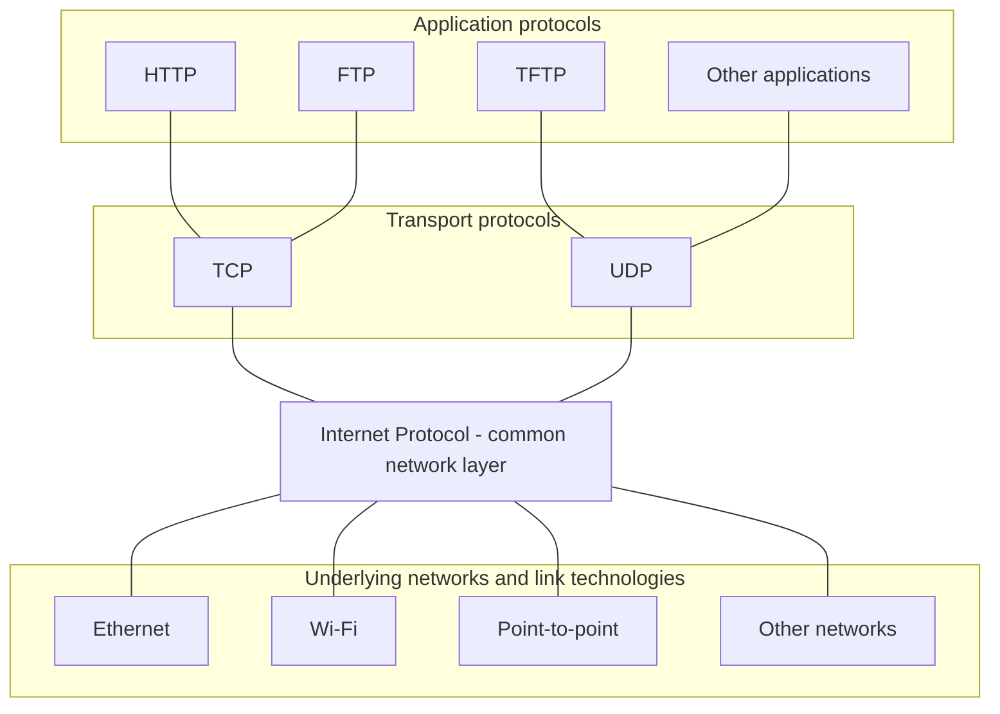

### Encapsulation and service model

**Encapsulation** adds a protocol header as data moves down through layers. An application message becomes transport-layer data, then an IP payload, then the payload of a link-layer frame. At the receiver, each layer interprets and removes its own header. A frame header is relevant to the **current link**, whereas the destination IP address identifies the packet's destination across the internetwork.

The on-wire nesting is:

| Outer to inner | Contents |
| --- | --- |
| Link frame | Link header, IP datagram, and any link trailer |
| IP datagram | IP header and transport payload |
| TCP segment or UDP datagram | Transport header and application data |

IP is **connectionless**: routers forward each datagram independently instead of establishing a network-layer connection first. The service is **best effort**; an IP network does not promise delivery, bounded delay, unique delivery, or in-order arrival. A packet may be lost, duplicated, delayed, or reordered. Where necessary, TCP or the application provides mechanisms above IP to cope with these effects.

## IPv4 header and fields

An IPv4 datagram comprises a header followed by a payload (usually a TCP segment, UDP datagram, or ICMP message). The fixed portion of the IPv4 header occupies **20 bytes**, and the optional portion can extend it. Each complete header row in the format is **32 bits**; the diagram indicates field lengths explicitly because Mermaid column widths are not bit-proportional.

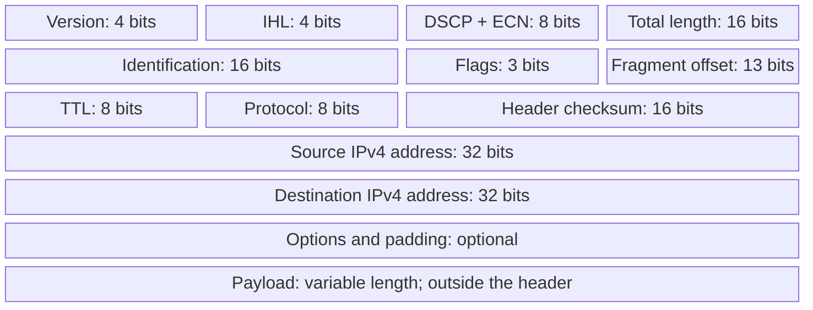

**Version** is 4 for IPv4. **IHL** counts header length in units of four bytes, so a header with no options has IHL = 5. **Total Length** includes both header and payload and is encoded in 16 bits, with a maximum represented packet size of **65,535 bytes**. The source and destination addresses each occupy **32 bits**. The destination address drives forwarding.

**DSCP** identifies differentiated service treatment (for example, certain real-time voice traffic). **ECN**, when supported end to end and by the network, permits congestion signalling without necessarily dropping the packet. **TTL** decreases at each router, limiting the life of a looping datagram. **Protocol** identifies the next protocol: **ICMP = 1**, **TCP = 6**, and **UDP = 17**. The **header checksum** checks the IPv4 header, not the full payload. **Identification, Flags, and Fragment Offset** describe fragmentation and reassembly.

## Fragmentation and path MTU

Every network link has a **maximum transmission unit (MTU)**. An IPv4 datagram too large for the next link may need **fragmentation** (unless prohibited by its **DF** flag). Each fragment is its own IP datagram and carries enough header information for the **destination host** to reassemble the original. An intermediate router may fragment further, but reassembly is generally postponed until the destination.

### Fragmentation example

Suppose the original datagram contains **1,400 bytes of data**. Along a route with a smaller link, a router splits it into payloads of **512**, **512**, and **376 bytes**. These are payload sizes; each fragment also has its own IP header. Offsets are measured in **units of eight bytes**, not individual bytes.

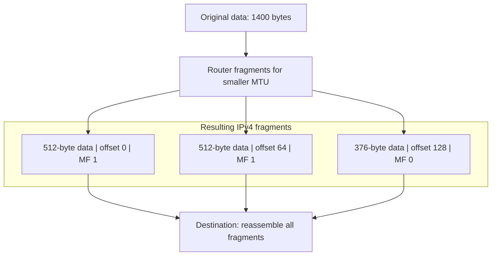

The **Identification** field helps associate fragments from the same datagram. **MF** (*More Fragments*) is set on every fragment except the last; the last fragment has MF = 0. **DF** (*Don't Fragment*) means a router must discard a too-large packet rather than fragment it, and normally signal the problem to the sender with ICMP. For an unfragmented datagram, both MF and offset are zero; the last fragment of a fragmented datagram typically has a nonzero offset. The 13-bit offset encodes units of eight bytes, so the maximum represented starting offset is **8191 × 8 = 65,528 bytes**.

A lost fragment prevents reassembly of the complete original datagram. IP itself does **not** request missing fragments again: any retransmission comes from a higher layer or the sender. Consequently, fragmentation can waste capacity. **Path MTU Discovery** tries to identify the smallest MTU along the route, commonly using the DF flag and ICMP feedback, so that the sender can avoid fragmentation. IPv4 hosts have a minimum reassembly requirement of **576-byte** datagrams; modern hosts generally support much larger ones.

## IPv4 addressing, CIDR, and ARP

An IPv4 address is a **32-bit logical network-layer address**. Its network-prefix portion supports routing aggregation; the remaining bits identify addresses within the network. Early **classful** addressing used Class A, B, and C network sizes (traditionally /8, /16, /24). **CIDR** removes that fixed boundary: an address and a prefix length specify a range, such as `128.96.34.0/25`, whose mask is `255.255.255.128`.

### Network-layer and link-layer addressing

A router uses the **destination IP address** to select a route and the **next-hop** to choose where the packet should go next. On a local Ethernet, it must then place an appropriate **MAC address** in the outgoing frame. This is why IP addressing and local link-layer addressing have different roles: the destination IP normally remains the same across intermediate links, whereas the frame's source and destination MAC addresses change at each link. A device can also have several interfaces, each with its own link-layer address.

**ARP** maps a local IPv4 next-hop address to a link-layer address. If no suitable mapping is cached, a host broadcasts an ARP request. The target replies with its MAC address, and the sender can transmit the frame. Learned mappings are cached for a limited time rather than permanently assumed correct.

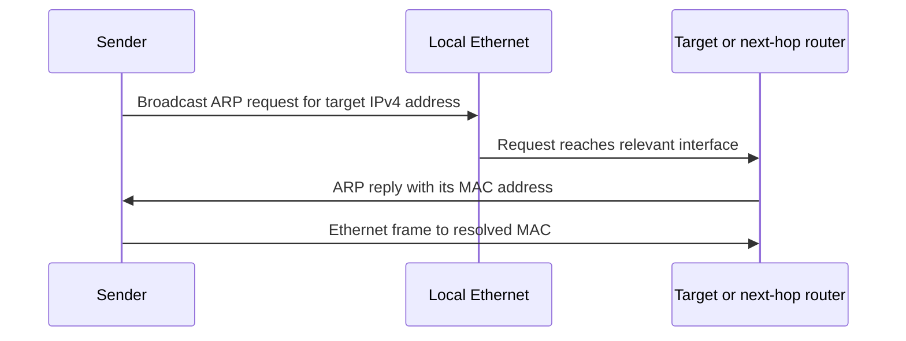

### ARP message structure

For **ARP over Ethernet/IPv4**, Hardware Type identifies Ethernet (1), Protocol Type is `0x0800` (IPv4), the hardware/protocol address lengths are **6/4 bytes**, and **Operation** distinguishes request from reply. The rest of the message gives the sender and target hardware and protocol addresses. The diagram shows field widths but not proportional byte-sized rectangles.

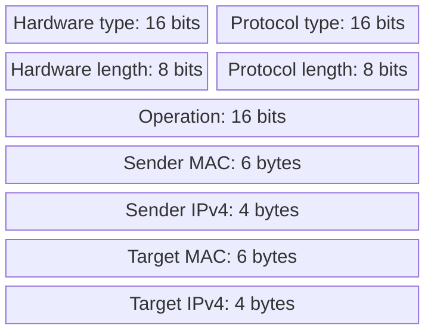

DNS is a **different mapping**: it translates human-readable names into records such as IP addresses. ARP resolves the IP address of a *local next hop* into a link-layer address; DNS does not replace ARP.

## ICMP and network diagnostics

**ICMP** carries IP-related error, diagnostic, and control messages. **Echo Request/Echo Reply** support `ping`; **Time Exceeded** reports packets whose TTL expires; **Destination Unreachable** can report unreachable hosts, networks, ports, or an inability to fragment; and **Redirect** can indicate a better first-hop router. ICMP can report some IP-header parameter problems and fragment reassembly timeouts. An invalid IPv4 header checksum normally causes silent discard, rather than an ICMP checksum-error report. ICMP errors commonly quote enough of the original packet to identify which transmission caused the error.

### ICMP packet format and Time Exceeded

The ICMP message begins with a **Type**, **Code**, and **Checksum**. Type selects the broad message category; Code specifies a case within that category. For example, **Time Exceeded** uses Type 11 and commonly Code 0 for TTL expiry during transit. The remaining fields depend on the message.

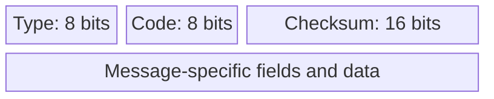

`traceroute` (or Windows `tracert`) sends probes using progressively larger TTL values. Routers where probes expire may return **ICMP Time Exceeded** messages, making intermediate hops visible. A missing response (`*` or time-out) does not automatically mean forwarding failed: routers may filter or rate-limit ICMP. `ping` asks a different question: whether Echo responses return from a target, and how long the round trip takes.

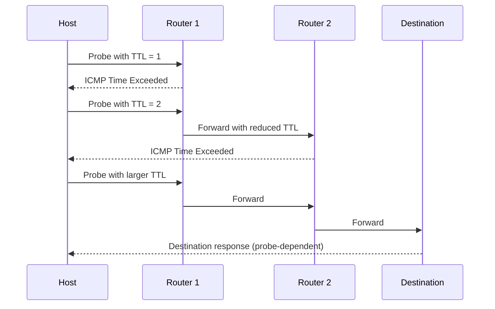

The **UDP header** is exactly eight bytes, consisting of four 16-bit fields. This matters because classic ICMP error messages include the original IP header plus at least the first eight bytes of its payload, sufficient to recover the UDP port numbers when UDP was used.

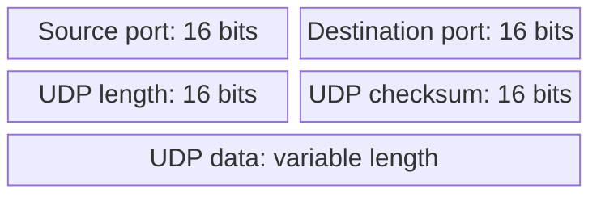

## DHCP configuration and leasing

**DHCP** saves hosts from manually configuring every network interface. A server can supply a **leased IP address**, **subnet mask** (which destinations count as local), **default gateway** (where nonlocal traffic is sent), **DNS server**, and lease duration. Hosts with no usable IP configuration discover a DHCP server and negotiate an offer.

A client acquiring an initial lease commonly uses the four-step **DORA** exchange:

1. **Discover:** The client broadcasts a request for DHCP service.
2. **Offer:** One or more DHCP servers offer an available address and configuration. The client may not yet have accepted an offered address, so the response must be deliverable before ordinary IP configuration is established.
3. **Request:** The client selects an offer and broadcasts a request identifying its choice.
4. **Acknowledge:** The chosen server sends a DHCP ACK confirming the address and lease.

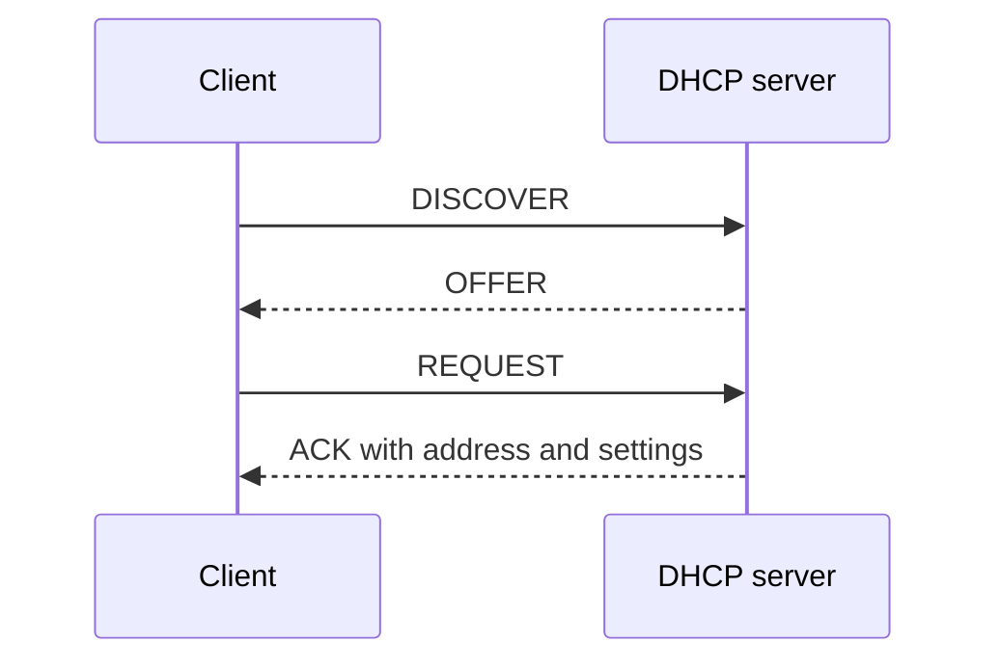

**Leases expire.** A client generally first tries **renewal** with its original DHCP server, then **rebinding** with any reachable DHCP server if renewal fails. A device may send **Release** when it no longer needs its address. A DHCP **scope** defines the server's allocatable address pool and configuration; **exclusions** reserve addresses from allocation, while **reservations** associate chosen addresses with particular clients. Larger deployments can distribute the workload among multiple DHCP servers.

## Forwarding and switching models

**Forwarding** is the data-plane operation of sending a received packet to a selected output interface. **Routing** is the control-plane process that calculates or learns the rules placed in a forwarding table. A router can connect different underlying link technologies and must still process relevant network-layer fields, including TTL. Destination-based IP forwarding normally chooses the entry with the **longest matching prefix**.

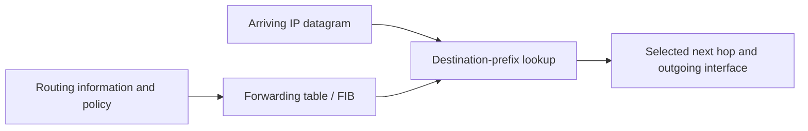

Communication networks can be **broadcast** or **switched**. Switched networks may provide circuits or forward packets. Within packet switching, **datagram networks** and **virtual-circuit networks** differ in what forwarding state is maintained.

### Datagram, virtual-circuit, and source routing

In a **datagram network**, no path must be installed before data transfer. Each packet carries its destination address, and routers independently select next hops using their tables. Packets between the same endpoints may follow different paths, with possible reordering. IP forwarding follows this model.

A **virtual circuit** first establishes an end-to-end logical path and installs per-circuit forwarding state in intermediate switches. Subsequent packets carry a shorter circuit identifier, and each switch maps an incoming circuit and port to an outgoing one. This can simplify forwarding and facilitate resource reservation, but setup and state management add costs; a failed path may require re-establishment.

**Source routing** places the selected route (or waypoints) in the packet itself instead of relying solely on each router's independent destination lookup. The different designs trade flexibility, setup, per-packet overhead, and router state.

| Model | Before transmission | Packet forwarding information | Main trade-off |
| --- | --- | --- | --- |
| Datagram | No per-flow path setup | Destination address | Flexible, but successive packets can take different paths |
| Virtual circuit | Install per-circuit state | Circuit identifier and input port | Compact forwarding state per packet, with setup and failure-recovery costs |
| Source routing | Sender selects route or waypoints | Route information carried in packet | Greater sender control, with extra per-packet overhead |

### Traditional telephone circuit switching — supplementary †

The traditional **Public Switched Telephone Network (PSTN)** illustrates a different idea: dialling a telephone number triggered switches to establish a **physical or dedicated circuit** between the endpoints for the duration of a call. This contrasts with IP datagrams, where different communications share packet-switched links without reserving a physical end-to-end wire. 

## Address aggregation and Internet structure

Early Internet routing was relatively hierarchical, with a central backbone (such as **NSFNET** around 1990) and regional networks attached to it. Today's Internet has **multiple backbone providers, peering points, access providers, corporate networks, and interconnecting autonomous systems**. There is no single organization that determines all paths or operates every backbone.

### Subnetting, supernetting, and CIDR

**Subnetting** divides an organization's allocated block into smaller networks by extending the prefix into what was previously the host part of an address. A **subnet mask** makes that division explicit; internal subnet structure need not be separately visible to the whole Internet. **Supernetting (route aggregation)** works in the opposite direction: a set of **contiguous, properly aligned address blocks** is summarized by a shorter common prefix, reducing the number of routes advertised globally. CIDR prefix sizes correspond to powers of two.

For example, `128.96.34.0/25` has a 25-bit network prefix and the mask `255.255.255.128`. The prefix `128.96.33.0/24` has mask `255.255.255.0`. An ISP that owns neighboring organization prefixes may announce one aggregated prefix to its upstream providers, rather than a separate announcement for every organization.

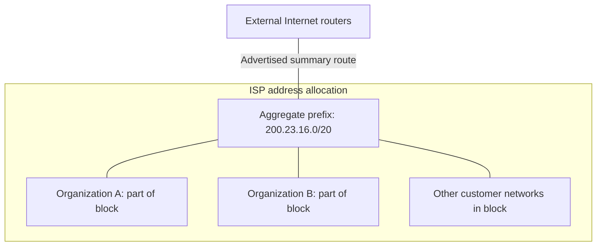

When forwarding, a router compares the destination against its known prefixes and chooses the **longest-prefix match**, meaning the *most specific* applicable route. If no more specific entry matches, a **default route** `0.0.0.0/0` can send packets to an upstream gateway. A router with a complete global routing view may not require a default route. More specific exceptions to an aggregate can coexist with the aggregate: the longest match wins.

### From connected networks to autonomous systems

Since modern backbones and customer networks are operated by different organizations, the Internet separates **intra-AS** routing (each organization's chosen IGP and policy) from **inter-AS** routing (the common exterior protocol, BGP). Network visualizations such as **CAIDA's AS-core maps** represent the geography and connectivity of ASes, their **customer cones**, and different levels of the network: AS, point of presence, router, and IP address. Such views are inferred from measurements and BGP information rather than being a single centrally known topology.

## Autonomous systems and routing fundamentals

An **Autonomous System (AS)** is an administratively controlled routing domain. Each AS has an **AS number (ASN)**, uses its own internal networking decisions, and sets policies for reachability that crosses its boundary. The original AS number space was 16-bit; BGP also supports **32-bit ASNs**. The Internet is therefore a **network of independently managed networks**, not one unified network with one shortest-path algorithm.

### Traffic and AS categories

**Local traffic** has a source or destination inside the AS. **Transit traffic** passes through an AS between other networks. Three useful AS categories are:

- **Stub AS:** connects to just one other AS and does not carry external transit traffic.
- **Multihomed AS:** connects to several ASes but does not offer transit service between them.
- **Transit AS:** connects to several ASes and does forward transit traffic, commonly as a paid provider.

### Intra-AS and inter-AS relationships

An **IGP** exchanges internal reachability information between routers *belonging to the same AS*. **BGP** exchanges policy-controlled reachability between border routers of *different ASes* (**eBGP**), while **iBGP** can disseminate external reachability within an AS. The figure encloses each AS's routers instead of misleadingly treating an AS as a single router. All links here represent **relationships/sessions**, not the one-way direction of packet travel.

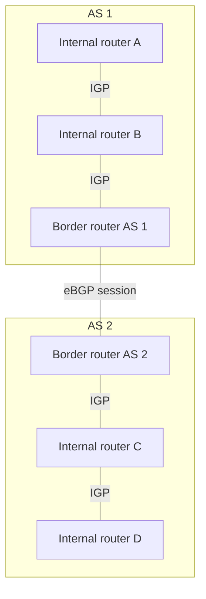

Routing protocols **populate forwarding tables**; forwarding uses those tables to move individual packets. An internal routing algorithm may try to minimize cost or delay, whereas inter-domain routing may prefer a path for **commercial, political, operational, or security reasons** even if it is longer. Global algorithms assume knowledge of the topology; distributed algorithms know neighbors and learn additional information through messages.

An important routing property is **optimal substructure**: if a path from A to C through B is shortest, its relevant subpaths must also be shortest. This underlies many shortest-path calculations, but not necessarily policy-selected inter-domain routes.

## Link-state routing and shortest paths

In **link-state routing**, each router learns its directly connected neighbors and associated **link costs**. It then shares that information through **reliable flooding**, so routers in the flooding scope acquire a common description of the topology. Each router separately computes shortest routes from itself to the destinations and installs the appropriate **next-hop entries**.

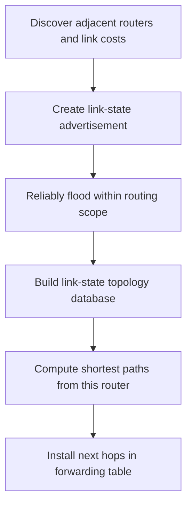

Flooding must control **duplicates, stale advertisements, and loss**. Routers can acknowledge updates, record sequence or age information, and forward fresh advertisements onward; topology changes cause updated advertisements. Reliable dissemination matters because independently computed paths are only consistent when routers have sufficiently consistent information about the network.

### Dijkstra's algorithm

Model the topology as a graph **G = (N, E)** whose edges have non-negative costs. If there is no direct link from u to v, its direct-link cost can be regarded as infinite. **Dijkstra's algorithm** constructs least-cost routes incrementally, tracking a set of nodes whose shortest distance is known.

1. Initialize the confirmed set with the source router; assign tentative direct-link costs to its neighbors and infinity to other nodes.
2. Choose the as-yet unconfirmed node with the **smallest tentative distance**.
3. Confirm that node and **relax** edges to its neighbors: if the path through the new node is cheaper, update the tentative cost and predecessor.
4. Repeat until the required destinations are confirmed; reconstruct paths using the recorded predecessors and choose each path's first hop.

The key idea is that a router can obtain **global topology information** but still calculate *its own* forwarding table locally. A shortest-path tree rooted at a source `u` records each destination's predecessor. Incorrect advertised link costs can mislead every router that uses those advertisements in its calculation.

### Properties and limitations

Link state makes topology reasoning and debugging relatively direct because routers know the graph, but flooding the topology costs communication and storage. **Complexity clarification:** Flooding cost depends on the number of links, not just diameter. In a simplified model, flooding one advertisement across a connected graph costs $O(|E|)$ transmissions; flooding one from each of $|V|$ routers costs $O(|V||E|)$, excluding retransmissions. Diameter helps describe propagation rounds under timing assumptions. The supplied guide's unexplained $O(n d)$ claim should not be used as a general message bound. A malfunctioning router might advertise incorrect link costs, affecting the routes computed by everyone who receives the information.

## Distance-vector routing and Bellman–Ford

**Distance-vector routing** does not require a global topology map. Each router maintains an estimate of the cost to each destination, along with the chosen next hop, and exchanges these estimates with **direct neighbors**. A router improves its own estimates using the paths reported by those neighbors. The algorithm is **distributed**, usually **asynchronous**, and reacts to link-cost changes and incoming updates.

The Bellman–Ford recurrence for router x and destination y is:

$$
D_x(y) = \min_{v \in N(x)}\big(c(x,v)+D_v(y)\big),
$$

where **N(x)** is the set of x's neighbors, **c(x,v)** is the cost of the direct link to v, and **D_v(y)** is v's current estimate to reach y. The chosen neighbor that achieves the minimum becomes the next hop.

### Distance-vector algorithm

1. **Initialize** distances from directly known links; other destinations start at infinity.
2. **Wait** for a neighbor's distance vector or a change in local link cost.
3. **Recompute** the best cost and next hop for each destination using Bellman–Ford.
4. **Advertise** the new vector to directly connected neighbors if it changed; otherwise wait for the next event.

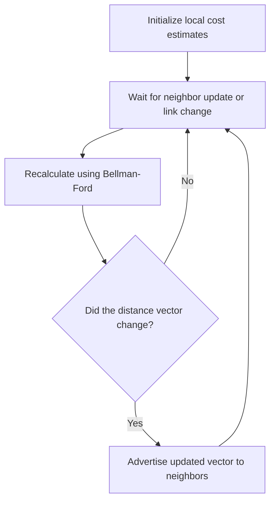

For example, three candidate routes to a destination produce total costs **2 + 5**, **1 + 3**, and **5 + 3**. The minimum is **4**, reached through the neighbor supplying the `1 + 3` path. Each router performs the same procedure using only neighboring estimates; it need not know why a neighbor believes its distance is correct.

**Distance vector versus link state:** DV communicates estimates locally rather than flooding the full topology. It can require less topology data per router, but bad estimates can propagate through many routers, convergence time varies, and changes can create temporary routing loops. The two approaches differ not merely in implementation but in **what information each router is allowed to know**.

## Routing loops, split horizon, and poison reverse

A **routing loop** arises when routers forward packets around a cycle because their next-hop information is mutually inconsistent. The packet's **TTL** eventually expires, preventing indefinite circulation, but TTL does **not fix** the incorrect routing tables.

### Counting to infinity

The classic DV problem appears after a route fails but some routers still have obsolete routes pointing to one another. For example, if a path to destination E disappears, router B may hear C's stale cost and conclude E remains reachable via C. C may then believe the same about B. Advertised distances grow with each iteration until the metric reaches the protocol's designated **infinity**. This is **count-to-infinity**; if updates are slow, convergence can be slow as well.

### Loop-mitigation techniques

- **Split horizon:** do not advertise a route *back to the neighbor from which it was learned* as a usable route.
- **Poison reverse:** advertise that same route to that neighbor with an **infinite metric**, explicitly stating it must not use this router for the destination.
- **Bounded infinity:** choose a comparatively small metric value that means unreachable. This limits counting, but also limits the routes that can be represented.

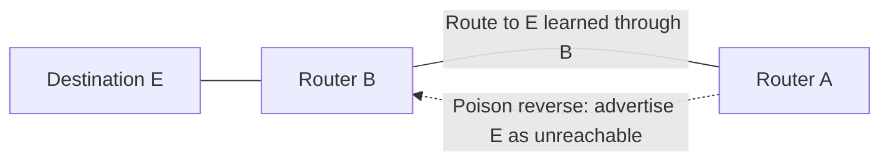

The undirected links indicate network connectivity, while the dashed **directed** update indicates the actual advertisement back toward a neighbor. Split horizon and poison reverse mitigate simple two-router loops; they **do not guarantee freedom from every possible multi-router loop**. Failure chains involving nodes F, A, C, and G show how inconsistent updates can reintroduce increasingly long alternative routes.

## RIP and RIPv2 — supplementary †

**Supplementary (†).** General distance-vector routing and loop behavior remain part of the unmarked material above.

**Routing Information Protocol (RIP)** is a comparatively simple distance-vector IGP. **RIPv2**, specified in **RFC 2453**, uses **UDP port 520** and counts **hops** as its metric. Its maximum reachable distance is **15 hops**, while **16 means infinity/unreachable**. It supports split horizon and poison reverse but is subject to the distance-vector counting-to-infinity problem. Router requirements are discussed in **RFC 1812** and Radia Perlman's work on self-stabilizing routing.

### RIPv2 message format

A RIP message consists of a four-byte message header and **zero or more 20-byte route entries**. The first byte identifies the **Command** (such as request/response), the second the **Version**, followed by a reserved two-byte field set to zero.

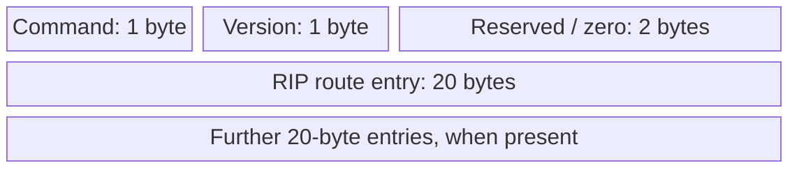

Each RIPv2 entry encodes a route using the following fields. The **Route Tag** distinguishes routes learned inside and outside RIP's domain and should persist when the route is re-advertised; it may be used to encode external AS-related information. **Next Hop** lets an advertising router refer to another router on the same subnet that offers a better onward path.

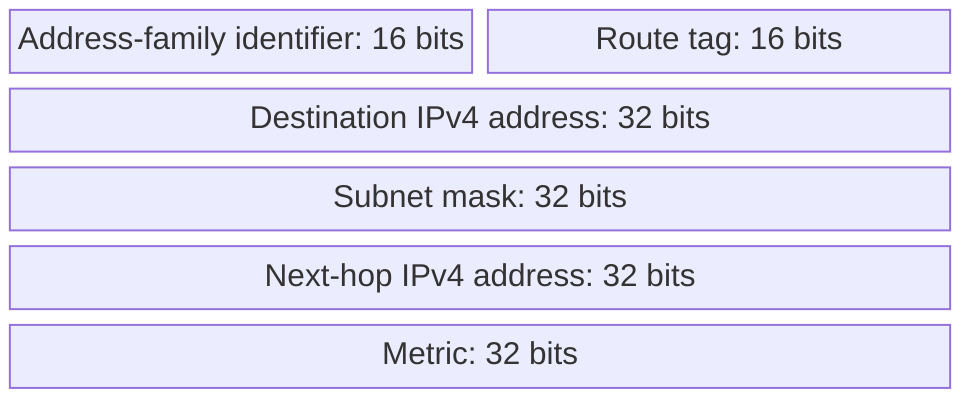

## OSPF areas, packets, and operation — supplementary †

**Supplementary (†).** Link-state routing as a general algorithm remains unmarked in the earlier section.

**Open Shortest Path First (OSPFv2)**, specified in **RFC 2328**, is a **link-state IGP** that runs directly over IP (**protocol number 89**), not over TCP or UDP. OSPF distributes **Link-State Advertisements (LSAs)** with its own reliability mechanisms, and its packets support authentication. Routers form neighbor relationships, synchronize link-state databases, and calculate paths from their resulting topology views.

### Areas and backbone

OSPF uses a **two-level hierarchy**: a backbone (**Area 0**) and local areas. A router knows the detailed topology within its own area, but it can route to other areas using summarized reachability through **area border routers (ABRs)**. LSAs are flooded within the appropriate area/backbone scope, reducing the amount of topology information every router must manage. Inter-area traffic normally traverses Area 0, and **virtual links** can address some disconnected-backbone arrangements.

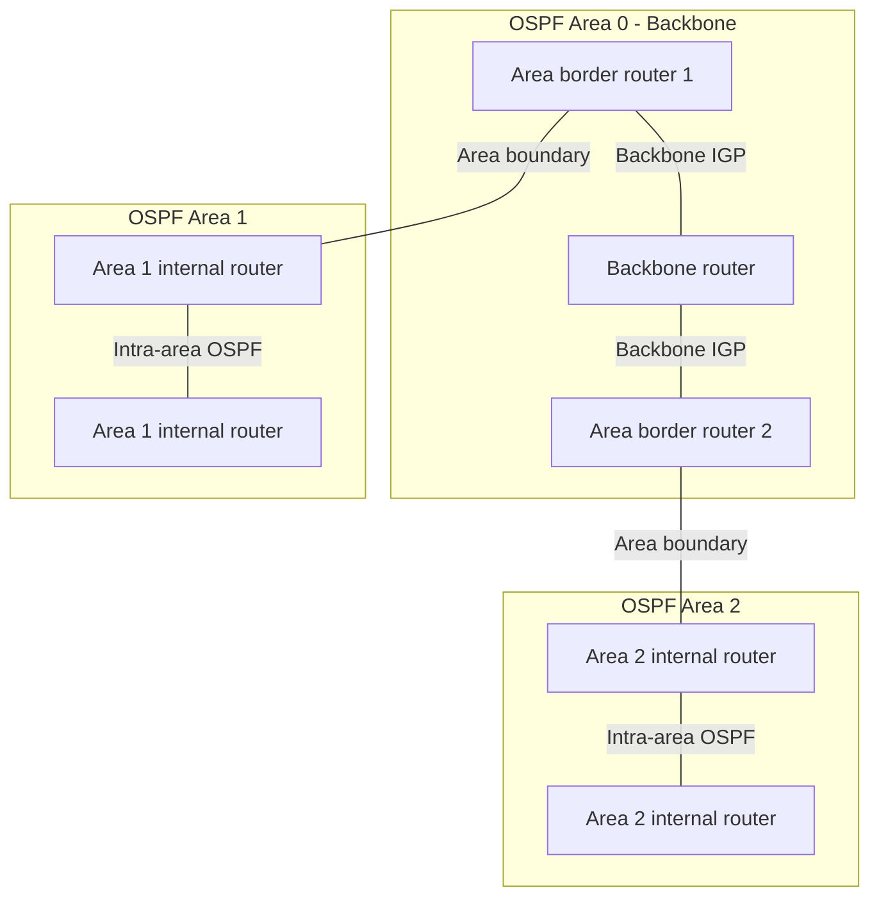

### OSPFv2 common packet header

Every OSPFv2 packet starts with a **24-byte common header**. It identifies the version, packet type, length, originating router ID, area ID, checksum, and authentication information. Packet-specific content follows.

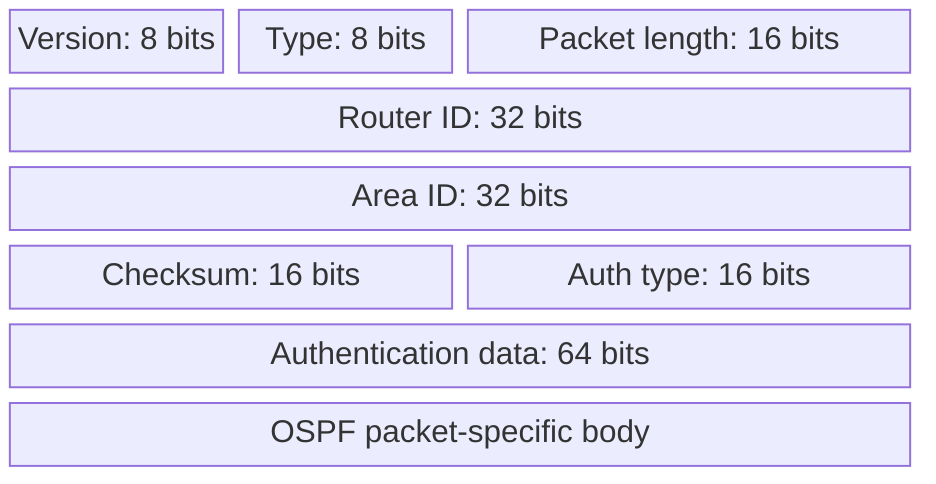

### OSPF packet types and synchronization

The five principal packet types have distinct roles:

1. **Hello:** discover neighbors, maintain reachability, and establish compatible adjacencies.
2. **Database Description (DD):** exchange summaries of link-state database contents and coordinate synchronization.
3. **Link State Request:** request individual LSAs that are missing or outdated.
4. **Link State Update:** carry LSAs describing routers, links, and topology changes.
5. **Link State Acknowledgment:** acknowledge LSAs to support reliable dissemination.

A typical synchronization process begins with Hello discovery. Neighboring routers exchange DD summaries, request missing LSAs, and acknowledge reliably received advertisements. The resulting **Link-State Database (LSDB)** is used to compute routes. New link information triggers further flooding; LSAs also have aging/refresh behavior so old information does not persist indefinitely.

### Database Description (DD) packet

After the common OSPF header, the DD body begins with the interface MTU, options, and control flags, followed by a **DD sequence number** and summaries of LSA headers. The **I** (*Initial*) bit identifies the first packet of an exchange, **M** (*More*) indicates further packets, and **MS** (*Master/Slave*) coordinates sequence-number control between peers.

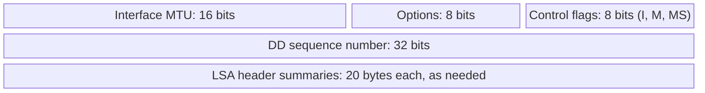

**DD exchange, in order:** One router begins with an initial DD packet indicating negotiation; the peer responds and the routers settle the master/slave role and sequence-numbering. They then exchange DD summaries, advancing the sequence and setting **M** while more descriptions remain. Missing or newer LSAs are requested and transferred using the request/update/acknowledgment packet types. DD summaries alone are **not** complete LSAs.

## Inter-domain routing and the role of BGP

Why not use a shortest-path IGP over the entire Internet? **Scale is not the only obstacle**: different ASes are independent organizations, need to hide internal details, and make **policy** decisions about who may use their networks. Routing across AS boundaries is therefore as much about economic relationships, information control, and trust as about path length.

**Border Gateway Protocol (BGP)** is the Internet's widely deployed exterior gateway protocol. It advertises **reachability to IP prefixes** together with an **AS-level path** and other attributes, rather than exposing every internal router and link. A receiving AS may learn several candidate routes yet **select and propagate just one preferred route** to a given peer under ordinary BGP operation. When advertising an ordinary route to an external BGP peer, an AS normally prepends its ASN, supporting AS-level loop detection. Ordinary iBGP propagation does not add the local ASN again. This does not eliminate every transient forwarding loop, particularly during change or IGP/BGP inconsistency.

### BGP background and path-vector model

BGP evolved through versions from **BGPv1 (1989; RFC 1105)**, **v2 (1990; RFC 1163)** and **v3 (1991; RFC 1267)** to **BGPv4 (1994/1995; RFCs 1654 and 1771)**, whose CIDR support allowed classless prefix aggregation. The later core BGPv4 specification is **RFC 4271**. Related references include RFCs 1772–1774 for applications, operational experience, and protocol analysis.

**Prefix correction:** The supplied guide writes `171.67.0.0/14`, whose host bits are nonzero. Its canonical /14 network is `171.64.0.0/14` (covering 171.64.0.0–171.67.255.255).

At the AS level, an advertisement such as prefix `171.64.0.0/14` with an AS path listing **15444, 3549, 174, 46749, 32** means the speaker claims a route through that advertised sequence of ASes to the origin. The actual router-by-router internal topology is not included. This abstraction scales organizational policy but can sacrifice **shortest-path efficiency**: an AS with a cheaper route may still choose a commercially preferable longer one.

## BGP state, updates, and advertisements

A BGP speaker conceptually maintains **three groups of routing state**. **Adj-RIBs-In** stores routing information learned from neighbors; the **Loc-RIB** holds routes selected using local policy and next-hop reachability; **Adj-RIBs-Out** represents routes approved for advertisement to each neighbor. A BGP next hop must be reachable using suitable internal routing or a static route before its external path can be used for forwarding.

```mermaid
flowchart TB
    neighbor["BGP neighbor advertisements"] --> inbound["Adj-RIBs-In"]
    inbound --> policy["Import policy + route selection + next-hop check"]
    policy --> local["Loc-RIB"]
    local --> export["Export policy"]
    export --> outbound["Adj-RIBs-Out"]
    outbound --> peers["Advertisements to selected peers"]
```

### Sessions and message types

BGP peers communicate over a **long-lived TCP session on port 179**, exchanging control messages in both directions. The four basic BGP message types are:

1. **OPEN:** begin a BGP session and identify the peers' capabilities and basic parameters.
2. **UPDATE:** announce reachable prefixes with path attributes or withdraw previously advertised routes.
3. **KEEPALIVE:** maintain evidence that the BGP session remains active.
4. **NOTIFICATION:** report protocol errors and close a session.

Extensions also introduce types such as **ROUTE-REFRESH** (RFC 2918). BGP has no global coordinator: each AS independently chooses what it advertises and what information to accept, so two routers can have different views of reachable paths.

### UPDATE content and route advertisements

The key BGP message is **UPDATE**. It can carry **Withdrawn Routes** (prefixes that are no longer advertised), **Path Attributes**, and **Network Layer Reachability Information (NLRI)** (prefixes to which those attributes apply).

```mermaid
block-beta
    columns 1
    withdrawn["Withdrawn routes: length and withdrawn-prefix list"]
    attrs["Total path-attribute length + path attributes"]
    nlri["NLRI: advertised IP prefixes"]
```

Important path attributes include **ORIGIN**, **AS_PATH**, **NEXT_HOP**, **LOCAL_PREF**, **MULTI_EXIT_DISC (MED)**, **ATOMIC_AGGREGATE**, and **AGGREGATOR**. Attributes are typed and length-delimited, which allows the protocol to evolve; the slides note **AS4_PATH** as an extension supporting 32-bit AS numbers. Attributes such as **communities** and **LOCAL_PREF** support traffic-engineering policy. Vendor-specific **weight** is a local selection setting, not a BGP attribute carried in UPDATE messages. A BGP UPDATE is not a promise that the advertiser will export the same route to every peer.

For example, an AS may announce that prefix `171.64.0.0/14` is reachable via a sequence of ASNs and a specified **NEXT_HOP** address. Other ASes evaluate that information using their own policies before installing or exporting a path.

## BGP route selection and sessions

BGP aims to choose a **permitted and preferred route**, not necessarily the path with the fewest router hops, lowest delay, or shortest AS sequence. The exact decision procedure depends on implementation and local configuration. A common implementation-oriented sequence of selection preferences is:

1. Discard unusable paths, including those with an **unreachable next hop**.
2. Prefer the highest locally assigned **weight**, where that attribute is implemented.
3. Prefer higher **LOCAL_PREF**, which expresses preference inside the AS.
4. Prefer **locally originated** routes over comparable externally learned candidates.
5. Prefer shorter **AS_PATH** length.
6. Prefer lower **ORIGIN** type according to the protocol's ordering.
7. Prefer lower **MED**, typically when comparing routes received from the **same neighboring AS**.
8. Prefer paths learned using **eBGP** over comparable paths learned through **iBGP**.
9. Prefer the route whose egress/next hop has the lowest **internal IGP cost** (often called **hot-potato routing**).
10. Apply remaining tie-breakers, such as router ID or route age, according to the implementation.

**eBGP** exchanges information between ASes. **iBGP** distributes externally learned routes among routers *within* one AS so internal border routers can make coordinated decisions even when the AS has multiple peering points. These are BGP sessions with a direction for advertisement **messages**, but diagrams of the topology should use **undirected links** unless a specific advertisement direction is being shown.

```mermaid
flowchart LR
    subgraph ASX["AS X"]
      direction LR
      X1["Border router X1"] ---|iBGP| X2["Border router X2"]
      X1 ---|IGP| XI["Internal router"]
      XI ---|IGP| X2
    end
    subgraph ASY["AS Y"]
      Y1["Border router Y1"]
    end
    subgraph ASZ["AS Z"]
      Z1["Border router Z1"]
    end
    Y1 ---|eBGP| X1
    X2 ---|eBGP| Z1
```

## AS business relationships and export policy

**Customer–provider** arrangements and **peering** agreements explain much of real-world BGP behavior. A customer pays a provider for connectivity beyond its own network; an AS may purchase service from several providers (**multihoming**). Two ASes can also peer to exchange selected traffic directly. Peering may be settlement-free, although commercial terms and imbalance clauses vary. **Tier-1** networks generally reach the rest of the Internet without buying upstream transit and exchange traffic with one another.

### Export policy and valley-free paths

A typical transit policy is to **prefer customer routes** because carrying customer traffic produces revenue. The commonly used *valley-free* export pattern distinguishes the source of a route:

- **Learned from a customer:** ordinarily exportable to other customers, peers, and providers.
- **Learned from a peer:** ordinarily exportable only to customers, not other peers or providers.
- **Learned from a provider:** ordinarily exportable only to customers, not other providers or peers.

These conventions are not guaranteed by the basic BGP protocol; they are business policies configured by operators. Exporting an unauthorized path can create a **route leak**.

```mermaid
flowchart TB
    upstream["Transit provider AS"] ---|"Customer-provider relationship"| customer["Customer AS"]
    subgraph Peers["Peer networks - separate ASes"]
      direction LR
      peerA["Peer AS A"] ---|"Peering"| peerB["Peer AS B"]
    end
    customer ---|"Possible peering agreement"| peerA
```

### University network example

An illustrative network arrangement places **Chalmers at AS2841**, connected to **SUNET (AS1653)**, then **NORDUnet (AS2603)**, and onward to commercial Internet networks. **Göteborgs universitet (AS2842)** is shown as another customer of SUNET. SUNET peers with many networks, so paths can be influenced by peering rather than simply following the imagined upstream chain. Networks and AS-level paths can change; a current traceroute need not match this historical example.

Useful diagnostics include `traceroute -A -q 1 www.gu.se` on suitable Linux systems, `mtr -z -c 10 --report www.gu.se`, and `curl -s https://ipinfo.io/json` to inspect a public-facing ASN. macOS/BSD `traceroute` flags differ and Windows `tracert` lacks native AS display. A time-out or `*` hop can indicate **ICMP filtering**, not necessarily loss of IP connectivity; a short AS path may indicate **peering**, not physical proximity.

### A peering dispute

The **2005 Level 3–Cogent dispute** serves to demonstrate policy as a reachability constraint. After a dispute over whether one peer should pay the other, networks stopped exchanging traffic, and customers on each side could not reach some customers on the other. A subsequent agreement restored the relationship. The supplied guide does not establish the precise settlement timeline. The event shows that paths can disappear even when physical links and routing machinery exist.

## BGP hijacks and route leaks

Basic BGP historically **trusted neighbors' claims about prefix origination**. A neighbor can announce reachability to a prefix without the protocol itself cryptographically proving the announcement's origin. This was workable when operators formed a smaller trust community but is dangerous on today's Internet.

A **route hijack** occurs when an AS originates an unauthorized prefix advertisement; it may attract traffic by announcing a **more-specific prefix**, because routers forward using the longest matching IP prefix. A **route leak** is different: an AS may truthfully originate no new address space but export a route beyond its permitted scope, violating commercial/export policy. **RFC 7908** categorizes several kinds of leaks. Origin validation alone cannot determine whether a genuine route was exported to the wrong neighbor.

### YouTube/Pakistan example

In **February 2008**, Pakistan Telecom's attempt to block YouTube within Pakistan caused an advertisement to escape into global routing. A more-specific announcement than YouTube's legitimate aggregate attracted traffic elsewhere on the Internet, making YouTube unreachable for many users for approximately **two hours**. The lesson is especially striking: routers could follow their normal BGP selection and longest-prefix rules while the collective outcome was wrong. The presentation also mentions hijacking unused address space for spam and misleading path advertisements.

```mermaid
flowchart TB
    subgraph Legitimate["Legitimate origin AS"]
      youtube["YouTube prefix - authorized announcement"]
    end
    subgraph Unauthorized["Unauthorized origin AS"]
      attacker["More-specific, unauthorized prefix announcement"]
    end
    router["Remote AS making a forwarding decision"]
    youtube -->|"Advertised reachability"| router
    attacker -->|"More-specific route attracts matching traffic"| router
    router --> result["Traffic can be misdirected or blackholed"]
```

## RPKI, ROAs, and origin validation

The **Resource Public Key Infrastructure (RPKI)** binds Internet number resources to their authorized holders using certificates rooted in the **Regional Internet Registries (RIRs)** and their allocation hierarchy. A **Route Origin Authorization (ROA)** says that an identified AS is authorized to originate an identified IP prefix, with a **maxLength** specifying the most-specific prefix length allowed. For ROA profiles, see **RFC 9582** (which supersedes RFC 6482).

A ROA does **not** sign every hop of the BGP path. It expresses **origin authorization**, not proof that the entire AS_PATH was honestly propagated. Consequently, RPKI addresses an important class of hijacks while leaving room for path forgery and route leaks.

### maxLength and origin-validation outcomes

A loosely configured **maxLength** can authorize many more-specific prefixes under one ROA. A conservative approach, discussed in **RFC 9319**: minimize maxLength and, where suitable, authorize explicit prefixes instead of allowing overly broad subprefixes.

When a router compares received BGP origin information against ROAs (through an RPKI validator), **Route Origin Validation (ROV)** classifies it as:

- **Valid:** a covering ROA authorizes the claimed origin ASN and announced prefix length.
- **Invalid:** relevant ROA information exists but does not authorize the announcement's origin or prefix length.
- **NotFound:** no applicable ROA exists. **NotFound does not automatically mean malicious**.

A network then chooses a policy, such as **rejecting invalid routes** or reducing their preference. Signed objects and active filtering are different stages: a ROA protects little unless receiving networks actually validate and act on the result.

### Limits and deployment

The supplied guide reports **67.4% ROA coverage** of announced prefixes (Hurricane Electric, **29 June 2026**) and measurements of about **12.3% of ASes with full ROV protection**, with around **36.2% not validating** (RIPE Labs, **2026**). These are **source-reported, dated figures**, not independently verified measurements in this revision. Their denominators also differ: prefix coverage cannot be directly compared as a percentage with AS-level validation. Their significance is the gap between **signing** and **checking**.

For a concrete limitation, imagine prefix `192.0.2.0/24` legitimately originated by AS64500. A malicious AS64666 could advertise an AS_PATH that *claims* to lead to AS64500. Even if a ROA authorizes AS64500 as origin, **ROV examines the claimed origin only**, not the authenticity of the intermediate AS path. This is why a valid origin can coexist with a forged path.

```mermaid
flowchart TD
    route["Received BGP prefix and claimed origin AS"] --> roa["Compare with validated ROA data"]
    roa --> match{"Covered and authorized?"}
    match -->|Yes| valid["Valid"]
    match -->|No applicable ROA| missing["NotFound"]
    match -->|ROA conflicts| bad["Invalid"]
    valid --> policy["Apply local route policy"]
    missing --> policy
    bad --> policy
```

## ASPA and partial deployment

**Autonomous System Provider Authorization (ASPA)** addresses a different weakness: an AS publishes a signed list of the networks that are its legitimate **providers**. Other networks can use these declarations to detect AS paths inconsistent with customer–provider hierarchy and thus identify certain **route leaks or impossible-looking paths**. Rather than signing an entire BGP path, ASPA checks whether the claimed path is compatible with known provider relationships. Compare this with **BGPsec**, which seeks path cryptographic protection but presents difficult deployment and computational requirements.

It is important to distinguish three adoption stages:

1. **Specified:** the mechanism is defined in a specification and can be implemented.
2. **Available:** registries and software infrastructure support it.
3. **Adopted:** operators actually publish/use it in deployed routing policy.

The supplied guide reports that registry support had arrived in **RIPE NCC and APNIC since November 2025**, and **ARIN since January 2026**, with **well under 1% of ASNs publishing ASPA objects as of February 2026**. These deployment dates and percentages have been retained as source-reported historical claims, not independently verified current statistics. The mechanism's specification status must be distinguished from registry tooling and operator adoption.

**Partial deployment matters on its own.** A hijacked route can be rejected by validating ASes while continuing to spread through nonvalidating ASes. The result is neither a fully secure nor a fully insecure Internet; reachability and policy can diverge between regions of the network. Security mechanisms therefore have **deployment and convergence properties**, not merely theoretical correctness under universal adoption.

## Convergence, stability, and failures

A routing system has **converged** when the affected routers have settled on a stable set of routes after a change. For BGP, the answer to “How long does convergence take?” depends on the topology, policy, and order of updates; the protocol can **oscillate** or have multiple stable outcomes. Even asking whether an arbitrary policy configuration admits a stable routing state is computationally difficult (see **Griffin, 1999**, on an NP-complete formulation).

```mermaid
flowchart TD
    change["Topology, policy, or announcement changes"] --> updates["Route withdrawals and new advertisements"]
    updates --> decisions["ASes reconsider reachable candidate routes"]
    decisions --> stable{"Are route choices stable?"}
    stable -->|No| updates
    stable -->|Yes| converged["Converged state"]
```

Networks also trade **optimality against stability**. Changing repeatedly between a 50 ms path and a 500 ms path complicates management and can disrupt higher-layer algorithms such as TCP's **round-trip-time estimation**. A slightly worse but stable route may be preferable to a perpetually fluctuating one.

Failure adaptation can reveal distance-vector weaknesses even when described alongside BGP. In an example, F loses its link to G and announces G as unreachable. A, which used F as next hop, does likewise. Later A hears C claim a two-hop route to G, adopts a three-hop estimate, and tells F; F then believes it has a four-hop path through A. This is another illustration of **stale distributed estimates creating loops or worsening metrics**.

Relevant BGP operational tools and mitigations include **route reflectors** for scaling iBGP state, **AS-path prepending** for influencing inbound path selection, careful policies, and mechanisms such as graceful restart. These do not remove the fundamental challenge that different independent networks can prefer incompatible outcomes.

## BGP wedgies and persistent states

A **BGP wedgie** is a case where a network can reach **more than one stable routing configuration** and a disruption can push it into an undesirable one. The result might persist even after the original failure disappears. Every BGP speaker can follow its configured ranking and export rules, yet the collective state may differ from the intended operating condition. See **RFC 4264** for a detailed study of persistent policy-driven states.

The example policy is common: **prefer customer-learned routes over noncustomer routes**, and then prefer a shorter AS path among comparable alternatives. The order of changes and updates can determine which stable state the network reaches; ordinary protocol convergence does not necessarily select the operator's preferred state.

**Example limitation:** The supplied topology does not include all route rankings, export rules, or update steps needed to reproduce a wedgie. It illustrates the setting; topology alone does not prove multiple stable outcomes.

The five-AS example connects an origin (**AS 1**, announcing `1.2.0.0/16`) to **AS 2** and **AS 5**, with an additional chain through **AS 3** and **AS 4**. An intentionally longer backup announcement from AS 1 and AS 3's preference for routes via AS 2 contribute to the path-choice interaction. The diagram describes **AS-level interconnections**, so each AS is explicitly grouped instead of confusing its boundary with an individual router; no arrows imply a one-way physical link.

```mermaid
flowchart LR
    subgraph AS1["AS 1 - origin of 1.2.0.0/16"]
      R1["Border router 1"]
    end
    subgraph AS2["AS 2"]
      R2["Border router 2"]
    end
    subgraph AS3["AS 3"]
      R3["Border router 3"]
    end
    subgraph AS4["AS 4"]
      R4["Border router 4"]
    end
    subgraph AS5["AS 5"]
      R5["Border router 5"]
    end
    R1 ---|"Backup advertisement on this link"| R2
    R2 --- R3
    R3 --- R4
    R4 --- R5
    R5 --- R1
```

**Convergence and correctness are distinct.** A routing system can converge to a configuration that is *stable but unwanted*. This raises the question of what extra information or mechanism would allow routers to leave such a state without manual intervention.

## Internet design principles

Routing behavior reflects broader Internet design choices. The **end-to-end principle** places functionality that needs endpoint knowledge at the edges, leaving a comparatively simple core. **Layering** and **abstraction** separate applications, transport, network, and link mechanisms so each can evolve independently. **Decentralization** lets different organizations operate their own networks, while **open standards** promote interoperability.

**Packet switching**, **connectionless/stateless forwarding**, and **best-effort delivery** allow the network to support many traffic types without guaranteeing the properties every application might need. The culture of **rough consensus and running code** encourages practical interoperable designs. A **public, evolutionary network** accommodates new technologies and users without centrally redesigning the entire system. These strengths also explain many routing problems discussed above: there is no omniscient controller, administrative trust varies, and improvements such as routing-security mechanisms succeed only when other networks adopt them.

## Revision notes and references

This revision preserves the supplied guide's scope and † classifications. It corrects the noncanonical /14 example, distinguishes iBGP from eBGP AS-path handling, separates local weight from advertised attributes, and qualifies flooding complexity and deployment statistics. Original slide visibility and the missing details of the wedgie example could not be independently reconstructed from this Markdown file.

- [RFC 4271 — BGP-4](https://www.rfc-editor.org/rfc/rfc4271): route advertisements and path attributes.
- [RFC 792 — ICMP](https://www.rfc-editor.org/rfc/rfc792): error and diagnostic messages.
- [RFC 4264 — BGP Wedgies](https://www.rfc-editor.org/rfc/rfc4264): persistent policy-driven states.
