# IPv6, Multicast, and Anycast: Addressing, Configuration, and Deployment

**Computer Networks — EDA387/DIT663**  
**Generated:** 2026-10-20

**† Supplementary material:** Content originating exclusively from hidden PowerPoint slides. It may not be included in this year's examinable material. **This presentation has no hidden slides**, so no topic below carries this marker. Visible material labelled “self-study” remains included without a dagger.

Examples preserve the lecture's addresses and configurations. **Technical clarification** notes identify source contradictions or necessary standards context. Historical measurements and projections are labelled with their scope rather than presented as current universal facts.

## Glossary

| Term | Full name | Meaning |
|---|---|---|
| 464XLAT | — | Client-side and provider-side translation allowing IPv4 applications to use an IPv6-only access network. |
| 6to4 | — | Historical automatic IPv6-over-IPv4 tunnelling scheme using `2002::/16`. |
| AFRINIC | African Network Information Centre | Regional Internet Registry serving Africa. |
| Anycast | — | One destination address assigned at several locations, with routing selecting one instance. |
| APNIC | Asia Pacific Network Information Centre | Regional Internet Registry serving the Asia-Pacific region. |
| ARIN | American Registry for Internet Numbers | Registry serving the United States, Canada, and parts of the Caribbean. |
| ARP | Address Resolution Protocol | IPv4 mechanism for discovering a neighbour's link-layer address; IPv6 uses Neighbor Discovery. |
| BGP | Border Gateway Protocol | Routing protocol exchanging reachability between networks, including anycast routes. |
| CDN | Content delivery network | Distributed infrastructure delivering content from multiple sites. |
| CGN | Carrier-grade NAT | Provider-operated address translation sharing public IPv4 addresses among customers. |
| CIDR | Classless Inter-Domain Routing | Prefix-based address allocation and routing, written using slash notation. |
| CLAT | Customer-side translator | Stateless translator converting legacy IPv4 traffic into IPv6 in 464XLAT. |
| DAD | Duplicate Address Detection | Tests whether another interface on the link already uses a tentative IPv6 address. |
| DHCPv6 | Dynamic Host Configuration Protocol for IPv6 | Supplies addresses and/or other configuration, depending on the operating mode. |
| DNS | Domain Name System | Maps names to records such as IP addresses. |
| DNS64 | DNS synthesis for NAT64 | Synthesizes IPv6 address answers for IPv4-only destinations. |
| Dual stack | — | Running both IPv4 and IPv6 on the same hosts or network. |
| EUI-64 | Extended Unique Identifier, 64-bit | Identifier format; modified EUI-64 can derive an IPv6 interface ID from a MAC address. |
| Extension header | — | Optional header linked after the IPv6 base header to carry additional functions. |
| GUA | Global unicast address | IPv6 address intended for globally unique, Internet-routable use. |
| Happy Eyeballs | — | Connection algorithm that tries alternative addresses with controlled concurrency to avoid long delays. |
| Hextet | — | Informal name for a 16-bit IPv6 address group, written with up to four hexadecimal digits. |
| IANA | Internet Assigned Numbers Authority | Coordinates global Internet identifier registries and top-level address allocations. |
| ICMPv6 | Internet Control Message Protocol for IPv6 | Carries errors and control messages, including Neighbor Discovery and MLD. |
| IEEE | Institute of Electrical and Electronics Engineers | Standards organization associated with Ethernet and identifier formats. |
| IETF | Internet Engineering Task Force | Develops Internet protocol standards. |
| IGMP | Internet Group Management Protocol | IPv4 host-to-router multicast membership protocol. |
| IID | Interface identifier | Usually the low 64 bits of an IPv6 unicast address on an ordinary LAN. |
| IoT | Internet of Things | Network-connected devices such as sensors and embedded systems. |
| IPsec | Internet Protocol Security | Mechanisms providing IP-layer authentication and/or encryption when configured. |
| IPv4 / IPv6 | Internet Protocol version 4 / version 6 | IP versions with 32-bit and 128-bit addresses respectively. |
| ISP | Internet service provider | Operator supplying connectivity and often address prefixes. |
| LACNIC | Latin America and Caribbean Network Information Centre | Regional Internet Registry serving Latin America and much of the Caribbean. |
| LAN | Local area network | A local network, commonly an Ethernet or Wi-Fi subnet. |
| LLA | Link-local address | Address usable only on its own link, normally beginning `fe80::`. |
| MAC | Media access control | Link-layer addressing, commonly a 48-bit Ethernet address. |
| MLD | Multicast Listener Discovery | ICMPv6 mechanism for reporting and querying IPv6 multicast membership. |
| MTU | Maximum transmission unit | Largest packet size a link can carry without fragmentation at that layer. |
| Multicast | — | Delivery to members of an addressed group. |
| NA | Neighbor Advertisement | Neighbor Discovery message providing information about an interface and its address. |
| NAT | Network Address Translation | Rewrites addresses, often also transport identifiers, between address realms. |
| NAT64 | IPv6/IPv4 translation | Allows IPv6 traffic to reach IPv4 destinations through a translator. |
| ND / NDP | Neighbor Discovery / Neighbor Discovery Protocol | IPv6 mechanisms for finding routers and neighbours and checking reachability. |
| NIC | Network interface card | Hardware interface connecting a device to a network. |
| NS | Neighbor Solicitation | Message used for neighbour discovery, reachability checks, and DAD. |
| PLAT | Provider-side translator | Stateful NAT64 component in the provider network in 464XLAT. |
| Prefix length | — | Number of leading address bits identifying a network or route. |
| RA | Router Advertisement | Router message advertising prefixes, router lifetime, and configuration information. |
| RDNSS | Recursive DNS Server | RA option advertising DNS resolver addresses. |
| RFC | Request for Comments | Internet technical publication series containing standards and other documents. |
| RIPE NCC | Réseaux IP Européens Network Coordination Centre | Registry serving Europe, the Middle East, and parts of Central Asia. |
| RIR | Regional Internet Registry | Organization allocating and registering Internet number resources within a region. |
| ROAD | Routing and Addressing | Early IETF effort addressing routing growth and address exhaustion. |
| RPKI | Resource Public Key Infrastructure | Infrastructure authenticating resource holdings and route-origin authorizations. |
| RS | Router Solicitation | Host request for routers to send an advertisement. |
| SID | Segment identifier | IPv6 identifier selecting a segment endpoint or behaviour in SRv6. |
| SLAAC | Stateless Address Autoconfiguration | Host-generated addressing based on advertised prefixes and locally generated interface IDs. |
| Soft state | — | Operational state maintained or refreshed over time, whose loss may disrupt ongoing work. |
| SRH | Segment Routing Header | IPv6 routing extension header carrying a segment list. |
| SRv6 | Segment Routing over IPv6 | Steering and processing packets using IPv6 segment identifiers. |
| Subnet ID | Subnet identifier | Bits used by a site to select a subnet within its delegated prefix. |
| TCP / UDP | Transmission Control Protocol / User Datagram Protocol | Common transport protocols carried over IP. |
| TTL | Time to live | IPv4 packet lifetime field; IPv6 uses Hop Limit. |
| ULA | Unique local address | IPv6 address for local or limited inter-site use rather than global Internet routing. |
| Unicast | — | Delivery to one addressed interface. |
| Zone index | — | Interface or scope identifier disambiguating a scoped address, often written after `%`. |

## Table of contents

- [1. Why IPv6 exists](#1-why-ipv6-exists)
- [2. Writing and reading IPv6 addresses](#2-writing-and-reading-ipv6-addresses)
- [3. Address types and scope](#3-address-types-and-scope)
- [4. Subnetting a site allocation](#4-subnetting-a-site-allocation)
- [5. Static configuration](#5-static-configuration)
- [6. Dynamic addressing and interface identifiers](#6-dynamic-addressing-and-interface-identifiers)
  - [The three configuration methods](#the-three-configuration-methods)
  - [Modified EUI-64](#modified-eui-64)
  - [Stable and temporary identifiers](#stable-and-temporary-identifiers)
- [7. ICMPv6 and Neighbor Discovery](#7-icmpv6-and-neighbor-discovery)
  - [Router discovery](#router-discovery)
  - [Solicited-node multicast and address resolution](#solicited-node-multicast-and-address-resolution)
  - [Duplicate Address Detection](#duplicate-address-detection)
- [8. Multicast delivery and membership](#8-multicast-delivery-and-membership)
- [9. Anycast and routing](#9-anycast-and-routing)
- [10. The IPv6 header and extensibility](#10-the-ipv6-header-and-extensibility)
- [11. Coexistence and transition mechanisms](#11-coexistence-and-transition-mechanisms)
  - [Tunnelling and the historical 6to4 example](#tunnelling-and-the-historical-6to4-example)
  - [NAT64, DNS64, and 464XLAT](#nat64-dns64-and-464xlat)
  - [Dual-stack, IPv6-mostly, and IPv6-only networks](#dual-stack-ipv6-mostly-and-ipv6-only-networks)
- [12. Deployment evidence and failure modes](#12-deployment-evidence-and-failure-modes)
- [13. Worked checks and revision questions](#13-worked-checks-and-revision-questions)
- [References](#references)

## 1. Why IPv6 exists

IPv4 has **32-bit addresses**, giving \(2^{32}=4{,}294{,}967{,}296\) possible bit patterns before reservations and allocation constraints. Internet growth, mobile access, and the Internet of Things made a much larger address space necessary. IPv6 uses **128 bits** and also revises packet processing and configuration.

The aim is not to attach \(2^{128}\) usable hosts to the Internet. The space supports hierarchical allocation with room to spare. A conventional `/64` subnet divides the address into a 64-bit prefix and a 64-bit interface identifier. Mathematically the whole 128-bit space contains \(2^{64}\) distinct `/64` prefixes, but reserved ranges and allocation policy mean that this is not a count of available public subnets.

### Address exhaustion and temporary relief

IPv4 exhaustion was foreseeable well before the free pools ran out. The historical consumption model measures **consumed `/8` equivalents increasing** toward the total of 256, not a remaining pool decreasing. The time axis spans January 1995 to January 2021, and the displayed consumption scale runs from 128 to 256 `/8` equivalents. The fitted series are a five-year polynomial, five-year exponential, ten-year exponential, and ten-year linear model. The models differ in timing but all imply exhaustion under continued growth.

The historical projection is attributed to Tony Hain's “A Pragmatic Report on IPv4 Address Space Consumption.” The supplied citation labels it 2007 and misspells the surname “Main.” Its projected exhaustion dates depend on the model and fitting window; they are not measurements of today's address availability.

The main milestones establish why IPv6 was designed long before widespread adoption:

- **September 1981:** RFC 791 specifies IPv4.
- **1989:** The World appears in the lecture's timeline as an early commercial ISP, marking growing commercial access.
- **November 1991:** the IETF ROAD effort addresses routing and addressing growth.
- **June 1992:** RFC 1338 describes problems and remedies related to routing and address-space exhaustion.
- **September 1993:** CIDR, associated with RFC 1519, improves address allocation and route aggregation.
- **May 1994:** RFC 1631 describes NAT. IPv6 design work develops during the mid-1990s.
- **December 1995:** RFC 1883 publishes the early IPv6 specification.
- **December 1998:** RFC 2460 revises IPv6. After a lull, activity increases around 2003–2006.
- **2017:** RFC 8200 replaces RFC 2460 as the IPv6 base specification.

**Technical clarification:** the source timeline dates RFC 1883 to December 1996; the RFC itself is dated **December 1995**. The protocol did not first appear in 1998. Version number 5 had already been used by the experimental **Internet Stream Protocol**, aimed at streaming rather than replacing general-purpose IPv4.

CIDR and NAT bought time. More efficient allocation and sharing addresses among many hosts reduced immediate pressure to deploy IPv6. That success also reduced the urgency of replacing IPv4, helping explain the long coexistence period.

### Regional allocation and depletion

IANA allocates resources to five RIRs, which distribute and register resources for providers and organizations within their regions:

| Registry | Region |
|---|---|
| AFRINIC | Africa |
| APNIC | Asia-Pacific |
| ARIN | United States, Canada, and parts of the Caribbean |
| LACNIC | Latin America and much of the Caribbean |
| RIPE NCC | Europe, the Middle East, and parts of Central Asia |

Chalmers' Swedish setting, through SUNET, belongs to the RIPE NCC region. This hierarchy also helps explain the registry trust anchors used in RPKI. Regional pools differed in size, demand, and allocation policies, so exhaustion occurred in stages rather than on one global date.

The lecture's timeline gives APNIC's last-`/8` stage in **April 2011**, RIPE NCC's in **September 2012**, a LACNIC exhaustion milestone in **June 2014**, AFRINIC's restricted-allocation stage around **March 2017**, and RIPE NCC's final available `/22` allocation in **November 2019**. These milestones should not all be read as the same kind of “zero addresses remaining” event.

**Technical clarification:** the source contains inconsistent dates. It labels IANA exhaustion January 2011, whereas exhaustion of the central free pool occurred **3 February 2011**. It gives ARIN September 2014 in one timeline and July 2015 in another map; ARIN's free pool actually reached zero on **24 September 2015**. One map also places April 2011 under LACNIC and June 2014 under APNIC, reversing the regional milestones stated elsewhere, and includes an old AFRINIC projection for 2020. Those graphical labels should not be memorized as historical facts.

A `/8` contains \(2^{24}=16{,}777{,}216\) IPv4 addresses, whereas a `/22` contains \(2^{10}=1{,}024\). The shrinking allocation sizes make the rationing visible.

The historical **RIR run-down model** tracks remaining pools in `/8` equivalents over a **2013–2022** time axis. It compares AFRINIC, APNIC, ARIN, RIPE NCC, and LACNIC. Their curves decline at different rates: some drop sharply before flattening under restrictive allocation policies, while others decline more gradually. Projected tails must not be mistaken for later observed data. The source supplies no numerical series from which to reproduce exact values or fitted curves reliably.

As free pools diminish, restrictions can flatten allocation curves even while demand remains high. Growth and **policy both affect the shape**. Exhaustion means ordinary free allocation is constrained; it does not mean IPv4 stops forwarding packets or that existing addresses disappear. Reuse and transfers continue.

## 2. Writing and reading IPv6 addresses

An IPv6 address contains **eight 16-bit hextets**. A full representation uses four hexadecimal digits per hextet:

```text
2001:0db8:0000:1111:0000:0000:0000:0200
2001:0db8:0000:00a3:abcd:0000:0000:1234
```

The arithmetic is \(8\times16=128\) bits. Hexadecimal letters are case-insensitive, although canonical notation uses lowercase.

### Compression rules

**Rule 1: omit leading zeros within a hextet.**

| Full hextet | Short form |
|---|---|
| `01ab` | `1ab` |
| `09f0` | `9f0` |
| `0a00` | `a00` |
| `00ab` | `ab` |
| `0000` | `0` |

Trailing zeros cannot be removed: `a00` and `a` are different values. Expanding a short hextet means padding it on the **left** to four digits.

**Rule 2: replace one contiguous run of zero hextets with `::`.** For example:

```text
2001:db8:cafe:1:0:0:0:1
2001:db8:cafe:1::1
```

Use `::` at most once. To expand it, count the explicit hextets, subtract from eight, and insert that many zero hextets at its position. Two `::` gaps would leave the division of missing groups ambiguous.

Combining both rules:

```text
Full:       2001:0db8:0000:1111:0000:0000:0000:0200
Zero trim:  2001:db8:0:1111:0:0:0:200
Compressed: 2001:db8:0:1111::200
```

The second full example becomes `2001:db8:0:a3:abcd::1234`.

**Technical clarification:** valid syntax can use `::` for a single zero hextet, but **RFC 5952 canonical notation does not**. Canonical form compresses the longest zero run, chooses the leftmost in a tie, and uses lowercase. Distinguish a valid spelling from the recommended canonical spelling.

### Prefix notation

`address/p` means the leading \(p\) bits form the prefix. The length ranges from `/0` to `/128`. It is a bit count, not a count of hexadecimal digits.

An ordinary LAN normally uses `/64`:

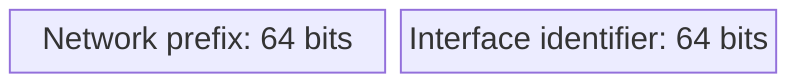

For the `2001:db8:a::/64` example, the full prefix is `2001:0db8:000a:0000`, followed by the 64-bit IID. The blocks indicate field order and labelled sizes.

The 64-bit boundary supports ordinary SLAAC on common link types. **It is not a ban on all other IPv6 prefix lengths.** Router-to-router point-to-point links often use `/127`, while `/128` denotes a single address. Site allocations such as `/48` and `/56` are normally divided into `/64` LANs.

## 3. Address types and scope

IPv6 defines three delivery models:

- **Unicast:** deliver to one interface.
- **Multicast:** deliver to members of a group.
- **Anycast:** deliver to one of several interfaces using the same address, selected by routing.

There is **no IPv6 broadcast address**. Multicast replaces broadcast uses, with groups targeted to the participants that need a message.

An interface can hold several IPv6 addresses simultaneously. A typical host has a link-local address and one or more global addresses, possibly including temporary addresses. **Technical clarification:** IPv4 interfaces can also have multiple addresses; the contrast is about normal configuration patterns, not an IPv4 restriction to one address.

### Global unicast and its structure

A **GUA** is intended to be globally unique and routable. The lecture focuses on ordinary global allocations within `2000::/3`, whose first three bits are `001`. The first hextet therefore ranges from `2000` to `3fff`, beginning with hexadecimal `2` or `3`.

That block is one eighth of the total address space. **Technical clarification:** the other seven eighths are not all freely available for future GUA allocation: they also contain special-purpose ranges such as multicast and link-local addresses. The `/3` is the lecture's allocation context, not the definition of every possible global-use IPv6 address.

A common site layout is:


The provider assigns the global routing prefix. The organization chooses subnet IDs within that allocation. The interface ID identifies an interface on its link. `/48` site allocations and `/56` home allocations are examples, not mandatory allocation sizes.

The `2001:db8::/32` addresses used throughout the exercises are **documentation addresses**. They illustrate GUA structure but are not public addresses to deploy on the Internet.

### Link-local addresses

An **LLA** supports communication only on the local link. Routers do not forward packets with a link-local source or destination to another link. IPv6-enabled ordinary interfaces use LLAs for bootstrapping, router advertisements, neighbour communication, and many routing-protocol exchanges.

The reserved block is `fe80::/10`. The usual address format consists of those 10 prefix bits, 54 zero bits, and a 64-bit IID, so addresses normally appear within `fe80::/64`. Unlike SLAAC GUAs, an automatically formed LLA needs no advertised site prefix: the prefix is already known.

Link-local uniqueness applies **per link**. A router can use `fe80::1` on several different interfaces, provided no other interface on each corresponding link uses the same address. To select the intended link, tools may require a **zone index**, for example:

```text
fe80::1%eth0
fe80::1%12
```

The suffix selects an interface or scope zone and is not part of the 128-bit address.

### Unique local and special addresses

**ULAs** occupy `fc00::/7`, covering first-hextet values from `fc00` through `fdff`. Locally assigned ULAs use `fd00::/8`, with a 40-bit pseudo-random global ID intended to reduce collisions between independently numbered sites. The `fc00::/8` half is reserved for a different assignment scheme.

ULAs support local or limited inter-site communication and are not intended for global Internet routing. They resemble IPv4 RFC 1918 private addresses, but local addressing does not require translation. **Technical clarification:** translation mechanisms for IPv6 do exist; the sound distinction is that ULA use does not inherently require or imply NAT. Address scope also does not replace a firewall or access policy.

Two special addresses shown in the source classification are:

- **`::1/128` — loopback:** communication with the same host.
- **`::/128` — unspecified:** indicates the absence of an assigned source address in particular bootstrap operations. It is not an ordinary interface address to assign.

IPv6 has no all-ones broadcast host address. However, an all-zero IID has the **Subnet-Router Anycast** role for the corresponding subnet. Do not interpret the source's “all-zero and all-one host values are assignable” as permission to assign the subnet-router anycast address to an arbitrary ordinary host.

### IPv4 embedded in IPv6 notation

The same IPv4 value can appear in several IPv6 formats with different meanings. `192.0.2.128` has bytes `c0 00 02 80`, forming hextets `c000:0280`.

| Form | Example | Meaning |
|---|---|---|
| IPv4-mapped | `::ffff:192.0.2.128` = `::ffff:c000:280` | Socket/API representation allowing IPv6-capable applications to handle IPv4 peers; not ordinary IPv6 Internet routing. |
| IPv4-compatible | `::192.0.2.128` = `::c000:280` | Deprecated historical format. |
| 6to4 | `2002:c000:0280::/48` | Embeds an IPv4 tunnel endpoint after `2002::/16`. |
| NAT64 well-known prefix | `64:ff9b::192.0.2.128` = `64:ff9b::c000:280` | Represents an IPv4 destination through translation using `64:ff9b::/96`. |

Leading zeros in `0280` may be omitted without changing the address. These formats are not interchangeable simply because they contain the same low-order IPv4 bits.

## 4. Subnetting a site allocation

With a `/48` allocation and `/64` LANs, the subnet field has:

\[
64-48=16\text{ bits},\qquad 2^{16}=65{,}536\text{ subnets}.
\]

For `2001:db8:acad::/48`, the fourth hextet is the subnet ID. The first three hextets stay fixed, and the last four are the IID:

```text
2001:db8:acad:0000::/64
2001:db8:acad:0001::/64
2001:db8:acad:0002::/64
...
2001:db8:acad:0009::/64
2001:db8:acad:000a::/64
2001:db8:acad:000b::/64
2001:db8:acad:000c::/64
...
2001:db8:acad:ffff::/64
```

Increment in **hexadecimal**, including `a` through `f`. The zero subnet is part of the available numbering space. More generally, splitting a `/p` allocation into `/64` subnets gives \(2^{64-p}\) subnets when \(p\le64\). For a `/56`, that is \(2^8=256\).

The lecture's topology needs four LANs and one router-to-router link:

| Subnet | Purpose | Router address(es) | Host example |
|---|---|---|---|
| `2001:db8:acad:1::/64` | R1 G0/0/0 LAN | R1 `2001:db8:acad:1::1` | PC1 `2001:db8:acad:1::10` |
| `2001:db8:acad:2::/64` | R1 G0/0/1 LAN | R1 `2001:db8:acad:2::1` | PC2 `2001:db8:acad:2::10` |
| `2001:db8:acad:3::/64` | R1–R2 serial link | R1 `…:3::1`, R2 `…:3::2` | — |
| `2001:db8:acad:4::/64` | R2 G0/0/0 LAN | R2 `2001:db8:acad:4::1` | PC3 `2001:db8:acad:4::10` |
| `2001:db8:acad:5::/64` | R2 G0/0/1 LAN | R2 `2001:db8:acad:5::1` | PC4 `2001:db8:acad:5::10` |

Here `…` abbreviates the unchanged `2001:db8:acad` text in the table, not valid address syntax. The example intentionally uses `/64` even on the serial link; that does not contradict the separate `/127` practice for point-to-point deployments.

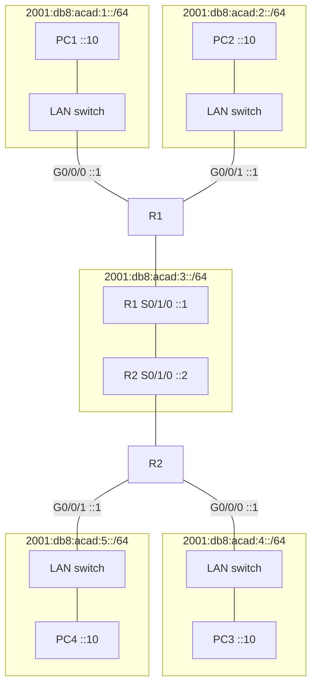

Undirected lines show connectivity, not one-way packet movement. R1 and R2's serial-interface boxes represent interfaces of those routers, not additional routers.

The generous space makes address planning simpler than tightly rationed IPv4 allocations. It does not remove the need to calculate prefix boundaries, allocate consistently, and configure routes.

## 5. Static configuration

### Router addresses and forwarding

The Cisco IOS examples use `ipv6 address address/prefix-length`. Enabling an interface and assigning an address are separate from enabling forwarding. The lecture emphasizes the global command **`ipv6 unicast-routing`**, which enables IPv6 routing on the relevant IOS platform and allows normal router-advertisement operation.

R1's three-subnet configuration is:

```text
R1(config)# ipv6 unicast-routing
R1(config)# interface gigabitethernet 0/0/0
R1(config-if)# ipv6 address 2001:db8:acad:1::1/64
R1(config-if)# no shutdown
R1(config-if)# exit
R1(config)# interface gigabitethernet 0/0/1
R1(config-if)# ipv6 address 2001:db8:acad:2::1/64
R1(config-if)# no shutdown
R1(config-if)# exit
R1(config)# interface serial 0/1/0
R1(config-if)# ipv6 address 2001:db8:acad:3::1/64
R1(config-if)# no shutdown
```

These are instructional commands for the illustrated interfaces, not a complete production configuration. Interface names and defaults depend on the platform.

### Host settings and gateway choice

A manually configured host needs an address, prefix length, a route through a gateway when reaching other networks, and DNS settings when name resolution is required. The source's Windows example enters:

```text
IPv6 address:         2001:db8:acad:1::10
Subnet prefix length: 64
Default gateway:      2001:db8:acad:1::1
```

The router's GUA can work as a static gateway, but its **LLA is generally preferable**. A next hop must be reachable on the local link; its own address need not be globally routable. A stable link-local gateway survives changes to the site's global prefix, whereas a gateway entered using an obsolete GUA would need updating.

### A memorable link-local gateway

To configure the source's explicit LLA example:

```text
R1(config)# interface gigabitethernet 0/0/0
R1(config-if)# ipv6 address fe80::1:1 link-local
R1(config-if)# no shutdown
R1(config-if)# exit
```

`link-local` distinguishes this from a global assignment. Administrators may use a short `fe80::1` on each separate link, or different suffixes to identify router interfaces more easily. Uniqueness is required on each link, not across all links.

In the Cisco example, assigning a GUA also enables IPv6 on the interface and causes an LLA to appear. This is a configuration trigger, not a universal protocol rule that GUAs must precede LLAs. Hosts can form LLAs before acquiring any global address.

## 6. Dynamic addressing and interface identifiers

Routers send **Router Advertisements (RAs)** containing prefixes and related configuration. A host can send a **Router Solicitation (RS)** instead of waiting for a periodic RA. The source address of an RA is the router's LLA. With a suitable nonzero router lifetime, that router can become a default router.

RAs can carry prefix and prefix-length information, configuration flags, and DNS-related options. The address-configuration mechanisms below are alternatives that may also coexist.

### The three configuration methods

| Method | Where the host address comes from | Other settings | Default router |
|---|---|---|---|
| SLAAC | Advertised prefix plus locally generated IID | Can come from RA options, including DNS | RA |
| SLAAC + stateless DHCPv6 | Advertised prefix plus locally generated IID | DHCPv6 provides DNS and other configuration | RA |
| Stateful DHCPv6 | DHCPv6 server allocates an address and maintains a binding | DHCPv6 may provide DNS and other settings | RA |

**SLAAC** needs no address-lease server. For a `/64`, the host combines an advertised 64-bit prefix with a 64-bit IID, then performs the appropriate address checks. The router still supplies configuration; “no server” does not mean “no network dependencies.” No DHCP address-binding database records the generated assignment, although logging and network observation can still provide accountability.

**Stateless DHCPv6** supplements SLAAC with configuration such as DNS server addresses and a domain search list. It does not allocate the host address or maintain an address lease for it. The lecture's typical combination is `M=0`, `O=1`: managed address configuration off, other configuration available.

**Stateful DHCPv6** maintains address bindings and lease information. It supports centralized assignment and records useful for auditing and incident response, at the cost of server operation and availability. A client discovers DHCPv6 service using a Solicit message to **`ff02::1:2`**, the link-local All_DHCP_Relay_Agents_and_Servers multicast group.

**Technical clarifications:**

- The **M flag** signals managed address configuration, and **O** signals other configuration. SLAAC permission comes from the **A flag in a Prefix Information Option**. `M=1` does not itself turn SLAAC off. A deliberately DHCPv6-only address policy must also avoid advertising that prefix for autonomous configuration. Host support and policy matter too.
- Ordinary DHCPv6 address assignment does **not** provide the default gateway. Router discovery supplies it. A DHCPv6 address lease also must not be treated as an IPv4-style subnet-mask lease: on-link prefix information normally comes from RAs. Delegating a prefix to a router is a separate DHCPv6 function.
- The source first says plain SLAAC cannot supply DNS, then later describes DNS in RAs. The latter reflects modern operation: **RDNSS and DNS search-list options** allow DNS configuration through RAs (RFC 8106). Stateless DHCPv6 is therefore not always necessary.
- Stateless DHCPv6 normally uses an **Information-request/Reply**, not the stateful Solicit exchange pictured beside it in the source.

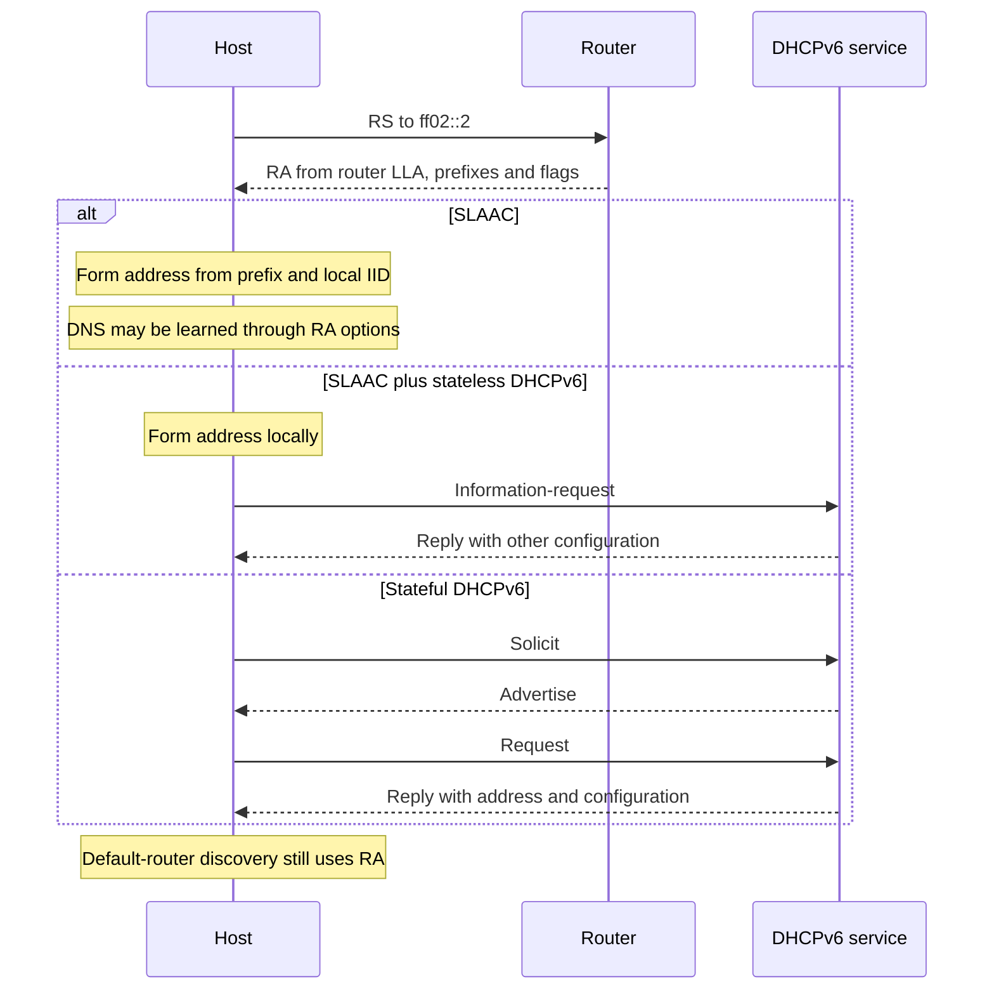

The diagram shows conventional exchanges rather than every option, relay, or rapid-commit variation. DAD applies where required before normal use of assigned unicast addresses.

### Modified EUI-64

A 48-bit Ethernet MAC can generate a 64-bit IID in two steps:

1. Insert hexadecimal **`ff:fe`** between the first three and last three MAC bytes.
2. **Invert the U/L bit** of the first byte. This is the second least significant bit, equivalent to XOR with `0x02`.

For the lecture's MAC:

```text
MAC:                 fc:99:47:75:ce:e0
Insert ff:fe:        fc:99:47:ff:fe:75:ce:e0
Flip U/L bit:        fe:99:47:ff:fe:75:ce:e0
IID in hextets:      fe99:47ff:fe75:cee0
```

The first-byte calculation is:

\[
\mathtt{fc}\oplus\mathtt{02}=\mathtt{fe}.
\]

Thus examples using that exact MAC are:

```text
GUA: 2001:db8:acad:1:fe99:47ff:fe75:cee0
LLA: fe80::fe99:47ff:fe75:cee0
```

In the MAC convention the bit distinguishes universal from local administration; modified EUI-64 inverts its meaning. **Flip** means either `0→1` or `1→0`, depending on the input, not always “set it to 1.”

**Source inconsistency:** a later displayed EUI-64 address uses `fc99:47ff:fe75:cee0`. If intended to derive from the same original `fc:99:47:75:ce:e0`, it misses the required flip. That IID could derive from a different MAC starting `fe`, but none is supplied for that example. Keep the corrected derivation above as the worked calculation.

A second, consistent router example starts with MAC `7079.b392.3640`:

```text
MAC: 70:79:b3:92:36:40
IID: 7279:b3ff:fe92:3640
LLA: fe80::7279:b3ff:fe92:3640
```

The lecture's verification output is:

```text
R1# show interface gigabitEthernet 0/0/0
GigabitEthernet0/0/0 is up, line protocol is up
Hardware is ISR4221-2x1GE, address is 7079.b392.3640

R1# show ipv6 interface brief
GigabitEthernet0/0/0 [up/up]
FE80::7279:B3FF:FE92:3640
2001:DB8:ACAD:1::1
```

The LLA is generated while the displayed GUA is manually assigned. They need not share an IID.

### Stable and temporary identifiers

A MAC-derived IID can remain constant as a device changes networks, making the changing prefix insufficient to conceal that device's identity. Hardware-independent generation reduces this link.

Two behaviours should be distinguished:

- **Stable opaque identifiers:** remain useful locally, often tied to a particular network rather than revealing the MAC across networks.
- **Temporary privacy addresses:** additional addresses that change over time and are commonly selected for outgoing connections.

Consequently, one interface may have an LLA, a stable GUA, and one or more temporary GUAs simultaneously. Rotation intervals and address-selection rules are implementation-dependent.

The Windows example, associated in the lecture with random identifier generation introduced in the Vista era, is:

```text
IPv6 Address:            2001:db8:acad:1:50a5:8a35:a5bb:66e1
Link-local IPv6 Address: fe80::50a5:8a35:a5bb:66e1
Default Gateway:        fe80::1
```

These equal suffixes illustrate reuse of an IID. **Technical clarification:** suffix equality is a clue, not proof of SLAAC, and unequal suffixes do not disprove SLAAC. Stable per-prefix generation, temporary addresses, and manual configuration can all invalidate that shortcut.

Automatic LLA generation uses the same general prefix-plus-IID structure, with the locally known `fe80::/64` prefix. A router advertisement is needed for the illustrated dynamic GUA prefix, not for creating the initial LLA. A statically assigned GUA is another exception to the claim that no GUA can exist before an RA.

## 7. ICMPv6 and Neighbor Discovery

ICMPv6 carries much more than diagnostic errors. **Neighbor Discovery** includes router discovery, prefix discovery, address resolution, and reachability-related functions. The four messages emphasized here are RS, RA, NS, and NA.

**Technical clarification:** these are message types, not four separate protocols, and they are not the entire ND message set: ND also defines Redirect. DHCPv6 remains a separate UDP-based protocol; IPv6 has not moved every possible configuration task into ICMPv6.

### Router discovery

A newly attached host can form and check an LLA, send an RS to `ff02::2`, and use the returned RA. The example advertisement supplies prefix **`2001:db8:acad:1::/64`** and identifies router **`fe80::1`** as a possible default next hop. The router also has GUA `2001:db8:acad:1::1`.

**Figure clarification:** one source RA illustration labels both PC1 and R1 with `2001:db8:acad:1::1`. That would be a duplicate on the same link. The host example elsewhere is `2001:db8:acad:1::10`, while the router uses `::1`; those distinct roles are used here.

Periodic RAs let passive listeners discover routers; solicited advertisements reduce the initial delay. The source uses **200 seconds** as an illustrative periodic interval. **Technical clarification:** RAs are not universally sent every 200 seconds. Standards use configurable, randomized intervals and rate limits. A response to an RS may also be delayed briefly rather than sent instantaneously.

An RS normally uses a valid LLA, but may use the unspecified source **`::`** if no suitable address is available. The simplified order “LLA, RS, RA, GUA” is useful without being the only permitted bootstrap path. Likewise, an RA source is not automatically a default router if its advertised router lifetime is zero.

### Solicited-node multicast and address resolution

To transmit over Ethernet to an on-link neighbour, a sender needs the neighbour's MAC address. For an off-link destination, it resolves the local next-hop router's MAC instead. IPv6 performs this through **NS/NA**, rather than ARP.

A solicited-node multicast group combines the fixed prefix **`ff02::1:ff00:0/104`** with the low **24 bits** of the target's unicast address. Its Ethernet destination is **`33:33:ff:xx:xx:xx`**, using those same final three bytes.

For the source's target `2001:db8:acad:1::10`:

```text
Low 24 bits:             00:00:10
Solicited-node group:    ff02::1:ff00:10
Ethernet multicast MAC:  33:33:ff:00:00:10
```

The NS packet's **IPv6 destination is the multicast group**; its separate **Target Address field is the unicast address being resolved**. This distinction corrects the loose description that the initial multicast solicitation is simply “sent to `2001:db8:acad:1::10`.”

The exchange proceeds as follows:

1. R1 needs the MAC for PC1 at `2001:db8:acad:1::10`.
2. R1 sends an NS to `ff02::1:ff00:10`, naming PC1's unicast address as the target.
3. PC1 recognizes its target address and replies with an NA carrying its link-layer address.
4. R1 records the neighbour information and can address Ethernet frames to PC1.

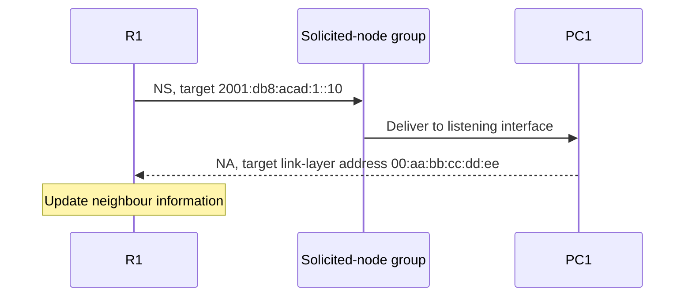

The group participant denotes multicast delivery, not an extra router. Other interfaces sharing the same low 24 bits can also belong to the group and must inspect the target field.

The Ethernet NIC can filter uninterested multicast frames before passing them to IP processing. That reduces the work compared with IPv4 broadcast ARP. It is not a guarantee that exactly one NIC receives every frame: group collisions, filtering implementation, and switch behaviour matter.

### Duplicate Address Detection

DAD asks whether an intended unicast address is already in use on the link:

1. Treat the proposed GUA or LLA as **tentative**.
2. Send an NS whose **Target Address is that tentative address**, normally to its solicited-node group.
3. During DAD, use **`::` as the IPv6 source**, since the tentative address is not yet available for normal use.
4. An existing owner can reply with an NA, indicating a conflict. Competing DAD solicitations can also reveal a duplicate.
5. If no conflict is detected over the required checks, the address can become usable.

DAD reuses Neighbor Discovery rather than requiring a separate query protocol. Even a low collision probability is not zero, and manual configuration can also create duplicates.

**Technical clarification:** silence supports an operational assumption of uniqueness; it is not mathematical proof. Packet loss, sleeping devices, or filtering can prevent a conflict from being observed.

### Why indiscriminate ICMPv6 filtering breaks IPv6

RAs and neighbour discovery are essential control traffic. MLD also uses ICMPv6, and error messages support functions such as path-MTU discovery. Blocking all ICMPv6 can therefore break addressing or packet delivery, not just `ping` diagnostics. Filtering must distinguish message types, scope, and role rather than treating the protocol as optional noise.

## 8. Multicast delivery and membership

Suppose a source sends identical video or audio to \(n\) receivers. Sending \(n\) unicast packets can place \(n\) copies on a shared upstream link. **Multicast replicates packets where paths diverge**, so a distribution-tree link need carry only one copy of each source packet for its downstream recipients.

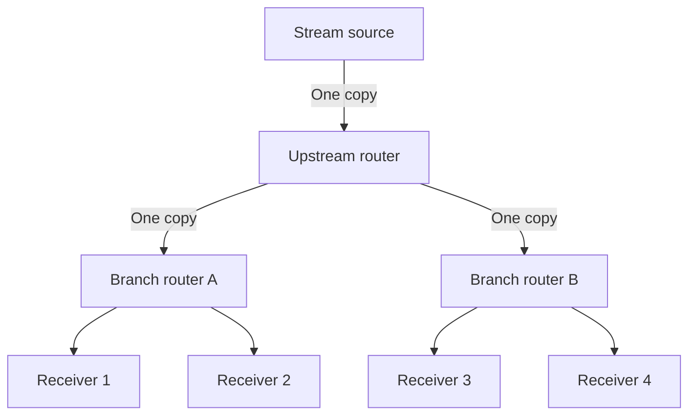

Arrows here show packet distribution. This shifts work from the source and shared links into routers maintaining forwarding state. Deployment across unrelated operators requires coordinated support, helping explain why the mechanism is useful without being universally available across the public Internet.

### Membership and forwarding state

A group has a multicast IP address. Hosts signal their membership to local routers using:

- **IGMP** for IPv4.
- **MLD**, carried in ICMPv6, for IPv6.

Reports and queries establish local listener information. **Technical clarification:** IGMP/MLD do not alone construct every inter-router distribution tree. Multicast routing mechanisms use membership information to establish forwarding paths.

The source's IPv4 membership example is a host requesting traffic for `239.1.1.1`. Its simplified forwarding entry is:

```text
(Source IP, Group Address) → Outgoing Interface List
(*, 239.1.1.1)             → [eth0, eth2]
```

The `*` indicates wildcard source state. Forwarding copies traffic onto the selected outgoing interfaces. This is a conceptual entry, not the entire multicast forwarding algorithm or reverse-path checks.

### IPv6 multicast addresses

IPv6 multicast addresses have prefix **`ff00::/8`**. They are destinations, **never source addresses**. The following groups are particularly important:

| Address | Membership or use |
|---|---|
| `ff02::1` | All IPv6 nodes on the link |
| `ff02::2` | All IPv6 routers on the link |
| `ff02::1:2` | DHCPv6 relay agents and servers on the link |
| `ff02::1:ffXX:XXXX` | Solicited-node group based on a target's low 24 bits |

In `ff02`, the `0` is the flags nibble and **the final `2` is the link-local scope nibble**. These groups are not forwarded beyond the link. Other multicast scopes exist.

The source focuses on well-known groups and solicited-node groups. This is a teaching classification, not a statement that every possible multicast address is one of those two fixed examples. Multicast to all nodes has reach similar to local broadcast; narrower groups reduce unnecessary processing.

## 9. Anycast and routing

**Anycast reaches one member of a set**, rather than all members. At the IP layer, several service instances use the same address, and the routing system selects a path to one of them. “Nearest” means preferred by routing policy and metrics, not necessarily geographically closest or lowest-latency.

An anycast address has the **same format as a unicast address**. There is no multicast-like prefix identifying it. The property arises from address assignment and route advertisement. Ordinary route selection and forwarding apply: the routing system chooses routes, and forwarding uses longest-prefix matching on the installed information.

### DNS selection versus IP anycast

The historical example returns several addresses:

```dns
www.google.com.   604799 IN CNAME www.l.google.com.
www.l.google.com. 300    IN A 74.125.19.103
www.l.google.com. 300    IN A 74.125.19.104
www.l.google.com. 300    IN A 74.125.19.147
www.l.google.com. 300    IN A 74.125.19.99
```

The lecture describes this loosely as application-layer anycast: the name names a service set and the client chooses an address. **Technical clarification:** multiple A records demonstrate DNS-based selection or load distribution, not proof of IP anycast. A DNS reply does not establish that those servers occupy different geographic sites or that the client chooses the closest one.

| Mechanism | What varies | Who chooses an instance? |
|---|---|---|
| DNS-based service selection | One name can return several distinct addresses | DNS policy and client address selection |
| IP anycast | The same destination address is reachable at several sites | IP routing |

### Root servers and operational consequences

DNS root service has **13 named identities**, backed by many physical instances. The lecture cites more than a thousand instances as a deployment-scale example, not a fixed limit. An identity can advertise its address from multiple sites. If a failed site withdraws its route, traffic can move elsewhere without clients needing a different DNS destination address.

Failure recovery is partly delegated to routing. **It is not necessarily instantaneous or invisible:** service-health detection, route withdrawal, convergence, retries, and connection state still matter.

Examples include the Cloudflare resolver's IPv6 service address **`2606:4700:4700::1111`**, corresponding to its `1.1.1.1` service, and Google's IPv4 resolver **`8.8.8.8`**. Subnet-Router Anycast is a separate local example using an all-zero IID.

The source suggests comparing `traceroute 8.8.8.8` from different locations using [PerfOps network utilities](https://panel.perfops.net/tools/network-utilities). Different paths illustrate route-dependent instance selection; a trace alone may not reveal every detail of the backend deployment.

Anycast is especially convenient when requests can be served independently, such as many DNS exchanges. Routing may change which instance receives subsequent packets. Long-lived or stateful services need a design that handles that possibility; the use of anycast by CDNs does not mean arbitrary mid-connection movement is harmless.

## 10. The IPv6 header and extensibility

IPv6 has a **fixed 40-byte base header**, compared with IPv4's variable header length and inline options. Less common functions use optional extension headers linked after the base header.

The base-header layout below has two 32-bit rows followed by the source and destination addresses. Read each row from left to right; labelled widths, not visual box widths, specify the bit sizes.

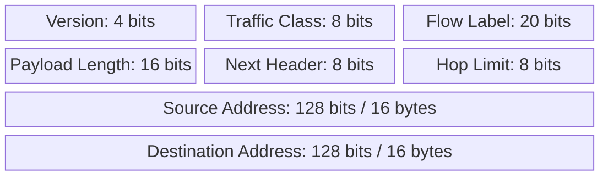

- **Version:** `6`.
- **Traffic Class:** differentiated traffic handling, analogous to IPv4's type-of-service field.
- **Flow Label:** identifies packets belonging to a flow for suitable handling.
- **Payload Length:** length in bytes **after the 40-byte base header**, including any extension headers.
- **Next Header:** identifies the next extension header or upper-layer protocol.
- **Hop Limit:** decremented during forwarding, limiting the number of hops.
- **Source and Destination:** 128 bits each.

The total is:

\[
4+8+20+16+8+8+128+128=320\text{ bits}=40\text{ bytes}.
\]

**Technical clarification:** the source's short label “datagram length” is imprecise. Payload Length excludes the base header. A payload length of 1,200 therefore ordinarily means an IPv6 packet of 1,240 bytes. A jumbogram is a special extension-based case, outside the lecture's basic format.

### Simplification and optional functions

The base header has **no header checksum**. IPv6 avoids recalculating such a checksum at each forwarding hop and relies on protection at other layers for error detection. This does not mean every layer provides identical integrity guarantees.

It also has no inline fragmentation fields. **IPv6 routers do not fragment packets.** A source can use the Fragment extension header when appropriate; a router encountering an oversized packet can report the problem through ICMPv6. Source fragmentation and router fragmentation must not be conflated.

Each extension header identifies what follows, allowing a chain without altering the fixed base layout. As an illustrative order:

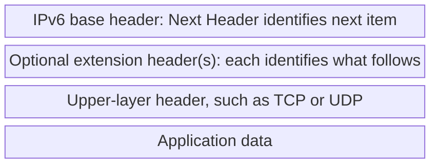

Security and authentication are available through mechanisms including **IPsec**. Their presence in the design does not automatically encrypt or authenticate ordinary IPv6 traffic. IPsec is also available for IPv4. The historical implementation requirement for IPv6 was relaxed, so “IPv6 is inherently secure” is not a valid conclusion.

### Extension headers in real networks

The architecture permits extensibility, but a path may contain firewalls or other middleboxes unable or unwilling to process particular header chains. Some drop such packets, making end-to-end reliance on an extension header risky across arbitrary Internet paths. RFC 7872 reports measurements of this problem.

**Technical clarification:** the source's phrase “deployment killed extension headers” overstates the result. The evidence concerns particular extension types, paths, and measurements. It does not establish that every extension header fails everywhere. The practical lesson is to distinguish **standardized**, **implemented**, and **usable on the intended path**.

### SRv6 in a controlled domain

**Segment Routing over IPv6** uses a list of segment identifiers to steer a packet through selected endpoints or processing behaviours. An SRH carries the list, and segment processing changes the active destination as the packet progresses.

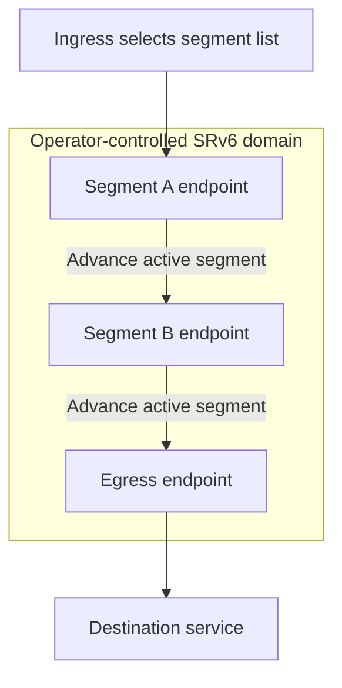

Arrows show the conceptual segment progression, not every transit hop. **Technical clarification:** a SID can identify a behaviour, not merely an ordinary host interface, and every intervening router need not process the SRH as a segment endpoint.

The operator can provision routing, endpoint behaviour, filtering, and trust boundaries within its domain. The same extension mechanism can therefore be usable there while unreliable across unrelated public networks. Deployability depends on both protocol design and the environment in which it operates.

## 11. Coexistence and transition mechanisms

IPv4 and IPv6 cannot simply replace each other everywhere on one date. Three mechanisms solve different problems:

- **Dual stack:** run both protocols, maintaining both address families and associated operations.
- **Tunnelling:** carry one complete IP packet inside another, crossing a network that supports the outer family.
- **Translation:** rewrite between families so endpoints using different versions can communicate.

Native IPv6 between IPv6 endpoints avoids transition machinery where it is unnecessary. This does not make every tunnel obsolete or every translator avoidable.

### Tunnelling and the historical 6to4 example

In IPv6-over-IPv4 tunnelling, the intermediate network processes an IPv4 packet whose payload contains an IPv6 packet:

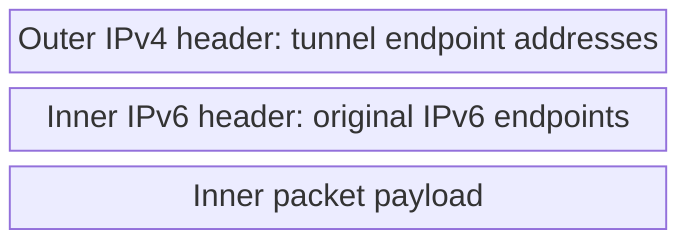

The tunnel presents the intervening path as a virtual link to the inner protocol. IPv4 routers forward based on the outer header. The remote endpoint removes it and resumes IPv6 forwarding.

The lecture's 6–4–6 example has IPv6 hosts A and B connected through dual-family tunnel endpoints D1 and D2:

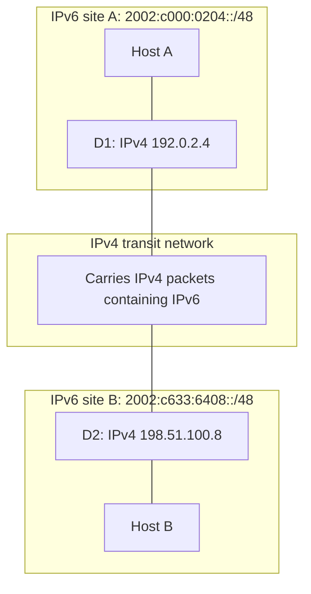

Every **6to4** prefix begins `2002::/16`, followed by the 32-bit IPv4 endpoint:

```text
192.0.2.4     = c0 00 02 04 → 2002:c000:0204::/48
198.51.100.8  = c6 33 64 08 → 2002:c633:6408::/48
```

That derivation yielded a `/48` from a public IPv4 address without a separate IPv6 allocation. These particular addresses are documentation examples. Embedding the endpoint reduced configuration needs, but did not eliminate the need for functioning routing and tunnel implementation.

Automatic public relay dependence made return paths and troubleshooting unreliable. **Technical clarification:** RFC 7526 deprecates the **6to4 anycast relay mechanism**. The broad source heading “IP tunnelling now obsolete” should not be applied to encapsulation in general. Managed tunnels remain useful in other settings. A transition mechanism can lose its purpose without the underlying technique becoming invalid.

### NAT64, DNS64, and 464XLAT

With **NAT64**, an IPv6 client sends to an IPv6 representation of an IPv4 destination. A translator forwards the communication into IPv4, commonly using a pool of IPv4 addresses and maintaining flow mappings.

**DNS64** can synthesize an AAAA response when a destination has an A record but no usable AAAA record. The synthesized IPv6 address directs traffic through NAT64. This helps applications using names, but an old application with an IPv4 literal or IPv4-only socket interface may still need another mechanism.

**464XLAT** adds a customer-side translator:

1. A legacy application sends IPv4 traffic through a local IPv4-facing interface.
2. The **CLAT** translates IPv4 into IPv6.
3. The access network carries the traffic natively as IPv6.
4. The provider's **PLAT**, a stateful NAT64 translator, converts it to IPv4 toward the destination.
5. Return traffic follows the corresponding translations in reverse.

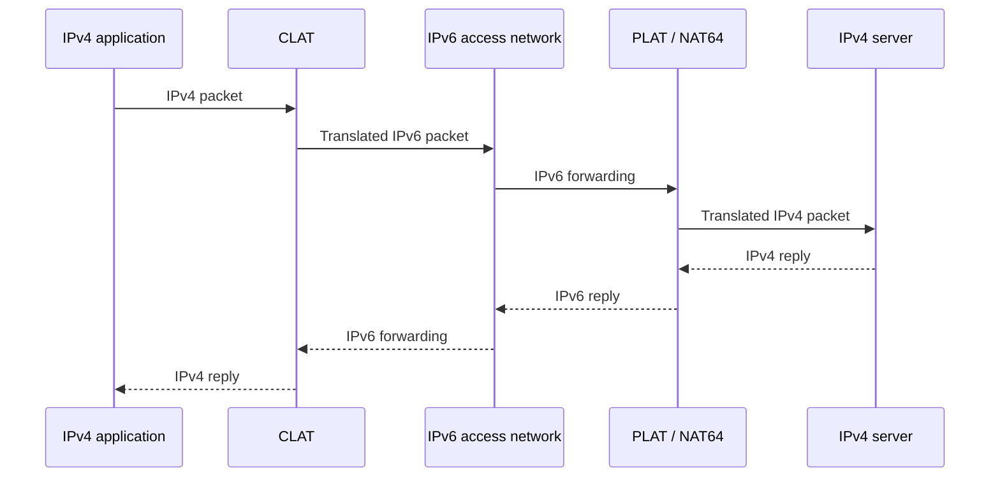

The access network need not run IPv4 even though the application and remote server still use it. This is **translation, not tunnelling**: the network carries translated packets rather than an intact inner IPv4 header enclosed in an IPv6 packet. CLAT translation is stateless in the RFC 6877 architecture; the provider translator holds the relevant stateful mapping.

Mobile carriers use this architecture to support legacy applications over IPv6-only access. The source's suggestion that a reader is “almost certainly using it” on mobile is too strong: the actual deployment depends on carrier, device, and connection. The useful exercise is to inspect the network rather than assume its transition mechanism.

### Dual-stack, IPv6-mostly, and IPv6-only networks

These describe the **native access-network operating model**, not necessarily what every remote service supports:

| Model | Native operation | Main operational consequence |
|---|---|---|
| Dual-stack | IPv4 and IPv6 | Maintain both families' addressing, routes, policies, and diagnostics. |
| IPv6-mostly | Prefer IPv6; retain IPv4 for clients that still need it | Reduce IPv4 dependence without requiring every host to stop using it immediately. |
| IPv6-only | No native IPv4 on the access network | Use translation or other compatibility facilities where legacy reachability is required. |

**RFC 8925** defines an IPv6-Only Preferred option in **DHCPv4**. A capable client signals support, and a server can tell it to defer IPv4 configuration for a stated interval when the IPv6 environment is suitable. This is more precise than saying hosts simply request IPv4 only if needed; the option coordinates client and server behaviour.

Dual stack is often a useful transition state, but it preserves two sets of things to operate. “Twice the operational surface” is a useful warning, not a measured universal cost multiplier. The cheapest appropriate model depends on requirements and deployed capabilities.

## 12. Deployment evidence and failure modes

### What an adoption percentage measures

The lecture records **50.10% of Google users accessing its services over native IPv6 on 28 March 2026**, 18 years after the measurement series began. The historical pattern was relatively flat until around 2011, followed by sustained growth. Google's [measurement page](https://www.google.com/intl/en/ipv6/statistics.html) defines its population as users accessing Google; [APNIC's April 2026 discussion](https://blog.apnic.net/2026/04/28/google-hits-50-ipv6/) confirms the approximately-half milestone.

**Scope clarification:** the exact dated 50.10% value is retained from the lecture. It is not a fresh reading for 2026-10-20 and does not establish that most Internet traffic bytes use IPv6. A first daily crossing also differs from a sustained global majority.

APNIC uses measurements distributed through advertising networks. The lecture places its contemporary estimate nearer **40%**, roughly ten percentage points lower. Treat this as a dated approximate comparison, not a newly retrieved measurement.

Different methods observe different populations:

- Google's sample depends on reaching Google services.
- Advertising-based measurement depends on receiving and executing the measurement task; advertisement blocking can affect coverage.
- Users, connections, successful tests, and byte volumes are different denominators.

A percentage needs a **population, method, and observation period**. Differences do not automatically establish that one measurement is wrong. They also should not be combined into a formal confidence interval: the lecture's “40–50% bracket” describes different observations, not a single estimator's uncertainty bounds.

### Testing the economic explanation

The source revisits a 2024 argument: IPv6 should become attractive when obtaining IPv4 addresses costs more than deploying IPv6. It cites roughly **US$60 per IPv4 address in 2022**, against **US$50–200 per device** plus wider migration costs for IPv6 deployment.

It then reports IPv4 transfer prices falling by roughly a third from a peak around 2021 while transfer volumes reached record levels, even as IPv6 adoption grew. These are **source-reported estimates with unspecified market coverage**, not verified current prices or universally comparable costs. Address prices and per-device deployment estimates do not even share the same denominator: NAT can let many devices share one address.

The lecture proposes broader operational drivers: the cost of carrier-grade NAT state, logging and lawful-intercept obligations, carriers' IPv6-only architectures, and changes in cloud defaults. Broker and marketplace figures vary by block size, timing, and transaction type, and suppliers have commercial interests.

**Interpretive clarification:** adoption rising while prices fall challenges a simple contemporaneous price-threshold story, but does not by itself prove that prices never mattered. Deployment has delays, anticipated costs matter, and adoption can itself affect demand for IPv4. The lesson is to test a proposed causal mechanism rather than treating a correctly predicted outcome as proof of the explanation.

### Hidden failure behind successful fallback

**Happy Eyeballs**, described in RFC 8305, reduces connection delays by trying alternative destination addresses and address families with controlled timing and concurrency. It does not necessarily launch exactly one IPv4 and one IPv6 connection at the identical instant.

If IPv6 is broken but IPv4 succeeds promptly, the user may see a successful connection. That protects usability while removing an obvious symptom of the IPv6 failure.

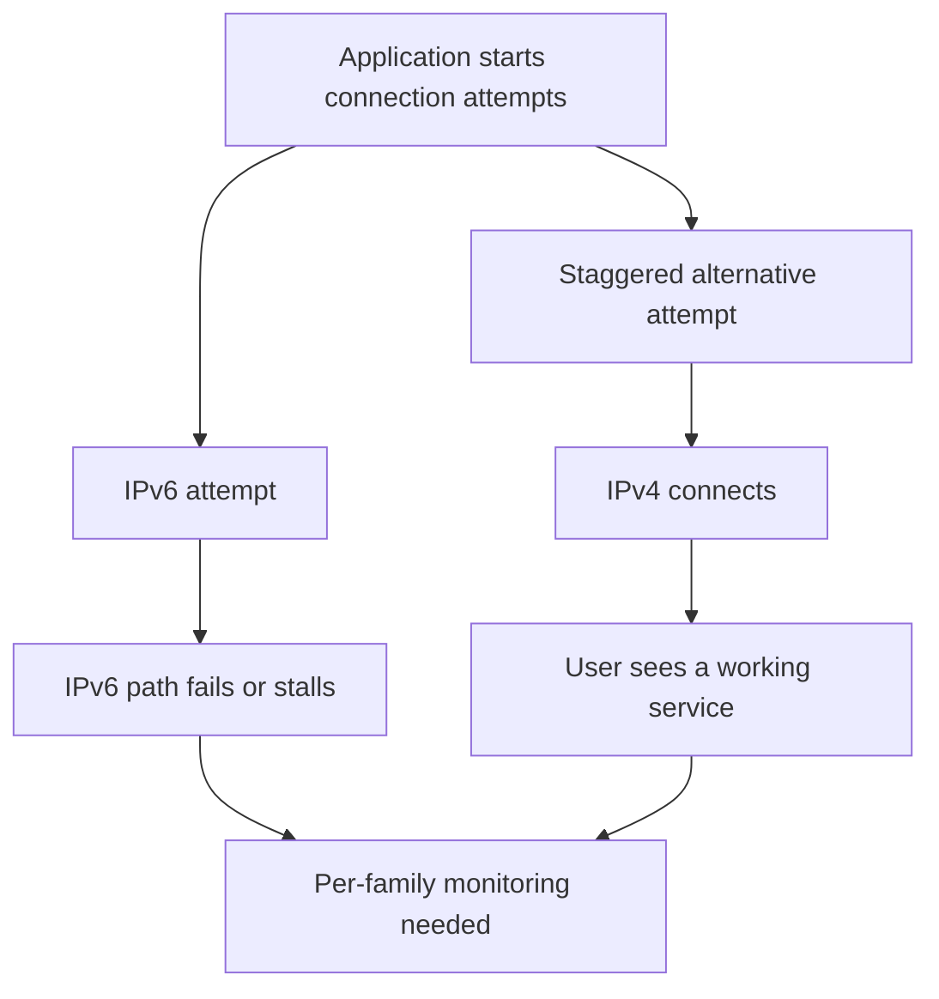

Dual stack permits independently failing paths. Aggregate “service reachable” monitoring can remain green while one family is consistently unusable. **Technical clarification:** failure is hidden only from observers that do not measure it. Operators can track family-specific reachability, latency, and fallback behaviour.

Translation adds another dependency: **mapping state at the provider edge**. Losing that state mid-connection can interrupt traffic even when both endpoints and the forwarding links remain available. The stateless CLAT and stateful PLAT should not be described as identical sources of this failure.

The wider lesson is that successful compatibility can postpone detection and repair. A system should distinguish “the user eventually connected” from “every intended path works.” The same distinction appears with extension headers: a specification and a working local implementation do not guarantee usability across the deployed path.

## 13. Worked checks and revision questions

The following small calculations connect the main mechanisms:

1. **Expand `2001:db8:cafe:1::1`.** Five hextets are explicit, so insert three zero hextets: `2001:0db8:cafe:0001:0000:0000:0000:0001`.
2. **Count `/64`s in `2001:db8:acad::/48`.** There are 16 subnet bits, giving 65,536 subnets. The fourth hextet selects one.
3. **Derive an IID from `fc:99:47:75:ce:e0`.** Insert `ff:fe`, then XOR the first byte with `02`, giving `fe99:47ff:fe75:cee0`.
4. **Resolve `2001:db8:acad:1::10` on Ethernet.** Send NS to `ff02::1:ff00:10` using Ethernet multicast `33:33:ff:00:00:10`; put the unicast address in the NS Target Address field.
5. **Decode the first 6to4 endpoint.** `c000:0204` consists of `c0`, `00`, `02`, `04`, or decimal `192.0.2.4`.
6. **Check the base header.** Two 32-bit field rows plus two 128-bit addresses equal 320 bits, or 40 bytes.

For practical inspection, compare `ipconfig` on Windows or `ip addr` on Linux with the router's `show ipv6 interface brief`. Identify each address's scope, prefix, IID, and role. A shared suffix can be informative without proving the configuration mechanism.

Questions worth being able to explain in your own words:

- Why did CIDR and NAT both alleviate IPv4 exhaustion and reduce pressure to migrate?
- Why can `::` appear only once, and why can trailing zeros not be removed from a hextet?
- Why is a link-local address useful as a default gateway even though routers do not forward link-local traffic off-link?
- Which settings come from RA, which can come from DHCPv6, and what does the A flag control?
- Why is a MAC-derived IID a privacy concern, and how do stable opaque and temporary identifiers differ?
- How do an ordinary NS and a DAD NS differ in their purpose and source address?
- What does MLD establish locally, and what additional work must multicast routing perform?
- Why do multiple DNS A records not demonstrate IP anycast?
- How does translation differ from encapsulation in the packet carried across the network?
- Why can SRv6 be practical inside an operator domain even when some extension headers are unreliable across the public Internet?
- What can a successful Happy Eyeballs connection conceal, and which measurement would expose it?

## References

The course material credits Cisco CCNAv7 and contributions from Philip Levis, David Mazières, Ali Salehson, and Rhouma Rhouma. The following primary references support technical clarifications and further study:

- [RFC 1883](https://www.rfc-editor.org/rfc/rfc1883), [RFC 2460](https://www.rfc-editor.org/rfc/rfc2460), and [RFC 8200](https://www.rfc-editor.org/rfc/rfc8200): IPv6 specification history and base packet format.
- [RFC 4291 — IPv6 Addressing Architecture](https://www.rfc-editor.org/rfc/rfc4291): address types, modified EUI-64, and multicast construction.
- [RFC 5952 — IPv6 Text Representation](https://www.rfc-editor.org/rfc/rfc5952): canonical address notation.
- [RFC 7421 — The 64-bit Boundary](https://www.rfc-editor.org/rfc/rfc7421): rationale and limits of the common prefix/IID split.
- [RFC 4861 — Neighbor Discovery](https://www.rfc-editor.org/rfc/rfc4861): RS, RA, NS, NA, router discovery, and timings.
- [RFC 4862 — SLAAC](https://www.rfc-editor.org/rfc/rfc4862): address formation and DAD.
- [RFC 8106 — RA DNS Configuration](https://www.rfc-editor.org/rfc/rfc8106): DNS resolver and search-list options.
- [RFC 8415 — DHCPv6](https://www.rfc-editor.org/rfc/rfc8415): address assignment and stateless information requests in the documented specification.
- [RFC 6877 — 464XLAT](https://www.rfc-editor.org/rfc/rfc6877) and [RFC 8925 — IPv6-Only Preferred](https://www.rfc-editor.org/rfc/rfc8925): translation and reducing native IPv4 dependence.
- [RFC 7526 — 6to4 Anycast Relay Deprecation](https://www.rfc-editor.org/rfc/rfc7526): scope of the historical mechanism's deprecation.
- [RFC 7872 — Extension-Header Dropping](https://www.rfc-editor.org/rfc/rfc7872): measurement evidence and deployment constraints.
- [RFC 8986 — SRv6 Network Programming](https://www.rfc-editor.org/rfc/rfc8986): segment behaviours and operator-domain use.
- [RFC 8305 — Happy Eyeballs v2](https://www.rfc-editor.org/rfc/rfc8305): connection establishment using concurrency.
- [RIPE NCC: IANA free-pool exhaustion, 3 February 2011](https://www.ripe.net/about-us/news/ipv4-exhaustion-ripe-ncc-update/) and [ARIN: free pool reaches zero, 24 September 2015](https://lists.arin.net/pipermail/arin-announce/2015-September/001892.html): corrections to the depletion timelines.
- [Google IPv6 statistics](https://www.google.com/intl/en/ipv6/statistics.html) and [APNIC: Google hits 50% IPv6](https://blog.apnic.net/2026/04/28/google-hits-50-ipv6/): population-specific adoption measurements.


Additional resources retained from the lecture: [archived IPv4 consumption report](https://web.archive.org/web/20110806165335/http:/www.cisco.com/web/about/ac123/ac147/archived_issues/ipj_8-3/ipv4.html) and [464XLAT supplementary video](https://www.youtube.com/watch?v=e5v5OynuPcM).
