# End-to-End Communication and Congestion Control (EDA387/DIT660)

**Generated:** 2026-10-20

**† Supplementary material:** Content originating exclusively from hidden or archived PowerPoint slides (or slides marked for replacement). It may not be included in this year's examinable material.

---

## Glossary

| Term | Full name | Meaning |
|---|---|---|
| ACK | Acknowledgment | Control message sent by a receiver to confirm the receipt of data bytes or segments. |
| AIMD | Additive Increase Multiplicative Decrease | Congestion control feedback scheme that increases the congestion window linearly during normal operation and halves it upon detecting packet loss. |
| AQM | Active Queue Management | Router-side techniques that actively monitor and manage buffer queues (by dropping or marking packets early) to prevent bufferbloat. |
| ASPA | Autonomous System Provider Authorization | Routing security standard referenced in comparison to L4S deployment (standardized and available, yet barely deployed in practice). |
| BBR | Bottleneck Bandwidth and Round-trip propagation time | Congestion control algorithm developed by Google that models the network path's bottleneck capacity and minimum delay rather than waiting for packet loss. |
| BDP | Bandwidth-Delay Product | The product of a data link's capacity and its round-trip delay ($B \times \text{RTT}$), representing the maximum amount of unacknowledged data that can be in flight on the pipe. |
| Bufferbloat | Bufferbloat | Excessive packet queueing delay caused by overly large memory buffers in network routers and switches when paired with loss-based congestion control. |
| CC | Congestion Control | Mechanisms that regulate the rate of data entering the network to prevent overloading intermediate links and routers. |
| CoDel | Controlled Delay | An AQM algorithm that drops packets based on how long they have spent waiting in a queue (sojourn time) rather than the raw number of packets in the queue. |
| CUBIC | CUBIC TCP | Standard loss-based congestion control algorithm (default in Linux) that uses a cubic function of time since the last loss event to govern window growth. |
| CWND | Congestion Window | Sender-side state variable that limits the maximum amount of unacknowledged data (in bytes or segments) a sender can have in transit across the network. |
| Demultiplexing | Transport-layer Demultiplexing | The process at the receiving host of examining transport header fields to deliver incoming segments to the appropriate application socket. |
| DevRTT | Deviation of RTT | An exponentially weighted moving average measuring the variability (mean deviation) between `SampleRTT` and `EstimatedRTT`. |
| DupACK | Duplicate Acknowledgment | An ACK that repeats the acknowledgment number of a previous ACK, sent when a receiver receives an out-of-order segment with a higher sequence number than expected. |
| ECN | Explicit Congestion Notification | Extension to IP and TCP allowing routers to mark packets in the IP header to signal impending congestion instead of dropping them. |
| ECT(1) | ECN-Capable Transport (1) | A specific two-bit codepoint in the IP header used by L4S to identify scalable traffic and separate it into a low-latency queue. |
| EstimatedRTT | Estimated Round-Trip Time | An exponentially weighted moving average of measured `SampleRTT` values maintained by a TCP sender. |
| EWMA | Exponentially Weighted Moving Average | A statistical averaging technique where the weight of older samples decreases exponentially over time. |
| FACK | Forward Acknowledgment | A 1996 extension to TCP SACK (by Mathis et al.) that explicitly tracks the highest sequence number held by the receiver to improve recovery. |
| Fast Recovery | TCP Fast Recovery | Phase entered after Fast Retransmit (in TCP Reno and later) where the sender halves the congestion window and inflates it for duplicate ACKs rather than resetting `cwnd` to $1$. |
| Fast Retransmit | TCP Fast Retransmit | Mechanism where the sender immediately retransmits a missing segment upon receiving three duplicate ACKs, without waiting for the retransmission timer to expire. |
| Flow Control | Transport Flow Control | Mechanism preventing a fast sender from overwhelming a slow receiver's socket buffer using the advertised `RcvWindow`. |
| FQ-CoDel | Flow Queue Controlled Delay | AQM discipline combining per-flow fair queueing with CoDel so that a bulk transfer flow cannot build a queue that delays interactive flows. |
| L4S | Low Latency, Low Loss, Scalable Throughput | IETF framework (RFCs 9330–9332) using dual queues and frequent, early `ECT(1)` packet marking to eliminate queueing delay for real-time applications. |
| MI | Mild Increase (Slow Start) | The initialization phase of TCP congestion control (commonly called Slow Start) where `cwnd` increases by $1\text{ MSS}$ for every ACK received, doubling every $\text{RTT}$. |
| MSS | Maximum Segment Size | The maximum amount of application-layer payload data (in bytes) that can be placed inside a single TCP segment. |
| Multiplexing | Transport-layer Multiplexing | The process at the sending host of gathering data chunks from multiple application sockets, encapsulating each with a transport header, and passing them to the network layer. |
| Pipelining | Pipelined Data Transfer | Technique (also called sliding window) allowing a sender to transmit multiple packets back-to-back without waiting for each individual packet to be acknowledged first. |
| QoS | Quality of Service | The ability of a network to guarantee or uphold a minimum level of performance, such as minimum bandwidth, low latency, and reliable delivery. |
| QUIC | QUIC Transport Protocol | A modern, encrypted transport protocol running in userspace on top of UDP that replaces TCP for web traffic (HTTP/3). |
| RcvBuffer | Receive Buffer | The total memory allocated by the receiving transport layer for a specific connection's incoming data. |
| RcvWindow | Receive Window | The amount of free, spare room currently available in the receiver's `RcvBuffer`, advertised to the sender in the TCP header. |
| RDT | Reliable Data Transfer | Protocols and mechanisms that provide guaranteed, error-free, in-order delivery of data over an underlying unreliable communication channel. |
| RTO | Retransmission Timeout | The time interval (`TimeoutInterval`) a TCP sender waits for an acknowledgment before assuming a transmitted segment was lost and retransmitting it. |
| RTT | Round-Trip Time | The time required for a small packet or segment to travel from a sender to a receiver and for the corresponding acknowledgment to return. |
| SACK | Selective Acknowledgment | TCP option allowing the receiver to acknowledge non-contiguous blocks of out-of-order data successfully received, rather than only the last cumulative in-order byte. |
| SampleRTT | Sample Round-Trip Time | A single direct measurement of the time elapsed from when a segment is passed to IP until the ACK for that segment arrives. |
| Segment | Transport Segment | The protocol data unit (PDU) exchanged between transport-layer entities, consisting of a transport header and application payload. |
| Sliding Window | Sliding Window Protocol | A mechanism that bounds the range of sequence numbers a sender may transmit without acknowledgment, advancing forward as cumulative ACKs arrive. |
| Slow Start | TCP Slow Start | Phase of TCP congestion control in which `cwnd` starts small (e.g., $1\text{ MSS}$) and grows exponentially by doubling each $\text{RTT}$ until reaching `ssthresh` or a loss event. |
| Socket | Network Socket | The software interface (door) between an application process and the end-system transport protocol. |
| ssthresh | Slow Start Threshold | A TCP state variable marking the congestion window size at which the sender transitions from exponential growth (Slow Start) to linear growth (Congestion Avoidance). |
| Stop-and-Wait | Stop-and-Wait ARQ | A basic reliable transfer protocol in which the sender transmits a single packet and waits until it receives an ACK before transmitting the next packet. |
| T/TCP | Transaction TCP | A 1994 experimental TCP extension (by Braden) designed for low-overhead request-response transactions. |
| TCP | Transmission Control Protocol | Connection-oriented, reliable Internet transport protocol providing error recovery, in-order byte-stream delivery, flow control, and congestion control. |
| UDP | User Datagram Protocol | Connectionless, best-effort Internet transport protocol that provides multiplexing and error checking without reliability, flow control, or congestion control. |

---

## Table of Contents

1. [Internet Protocol Stack and Transport Layer Services](#1-internet-protocol-stack-and-transport-layer-services)
   - [1.1 Layering: Logical vs. Physical Communication](#11-layering-logical-vs-physical-communication)
   - [1.2 TCP vs. UDP Service Models](#12-tcp-vs-udp-service-models)
   - [1.3 Addressing, Multiplexing, and Demultiplexing](#13-addressing-multiplexing-and-demultiplexing)
2. [Principles of Reliable Data Transfer and Pipelining](#2-principles-of-reliable-data-transfer-and-pipelining)
   - [2.1 Stop-and-Wait and Bandwidth Utilization](#21-stop-and-wait-and-bandwidth-utilization)
   - [2.2 Pipelined Protocols and Sliding Windows](#22-pipelined-protocols-and-sliding-windows)
   - [2.3 TCP Byte-Stream Sliding Window](#23-tcp-byte-stream-sliding-window)
   - [2.4 Round-Trip Time Estimation and Timeout Calculation](#24-round-trip-time-estimation-and-timeout-calculation)
   - [2.5 TCP Flow Control](#25-tcp-flow-control)
3. [Principles of Congestion Control and Classical TCP](#3-principles-of-congestion-control-and-classical-tcp)
   - [3.1 Causes, Consequences, and Goals of Congestion Control](#31-causes-consequences-and-goals-of-congestion-control)
   - [3.2 End-to-End Feedback and the AIMD Control Law](#32-end-to-end-feedback-and-the-aimd-control-law)
   - [3.3 TCP Slow Start and Congestion Avoidance (TCP Tahoe)](#33-tcp-slow-start-and-congestion-avoidance-tcp-tahoe)
   - [3.4 Fast Retransmit and Fast Recovery (TCP Reno)](#34-fast-retransmit-and-fast-recovery-tcp-reno)
   - [3.5 Classical TCP Variants and Early Evolution †](#35-classical-tcp-variants-and-early-evolution-)
4. [Modern Transport Evolution: Beyond Loss-Based Control](#4-modern-transport-evolution-beyond-loss-based-control)
   - [4.1 Bufferbloat and Active Queue Management (CoDel & FQ-CoDel)](#41-bufferbloat-and-active-queue-management-codel--fq-codel)
   - [4.2 Model-Based Congestion Control: BBR and BBRv3](#42-model-based-congestion-control-bbr-and-bbrv3)
   - [4.3 Explicit Congestion Notification (ECN) and L4S](#43-explicit-congestion-notification-ecn-and-l4s)
   - [4.4 Userspace Transport: QUIC](#44-userspace-transport-quic)
   - [4.5 Fundamental Failure Modes of TCP Congestion Control](#45-fundamental-failure-modes-of-tcp-congestion-control)
5. [Study Resources and Review Questions](#5-study-resources-and-review-questions)
   - [5.1 Interactive Animations and Exercises](#51-interactive-animations-and-exercises)
   - [5.2 Review Questions †](#52-review-questions-)

---

## 1. Internet Protocol Stack and Transport Layer Services

### 1.1 Layering: Logical vs. Physical Communication

The Internet protocol stack organizes networking functionality into five distinct layers, each providing services to the layer above it by relying on the layer below:

1. **Application layer:** Supports network applications and protocols such as FTP, SMTP, and HTTP.
2. **Transport layer:** Provides logical end-to-end communication between application processes running on different hosts using protocols such as TCP and UDP.
3. **Network layer:** Handles the routing of datagrams from source to destination across interconnected networks via IP and routing protocols.
4. **Link layer (Data Link):** Manages data transfer between neighboring network elements (e.g., between a host and a first-hop router, or between two adjacent routers) using protocols like PPP and Ethernet.
5. **Physical layer:** Transmits raw bits "on the wire" across the physical transmission medium.

Each layer is **distributed**: software or hardware "entities" implement the layer's functions at each node, performing local actions and exchanging messages with their peer entities at the same layer on remote nodes.

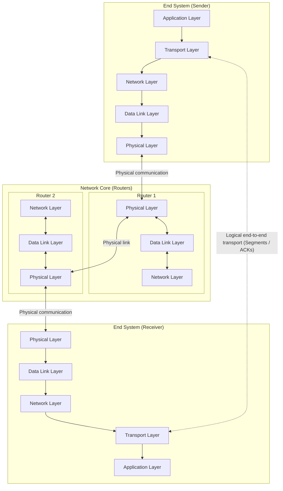

A crucial architectural distinction exists between **logical communication** and **physical communication**:

- **Physical communication** travels down the sender's protocol stack to the physical medium, traverses a series of intermediate switches and routers (which only process packets up to the link and network layers), and climbs up the receiver's stack.
- **Logical communication** at the transport layer makes it appear to application processes as if the two end systems are directly connected. Because intermediate routers do not implement the transport layer, **transport protocols run exclusively in the end systems**. The sending transport entity takes data from the application, encapsulates it with addressing and optional reliability metadata to form a **segment**, and sends the segment to its peer, optionally waiting for an acknowledgment (`ACK`) of receipt.

### 1.2 TCP vs. UDP Service Models

From an end-user perspective, applications typically care about three primary transport properties: **connection management**, **reliability** (guaranteed information arrival), and **timing** (such as bounded delay for streamed communication). The Internet offers two transport protocols with contrasting service models:

- **TCP (Transmission Control Protocol):**
  - **Connection-oriented service:** Requires connection setup (handshaking) between sender and receiver before data flows.
  - **Reliable transport:** Guarantees error-free, in-order delivery of a byte stream between the sending and receiving processes.
  - **Flow control:** Ensures the sender will not overwhelm the receiver by transmitting faster than the receiver can buffer and process.
  - **Congestion control:** Acts when the network is overloaded—an extra service benefiting both individual users and the overall network—by throttling the sender's rate.
  - **What TCP does NOT provide:** Timing guarantees or minimum bandwidth guarantees.

- **UDP (User Datagram Protocol):**
  - **Connectionless, best-effort delivery:** Acts like placing data in an envelope and relying entirely on IP for delivery (which may drop, reorder, or delay packets).
  - **What UDP does NOT provide:** Connection setup, reliability, flow control, congestion control, timing guarantees, or bandwidth guarantees.

### 1.3 Addressing, Multiplexing, and Demultiplexing

A single host simultaneously runs multiple network processes. Because the network layer only delivers datagrams to the destination host (via IP address), the transport layer is responsible for routing data to the specific application process within that host through **sockets**.

- **Multiplexing at the sending host:** Gathering data chunks from different application sockets, enveloping each data chunk with transport header information (including port numbers), and passing the resulting segments to the network layer.
- **Demultiplexing at the receiving host:** Examining the header fields of incoming segments and delivering the payload to the correct socket.

Every TCP and UDP segment begins with a 32-bit word containing two 16-bit port numbers:

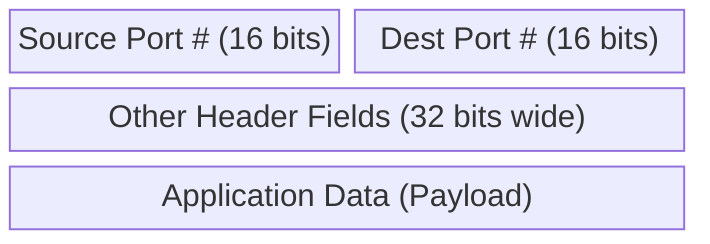

#### Connectionless Demultiplexing (UDP)

When a program creates a UDP socket, it binds the socket to a host-local 16-bit port number, for example:
`DatagramSocket mySocket1 = new DatagramSocket(12534);`

When creating a UDP datagram to send, the application must explicitly specify the **destination IP address** and **destination port number**. When a receiving host receives a UDP datagram, it inspects *only* the **destination port number** in the segment and directs the datagram to the socket bound to that port.

Consequently, **IP datagrams with the same destination IP address and destination port number, even if they originate from different source IP addresses and/or different source port numbers, will all be directed to the exact same UDP socket.**

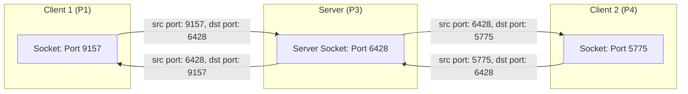

#### Connection-Oriented Demultiplexing (TCP)

In contrast to UDP, a TCP socket is uniquely identified by a **4-tuple**:
1. **Source IP address**
2. **Source port number**
3. **Destination IP address**
4. **Destination port number**

When a TCP segment arrives, the receiver uses **all four values** to direct the segment to the appropriate socket. A server host can therefore support many simultaneous TCP sockets bound to the exact same local port (such as port `80` for a web server):
- Each active connection gets its own dedicated socket identified by its unique 4-tuple.
- Web servers create distinct sockets for each connecting client process, and under non-persistent HTTP, they even create a different socket for each individual request.

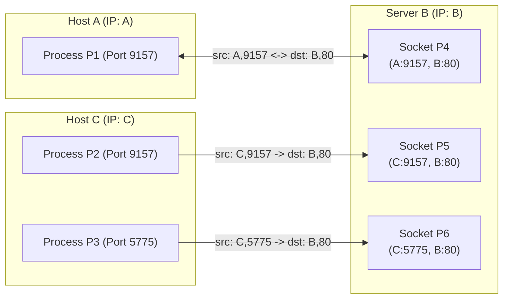

As shown above, three segments all destined to IP address `B` and destination port `80` are demultiplexed to three separate sockets (`P4`, `P5`, `P6`) because their source IP addresses or source port numbers differ.

---

## 2. Principles of Reliable Data Transfer and Pipelining

Reliable Data Transfer (RDT) is a top-10 networking topic fundamental to the application, transport, and link layers. While the transport layer presents a **reliable channel** abstraction to the application layer (invoked via `rdt_send()` at the sender and `deliver_data()` at the receiver), the underlying implementation must exchange packets across an **unreliable channel** (using `udt_send()` and `rdt_rcv()`) where packets may be corrupted, lost, or reordered. The characteristics of this unreliable channel determine the complexity of the RDT protocol.

### 2.1 Stop-and-Wait and Bandwidth Utilization

The traditional technique for providing reliability is **Positive Acknowledgment with Retransmission**, whose simplest form is **Stop-and-Wait**:
1. The sender transmits a single packet and starts a countdown timer.
2. The receiver sends an acknowledgment (`ACK`) when the data arrives intact.
3. The sender waits until the `ACK` arrives before sending the next packet; if the timer expires before the `ACK` arrives, the sender retransmits the packet.

While Stop-and-Wait achieves reliability, it suffers from abysmal **efficiency (bandwidth utilization)** over links with high bandwidth or long propagation delays.

#### Numerical Utilization Example

Consider a link with the following parameters:
- Link transmission rate: $R = 1\text{ Gbps} = 10^9\text{ bits/sec}$
- One-way propagation delay: $t_p = 15\text{ ms}$, giving a Round-Trip Time of $\text{RTT} = 2 \cdot t_p = 30\text{ ms}$
- Packet size: $L = 8000\text{ bits}$

First, compute the **transmission time** $D_{\text{trans}}$ required to push all bits of one packet into the channel:

$$D_{\text{trans}} = \frac{L}{R} = \frac{8000\text{ bits}}{10^9\text{ bits/sec}} = 8\text{ }\mu\text{s} = 0.008\text{ ms}$$

In Stop-and-Wait, the first bit is transmitted at $t = 0$, and the last bit leaves the sender at $t = L/R = 8\text{ }\mu\text{s}$. The last bit arrives at the receiver at $t = t_p + L/R$, at which point the receiver sends an `ACK` that arrives back at the sender at $t = \text{RTT} + L/R = 30.008\text{ ms}$.

The **sender utilization** $U_{\text{sender}}$—defined as the fraction of time the sender is actually busy transmitting bits into the channel—is:

$$U_{\text{sender}} = \frac{L / R}{\text{RTT} + L / R} = \frac{0.008\text{ ms}}{30.008\text{ ms}} \approx 0.00027 = 0.027\%$$

Thus, the sender uses only $0.027\%$ of the time to send a packet and remains completely silent for the remaining $99.973\%$ of the cycle waiting for the `ACK`.

### 2.2 Pipelined Protocols and Sliding Windows

To solve the low utilization problem of Stop-and-Wait, transport protocols use **pipelining** (also known as a **sliding window** protocol):
- The sender allows up to $N$ multiple "in-flight", yet-to-be-acknowledged segments simultaneously.
- **Optimal choice of window size $N$:** Ideally, $N$ should be large enough to allow the sender to transmit continuously throughout the entire round-trip transit time without stalling.
- **Error recovery:** Pipelining still requires acknowledgments and retransmissions. In case of an out-of-sequence error, a cumulative-ACK receiver acknowledges the **last correctly received in-order segment**.
- As acknowledgments arrive at the sender, the window of permissible sequence numbers **slides forward**.

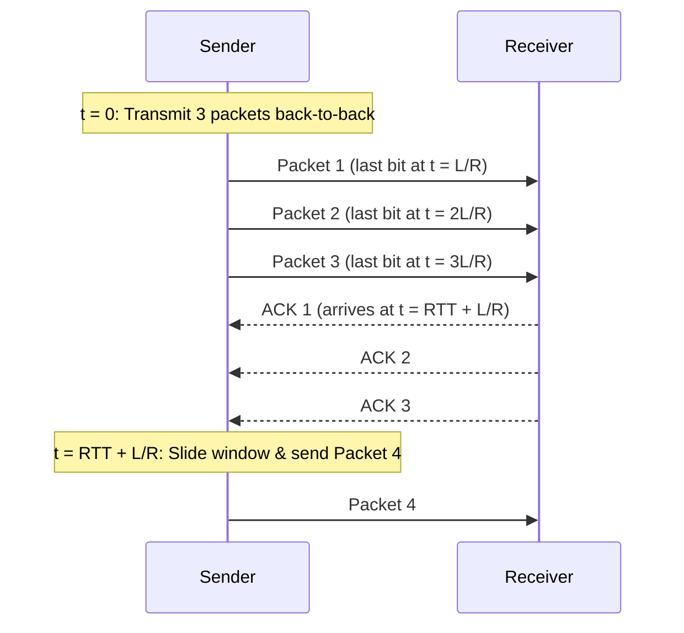

For a sliding window of size $N = 3$ on the same $1\text{ Gbps}$, $30\text{ ms}$ RTT link, the sender transmits $3$ packets per cycle, increasing utilization by a factor of $3$:

$$U_{\text{sender}} = \frac{3 \cdot (L / R)}{\text{RTT} + L / R} = \frac{0.024\text{ ms}}{30.008\text{ ms}} \approx 0.08\%$$

### 2.3 TCP Byte-Stream Sliding Window

TCP implements its sliding window over a continuous stream of **byte positions** rather than discrete packet numbers. At any instant, the sender's byte sequence space is partitioned into four regions relative to the current window of size $N$:

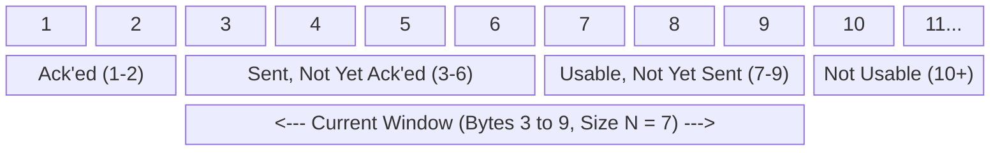

1. **Already acknowledged (e.g., Bytes 1–2):** Bytes below `send_base` that have been sent and cumulatively acknowledged by the receiver.
2. **Sent, not yet acknowledged (e.g., Bytes 3–6):** In-flight bytes starting at `send_base` up to `nextseqnum - 1` for which the sender is awaiting an `ACK`.
3. **Usable, not yet sent (e.g., Bytes 7–9):** Bytes starting at `nextseqnum` that fall within the current window and can be transmitted immediately as soon as the application provides data.
4. **Outside the window / Not usable (e.g., Bytes 10+):** Bytes beyond the upper edge of the current window (`send_base + N`) that cannot be sent until the window slides forward upon receipt of new acknowledgments.

### 2.4 Round-Trip Time Estimation and Timeout Calculation

To know when to retransmit a lost segment, TCP must set its **Retransmission Timeout (`TimeoutInterval`)** appropriately:
- If the timeout is too short, TCP triggers premature timeouts and unnecessary retransmissions.
- If the timeout is too long, TCP reacts too slowly to segment loss.

Because end-to-end queuing delays fluctuate across the Internet, TCP continuously measures `SampleRTT` (the time from when an un-retransmitted segment is sent until its `ACK` arrives) and smooths these measurements using an **Exponentially Weighted Moving Average (EWMA)** where the influence of past samples decays exponentially fast:

$$\text{EstimatedRTT} = (1 - \alpha) \cdot \text{EstimatedRTT} + \alpha \cdot \text{SampleRTT}$$

The typical recommended value is $\alpha = 0.125$ ($\frac{1}{8}$), so $\text{EstimatedRTT} = 0.875 \cdot \text{EstimatedRTT} + 0.125 \cdot \text{SampleRTT}$.

To account for jitter (large variations in RTT require a larger safety margin), TCP also tracks the RTT deviation `DevRTT`, defined as an EWMA of the absolute difference between `SampleRTT` and `EstimatedRTT`:

$$\text{DevRTT} = (1 - \beta) \cdot \text{DevRTT} + \beta \cdot |\text{SampleRTT} - \text{EstimatedRTT}|$$

The typical recommended value is $\beta = 0.25$ ($\frac{1}{4}$). The retransmission timeout interval is then set to `EstimatedRTT` plus a safety margin of four times `DevRTT`:

$$\text{TimeoutInterval} = \text{EstimatedRTT} + 4 \cdot \text{DevRTT}$$

#### Worked Example: RTT Estimation from a Packet Trace

Consider a packet trace between client `192.168.86.68` (port `55639`) and server `128.119.245.12` (port `80`):
- **Packet 4 ($t = 0.024047\text{ s}$):** Client sends data segment `Seq=1, Ack=1, Len=1448`.
- **Packet 5 ($t = 0.024048\text{ s}$):** Client sends data segment `Seq=1449, Ack=1, Len=1448`.
- **Packet 7 ($t = 0.052671\text{ s}$):** Server sends `ACK` for Packet 4 (`Ack=1449`).
- **Packet 8 ($t = 0.052676\text{ s}$):** Server sends `ACK` for Packet 5 (`Ack=2897`).

1. **Initialization (after 1st packet is ACKed at $t = 0.052671\text{ s}$):**
   Because no prior `EstimatedRTT` exists at the start of the connection, `EstimatedRTT` is initialized directly to the first `SampleRTT`:
   $$\text{SampleRTT}_1 = 0.052671 - 0.024047 = 0.028624\text{ s}$$
   $$\text{EstimatedRTT}_1 = 0.875 \cdot 0.028624 + 0.125 \cdot (0.052671 - 0.024047) = 0.028624\text{ s}$$

2. **Update (after 2nd packet is ACKed at $t = 0.052676\text{ s}$):**
   $$\text{SampleRTT}_2 = 0.052676 - 0.024048 = 0.028628\text{ s}$$
   $$\text{EstimatedRTT}_2 = 0.875 \cdot 0.028624 + 0.125 \cdot (0.052676 - 0.024048) = 0.0286245\text{ s}$$

This update process repeats for each newly acknowledged segment.

### 2.5 TCP Flow Control

Besides reliability, acknowledgments in TCP enable **flow control**: preventing a fast sender from swamping a slow receiver's finite buffer memory.

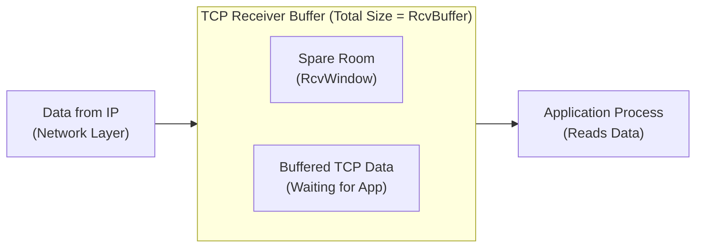

- The receiver allocates a receive buffer of total size `RcvBuffer`. As segments arrive from IP, they are placed in `RcvBuffer` until the application process reads them.
- The amount of free, spare room remaining in the buffer is called `RcvWindow`.
- **Dynamic sliding window:** The receiver explicitly informs the sender of its dynamically changing free buffer space by placing the current value of `RcvWindow` in the Window field of every outgoing TCP segment header.
- The sender constrains the amount of transmitted, unacknowledged data (`LastByteSent - LastByteAcked`) to remain strictly less than or equal to the most recently received `RcvWindow`, ensuring it never overruns the receiver's buffer.

---

## 3. Principles of Congestion Control and Classical TCP

### 3.1 Causes, Consequences, and Goals of Congestion Control

**Network congestion** occurs when the aggregate demand for network resources (such as link bandwidth, router buffer memory, and processing capacity) surpasses what the network can provide. Informally, it means *"too many sources sending too much data too fast for the network to handle."*

It is essential to distinguish **flow control** from **congestion control**:
- **Flow control** is a point-to-point issue: *one sender* transmitting too fast for *one specific receiver's buffer*.
- **Congestion control** is a shared-network issue: *too many senders* transmitting too fast for the *routers and links inside the network core*.

#### Consequences of Unchecked Congestion
1. **Increased Latency:** As congestion builds, packets spend long periods waiting in router queues (queueing delay), increasing end-to-end latency.
2. **Packet Loss:** When router memory buffers overflow, routers drop incoming packets.
3. **Reduced Throughput:** Dropped packets must be retransmitted, wasting link capacity and reducing useful data transfer rates (goodput).
4. **Degraded User Experience:** Slow-loading websites, buffering video streams, and sluggish response times for interactive applications.

#### Goals of Congestion Control
1. **Preventing Collapse:** Regulate data flow to avoid overwhelming routers and prevent **congestion collapse** (a state where the network is saturated with retransmissions and delivers minimal useful data).
2. **Fair Resource Sharing:** Ensure a fair distribution of bottleneck bandwidth among competing users, applications, and connections.
3. **Ensuring Quality of Service (QoS):** Uphold minimum performance levels (bandwidth, low latency, reliable delivery).
4. **Enhancing User Experience:** Maintain smooth, responsive application performance.

### 3.2 End-to-End Feedback and the AIMD Control Law

In classical TCP, congestion control operates **end-to-end** without explicit assistance from network routers. The network acts as a black box whose internal congestion state is inferred through an **alarm flag observable at the end stations**—specifically, via packet acknowledgments returned every $\text{RTT}$:
- **Smoothly arriving ACKs** indicate low congestion, prompting the sender to **increase** its sending rate (larger congestion window `CWND`).
- **Missing ACKs (timeouts) or duplicate ACKs** indicate high congestion (buffer overflow), prompting the sender to **decrease** its sending rate (smaller `CWND`).

The TCP sender limits its transmission by maintaining a **Congestion Window (`CWND`)**, which represents the maximum number of unacknowledged bytes or segments that the sender can have in transit at any given time. If a sender transmits $w$ segments of size $\text{MSS}$ bytes in one $\text{RTT}$ ($\text{CWND} = w \cdot \text{MSS}$), its approximate throughput is:

$$\text{Throughput} = \frac{\text{CWND}}{\text{RTT}} = \frac{w \cdot \text{MSS}}{\text{RTT}}\text{ bytes/sec}$$

#### Why AIMD? Comparing Window Update Schemes

To understand why TCP uses **Additive Increase, Multiplicative Decrease (AIMD)**—pioneered by Dah-Ming Chiu and Raj Jain (1989) and incorporated into TCP by Van Jacobson (1988)—consider the performance and fairness properties of pure multiplicative vs. pure additive updates:

1. **Pure Multiplicative Update (MI/MD):**
   - *No congestion:* $\text{CWND}_{\text{new}} = 2 \cdot \text{CWND}_{\text{old}}$
   - *Congestion:* $\text{CWND}_{\text{new}} = \frac{\text{CWND}_{\text{old}}}{2}$
   - *Evaluation:* Provides a **fast response**, but is **unfair**. Multiplying or dividing both flows by $2$ leaves the **ratio** of their bandwidth shares completely unchanged; a flow that starts with more bandwidth permanently dominates.

2. **Pure Additive Update (AI/AD):**
   - *No congestion:* $\text{CWND}_{\text{new}} = \text{CWND}_{\text{old}} + 1$
   - *Congestion:* $\text{CWND}_{\text{new}} = \text{CWND}_{\text{old}} - 1$
   - *Evaluation:* Divides spare bandwidth equally, but exhibits a **slow response** during overload and **unfairness**: adding and subtracting a constant leaves the **absolute difference** between two flows' rates unchanged.

3. **AIMD Scheme (Additive Increase, Multiplicative Decrease):**
   - **Additive Increase ($\text{CWND}_{\text{new}} = \text{CWND}_{\text{old}} + 1\text{ MSS}$ per RTT):** Gradually probes for spare bandwidth. Because both competing flows increase by the same constant amount, the **ratio** between their rates improves toward $1:1$ (fairness improves).
   - **Multiplicative Decrease ($\text{CWND}_{\text{new}} = \frac{\text{CWND}_{\text{old}}}{2}$ on loss):** Provides a **fast response** to overload. Although halving preserves the ratio momentarily, **connections that are overusing resources lose a larger absolute amount of bandwidth** during multiplicative decreases, allowing connections using less than their fair share to catch up during the subsequent additive increase phase.

This produces the classic **AIMD sawtooth behavior**, continually probing for available bandwidth until loss occurs and backing off by half.

#### Geometric Convergence of Two Users Sharing One Bottleneck Link

Chiu and Jain (1989) proved that AIMD converges to an **efficient and fair** operating point using a 2D phase-plane vector diagram where the X-axis represents the transmission rate of User 1 ($x_1$) and the Y-axis represents the transmission rate of User 2 ($x_2$) sharing a link of capacity $C$:

- **Efficiency line ($x_1 + x_2 = C$):** Any point below this negatively sloped line underutilizes the link; any point above it exceeds the link's bandwidth limit (causing packet drops).
- **Fairness line ($x_1 = x_2$):** The $45^\circ$ diagonal line where both users receive an equal share of the link.
- **Trajectory:** Starting from an unfair point (e.g., $x_1 < x_2$), **Additive Increase** moves the system along a $45^\circ$ vector $(+\Delta, +\Delta)$ parallel to the fairness line until total throughput crosses the bandwidth limit $x_1 + x_2 > C$. Upon congestion, **Multiplicative Decrease** pulls the operating point halfway back toward the origin $(0,0)$ along the radial line connecting the current point to the origin: $(x_1, x_2) \to (\frac{x_1}{2}, \frac{x_2}{2})$. Repeated cycles of $45^\circ$ up-and-right increases followed by radial-to-origin halvings force the trajectory to oscillate tightly around the intersection of the **Fairness line** and the **Bandwidth limit** $(\frac{C}{2}, \frac{C}{2})$.

### 3.3 TCP Slow Start and Congestion Avoidance (TCP Tahoe)

Designed by Van Jacobson in 1988, classical TCP congestion control has scaled across a $>200,000\times$ increase in Internet bandwidth by combining two distinct phases governed by a state variable called the **Slow Start Threshold (`ssthresh`)**:

1. **Initialization — Slow Start / Mild Increase (MI):**
   When a connection begins, `CWND` is initialized to $1\text{ MSS}$. Because starting with additive increase would take too long to reach high speeds, TCP increases `CWND` by $1\text{ MSS}$ for **every single ACK received**:
   ```text
   initialize: CWND = 1
   for (each segment ACKed)
       CWND++
   until (congestion event OR CWND > ssthresh)
   ```
   This results in an **exponential increase per RTT** (e.g., $1 \to 2 \to 4 \to 8 \to 16\text{ segments}$, or $6 \to 12 \to 24$ in modern stacks with a larger initial window)—so Slow Start is actually *not slow at all*.

2. **Steady State — Congestion Avoidance (AIMD):**
   Once $\text{CWND} \ge \text{ssthresh}$, TCP transitions from Slow Start to **Congestion Avoidance**, increasing `CWND` additively by only $1\text{ MSS}$ **per entire RTT** (roughly $\text{CWND} \leftarrow \text{CWND} + \frac{\text{MSS}^2}{\text{CWND}}$ on each arriving ACK).

> **Terminology Note on Slide Pseudocode:** The lecture slide titled *"TCP Taheo Congestion Avoidance"* writes the loop body inside Congestion Avoidance as `every ACK: CWND++` while simultaneously plotting a graph where `CWND` increases by $1$ segment **per transmission round (RTT)** (rising linearly from $8 \to 9 \to 10 \to 11 \to 12$ across rounds $3$ to $7$). Keep this distinction clear for exams: incrementing `CWND` by $1$ on *every individual ACK* doubles `CWND` each RTT (Slow Start), whereas during **Congestion Avoidance**, `CWND` increases by $1\text{ MSS}$ **per RTT** (i.e., once every full window of ACKs).

#### TCP Tahoe Behavior on Loss

In **TCP Tahoe** (4.3BSD Tahoe, 1988), whenever a loss event occurs—whether detected via a **timeout** or via **three duplicate ACKs (Fast Retransmit)**—Tahoe performs the following reset:
1. Sets $\text{ssthresh} = \frac{\text{CWND}}{2}$.
2. Resets $\text{CWND} = 1\text{ MSS}$.
3. Re-enters the **Slow Start** phase, growing exponentially until reaching the new `ssthresh`, and then switches back to linear Congestion Avoidance.

For example, if `ssthresh` starts at $8$, `CWND` grows exponentially in Slow Start during rounds $0 \to 3$ ($1 \to 2 \to 4 \to 8$), then grows linearly in Congestion Avoidance during rounds $3 \to 7$ ($8 \to 9 \to 10 \to 11 \to 12$). If a loss occurs at $\text{CWND} = 12$ (round $7$), Tahoe sets $\text{ssthresh} = \frac{12}{2} = 6$, drops $\text{CWND}$ to $1$ at round $8$, grows exponentially ($1 \to 2 \to 4 \to 6$) up to round $11$, and then grows linearly ($6 \to 7 \to 8 \to 9$) from round $11$ onward.

### 3.4 Fast Retransmit and Fast Recovery (TCP Reno)

#### Fast Retransmit

Waiting for a retransmission timeout (RTO) introduces a long idle delay before resending a lost packet. However, because a pipelined sender transmits many segments back-to-back, if a single segment in the middle of a window is lost, subsequent segments with higher sequence numbers will still arrive at the receiver.

In TCP, whenever a receiver receives an out-of-order segment with a sequence number higher than the next expected in-order byte, it immediately sends a **duplicate ACK** repeating the byte number it is still waiting for.

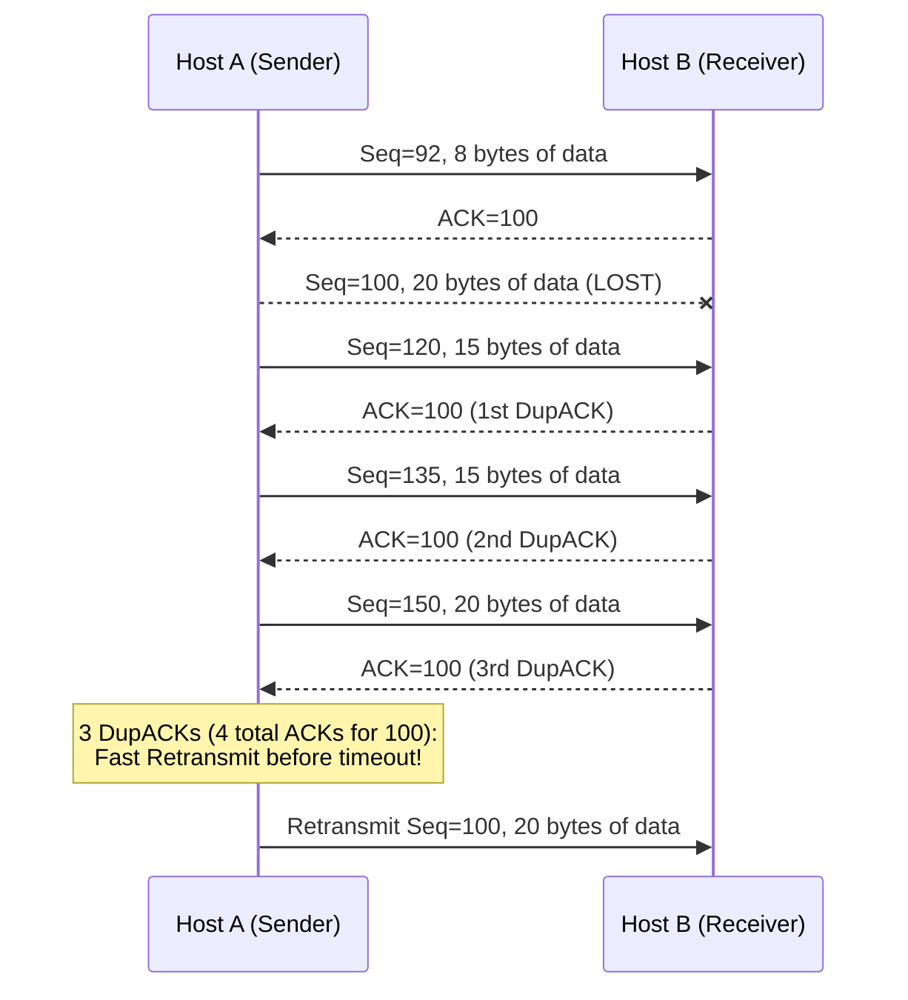

- **Rule:** If the sender receives **3 duplicate ACKs** for the same data (meaning 4 identical ACKs in total: the original ACK plus 3 duplicates), it assumes the segment immediately following the ACKed data was lost and triggers **Fast Retransmit**, resending the missing segment immediately before the retransmission timer expires.
- **Why wait for 3 duplicate ACKs instead of 1 or 2?** Packets in an IP network can be slightly **reordered** in flight without being lost. A single out-of-order packet swap produces 1 or 2 duplicate ACKs; waiting for 3 duplicate ACKs distinguishes genuine packet loss from minor packet reordering.

#### Fast Recovery (TCP Reno)

In **TCP Reno** (1990), the receipt of 3 duplicate ACKs is treated as a milder congestion signal than a timeout: the fact that 3 duplicate ACKs arrived proves that segments are still flowing through the network! Therefore, instead of resetting $\text{CWND} = 1$ and entering Slow Start (like Tahoe), Reno uses **Fast Recovery** to keep the pipe full:

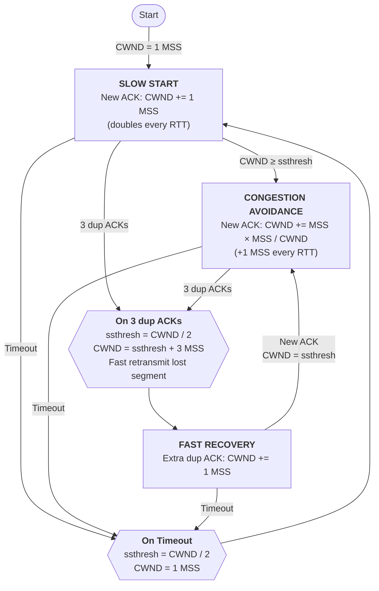

The exact steps of **Fast Recovery** upon receiving 3 duplicate ACKs are:
1. **Halve threshold:** Set $\text{ssthresh} = \frac{\text{CWND}}{2}$.
2. **Inflate CWND by 3:** Set $\text{CWND} = \text{ssthresh} + 3\text{ MSS}$. Why $+3$? Because the 3 duplicate ACKs imply that 3 out-of-order segments have already left the network and are buffered at the receiver, so inflating `CWND` by 3 accounts for those segments and prevents the sender from reducing its window too aggressively.
3. **Increment on additional DupACKs:** For each additional duplicate ACK received while in Fast Recovery, increment $\text{CWND} \leftarrow \text{CWND} + 1\text{ MSS}$ (reflecting that one more packet has left the network pipe), and transmit a new segment if allowed by the inflated window.
4. **Deflate on New ACK:** When a new (non-duplicate) ACK finally arrives acknowledging the retransmitted segment (and all buffered out-of-order segments), set $\text{CWND} = \text{ssthresh}$ and return directly to the **Congestion Avoidance** phase, completely bypassing Slow Start.

For example, in the textbook trace (slide 66), `ssthresh` is initially $28$. `CWND` grows exponentially in Slow Start from $1$ to $28$ (at $\text{RTT} = 5$), then grows linearly in Congestion Avoidance up to $\text{CWND} = 36$ (at $\text{RTT} = 13$), where 3 duplicate ACKs arrive. Reno sets $\text{ssthresh}_{\text{new}} = \frac{36}{2} = 18$, sets $\text{CWND}_{\text{new}} = 18 + 3 = 21$ (at $\text{RTT} = 14$), increments `CWND` to $23$ as two more DupACKs arrive (at $\text{RTT} = 16$), and upon receiving the ACK for the retransmitted segment at $\text{RTT} = 17$, deflates $\text{CWND} = \text{ssthresh}_{\text{new}} = 18$ and resumes linear Congestion Avoidance.

#### Summary of Differences: Fast Retransmit vs. Fast Recovery
- **Objective:** Fast Retransmit aims to quickly retransmit a lost packet detected via 3 duplicate ACKs without waiting for RTO. Fast Recovery aims to manage and adjust `CWND` after Fast Retransmit to maintain data flow and adapt to network conditions without dropping `CWND` to $1$.
- **Timing:** Fast Retransmit triggers *immediately* upon the 3rd duplicate ACK. Fast Recovery *follows* Fast Retransmit and governs window size until a new cumulative ACK arrives.
- **Impact on `CWND`:** Fast Retransmit itself is the retransmission action and does not directly govern the window trajectory; Fast Recovery halves `CWND` (plus $3\text{ MSS}$), inflates it per DupACK, and deflates it to `ssthresh` upon recovery.

### 3.5 Classical TCP Variants and Early Evolution †

*Note: While TCP Tahoe, Reno, SACK, CUBIC, Vegas, and ECN are introduced in visible slides, the detailed comparison slides and timeline below come from archived slides at the end of the presentation and are preserved here as supplementary reference material.*

#### Comparing Tahoe, Reno, NewReno, SACK, and Westwood †
- **Out-of-order buffering in Tahoe and Reno:** In both TCP Tahoe and TCP Reno, the receiver buffers out-of-order segments that fall within the receive window. When the missing segment is finally received via Fast Retransmit, the receiver sends a single **cumulative ACK** covering the missing segment and all contiguous buffered segments.
- **Reno vs. NewReno:** Standard TCP Reno exits Fast Recovery upon the first new ACK. If *multiple* packets were lost from a single window of data, Reno only recovers one lost packet per Fast Recovery cycle and can be forced into multiple halvings or a timeout. **TCP NewReno** (1996) modifies Fast Recovery to handle multiple packet losses within a single window (transmitting/recovering multiple lost packets before exiting Fast Recovery), reducing slowdowns and improving bandwidth utilization.
- **TCP SACK (Selective Acknowledgment, 1996):** Allows the receiver to explicitly list non-contiguous blocks of data that have arrived safely so the sender only retransmits the exact missing holes. **FACK (Forward Acknowledgment, 1996)** by Mathis et al. extended SACK to track the highest forward sequence number held at the receiver.
- **TCP Vegas (1993, Brakmo et al.):** Rather than waiting for packet loss, Vegas monitors variations in $\text{RTT}$. If the measured $\text{RTT}$ increases above the minimum baseline (indicating a building router queue), Vegas proactively decreases its sending rate before any packets are dropped, minimizing queueing delay. However, Vegas is not widely deployed because it loses bandwidth share when competing against loss-based flows that deliberately fill buffers.
- **TCP Westwood:** Estimates available bottleneck bandwidth by monitoring the arrival rate of returning `ACK` packets and uses that estimate to set `ssthresh` and `CWND` after a loss event, optimizing performance over high-speed, long-distance, or lossy wireless links.

#### Historical Timeline of Classical TCP Evolution (1974–1996) †
- **1974:** TCP first described by Vint Cerf and Bob Kahn in *IEEE Transactions on Communications*.
- **1975:** Three-way handshake introduced by Ray Tomlinson in *SIGCOMM '75*.
- **1981:** TCP and IP standardized in **RFC 793** and **RFC 791**.
- **1983:** BSD Unix 4.2 ships with built-in TCP/IP support.
- **1984:** John Nagle introduces **Nagle's algorithm** to reduce the overhead of small packets ("tinygrams") and predicts the danger of congestion collapse.
- **1986:** **Congestion collapse** is first observed on the operational Internet (throughput on links dropped by orders of magnitude due to uncontrolled retransmissions).
- **1987:** Phil Karn introduces **Karn's algorithm** to unambiguous RTT estimation (ignoring RTT samples from retransmitted segments and backing off the timer).
- **1988:** Van Jacobson publishes **Slow Start, Congestion Avoidance, and Fast Retransmit** in *SIGCOMM '88*, implemented in **4.3BSD Tahoe**.
- **1990:** **4.3BSD Reno** adds **Fast Recovery** and delayed ACKs.
- **1993:** **TCP Vegas** (Brakmo et al.) proposes delay-based congestion avoidance.
- **1994:** Sally Floyd proposes **Explicit Congestion Notification (ECN)**; Bob Braden proposes **T/TCP** (Transaction TCP).
- **1996:** **NewReno** (modified Fast Recovery), **SACK TCP** (Floyd et al.), startup improvements (Janey Hoe), and **FACK TCP** (Mathis et al.).

---

## 4. Modern Transport Evolution: Beyond Loss-Based Control

The classical textbook story of TCP congestion control ends around 1996 with Tahoe, Reno, NewReno, and SACK. Over the subsequent thirty years, congestion control stopped being a "solved problem" and became an active battleground driven by six major developments:
1. **CUBIC** becoming the default loss-based algorithm in Linux and web servers.
2. **Bufferbloat** exposing a fundamental flaw in loss-based congestion control.
3. **Active Queue Management (AQM)** such as CoDel and FQ-CoDel moving queue control into routers.
4. **BBR** replacing loss-based reaction with path-capacity modeling.
5. **ECN and L4S** redesigning network congestion signaling for near-zero queueing delay.
6. **QUIC** moving transport and congestion control out of the OS kernel and into application userspace.

#### TCP CUBIC

**TCP CUBIC** replaced Reno/NewReno as the default congestion control algorithm in Linux and the most popular TCP variant on web servers. Instead of Reno's linear additive increase, CUBIC adjusts `CWND` using a **cubic function of time** elapsed since the last loss event:

$$\text{CWND}(t) \propto (t - K)^3 + W_{\max}$$

where $W_{\max}$ is the window size just before the previous loss occurred, and $K$ is the time period required for the window to grow back to $W_{\max}$ in the absence of further loss:
- When `CWND` is far below $W_{\max}$ (early after a loss) or far above $W_{\max}$ (probing for new bandwidth), the cubic curve is steep, yielding a **large increase**.
- When `CWND` is **near $W_{\max}$** (around time $t \approx K$), the cubic curve flattens into a plateau, yielding a **very small increase** so the sender hovers stably near the bottleneck's previous capacity without immediately triggering another packet drop.

*(Note: Slide 82 contains a typo in its bullet text—"Large increase when near K, small increase near K"—which contradicts its accompanying graph; as shown in the slide's plot of $W_{\max}$ across times $t_0 \dots t_4$, CUBIC grows rapidly right after loss, flattens into a small increase near the $W_{\max}$ plateau at $K$, and accelerates again past $K$ if no loss occurs.)*

### 4.1 Bufferbloat and Active Queue Management (CoDel & FQ-CoDel)

#### The Bufferbloat Problem

Loss-based congestion control algorithms (Tahoe, Reno, NewReno, CUBIC) share a structural flaw: **they only know a link is full when a packet is dropped, which means they deliberately fill whatever router buffer they find.**

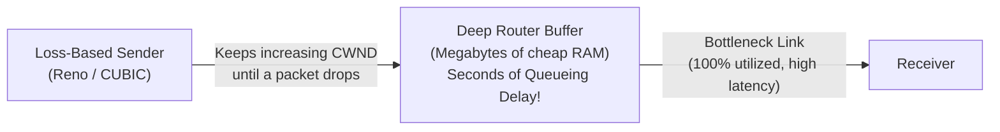

As memory became cheap, router and switch manufacturers installed **deep buffers**. When a loss-based TCP flow traverses a router with a massive buffer, it continues increasing `CWND` until that entire buffer is full before experiencing a single drop. The result is **bufferbloat**:
- **Throughput stays fine** (the bottleneck link is $100\%$ utilized).
- **Latency collapses:** Packets sit in router queues for hundreds of milliseconds or even **seconds** of queueing delay, ruining interactive applications like voice calls, gaming, and web browsing.
- *Lesson:* More memory made the Internet slower, even though the TCP protocol was working exactly as designed.

#### Active Queue Management (AQM): Managing the Queue Instead

Because loss-based endpoints cannot detect that they are filling a deep buffer until it overflows, the buffer itself must intervene. **Active Queue Management (AQM)** moves the fix from the endpoint to the middle of the network:

1. **CoDel (Controlled Delay):** Instead of dropping packets based on *how many* packets are in the queue (queue length), CoDel tracks **sojourn time**—*how long* packets have been sitting in the queue. When minimum queueing delay exceeds a target threshold over an interval, CoDel begins dropping (or ECN-marking) packets to signal the sender to back off while the queue is still short.
2. **FQ-CoDel (Flow Queue CoDel):** Combines CoDel with **per-flow queueing**. Each network flow gets its own separate sub-queue scheduled fairly, ensuring that a single bulk file transfer cannot build a standing queue that starves or delays an interactive flow (such as SSH, DNS, or VoIP).

### 4.2 Model-Based Congestion Control: BBR and BBRv3

#### Asking a Different Question

Developed by Google, **BBR (Bottleneck Bandwidth and Round-trip propagation time)** abandons the loss-based paradigm entirely:
- **Loss-based CC asks:** *"Has something been dropped yet?"* (Reacting to failure after filling the queue.)
- **BBR asks:** *"What is the bottleneck bandwidth ($B_{\text{tlBw}}$), and what is the minimum propagation RTT ($\text{RT}_{\text{prop}}$)?"*

Instead of increasing `CWND` until buffers overflow, BBR continuously measures the maximum delivery rate and minimum RTT to build an explicit **model of the network path**. It then paces packets at the estimated bottleneck bandwidth and caps in-flight data near the **Bandwidth-Delay Product ($\text{BDP} = B_{\text{tlBw}} \times \text{RT}_{\text{prop}}$)**, aiming to keep the bottleneck link $100\%$ utilized while **not filling the router queue at all**.

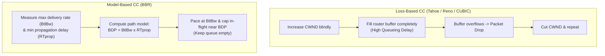

#### BBR's Standardization Status and Fairness Controversy

- **Standardization status:** As of July 2026, **BBRv3** is specified in IETF draft `draft-ietf-ccwg-bbr` (revision 06). Despite being widely deployed across Google's production infrastructure for nine years and three major versions, BBR remains an **Experimental** draft rather than a finalized standard—demonstrating that *"widely deployed"* and *"not yet standardised"* are compatible states on the modern Internet. Notably, the BBRv3 draft specifies **no ECN response**, which remains an active open question in the working group rather than an oversight.
- **Does BBR play fair?** Google designed BBRv3 to fix fairness issues observed in BBRv1 and BBRv2. However, an independent empirical evaluation presented at **PAM 2024** (by researchers at MPI-INF and VU Amsterdam) tested this claim and found:
  1. **Unfairness toward CUBIC in shallow buffers:** BBRv3 retains BBRv1-like aggressiveness when competing against CUBIC in routers with shallow buffers, starving CUBIC flows.
  2. **RTT bias:** A persistent bias favoring **long-RTT flows** over short-RTT flows remains.
  - *Takeaway:* Measured empirical behavior contradicts the optimistic deployment narrative.

### 4.3 Explicit Congestion Notification (ECN) and L4S

#### Classical ECN

First proposed by Sally Floyd in 1994, **Explicit Congestion Notification (ECN)** allows routers to signal impending congestion *before* buffers overflow and packets are dropped:

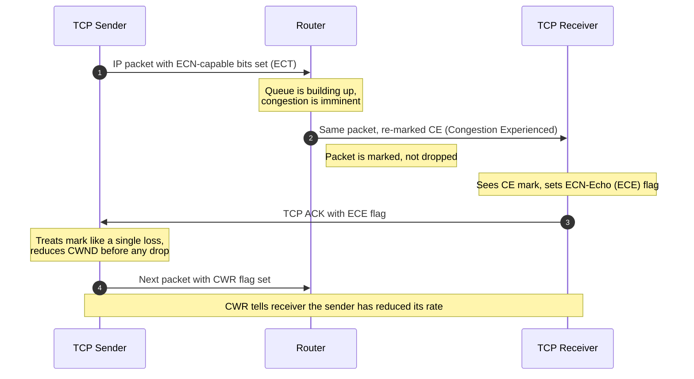

1. **ECN Bits in IP Header:** The sender marks two ECN bits in the IP header to indicate that the transport endpoints are ECN-capable.
2. **Router Marking:** When a router experiences building congestion, it sets the ECN bits in the IP header to "Congestion Experienced" (`CE`) instead of dropping the packet.
3. **Receiver Notification:** When the marked packet arrives at the receiver, the TCP receiver reliably informs the TCP sender of the congestion via flags in the returning TCP `ACK` header.
4. **Sender Response:** The TCP sender reacts proactively—treating the ECN mark like a single packet loss and cutting its sending rate before any actual packet drop occurs.

#### L4S: Low Latency, Low Loss, Scalable Throughput

While classical ECN avoided packet drops, classical TCP still reacted to an ECN mark by cutting `CWND` drastically (e.g., by half or $30\%$), requiring a substantial buffer to avoid underutilizing the link. Standardized in **RFC 9330, RFC 9331, and RFC 9332**, **L4S (Low Latency, Low Loss, Scalable Throughput)** redesigns congestion signaling from the ground up to support real-time interactive applications (cloud gaming, video conferencing, VR):

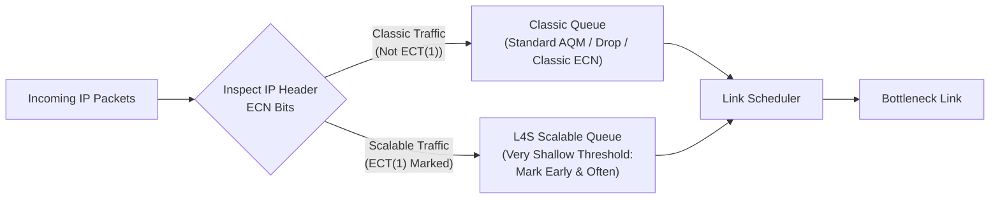

- **Dual-Queue Architecture:** L4S routers maintain **two separate queues** isolated from one another: one for **classic traffic** (Reno/CUBIC) and one for **scalable traffic** (such as TCP Prague or L4S-enabled QUIC), separated by the **`ECT(1)`** codepoint marking in the IP header.
- **Mark early and often:** In the L4S queue, the router marks packets with ECN **early and frequently** as soon as a tiny queue begins to form. Scalable senders adjust their sending rate in fine-grained steps proportional to the fraction of marked packets, reacting *before* any significant queue builds.

#### Real-World Deployment and Empirical Performance of L4S

Unlike some IETF standards that remain unused on paper (such as ASPA in routing security), **L4S is actively deployed in consumer networks today**:
- **Comcast** has rolled out L4S across its production broadband network.
- **Apple** enabled L4S support across its operating systems starting with **iOS 17** and **macOS Sonoma**.

**What do honest measurements show?** A **March 2026 field study** across **83 households** comprising roughly **120,000 controlled experiments** evaluated L4S in the wild:
- **Up to $\sim 25\%$ tail-latency reduction** for interactive traffic.
- **Bounded, situational gains:** Minimal gains were observed for some workloads, with benefits concentrated primarily during **peak usage hours** when access links experience contention. Thus, L4S represents a real, measurable engineering improvement, but one that is bounded and situational rather than a universal panacea.

### 4.4 Userspace Transport: QUIC

Historically, TCP congestion control lived inside the **operating system kernel**. Changing or updating a TCP algorithm required updating the OS kernel on servers and client devices—a process that took years or decades.

**QUIC** is a modern transport protocol that runs **on top of UDP in application userspace** (forming the transport foundation of HTTP/3):
- **Deployment velocity:** Because QUIC runs in userspace, the transport protocol and its congestion control algorithm ship directly inside the application binary (such as a web browser or mobile app). An application developer can update the congestion control algorithm with a routine app update without waiting for OS kernel upgrades.
- **Trade-off — Fragmentation:** While deployment velocity increases dramatically, moving congestion control to userspace also increases **fragmentation across implementations**. Instead of a few standardized OS kernel TCP stacks, every browser, CDN, and application vendor maintains its own independent QUIC stack and congestion control tuning. *Who controls the algorithm determines how fast it can change.*

### 4.5 Fundamental Failure Modes of TCP Congestion Control

Even with decades of refinement, end-to-end congestion control faces fundamental structural limitations:

1. **Inability to distinguish congestion loss from non-congestion (wireless) loss:**
   A loss-based TCP sender cannot tell whether a packet was dropped because a router buffer overflowed or because of bit errors/interference on a **wireless link**. TCP backs off and cuts `CWND` either way, needlessly throttling throughput over noisy wireless channels.
2. **Adverse equilibria between competing algorithms:**
   When heterogeneous algorithms (such as Reno, CUBIC, Vegas, and BBR) share the same bottleneck link, their differing control laws interact to reach an equilibrium that **neither algorithm would choose alone** (for instance, loss-based flows starving delay-based Vegas flows, or BBR starving CUBIC in shallow buffers).
3. **Route flaps invalidating RTT estimators:**
   TCP's EWMA timeout estimator (`EstimatedRTT` and `DevRTT`) and delay-based controllers are built on the assumption that the underlying physical path's propagation delay is relatively stable. When a **route flap** suddenly switches packets onto a longer or shorter path, the RTT shifts abruptly underneath an estimator that assumes stability, triggering spurious timeouts or miscalibrated sending rates.
4. **Stability vs. Optimality:**
   *Convergence to a stable state is not convergence to a good one.*

---

## 5. Study Resources and Review Questions

### 5.1 Interactive Animations and Exercises

The following Kurose & Ross interactive exercises and animations reinforce the mechanisms covered in this guide:
- **Interactive Exercises:** [Kurose & Ross Interactive Problems](http://gaia.cs.umass.edu/kurose_ross/interactive/)
  - TCP sequence and ACK numbers with segment loss
  - TCP RTT and timeout (`EstimatedRTT`, `DevRTT`, `TimeoutInterval`)
  - TCP congestion window evolution
  - TCP retransmissions (reliable data transmission with ACK loss)
- **Interactive Animations:** [TCP Congestion Control (Tahoe/Reno) Animation](https://media.pearsoncmg.com/ph/esm/ecs_kurose_compnetwork_8/cw/content/interactiveanimations/tcp-congestion/index.html) (along with Go-Back-N, Selective Repeat, and Flow Control animations).

### 5.2 Review Questions †

*The following review questions appear on archived slides at the end of the presentation and serve as self-test problems for deeper understanding:*

1. **Finite Sequence Number Space:** TCP uses a finite (32-bit) header field to contain byte-stream sequence numbers. How does the protocol specification allow an arbitrary-length byte stream to pass from one machine to another without ambiguity when sequence numbers wrap around?
2. **Unnecessary Retransmissions:** Under what conditions of delay, bandwidth, load, and packet loss will TCP retransmit significant volumes of data unnecessarily?
3. **Lost Acknowledgments:** A lost TCP acknowledgment does not necessarily force a packet retransmission. Explain why (hint: consider cumulative acknowledgments in a pipelined window).
4. **Discarding Out-of-Order Segments:** Imagine an implementation of TCP that discards segments that arrive out of order, even if they fall within the current receive window (i.e., it only accepts segments that immediately extend the contiguous byte stream already received). Does it still work (provide reliable delivery)? How does its performance compare to a standard TCP implementation that buffers out-of-order segments?
5. **Fixed Initial Sequence Number Hazard:** Suppose an implementation of TCP always uses initial sequence number `1` (`ISN = 1`) whenever it creates a new connection. Explain how a system crash and quick restart can confuse a remote system into believing that the old connection remained open (or accept stale duplicate segments from the previous incarnation).
6. **Window-Limited Throughput Calculation:** Assume TCP is sending segments using a maximum receive window size of $64\text{ KBytes}$ on a channel that has unbounded (infinite) bandwidth and an average round-trip time of $\text{RTT} = 20\text{ ms}$ (assume `CWND` is very large and imposes no limit):
   - What is the maximum achievable throughput?
     $$\text{Throughput}_{20\text{ ms}} = \frac{64\text{ KB}}{0.020\text{ s}} = 3.2\text{ MB/s}\text{ (or } 3200\text{ KBytes/s} \approx 25.6\text{ Mbps)}$$
   - How does the maximum throughput change if the round-trip time doubles to $\text{RTT} = 40\text{ ms}$ while bandwidth remains infinite?
     $$\text{Throughput}_{40\text{ ms}} = \frac{64\text{ KB}}{0.040\text{ s}} = 1.6\text{ MB/s}\text{ (halved to } 1600\text{ KBytes/s} \approx 12.8\text{ Mbps)}$$