# Socket API, Network Programming, and High-Performance I/O (EDA387; supplied guide labels DIT661)

**Revised:** 21 October 2026

**† Supplementary material:** Content identified by the supplied guide as originating exclusively from hidden slides. It may not be included in this year's examinable material. The supplied guide reports no hidden substantive slides; that classification has been retained.

---

## Glossary

| Term | Expansion or category | Meaning |
|---|---|---|
| Active Close | Active Connection Close | The endpoint that calls `close()` (or `shutdown(SHUT_WR)`) first to initiate TCP connection teardown by sending the initial `FIN` segment, normally entering `TIME_WAIT` during orderly teardown. |
| Active Open | Active Connection Open | The action performed by a client calling `connect()` to initiate a TCP three-way handshake by sending a `SYN` segment. |
| `AF_INET` | Address Family Internet (IPv4) | Socket address family constant specifying 32-bit IPv4 network protocols. |
| `AF_INET6` | Address Family Internet v6 (IPv6) | Socket address family constant specifying 128-bit IPv6 network protocols. |
| `AF_XDP` | Address Family eXpress Data Path | Linux socket family for XDP-directed user-space packet I/O; zero-copy depends on driver support and operating mode. |
| API | Application Programming Interface | A set of functions, data structures, and conventions through which an application program interacts with the operating system kernel or libraries. |
| Big-Endian | Big-Endian Byte Order | Memory ordering in which the most significant byte (MSB) of a multi-byte integer is stored at the lowest memory address; the standard for **network byte order**. |
| C10K | Concurrent 10,000 Connections Problem | Coined by Dan Kegel (1999): the architectural challenge of handling 10,000 simultaneous client connections on a single server, exposing the $O(N)$ scaling limits of `select()`. |
| C10M | Concurrent 10 Million Connections Problem | Formulated by Robert Graham (2013): the challenge of handling $10^7$ concurrent connections where the OS kernel itself (syscalls, interrupts, copies) becomes the bottleneck. |
| CGI | Common Gateway Interface | Standard interface for web servers to execute external programs (compute cycles) on behalf of client requests. |
| Connected Descriptor | Connected Socket Descriptor (`connfd`) | A brand-new file descriptor returned by `accept()` for each accepted connection, dedicated to full-duplex I/O with that specific client. |
| CSRG | Computer Systems Research Group | Research group at UC Berkeley responsible for developing BSD Unix, the sockets API (4.2BSD), and the public BSD Networking Releases (`Net/1`, `Net/2`, `Net/3`). |
| Daemon | Daemon Process | A long-running background server process, typically started at boot time by the `init` process (PID 1), that waits for client requests on a well-known port. |
| DNS | Domain Name System | Worldwide distributed database that maps human-readable Internet domain names (e.g., `www.cs.cmu.edu`) to binary IP addresses. |
| DPDK | Data Plane Development Kit | A framework of user-space libraries and poll-mode NIC drivers that bypass the normal kernel packet-processing path for high-throughput, low-latency packet processing. |
| `EINTR` | Interrupted System Call | POSIX `errno` value returned when a slow blocking system call (such as `read`, `write`, or `accept`) is interrupted by a caught signal before completion. |
| EOF | End of File | Condition signaled when `read()` returns `0` on a TCP socket, after preceding buffered data is consumed, indicating an orderly end to the peer's sending stream (assuming a nonzero read request). |
| Ephemeral Port | Ephemeral (Short-Lived) Port | A temporary local port number automatically assigned by the kernel to a client socket (upon `connect()`) for the duration of a communication session. |
| `epoll` | Event Poll | Linux readiness-notification mechanism with persistent interest and ready lists that replaces `select()` and `poll()` for high-concurrency servers. |
| `EWOULDBLOCK` | Operation Would Block | Error code (often aliased to `EAGAIN`) returned immediately when an I/O system call on a non-blocking socket cannot complete without putting the process to sleep. |
| `FD_SETSIZE` | File Descriptor Set Size | Compile-time constant (typically `1024`) defining the maximum number of file descriptors that an `fd_set` bitmask can hold for `select()`. |
| File Descriptor | Unix File Descriptor | A small non-negative integer returned by the kernel to represent an open file, pipe, device, or network socket. |
| Half-Close | TCP Half-Close | The ability of one end of a TCP connection to terminate its output stream (by sending a `FIN` via `shutdown(sockfd, SHUT_WR)`) while still remaining open to receive data from the peer. |
| IANA | Internet Assigned Numbers Authority | Organization responsible for coordinating global IP addressing and managing the allocation of well-known ($0\text{--}1023$) and registered ($1024\text{--}49151$) port numbers. |
| `INADDR_ANY` | IPv4 Wildcard Address (`0.0.0.0`) | Constant used in `bind()` allowing a server on a multihomed host to accept incoming connections destined to any of the host's local network interfaces. |
| Incarnation | Connection Incarnation | A new TCP connection established later using the exact same 4-tuple (source IP, source port, destination IP, destination port) as a previously closed connection. |
| `io_uring` | Asynchronous I/O Ring | Modern Linux asynchronous system call and I/O interface using shared memory submission and completion rings between user space and kernel space. |
| `kqueue` | Kernel Event Queue | Scalable event notification interface introduced in FreeBSD/BSD systems as a high-performance replacement for `select()`. |
| Listening Descriptor | Listening Socket Descriptor (`listenfd`) | A socket converted from active to passive via `listen()`, created once for the lifetime of a server to accept incoming client connection requests. |
| Little-Endian | Little-Endian Byte Order | Memory ordering in which the least significant byte (LSB) of a multi-byte integer is stored at the lowest memory address (e.g., x86/x86_64 architectures). |
| MOM | Message-Oriented Middleware | High-level messaging libraries or brokers (such as ZeroMQ, NATS, or Aeron) that abstract away raw byte-stream sockets and deliver framed messages with system-specific delivery guarantees. |
| MSL | Maximum Segment Lifetime | An assumed upper bound on TCP segment lifetime; historical values vary and are not a wall-clock bound derived from TTL. |
| Multihomed Host | Multihomed Network Host | A host with two or more network interfaces and multiple IP addresses. |
| Network Byte Order | Big-endian for the relevant protocol fields | The standard byte ordering used for multi-byte binary integers in TCP/IP protocol headers and socket address structures, defined as **big-endian**. |
| Passive Close | Passive Connection Close | The endpoint that receives a `FIN` segment from its peer first while in the `ESTABLISHED` state, transitioning to `CLOSE_WAIT`. |
| Passive Open | Passive Connection Open | The sequence performed by a server (`socket` $\to$ `bind` $\to$ `listen`) to prepare a socket to accept incoming client connection requests. |
| `RST` | TCP Reset Segment | A TCP segment sent immediately when something is wrong (e.g., a `SYN` arrives for a port with no listening server, a connection is aborted, or a segment arrives for a closed/nonexistent connection). |
| Short Count | Short Read/Write Count | When `read()` or `write()` on a stream socket transfers fewer bytes than requested—not an error, but a normal consequence of kernel socket buffer limits or the amount of data currently available; packet boundaries are not exposed. |
| Socket | Network Socket | To the kernel, an endpoint of communication; to an application, an integer file descriptor used to read from and write to the network. |
| Socket Pair | TCP Connection Socket Pair | The 4-tuple `{client_IP:client_port, server_IP:server_port}` that identifies a TCP connection within its networking context. |
| `SOCK_DGRAM` | Datagram Socket Type | Socket type constant used with `socket()` to create a connectionless, unreliable UDP datagram endpoint. |
| `SOCK_STREAM` | Stream Socket Type | Socket type constant used with `socket()` to create a connection-oriented, full-duplex stream interface; TCP is the usual Internet example, while SCTP has distinct message semantics. |
| `TIME_WAIT` | TCP `TIME_WAIT` State | State entered by the endpoint performing the active close for a duration of $2 \times \text{MSL}$ in the ordinary orderly-close model, allowing final-ACK retransmission and old-duplicate expiry; actual reuse rules vary. |
| Value-Result Argument | Value-Result Pointer Argument | A pointer parameter (such as `socklen_t *addrlen` in `accept()`) where the caller supplies buffer capacity and the kernel returns the actual address length, which can exceed that capacity on truncation. |
| Well-Known Port | IANA Well-Known Port | Port numbers in the range $0\text{--}1023$ reserved and assigned by IANA to conventional services (port 0 is reserved) (e.g., port `7` for Echo, `13` for Daytime, `21` for FTP, `25` for SMTP, `80` for HTTP). |
| Wrapper Function | Error-Handling Wrapper Function | Convention (popularized by W. Richard Stevens) of capitalizing the first letter of a system call (e.g., `Socket()`, `Bind()`, `Writen()`) to encapsulate the call and its error check in one place. |
| XDP | eXpress Data Path | Linux framework that runs verified eBPF programs directly inside the network device driver before packets enter the kernel networking stack. |
| XTI | X/Open Transport Interface | An alternative transport-layer API (historically competing with BSD sockets) sitting between user processes and the kernel transport stack. |
| ZeroMQ | ZeroMQ (ØMQ) | A brokerless, high-performance asynchronous messaging library that provides message framing and communication patterns (`REQ/REP`, `PUB/SUB`, `PUSH/PULL`) over a socket-like API. |

## Contents

- [1. Introduction to the Client-Server Model and the Socket Interface](#1-introduction-to-the-client-server-model-and-the-socket-interface)
  - [1.1 Layered Communication: User Processes vs. Kernel Protocol Stack](#11-layered-communication-user-processes-vs-kernel-protocol-stack)
  - [1.2 Client-Server Paradigm, Sockets, and Connection 4-Tuples](#12-client-server-paradigm-sockets-and-connection-4-tuples)
  - [1.3 Port Number Ranges, Services, and Concurrent Demultiplexing](#13-port-number-ranges-services-and-concurrent-demultiplexing)
  - [1.4 History of BSD Networking Releases](#14-history-of-bsd-networking-releases)
- [2. Byte Ordering, Socket Address Structures, and Address Conversion](#2-byte-ordering-socket-address-structures-and-address-conversion)
  - [2.1 Little-Endian vs. Big-Endian and Network Byte Order](#21-little-endian-vs-big-endian-and-network-byte-order)
  - [2.2 Socket Address Structures (sockaddr, sockaddr_in, sockaddr_storage)](#22-socket-address-structures-sockaddr-sockaddr_in-sockaddr_storage)
  - [2.3 IP Address Conversion (inet_pton, inet_ntop, sock_ntop) and DNS Resolution](#23-ip-address-conversion-inet_pton-inet_ntop-sock_ntop-and-dns-resolution)
- [3. Elementary TCP Sockets and the Daytime Client/Server](#3-elementary-tcp-sockets-and-the-daytime-clientserver)
  - [3.1 Overview of a TCP Client-Server Session](#31-overview-of-a-tcp-client-server-session)
  - [3.2 Detailed Specification of Core Socket System Calls](#32-detailed-specification-of-core-socket-system-calls)
  - [3.3 Walkthrough: Daytime Client and Iterative Daytime Server](#33-walkthrough-daytime-client-and-iterative-daytime-server)
- [4. TCP Connection Establishment, Termination, and State Transitions](#4-tcp-connection-establishment-termination-and-state-transitions)
  - [4.1 The Three-Way Handshake and Kernel Listen Queues](#41-the-three-way-handshake-and-kernel-listen-queues)
  - [4.2 Four-Way Connection Termination and Half-Close](#42-four-way-connection-termination-and-half-close)
  - [4.3 TCP State Transitions and Packet Trace](#43-tcp-state-transitions-and-packet-trace)
  - [4.4 The TIME_WAIT State and the 2\text{MSL} Timeout](#44-the-time_wait-state-and-the-2textmsl-timeout)
- [5. Byte-Stream Framing, Short Counts, and Robust I/O Wrappers](#5-byte-stream-framing-short-counts-and-robust-io-wrappers)
  - [5.1 Record Boundaries and Short Counts in TCP](#51-record-boundaries-and-short-counts-in-tcp)
  - [5.2 Implementing readn, writen, and Buffered readline](#52-implementing-readn-writen-and-buffered-readline)
  - [5.3 The Baseline TCP Echo Server and Client (str_echo and str_cli)](#53-the-baseline-tcp-echo-server-and-client-str_echo-and-str_cli)
- [6. I/O Models, I/O Multiplexing (select), and Batch Input](#6-io-models-io-multiplexing-select-and-batch-input)
  - [6.1 Comparing Unix I/O Models](#61-comparing-unix-io-models)
  - [6.2 The select() System Call and Descriptor Readiness Conditions](#62-the-select-system-call-and-descriptor-readiness-conditions)
  - [6.3 Revisiting str_cli with select(), Batch Input Pipelining, and shutdown()](#63-revisiting-str_cli-with-select-batch-input-pipelining-and-shutdown)
- [7. Server Architectures, Denial-of-Service Attacks, and Modern High-Speed I/O](#7-server-architectures-denial-of-service-attacks-and-modern-high-speed-io)
  - [7.1 Iterative vs. Concurrent Servers and Concurrency Mechanisms](#71-iterative-vs-concurrent-servers-and-concurrency-mechanisms)
  - [7.2 Event-Driven Single-Process Server Using select()](#72-event-driven-single-process-server-using-select)
  - [7.3 Denial-of-Service Attacks (Partial Lines) and Per-Client State Machines](#73-denial-of-service-attacks-partial-lines-and-per-client-state-machines)
  - [7.4 Beyond select(): C10K (epoll/kqueue), C10M (io_uring, XDP, DPDK), and Messaging Middleware](#74-beyond-select-c10k-epollkqueue-c10m-io_uring-xdp-dpdk-and-messaging-middleware)
- [8. Debugging, Testing, Pitfalls, and Best Practices](#8-debugging-testing-pitfalls-and-best-practices)
  - [8.1 Debugging Network Programs with GDB and Testing with telnet / netstat](#81-debugging-network-programs-with-gdb-and-testing-with-telnet--netstat)
  - [8.2 Summary of Pitfalls and Best Practices](#82-summary-of-pitfalls-and-best-practices)
- [Revision notes and references](#revision-notes-and-references)

## 1. Introduction to the Client-Server Model and the Socket Interface

### 1.1 Layered Communication: User Processes vs. Kernel Protocol Stack

Many network applications use **clients** and **servers** communicating through an Application Programming Interface (API) known as **sockets**. Created in the early 1980s as part of the original Berkeley Software Distribution (4.2BSD Unix), the sockets interface provides a user-level interface to the kernel's networking stack and underpins many Internet applications.

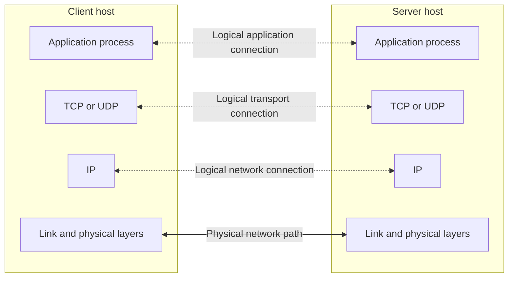

Lines show layering and connectivity, not one-way traffic. Actual data moves down one stack, across the network, and up the other; the reverse direction is also available.

When comparing the 7-layer **OSI model** with the **Internet protocol suite**:

* **User process (upper layers):** The application, presentation, and session layers (OSI layers 5–7) are folded into a single **application** layer running in user space, which handles all application-specific details.
* **Kernel protocol stack (lower layers):** The transport layer (TCP, UDP — OSI layer 4), network layer (IPv4, IPv6 — OSI layer 3), and datalink/physical layers (device drivers and hardware — OSI layers 1–2) typically run in the kernel or associated device hardware. User-space transports and kernel-bypass designs are important exceptions, discussed later.
* **The Socket / XTI boundary:** The sockets API (and historically XTI) sits directly on the boundary between the user process (layer 5–7) and the kernel transport layer (layer 4). While two endpoints communicate logically at each peer layer, the **actual flow of data** descends through the client's kernel stack, traverses Local Area Networks (LANs) and Wide Area Network (WAN) routers, and ascends the server's kernel stack.

### 1.2 Client-Server Paradigm, Sockets, and Connection 4-Tuples

In the client-server model, a **server process** manages some resource (such as files, an email spool, a terminal, or compute cycles) and provides a service by manipulating that resource on behalf of one or more **client processes**:

1. The client sends a request to the server.
2. The server receives and handles the request by accessing or manipulating its managed resource.
3. The server sends a response back to the client.
4. The client receives and handles the response.

*(Note: Clients and servers are software processes—not necessarily distinct physical machines—and can run on the same host or on different hosts).*

#### What is a Socket?

The term "socket" is used in three related ways in network programming:
1. **The Sockets API:** The programming interface itself.
2. **The `socket()` function:** The system call within that API used to create an endpoint.
3. **The socket endpoint/descriptor:**
   * **To the kernel**, a socket is an endpoint of communication.
   * **To an application**, a socket is a **file descriptor** (a small integer) that lets the application read from and write to the network.

Because Unix models all I/O devices—including networks—as files, clients and servers communicate with one another simply by reading from and writing to socket descriptors using system calls. The primary distinction between regular file I/O and socket I/O is how the application "opens" and configures the socket descriptor, as well as the transient, byte-stream behavior of network buffers.

#### Communication Paradigms and the Connection Socket Pair

The Internet protocol suite provides two main transport paradigms for client-server communication:

* **Datagrams (`SOCK_DGRAM`):** Unreliable, connectionless packet delivery using the **UDP** protocol (illustrated in languages like Java via `DatagramSocket()`, where each datagram explicitly carries the destination `(hostid, port)`).
* **Connections (`SOCK_STREAM`):** Point-to-point, **full-duplex** (two-way simultaneous communication), reliable byte-stream channels using the **TCP** protocol.

Within a given networking context, a TCP connection is identified by a **connection socket pair** (a 4-tuple consisting of the client socket address and the server socket address):

```math
\{\text{client\_IP}:\text{client\_port},\ \text{server\_IP}:\text{server\_port}\}
```

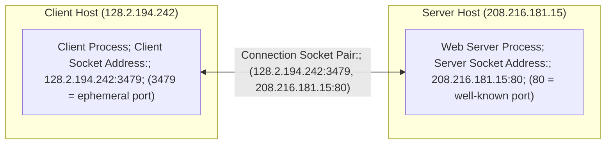

How does a client locate and connect to a server?
* **The IP address** in the server socket address identifies the destination host (more precisely, a specific network interface adaptor on that host).
* **The well-known port number** in the server socket address identifies the specific service—and thus implicitly identifies the server process performing that service on the host.

### 1.3 Port Number Ranges, Services, and Concurrent Demultiplexing

#### Servers and Well-Known Services

Many servers run as long-lived background **daemons**, often managed by a service manager; others start on demand. A server listens on its configured port, which may be a registered service port or an application-specific choice. `/etc/services` lists conventional service-to-port mappings:

| Service | Port(s) | Managed Resource | Service Provided |
|---|---|---|---|
| **Echo server** | `7` | Input buffer | Echoes back whatever bytes the client sends. |
| **Daytime server** | `13` | System clock | Returns the current date and time as a human-readable ASCII string. |
| **FTP server** | `20`, `21` | Filesystem | Stores and retrieves files (`21` = control; active-mode FTP commonly uses server source port `20` for data, while passive mode negotiates another port). |
| **Telnet server** | `23` | Terminal | Proxies an interactive terminal login session on the server machine. |
| **Mail (SMTP) server** | `25` | Email "spool" file | Receives and stores mail messages in the mail spool file. |
| **Web (HTTP) server** | `80` | Files / compute cycles (CGI) | Retrieves static files and executes CGI programs on behalf of the client. |

#### IANA and OS Port Number Allocations

TCP and UDP ports have 16-bit values, **0–65535**. IANA separates the namespace from OS rules for binding privileges and automatic allocation:

| IANA range | Name | Meaning |
| --- | --- | --- |
| 0–1023 | System ports | Assigned under IANA procedures; port 0 is reserved |
| 1024–49151 | User ports | Registered services, also governed by IANA procedures |
| 49152–65535 | Dynamic/private ports | Not assigned by IANA |

In `bind()`, requesting port **0** asks the OS to select a local port; it is not a request to run a service on port 0. Unix systems traditionally protect ports below 1024, but capabilities and configuration can grant permission without running the whole program as root.

The lecture's historical examples use BSD ephemeral ports 1024–5000, higher ports for ordinary servers, `rresvport` in 513–1023, and Solaris allocation in 32768–65535. These are implementation snapshots, not IANA rules or universal current defaults. A released port can still be subject to connection-identity and TIME_WAIT constraints.

#### Concurrent Servers, Multihomed Hosts, and 4-Tuple Demultiplexing

Consider how TCP uses the 4-tuple socket pair to distinguish between a listening socket and multiple concurrent client connections on a **multihomed server host** that has two IP addresses (`12.106.32.254` and `192.168.42.1`):

1. **Passive Open (Listening Socket):** The FTP server starts and performs a passive open on its well-known port `21` using the wildcard IP address (`INADDR_ANY`, denoted `*`). Its socket pair is `{*:21, *:*}`, indicating that it accepts incoming connection requests arriving on *any* local network interface (`1st *`) addressed to port `21`, from *any* foreign client IP and port (`*:*`).
2. **First Client Connection and `fork()`:** A client on host `206.168.112.219` allocates ephemeral port `1500` and connects to the server's `12.106.32.254` interface on port `21`. When the server accepts the connection, it calls `fork()` to spawn a child process to handle the client:
   * The parent retains the **listening socket** `{*:21, *:*}`.
   * The child receives the **connected socket** `{12.106.32.254:21, 206.168.112.219:1500}`. Notice that the connected socket uses the **exact same local port (`21`)** as the listening socket, and its local IP address (`12.106.32.254`) is now filled in based on the interface through which the connection arrived.
3. **Second Concurrent Client Connection:** Suppose a second client process on the same client host (`206.168.112.219`) connects to the same server (`12.106.32.254:21`). The client's TCP stack assigns the second client an unused ephemeral port (`1501`), and the server forks a second child process.

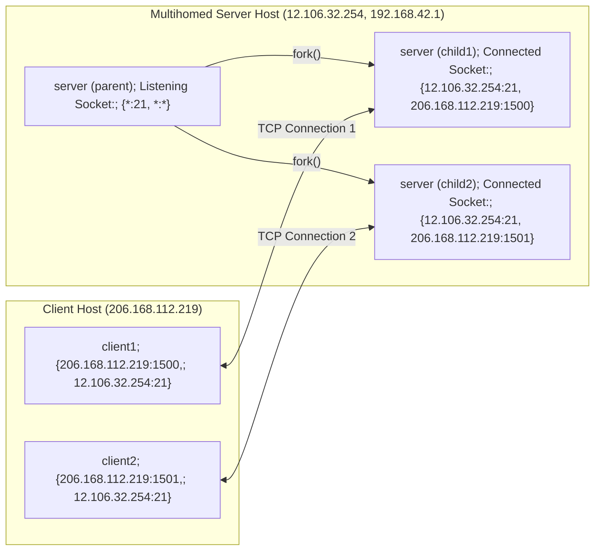

**Crucial Demultiplexing Rule:** Because the listening socket, `child1`, and `child2` are *all* bound to local port `21`, **TCP cannot demultiplex incoming segments by looking solely at the destination port number.** The kernel's TCP stack must inspect **all four elements in the socket pair** to route an arriving data segment to the connected socket in `child1` or `child2`, and route a new incoming `SYN` to the listening socket in the parent.

### 1.4 History of BSD Networking Releases

The sockets API was introduced in **4.2BSD (1983)** by the Computer Systems Research Group (CSRG) at UC Berkeley (spearheaded by Bill Joy, alongside pioneers like Kirk McKusick; see [Kirk McKusick's BSD History Talk](http://www.youtube.com/watch?v=ds77e3aO9nA)).

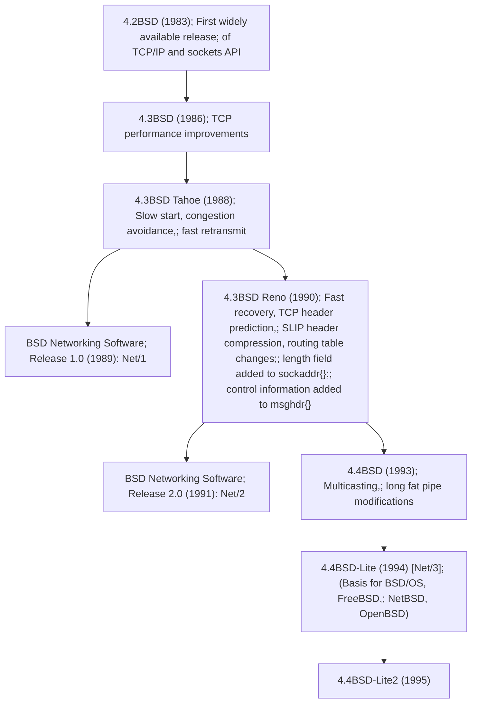

Although receiving the full 4.2BSD–4.4BSD operating system distributions required an AT&T Unix source code license, **the networking releases separated redistributable Berkeley code from AT&T-licensed components.** Starting in 1989 with **Net/1**, followed by **Net/2 (1991)** and **4.4BSD-Lite / Net/3 (1994)**, Berkeley released the networking stack publicly via anonymous FTP without any AT&T license restrictions, seeding modern open-source and commercial TCP/IP stacks worldwide.

---

## 2. Byte Ordering, Socket Address Structures, and Address Conversion

### 2.1 Little-Endian vs. Big-Endian and Network Byte Order

A 16-bit integer consists of 2 bytes (and a 32-bit integer consists of 4 bytes). Hardware architectures store multi-byte integers in memory using one of two conventions:

| Value 0x0102 | Byte at address A | Byte at address A + 1 |
| --- | --- | --- |
| Big-endian | 0x01, most significant | 0x02, least significant |
| Little-endian | 0x02, least significant | 0x01, most significant |

* **Little-endian byte order:** Stores the **low-order byte (LSB)** at the starting memory address $A$ and the **high-order byte (MSB)** at $A + 1$.
* **Big-endian byte order:** Stores the **high-order byte (MSB)** at the starting memory address $A$ and the **low-order byte (LSB)** at $A + 1$.

A C program can determine a host's byte order at runtime by storing `0x0102` in a 16-bit `short` inside a `union` and inspecting its two constituent bytes:

```c
union {
    short s;
    char  c[sizeof(short)];
} un;

un.s = 0x0102;
if (sizeof(short) == 2) {
    if (un.c[0] == 1 && un.c[1] == 2)
        printf("big-endian\n");
    else if (un.c[0] == 2 && un.c[1] == 1)
        printf("little-endian\n");
    else
        printf("unknown\n");
} else {
    printf("sizeof(short) = %zu\n", sizeof(short));
}
```

#### Network Byte Order and Conversion Functions

Because communicating hosts may have different native CPU byte orderings, networking protocols must mandate a canonical **network byte order** so the sending and receiving stacks agree on multi-byte header fields. **The Internet protocol suite (TCP/IP) uses big-endian byte ordering for the relevant TCP/IP header fields, including ports and IPv4 addresses** (such as 16-bit port numbers and 32-bit IPv4 addresses).

Ports and IPv4 address fields use network byte order. Address-family fields, structure lengths, and other API bookkeeping do not all use network byte order. Four standard functions convert 16- and 32-bit integer values:

* `htons()` (*host to network short*): Converts a 16-bit integer (e.g., port number) from host to network byte order.
* `htonl()` (*host to network long*): Converts a 32-bit integer (e.g., IPv4 address) from host to network byte order.
* `ntohs()` (*network to host short*): Converts a 16-bit integer from network to host byte order.
* `ntohl()` (*network to host long*): Converts a 32-bit integer from network to host byte order.

### 2.2 Socket Address Structures (`sockaddr`, `sockaddr_in`, `sockaddr_storage`)

Socket address structures contain an address-family field identifying their interpretation. Its exact layout is platform-dependent: Linux begins with the family field, while BSD layouts may place a length byte before it. Use the platform headers rather than assuming a universal binary layout.

#### IPv4 Socket Address Structure (`struct sockaddr_in`)

In IPv4 (`AF_INET`), addresses are stored in `struct sockaddr_in`, which embeds `struct in_addr` for the 32-bit network-byte-ordered IPv4 address:

```c
struct in_addr {
    in_addr_t s_addr;          /* 32-bit IPv4 address, network byte ordered */
};

struct sockaddr_in {
    /* Some BSD layouts include sin_len; Linux does not. */
    sa_family_t    sin_family; /* address family: always AF_INET            */
    in_port_t      sin_port;   /* 16-bit TCP or UDP port, network byte order*/
    struct in_addr sin_addr;   /* 32-bit IPv4 address, network byte order   */
    char           sin_zero[8];/* unused padding to sizeof(struct sockaddr) */
};
```

For ordinary IPv4 setup, the principal fields are `sin_family`, `sin_port`, and `sin_addr`. Because `sin_zero` is unused padding, zero-initializing the structure before filling its fields is a good portable convention. Use the system-provided definitions; do not copy this conceptual layout as a replacement header.

#### Generic Socket Address Structure (`struct sockaddr`)

When the sockets API was designed in 1983, ANSI C did not yet have generic `void *` pointers. To allow socket system calls (`connect`, `bind`, `accept`) to accept address structures from *any* protocol family, the API defined a generic 16-byte `struct sockaddr`:

```c
struct sockaddr {
    unsigned short sa_family;   /* protocol family (2 bytes) */
    char           sa_data[14]; /* family-specific address data (14 bytes) */
};
```

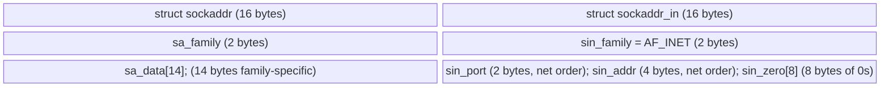

Whenever a socket address structure is passed to `bind()`, `connect()`, or `accept()`, it is **always passed by reference** (as a pointer) and **is normally cast to the generic pointer type `(struct sockaddr *)` (or its const-qualified form)** (often abbreviated in textbook code via `#define SA struct sockaddr`).

#### Protocol-Independent Storage (`struct sockaddr_storage`)

Because IPv6 (`struct sockaddr_in6`, 28 bytes) and Unix domain sockets (`struct sockaddr_un`) are larger than the 16-byte IPv4 `struct sockaddr_in`, modern protocol-independent programs should allocate **`struct sockaddr_storage`**, which is guaranteed to be large enough and properly aligned to hold any socket address family supported by the system.

### 2.3 IP Address Conversion (`inet_pton`, `inet_ntop`, `sock_ntop`) and DNS Resolution

Humans prefer readable ASCII presentation strings (such as dotted-decimal `"206.168.112.219"` or IPv6 hex `"x:x:x:x:x:x:x:x"`), whereas socket structures require binary numeric values in network byte order.

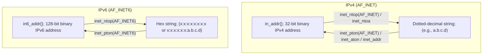

* **Legacy IPv4-only functions:** `inet_aton()`, `inet_addr()`, and `inet_ntoa()` convert only IPv4 addresses and appear frequently in older code.
* **Modern protocol-independent functions (`inet_pton` and `inet_ntop`):** The letters **`p`** and **`n`** stand for **presentation** (ASCII string) and **numeric** (binary network-byte-ordered structure):

```c
int inet_pton(int family, const char *strptr, void *addrptr);
/* Returns: 1 if OK, 0 if input is not a valid presentation format, -1 on error */

const char *inet_ntop(int family, const void *addrptr, char *strptr, size_t len);
/* Returns: pointer to result string if OK, NULL on error */
```

#### Wrapper for Address-Family-Independent Formatting (`sock_ntop`)

Because `inet_ntop()` requires the caller to know the address family and pass a pointer to the internal `sin_addr` or `sin6_addr` member, Stevens defines `sock_ntop()`, which takes a generic `struct sockaddr *`, inspects `sa_family`, and formats both the IP address and port number:

```c
char *sock_ntop(const struct sockaddr *sa, socklen_t salen) {
    char portstr[8];
    static char str[128]; /* shared output: not reentrant/thread-safe */

    switch (sa->sa_family) {
    case AF_INET: {
        const struct sockaddr_in *sin = (const struct sockaddr_in *) sa;
        if (inet_ntop(AF_INET, &sin->sin_addr, str, sizeof(str)) == NULL)
            return (NULL);
        if (ntohs(sin->sin_port) != 0) {
            snprintf(portstr, sizeof(portstr), ":%d", ntohs(sin->sin_port));
            strcat(str, portstr);
        }
        return (str);
    }
    /* IPv6 needs its own case and brackets around addresses with ports. */
    default:
        errno = EAFNOSUPPORT;
        return NULL;
    }
}
```

#### Domain Name System (DNS) Resolution

DNS maps between domain names (e.g., `www.cs.cmu.edu`) and IP addresses (`128.2.203.179`) in a worldwide distributed database:

* **Modern Resolver API (`getaddrinfo()` and `getnameinfo()`):** Prefer `getaddrinfo()` for portable name/service resolution:
  * It is **thread-safe** (unlike `gethostbyname()`).
  * It is **protocol-independent**: a single code path serves both IPv4 and IPv6 without conditional compilation.
  * It returns an **ordered linked list of address structures**; a client walks the list and tries `socket()`/`connect()` on each entry in turn until one succeeds.
  * `getnameinfo()` formats a socket address as host/service strings; flags can request numeric output without DNS lookup.
* **Legacy Resolver API (`gethostbyname()`, `gethostbyaddr()`, `struct hostent`):** historical interfaces with portability and shared-storage limitations; support varies by function and platform. They are still encountered in legacy code and lab exercises. For example, an echo server using the legacy API can identify a connected client's hostname and dotted-decimal IP string via:

```c
struct hostent *hp; /* pointer to DNS host entry */
char *haddrp;       /* pointer to dotted decimal string */

hp = Gethostbyaddr((const char *)&clientaddr.sin_addr.s_addr,
                   sizeof(clientaddr.sin_addr.s_addr), AF_INET);
haddrp = inet_ntoa(clientaddr.sin_addr);
printf("server connected to %s (%s)\n", hp->h_name, haddrp);
```

---

## 3. Elementary TCP Sockets and the Daytime Client/Server

### 3.1 Overview of a TCP Client-Server Session

A typical blocking TCP client-server interaction follows this sequence. The kernel completes handshakes independently of when the application calls `accept()`:

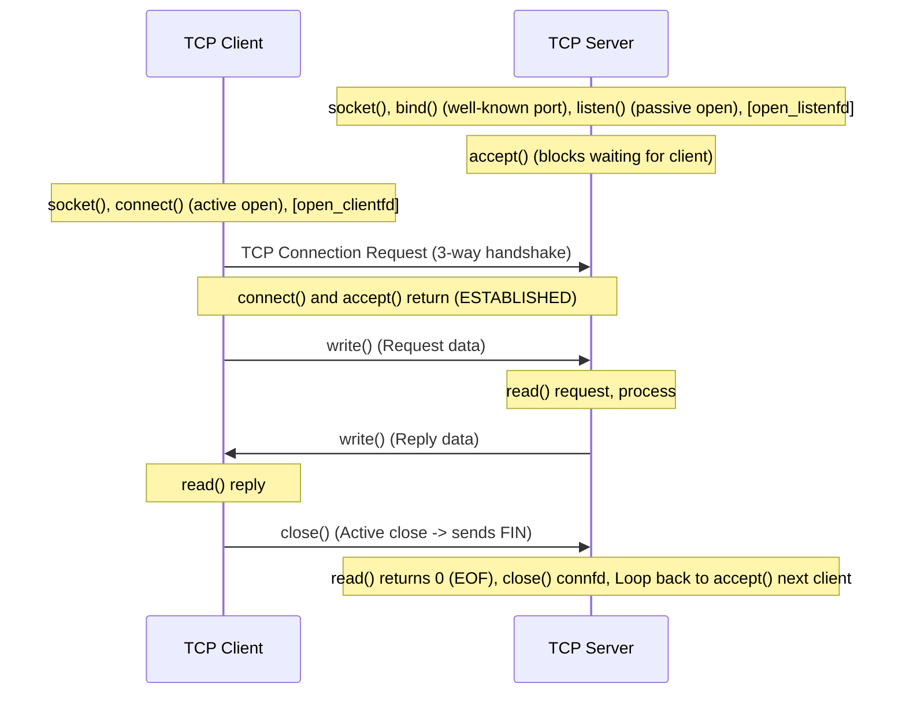

### 3.2 Detailed Specification of Core Socket System Calls

#### 1. `socket()` — Creating a Communication Endpoint

To perform network I/O, a process first calls `socket()`, specifying the desired protocol family, socket type, and transport protocol:

```c
int socket(int family, int type, int protocol);
/* Returns: non-negative file descriptor on success, -1 on error */
```

* **`family` (Address/Protocol Family):**
  * `AF_INET`: IPv4 protocols
  * `AF_INET6`: IPv6 protocols
  * `AF_LOCAL` (or `AF_UNIX`): Unix domain protocols
  * `AF_ROUTE`: Routing sockets
  * `AF_KEY`: Key management sockets
* **`type` (Socket Type):**
  * `SOCK_STREAM`: Stream socket (`TCP` or `SCTP` in `AF_INET`/`AF_INET6`; also supported in `AF_LOCAL`)
  * `SOCK_DGRAM`: Datagram socket (`UDP` in `AF_INET`/`AF_INET6`; also supported in `AF_LOCAL`)
  * `SOCK_SEQPACKET`: Sequenced packet socket (`SCTP` in `AF_INET`/`AF_INET6`; also supported in `AF_LOCAL`)
  * `SOCK_RAW`: Raw network-layer socket (`IPv4`/`IPv6`, plus `AF_ROUTE` and `AF_KEY`)
* **`protocol`:** Typically set to `0` to select the system's default protocol for the given `(family, type)` combination, or specified explicitly via `IPPROTO_TCP`, `IPPROTO_UDP`, or `IPPROTO_SCTP`.
* **Initial TCP State:** When created by `socket()`, a TCP socket begins in the **`CLOSED`** state.
* **Why can `socket()` fail?**
  1. Lack of permission to create a socket of the specified type/protocol (e.g., `SOCK_RAW` without superuser privileges).
  2. No kernel support for the specified address family or protocol.
  3. Per-process file descriptor table overflow.
  4. System-wide limit on the total number of open files has been reached.
  5. Insufficient kernel memory available.

#### 2. `connect()` — Initiating an Active Open (Client)

A TCP client establishes a connection with a server by calling `connect()`:

```c
int connect(int sockfd, const struct sockaddr *servaddr, socklen_t addrlen);
/* Returns: 0 if OK, -1 on error */
```

* **No prior `bind()` required:** A client does not need to call `bind()` before calling `connect()`; the kernel automatically assigns an unused **ephemeral port** and selects the **source IP address** (based on the outgoing network interface).
* **State Transition:** `connect()` initiates TCP's three-way handshake, moving the socket from `CLOSED` to **`SYN_SENT`**, and returns `0` once the `SYN+ACK` arrives and the socket enters **`ESTABLISHED`**.
* **Three Failure Scenarios for blocking `connect()`:**
  1. **No response to `SYN` (Timeout — `ETIMEDOUT`):** If the client's `SYN` receives no reply, the kernel retransmits the `SYN` (e.g., in 4.4BSD, one initial `SYN`, another $6\text{ s}$ later, and another $24\text{ s}$ later, failing after $75\text{ s}$ total) and returns a timeout error.
  2. **`RST` received (Hard Error — `ECONNREFUSED`):** If the server host responds to the `SYN` with a TCP Reset (`RST`) segment, the connection has been actively refused, commonly because no server is listening; an intervening device can also reject it. `connect()` immediately returns "connection refused."
     * *When does TCP send an `RST`?* (a) A `SYN` arrives for a port with no listening server; (b) TCP wants to abort an existing connection; or (c) TCP receives a segment for a connection that does not exist.
  3. **ICMP "Destination Unreachable" from an intermediate router (Soft Error — `EHOSTUNREACH` / `ENETUNREACH`):** Because an ICMP unreachable message may reflect a transient routing loop or flap that will soon heal, the kernel treats it as a *soft error*: it saves the ICMP message and keeps retransmitting `SYN`s. In the historical BSD example, the saved error can be returned after the retry timeout. Current retry timing and treatment of ICMP errors vary by OS and error type; 75 seconds is not a portable API rule.
* **Important Rule on Failure:** After a failed connection attempt, portable code closes the socket and creates a new one because its state is unspecified. Nonblocking `connect()` returning `EINPROGRESS` is different: connection establishment is still pending; wait for readiness and inspect `SO_ERROR`.

#### 3. `bind()` — Assigning a Local Protocol Address

The `bind()` function assigns a local protocol address (IPv4/IPv6 address and 16-bit port number) to a socket:

```c
int bind(int sockfd, const struct sockaddr *myaddr, socklen_t addrlen);
/* Returns: 0 if OK, -1 on error */
```

* **Servers vs. Clients:** Servers almost always call `bind()` at startup to register their well-known port. Normal TCP clients rarely call `bind()`.
* **Specifying IP Address and/or Port in `bind()`:**

| Process Specifies IP Address | Process Specifies Port | Result |
|---|---|---|
| **Wildcard (`INADDR_ANY`)** | `0` | Kernel chooses both the local IP address (upon connection) and an ephemeral port (when `bind` is called). |
| **Wildcard (`INADDR_ANY`)** | Nonzero | Kernel chooses the local IP address (from the client's `SYN` destination IP once connected); process specifies the port. |
| **Local IP address** | `0` | Process specifies the local IP address; kernel chooses an ephemeral port. |
| **Local IP address** | Nonzero | Process explicitly specifies both the local IP address and the port. |

* **Binding a Specific IP vs. Wildcard:**
  * On a **TCP client**, binding a specific local IP address forces all outgoing IP datagrams on that socket to use that source IP.
  * On a **TCP server**, binding a specific local IP restricts the socket to accept incoming client connections destined *only* to that IP address. If the server instead binds `INADDR_ANY` (`0.0.0.0`, whose value is `0`, though `htonl(INADDR_ANY)` is good style), the kernel accepts connections on any interface and uses the destination IP address of the client's `SYN` as the server's source IP address.
* **Common `bind()` Errors:**
  1. Protected port ($< 1024$) requested by a non-superuser (`EACCES`).
  2. The specified address/port is already in use (`EADDRINUSE`, often related to `TIME_WAIT`).
  3. `sockfd` is not a valid socket descriptor.
  4. The socket is already bound to an address.

#### 4. `listen()` — Converting to a Passive Listening Socket

For the TCP examples, called by a server (after `socket()` and `bind()`, and before `accept()`), `listen()` converts an unconnected active socket into a **passive socket**, moving it from `CLOSED` to the **`LISTEN`** state:

```c
int listen(int sockfd, int backlog);
/* Returns: 0 if OK, -1 on error */
```

The `backlog` parameter specifies the maximum number of connections the kernel should queue for this listening socket (detailed in Section 4.1). Because the historical 4.2BSD maximum of `5` is far too small for modern servers handling millions of connections per day, a clean wrapper allows an administrator to override `backlog` at runtime via an environment variable (`LISTENQ`):

```c
void Listen(int fd, int backlog) {
    char *ptr;
    /* Can override 2nd argument with environment variable */
    if ((ptr = getenv("LISTENQ")) != NULL)
        backlog = atoi(ptr);
    if (listen(fd, backlog) < 0)
        err_sys("listen error");
}
```

#### 5. `accept()` — Dequeuing a Completed Connection

Called by a TCP server to retrieve the next established connection from the front of the kernel's completed connection queue (putting the process to sleep if the queue is currently empty):

```c
int accept(int sockfd, struct sockaddr *cliaddr, socklen_t *addrlen);
/* Returns: non-negative connected descriptor (connfd) if OK, -1 on error */
```

* **Listening vs. Connected Descriptors:**
  * The first argument (`sockfd` / `listenfd`) is the **listening descriptor**, created once and kept open for the entire lifetime of the server.
  * The return value (`connfd`) is a brand-new **connected descriptor** created by the kernel specifically for this accepted client. All `read()`/`write()` data transfers with the client take place over `connfd`, and `connfd` is closed as soon as the server finishes servicing that client.
  * *Why separate them?* Separating `listenfd` from `connfd` enables **concurrent servers** (e.g., forking a child or multiplexing multiple `connfd` descriptors simultaneously while `listenfd` continues accepting new clients).
* **Value-Result Argument (`addrlen`):** `cliaddr` and `addrlen` return the client's protocol address (IP and ephemeral port). Before calling `accept()`, the caller must initialize `*addrlen = sizeof(clientaddr)`; upon return, the kernel overwrites `*addrlen` with the actual address length; this can exceed the supplied capacity if the address was truncated. If the server does not care about the client's identity, both `cliaddr` and `addrlen` may be passed as `NULL`.
* **Common `accept()` Errors:** Invalid descriptor, connection aborted before pickup (`ECONNABORTED`), socket not listening or invalid `addrlen`, per-process or system-wide file table full, socket type does not support accepting connections, insufficient socket buffer memory, protocol error, or firewall rules forbidding the connection.

#### 6. `close()` — Closing a Socket

```c
int close(int sockfd);
/* Returns: 0 if OK, -1 on error */
```

Calling `close()` releases this descriptor and normally returns without waiting for TCP teardown; linger settings can affect blocking behavior. The process can no longer use that released `sockfd` for `read()` or `write()`. However, in the kernel:
1. `close()` decrements the descriptor's **reference count on the underlying open socket**. Only when the reference count reaches `0` (crucial in concurrent `fork()` servers where both parent and child hold open copies of `connfd`!) does the kernel initiate TCP connection termination.
2. When reference count reaches `0`, TCP first attempts to transmit any data already queued in the kernel send buffer, and then sends a `FIN` segment to begin normal connection teardown (unless overridden by the `SO_LINGER` socket option).

### 3.3 Walkthrough: Daytime Client and Iterative Daytime Server

The C listings are separate teaching fragments, not one compilation unit. They assume the course support header/library defining `SA`, `MAXLINE`, `SERV_PORT`, `LISTENQ`, capitalized wrappers, and error helpers. Add system headers and declarations when extracting a program.

#### Error-Handling Wrapper Convention

Checking every system call for an error return (`< 0`) is mandatory in network programming. To keep code readable without omitting error checks, Stevens defines **capitalized wrapper functions** (such as `Socket()`, `Bind()`, `Listen()`, `Accept()`, `Write()`, `Close()`) that invoke the underlying lowercase system call and terminate with a diagnostic message via `err_sys()` if an error occurs:

```c
int Socket(int family, int type, int protocol) {
    int n;
    if ((n = socket(family, type, protocol)) < 0)
        err_sys("socket error");
    return (n);
}
```

#### Simple TCP Daytime Client (Port 13)

```c
int main(int argc, char **argv) {
    int                sockfd, n;
    char               recvline[MAXLINE + 1];
    struct sockaddr_in servaddr;

    if (argc != 2)
        err_quit("usage: a.out <IPaddress>");

    if ((sockfd = socket(AF_INET, SOCK_STREAM, 0)) < 0)
        err_sys("socket error");

    bzero(&servaddr, sizeof(servaddr));
    servaddr.sin_family = AF_INET;
    servaddr.sin_port   = htons(13); /* daytime server well-known port */
    if (inet_pton(AF_INET, argv[1], &servaddr.sin_addr) <= 0)
        err_quit("inet_pton error for %s", argv[1]);

    if (connect(sockfd, (SA *) &servaddr, sizeof(servaddr)) < 0)
        err_sys("connect error");

    while ((n = read(sockfd, recvline, MAXLINE)) > 0) {
        recvline[n] = 0; /* null terminate */
        if (fputs(recvline, stdout) == EOF)
            err_sys("fputs error");
    }
    if (n < 0)
        err_sys("read error");

    exit(0);
}
```

#### Simple Iterative TCP Daytime Server (Port 13)

```c
int main(int argc, char **argv) {
    int                listenfd, connfd;
    struct sockaddr_in servaddr;
    char               buff[MAXLINE];
    time_t             ticks;

    listenfd = Socket(AF_INET, SOCK_STREAM, 0);

    bzero(&servaddr, sizeof(servaddr));
    servaddr.sin_family      = AF_INET;
    servaddr.sin_addr.s_addr = htonl(INADDR_ANY); /* wildcard IP */
    servaddr.sin_port        = htons(13);         /* daytime server */

    Bind(listenfd, (SA *) &servaddr, sizeof(servaddr));
    Listen(listenfd, LISTENQ);

    for ( ; ; ) {
        connfd = Accept(listenfd, (SA *) NULL, NULL);

        ticks = time(NULL);
        snprintf(buff, sizeof(buff), "%.24s\r\n", ctime(&ticks));
        Writen(connfd, buff, strlen(buff));

        Close(connfd);
    }
}
```

This server is an **iterative server**: it processes one client completely from `Accept()` through `Writen()` and `Close()` before looping back to `Accept()` the next client. If multiple client handshakes complete simultaneously, the kernel queues them up to `LISTENQ` and hands them to `Accept()` one at a time.

---

## 4. TCP Connection Establishment, Termination, and State Transitions

### 4.1 The Three-Way Handshake and Kernel Listen Queues

Establishing a TCP connection requires a **three-way handshake**:

1. **Passive Open (Server):** The server calls `socket()`, `bind()`, and `listen()`, placing its socket in the `LISTEN` state, and blocks in `accept()`.
2. **Segment 1 — `SYN J` (Client $\to$ Server):** The client calls `connect()` (an **active open**), causing its kernel to send a `SYN` segment carrying the client's initial sequence number $J$ (along with TCP options such as $\text{MSS}$; this example assumes an ordinary handshake without SYN data). The client enters `SYN_SENT`.
3. **Segment 2 — `SYN K, ACK J+1` (Server $\to$ Client):** Upon receiving `SYN J`, the server kernel creates an entry in its **incomplete connection queue**, copies the listening socket's parameters to the embryonic connection, transitions it to `SYN_RCVD`, and replies with a single segment containing its own `SYN` (initial sequence number $K$) and `ACK J+1`. *Notice that the server application process is not woken up yet.*
4. **Segment 3 — `ACK K+1` (Client $\to$ Server):** When the client receives `SYN K, ACK J+1`, **blocking `connect()` can complete** (roughly one RTT without loss), the client enters `ESTABLISHED`, and the client's kernel sends `ACK K+1`. When `ACK K+1` arrives at the server, the kernel moves the connection from the **incomplete connection queue (`SYN_RCVD`)** to the **completed connection queue (`ESTABLISHED`)**, and **`accept()` wakes up and returns `connfd`**.

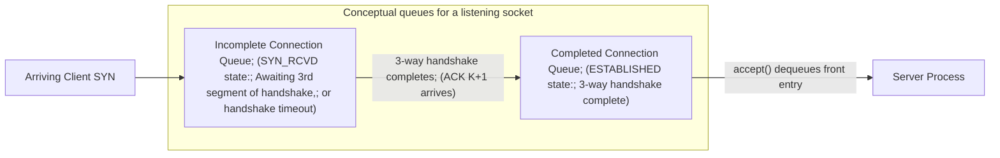

* **What does `backlog` in `listen(sockfd, backlog)` mean?** Historically in BSD, `backlog` specified the maximum allowed **sum of both queues** (incomplete + completed), with some implementations applying an additional factor. **On modern Linux, backlog limits the queue of established connections waiting for acceptance; the incomplete SYN queue is governed separately.** The requested backlog can also be capped by system settings. See [listen(2)](https://man7.org/linux/man-pages/man2/listen.2.html).

### 4.2 Four-Way Connection Termination and Half-Close

An ordinary handshake uses three segments. Closing both directions is often shown using **four separate control segments in the usual illustrative teardown** because TCP is full-duplex and each direction closes independently. ACK and FIN can be combined, and simultaneous close changes the exchange:

1. **Segment 1 — `FIN M` (Active Close):** One application calls `close()` first (an **active close**). Its TCP sends a `FIN M` segment indicating it has finished sending data, and enters `FIN_WAIT_1`.
2. **Segment 2 — `ACK M+1` (Passive Close):** The peer receives `FIN M` (performing a **passive close**), sends `ACK M+1`, transitions to `CLOSE_WAIT`, and makes EOF visible to its application **after previously received data has been read** (`read` then returns `0`). Meanwhile, the active closer receives `ACK M+1` and enters `FIN_WAIT_2`.
   * **Half-Close Window:** Between Step 2 and Step 3, the connection is **half-closed**: the passive closer (`CLOSE_WAIT`) can still send data back to the active closer (`FIN_WAIT_2`), though the active closer can no longer send data.
3. **Segment 3 — `FIN N`:** When the passive closer's application finishes processing the EOF and calls `close()`, its TCP sends `FIN N` and enters `LAST_ACK`.
4. **Segment 4 — `ACK N+1`:** The active closer receives `FIN N`, sends the final `ACK N+1`, and enters the **`TIME_WAIT`** state (while the passive closer receives `ACK N+1` and transitions immediately to `CLOSED`).

### 4.3 TCP State Transitions and Packet Trace

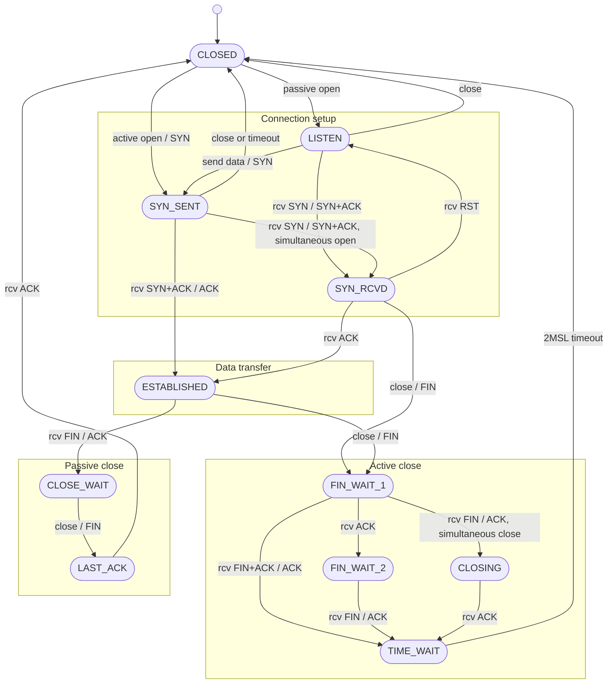

Notice the two special edge cases captured in the state machine:
* **Simultaneous open (`SYN_SENT` $\to$ `SYN_RCVD`):** Both ends perform an active open at nearly the same instant and their `SYN`s cross in the network.
* **Simultaneous close (`FIN_WAIT_1` $\to$ `CLOSING` $\to$ `TIME_WAIT`):** Both applications call `close()` simultaneously while in `ESTABLISHED`, and their `FIN`s cross in the network.

### 4.4 The `TIME_WAIT` State and the $2\text{MSL}$ Timeout

In the ordinary orderly-close sequence, the active closer enters **TIME_WAIT** for **2 × MSL**. Both endpoints can enter TIME_WAIT during simultaneous close; aborted connections need not follow the orderly-close path.

**MSL** is a protocol assumption about maximum segment lifetime, not a wall-clock bound calculated from IPv4's hop-limited TTL. The lecture's historical examples use MSL values of two minutes or 30 seconds, giving TIME_WAIT values of four minutes or one minute. Actual timers and permitted safe-reuse rules are implementation-dependent; these are not universal limits.

There are **two fundamental reasons** for the `TIME_WAIT` state:

#### Reason 1: Reliably Implementing TCP's Full-Duplex Connection Termination

Suppose the final `ACK N+1` (Segment 4 of connection teardown) from the active closer (Endpoint 1 / Client) to the passive closer (Endpoint 2 / Server) is **lost in the network**:
* Because the server in `LAST_ACK` does not receive `ACK N+1`, its timer expires and it **retransmits its final `FIN N`**.
* If the client had transitioned directly to `CLOSED` instead of remaining in `TIME_WAIT`, the client would have no state left for the connection and would respond to the retransmitted `FIN N` with an **`RST` segment** (interpreting the `FIN` as an unexpected segment), causing the server to report a spurious error even though all data was transferred cleanly!
* By remaining in `TIME_WAIT` for $2\text{MSL}$, the active closer maintains connection state so it can **retransmit the final `ACK N+1`** if it receives a retransmitted `FIN N`. This explains TIME_WAIT in the ordinary active-close case. In simultaneous close, both endpoints can need this state.

#### Reason 2: Allowing Old Duplicate Segments ("Wandering Duplicates") to Expire in the Network

Suppose a connection with 4-tuple `{12.106.32.254:1500, 206.168.112.219:21}` has a packet caught in a temporary routing loop. Once the routing loop heals (within $\text{MSL}$ seconds), the delayed packet is delivered to its destination.
* If the original connection closed and a new connection—called a new **incarnation**—were immediately established using the **exact same 4-tuple** `{12.106.32.254:1500, 206.168.112.219:21}`, that delayed duplicate segment from the old connection could arrive with a valid sequence number and be **mistaken for part of the second connection**, corrupting the data stream!
* To prevent this, TCP normally delays reuse of that connection identity; carefully constrained reuse mechanisms exist. Waiting $2 \times \text{MSL}$ allows up to $\text{MSL}$ seconds for a packet in one direction to be lost/delayed and another $\text{MSL}$ seconds for a reply in the opposite direction to expire, allowing old duplicates to expire under the segment-lifetime assumptions. Sequence numbers and timestamp-based protections also matter when implementations permit earlier reuse.

---

## 5. Byte-Stream Framing, Short Counts, and Robust I/O Wrappers

### 5.1 Record Boundaries and Short Counts in TCP

A critical principle of TCP socket programming is that **TCP is a byte-stream protocol with no inherent record boundaries (no message markers).**

For example, when the Daytime server writes the 26-byte Daytime response `"Mon May 26 20:58:40 2003\r\n"`, the client's `read()` call is **not** guaranteed to receive all 26 bytes at once:
* Normally, it arrives as 1 TCP segment of 26 bytes.
* However, sender segmentation, buffering, and read timing can produce different read sizes, even without IP fragmentation; a read can return as little as one byte, or across three `read()` calls (e.g., returning `"Hell"`, then `"o w"`, then `"orld\n"` for `"Hello world\n"`).

#### Three Common Techniques for Application-Level Record Framing

If an application wants to delineate the ends of logical records over TCP, it must implement framing itself using one of three standard conventions:
1. **End-of-File (Connection Close):** The sender closes the connection to mark the end of the record, and the receiver loops on `read()` until `read()` returns `0` (used by the Daytime protocol and HTTP/1.0).
2. **In-Band Delimiter Sequence:** Mark the end of each record with a special byte sequence, such as the two-byte ASCII carriage-return/linefeed (`\r\n`) used by **SMTP** (or `\n` in line-oriented protocols).
3. **Explicit Binary Length Prefix:** Prepend a fixed-size binary counter containing the exact byte length of the record in front of each record (used by **Sun RPC** and **DNS over TCP**).

#### Why TCP Sockets Return Short Counts

For both regular files and sockets, **it is not necessarily an error for `read()` or `write()` on a stream socket to return fewer bytes than requested** (a *short count*):
* On `read()`, a short count occurs whenever fewer bytes than requested are currently available in the kernel's socket receive buffer.
* On `write()`, a short count occurs if the kernel's socket send buffer reaches its limit (most commonly seen when the socket is non-blocking).

### 5.2 Implementing `readn`, `writen`, and Buffered `readline`

To handle short counts and interrupted system calls (`errno == EINTR`) cleanly, we use three helper functions: `readn()`, `writen()`, and `readline()`.

These helpers assume blocking descriptors. A successful write means bytes were accepted locally, not that the peer application consumed them. With nonblocking sockets, preserve progress across `EAGAIN`; also handle `SIGPIPE`/`EPIPE` when writing to a closed connection.

#### 1. `readn()` — Read Exactly $n$ Bytes

Loops calling `read()` until $n$ bytes have been received, EOF (`0`) is reached, or an unrecoverable error occurs (restarting automatically on `EINTR`):

```c
ssize_t readn(int fd, void *vptr, size_t n) {
    size_t  nleft = n;
    ssize_t nread;
    char   *ptr = vptr;

    while (nleft > 0) {
        if ((nread = read(fd, ptr, nleft)) < 0) {
            if (errno == EINTR)
                nread = 0; /* interrupted by signal; call read() again */
            else
                return (-1);
        } else if (nread == 0) {
            break;         /* EOF */
        }
        nleft -= nread;
        ptr   += nread;
    }
    return (n - nleft);    /* return >= 0 */
}
```

#### 2. `writen()` — Write Exactly $n$ Bytes

Loops calling `write()` until all $n$ bytes have been written to the kernel socket buffer:

```c
ssize_t writen(int fd, const void *vptr, size_t n) {
    size_t      nleft = n;
    ssize_t     nwritten;
    const char *ptr = vptr;

    while (nleft > 0) {
        if ((nwritten = write(fd, ptr, nleft)) <= 0) {
            if (nwritten < 0 && errno == EINTR)
                nwritten = 0; /* interrupted by signal; call write() again */
            else
                return (-1);  /* error */
        }
        nleft -= nwritten;
        ptr   += nwritten;
    }
    return (n);
}
```

#### 3. `readline()` — Buffering and Readiness

A naive `readline()` implementation invokes the `read(fd, &c, 1)` system call once for **every single byte** up to `\n`. While functionally correct, executing a system-call transition per byte is often inefficient.

Why not simply wrap the socket in a C standard I/O (`stdio`) `FILE *` stream and call `fgets()`?
* **The buffering mismatch:** The portable stdio API does not expose a general readiness count for prefetched input.
* If a server or `select()` loop uses `stdio`, multiple lines or unexpected extra protocol bytes may be slurped from the kernel socket buffer into the hidden `stdio` buffer in a single read. `select()` reports kernel-level readiness, not data already prefetched into a library buffer. Waiting only on the descriptor can therefore stall while the library still has unread bytes. Buffering itself is valid; its state must be integrated with the event loop.

#### Solution: `readline()` with an Exposed Internal Buffer (`my_read` and `readlinebuf`)

Instead of `stdio`, we write a custom buffered reader `my_read()` that reads up to `MAXLINE` bytes from the kernel at a time into `read_buf` and parcels them out one byte at a time to `readline()`, accompanied by `readlinebuf()` which **exposes the internal buffer state** so callers can inspect any leftover bytes received beyond a single line:

```c
static int   read_cnt;
static char *read_ptr;
static char  read_buf[MAXLINE];

static ssize_t my_read(int fd, char *ptr) {
    if (read_cnt <= 0) {
    again:
        if ((read_cnt = read(fd, read_buf, sizeof(read_buf))) < 0) {
            if (errno == EINTR)
                goto again;
            return (-1);
        } else if (read_cnt == 0) {
            return (0);
        }
        read_ptr = read_buf;
    }
    read_cnt--;
    *ptr = *read_ptr++;
    return (1);
}

ssize_t readline(int fd, void *vptr, size_t maxlen) {
    size_t n;
    ssize_t rc;
    char    c, *ptr = vptr;
    if (maxlen == 0) { errno = EINVAL; return -1; }

    for (n = 1; n < maxlen; n++) {
        if ((rc = my_read(fd, &c)) == 1) {
            *ptr++ = c;
            if (c == '\n')
                break;       /* newline is stored, like fgets() */
        } else if (rc == 0) {
            *ptr = 0;
            return (n - 1);  /* EOF, n - 1 bytes were read */
        } else {
            return (-1);     /* error, errno set by read() */
        }
    }
    *ptr = 0;                /* null terminate like fgets() */
    return ptr - (char *)vptr; /* bytes stored, excluding NUL */
}

ssize_t readlinebuf(void **vptrptr) {
    if (read_cnt)
        *vptrptr = read_ptr;
    return (read_cnt);
}
```

*(Note: Even with `readlinebuf()`, this single static buffer is neither thread-safe nor safe for alternating between multiple sockets, and still complicates `select()`; therefore, an event-driven server needs per-connection buffering integrated with readiness; line-oriented application protocols remain valid).*

### 5.3 The Baseline TCP Echo Server and Client (`str_echo` and `str_cli`)

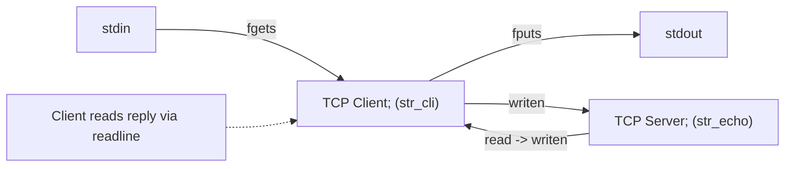

#### Baseline Echo Server (`main` and `str_echo`)

```c
int main(int argc, char **argv) {
    int                listenfd, connfd;
    socklen_t          clilen;
    struct sockaddr_in cliaddr, servaddr;

    listenfd = Socket(AF_INET, SOCK_STREAM, 0);
    bzero(&servaddr, sizeof(servaddr));
    servaddr.sin_family      = AF_INET;
    servaddr.sin_addr.s_addr = htonl(INADDR_ANY);
    servaddr.sin_port        = htons(7); /* or SERV_PORT */

    Bind(listenfd, (SA *) &servaddr, sizeof(servaddr));
    Listen(listenfd, LISTENQ);

    for ( ; ; ) {
        clilen = sizeof(cliaddr);
        connfd = Accept(listenfd, (SA *) &cliaddr, &clilen);
        str_echo(connfd);
        Close(connfd);
    }
}

void str_echo(int sockfd) {
    ssize_t n;
    char    buf[MAXLINE];
again:
    while ((n = read(sockfd, buf, MAXLINE)) > 0)
        Writen(sockfd, buf, n);
    if (n < 0 && errno == EINTR)
        goto again;
    else if (n < 0)
        err_sys("str_echo: read error");
}
```

#### Baseline Echo Client (`main` and `str_cli`)

```c
int main(int argc, char **argv) {
    int                sockfd;
    struct sockaddr_in servaddr;

    if (argc != 2)
        err_quit("usage: tcpcli <IPaddress>");

    sockfd = Socket(AF_INET, SOCK_STREAM, 0);
    bzero(&servaddr, sizeof(servaddr));
    servaddr.sin_family = AF_INET;
    servaddr.sin_port   = htons(SERV_PORT);
    Inet_pton(AF_INET, argv[1], &servaddr.sin_addr);

    Connect(sockfd, (SA *) &servaddr, sizeof(servaddr));
    str_cli(stdin, sockfd); /* do it all */
    exit(0);
}

void str_cli(FILE *fp, int sockfd) {
    char sendline[MAXLINE], recvline[MAXLINE];

    while (Fgets(sendline, MAXLINE, fp) != NULL) {
        Writen(sockfd, sendline, strlen(sendline));
        if (Readline(sockfd, recvline, MAXLINE) == 0)
            err_quit("str_cli: server terminated prematurely");
        Fputs(recvline, stdout);
    }
}
```

#### The Flaw in Baseline `str_cli`

Notice that `str_cli` handles two inputs (`stdin` and `sockfd`), but blocks inside `Fgets()` waiting for user keyboard input. If the server process crashes or is killed while the client is blocked inside `Fgets()`, an orderly server-side close can send FIN (the client TCP acknowledges it and enters CLOSE_WAIT), **but the client application process never notices the `FIN`/EOF until the user eventually types a line on `stdin` and the program reaches `Readline()`.** To fix this, a process must wait on *any* of multiple descriptors simultaneously using **I/O multiplexing**.

---

## 6. I/O Models, I/O Multiplexing (`select`), and Batch Input

### 6.1 Comparing Unix I/O Models

Every input operation on a socket involves **two distinct phases**:
1. **Phase 1:** Waiting for data to arrive from the network and be placed into a kernel buffer.
2. **Phase 2:** Copying the data from the kernel buffer into the application's user-space buffer.

The classical taxonomy distinguishes five models: blocking, nonblocking, I/O multiplexing, signal-driven, and asynchronous I/O. The next diagram compares the first three, in which a separate read receives the data. **Asynchronous I/O differs:** completion notification can follow both waiting and data transfer. The later io_uring discussion extends the lecture beyond readiness-based examples.

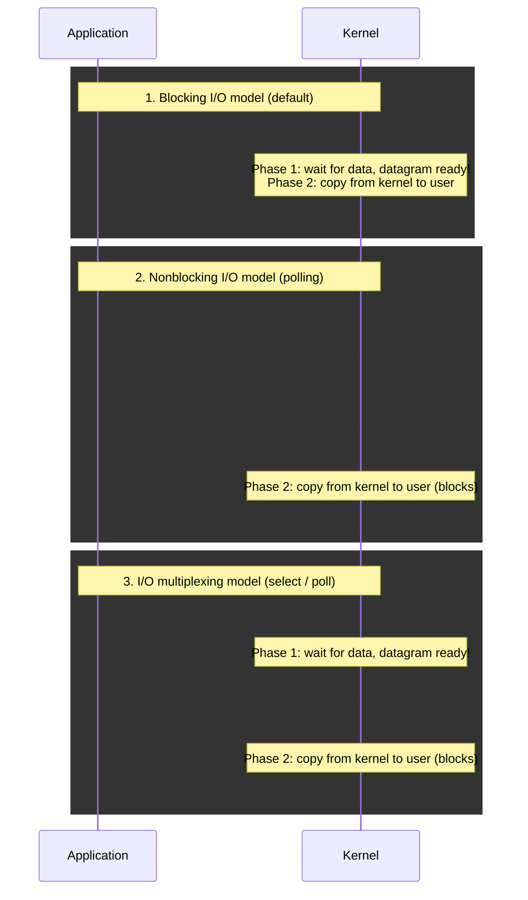

When should an application use **I/O Multiplexing**?
* When a client handles multiple descriptors simultaneously (e.g., interactive `stdin` + a network socket, or multiple concurrent sockets).
* When a single-process TCP server handles both its listening socket and multiple connected client sockets.
* When a server handles both TCP and UDP, or multiple services/protocols at once.

### 6.2 The `select()` System Call and Descriptor Readiness Conditions

The `select()` function instructs the kernel to suspend the process until one or more specified file descriptors become ready for reading, writing, or an exception condition, or until an optional timeout expires:

```c
int select(int maxfdp1, fd_set *readset, fd_set *writeset, fd_set *exceptset,
           struct timeval *timeout);
/* Returns: positive count of ready descriptors across all sets, 0 on timeout, -1 on error */

struct timeval {
    long tv_sec;  /* seconds */
    long tv_usec; /* microseconds */
};
```

* **`timeout` Behavior:**
  1. `timeout == NULL`: **Wait without a deadline**; readiness or an error such as signal interruption can end the wait.
  2. `timeout->tv_sec > 0 || timeout->tv_usec > 0`: **Wait up to a fixed time**; return when a descriptor is ready or the timer expires.
  3. `timeout->tv_sec == 0 && timeout->tv_usec == 0`: **Do not wait at all (polling)**; check descriptors and return immediately.
* **Manipulating `fd_set` Bitmasks:**
  * `void FD_ZERO(fd_set *fdset);` — Clear all bits in `fdset`.
  * `void FD_SET(int fd, fd_set *fdset);` — Turn on the bit for `fd` in `fdset`.
  * `void FD_CLR(int fd, fd_set *fdset);` — Turn off the bit for `fd` in `fdset`.
  * `int FD_ISSET(int fd, fd_set *fdset);` — Test whether the bit for `fd` is turned on in `fdset`.
* **Value-Result Sets:** Because **`select()` modifies the descriptor sets pointed to by `readset`, `writeset`, and `exceptset` in place** to indicate which descriptors are ready upon return, you must re-enable (`FD_SET`) the bits of interest before every call to `select()` in a loop!
* **Reset timeout as well:** Linux may modify the timeout structure; reconstruct it before reuse. The return value counts set bits across the returned sets, so one descriptor represented in two sets can be counted twice.
* **Why is the first argument `maxfdp1` ($`\mathrm{fd}_{max} + 1`$)?** `maxfdp1` specifies the *number* of descriptors to test starting from descriptor `0`. This is a descriptor-number bound, not the number of active descriptors. Because descriptors are zero-indexed ($`0, 1, \dots, \mathrm{fd}_{max}`$), the total count of descriptors to scan is $`\mathrm{fd}_{max} + 1`$ (e.g., to test `{1, 4, 5}`, `maxfdp1` is $`5 + 1 = 6`$).

#### Under What Conditions is a Socket Descriptor Ready in `select()`?

| Condition on Socket | Readable? | Writable? | Exception? |
|---|:---:|:---:|:---:|
| Data available to read in receive buffer | **Yes** (`read` returns $> 0$) | | |
| Read half of connection closed (**`FIN` received**) | **Yes** (read buffered bytes first, then `0` / EOF) | | |
| New connection completed on **listening socket** | **Yes** (an accept attempt can proceed; nonblocking mode protects against races) | | |
| Space available in send buffer for writing | | **Yes** | |
| Write half of connection closed | | **Yes** (`write` generates `SIGPIPE`) | |
| Pending socket error (**`RST` received**) | **Yes** (`read` returns `-1`, sets `errno`) | **Yes** (`write` returns `-1`, sets `errno`) | |
| TCP out-of-band (urgent) data arrived | | | **Yes** |

### 6.3 Revisiting `str_cli` with `select()`, Batch Input Pipelining, and `shutdown()`

#### Step 1: Event-Driven `str_cli` Using `select()`

Monitoring both descriptors lets the application react when the socket has data, EOF, or an error while waiting for keyboard input. A process exit may cause an orderly close or reset; a host failure can be silent until a timeout. This intermediate version still has line-buffering and batch-termination problems, addressed below:

```c
void str_cli(FILE *fp, int sockfd) {
    int    maxfdp1;
    fd_set rset;
    char   sendline[MAXLINE], recvline[MAXLINE];

    FD_ZERO(&rset);
    for ( ; ; ) {
        FD_SET(fileno(fp), &rset);
        FD_SET(sockfd, &rset);
        maxfdp1 = max(fileno(fp), sockfd) + 1;
        Select(maxfdp1, &rset, NULL, NULL, NULL);

        if (FD_ISSET(sockfd, &rset)) { /* socket is readable */
            if (Readline(sockfd, recvline, MAXLINE) == 0)
                err_quit("str_cli: server terminated prematurely");
            Fputs(recvline, stdout);
        }
        if (FD_ISSET(fileno(fp), &rset)) { /* input is readable */
            if (Fgets(sendline, MAXLINE, fp) == NULL)
                return; /* all done <-- BUG IN BATCH MODE! */
            Writen(sockfd, sendline, strlen(sendline));
        }
    }
}
```

#### Step 2: The Batch Input Problem and Stop-and-Wait vs. Full-Duplex Pipelining

The original `str_cli` operated in **stop-and-wait mode**: it sent one line, waited $1\text{ RTT}$ for the echoed reply, and then sent the next line.
* **Numerical Example:** Suppose `ping` measures an average $\text{RTT} = 175\text{ ms}$ ($0.175\text{ s}$) for $84\text{-byte}$ IP datagrams. We want to echo the first $2,000$ lines of a $98,349\text{-byte}$ file ($\approx 49\text{ bytes/line}$; adding the $20\text{-byte}$ IP header and $20\text{-byte}$ TCP header yields roughly an $89\text{-byte}$ IP packet, comparable to but not equal to the ping packet).
* In stop-and-wait mode, sending $2,000$ lines requires:

$$T_{\text{total}} \approx 2,000 \times 0.175\text{ s} = 350\text{ seconds}\quad (\text{measured time: } \approx 354\text{ seconds!})$$

Because the network pipe has a propagation delay (say, 4 time units each way, so $1\text{ RTT} = 8$ time units), the illustrative one-unit-send/eight-unit-cycle model spends about seven eighths of its cycle waiting. The exact utilization depends on serialization time and on how RTT is defined.

With our `select()`-based `str_cli` redirected from an input file in **batch mode**, `stdin` is always ready, so the client pipelines requests continuously into the full-duplex pipe (`request 1` at time 0, `request 2` at time 1, ..., `request 8` at time 7 while `reply 1..4` are simultaneously in flight returning from the server).

**However, a critical bug occurs when the input file has 9 lines and reaches EOF at time 8:**
1. At time 8, `Fgets()` reads the 9th line, and on the next iteration returns `NULL` (EOF on `stdin`).
2. The first `select()`-based `str_cli` immediately executes `return;` to `main()`, which calls `exit(0)` and closes the socket—**while requests 6–9 and replies 2–5 are still in flight inside the network pipe.** As a result, the output can be truncated because the client stops reading before all replies arrive.
3. Furthermore, because `Fgets()` and `Readline()` use internal user-space buffers hidden from `select()`, mixing buffered line functions with `select()` is unsafe.

#### Step 3: Fixing Batch Mode with `shutdown()` (TCP Half-Close) and Raw Buffer I/O

In batch mode, reaching EOF on `stdin` only means we have finished *writing* to the socket; we have not finished *reading* echoed replies from the socket. We need to send a `FIN` to the server (closing the write half of the connection) while keeping the read half open. This is accomplished with `shutdown()`:

```c
int shutdown(int sockfd, int howto);
/* Returns: 0 if OK, -1 on error */
```

#### Two Key Differences Between `close()` and `shutdown()`

1. **Reference Count Independence:** `close()` releases one reference to the underlying socket and sends a `FIN` only when the count reaches `0`. **`shutdown(SHUT_WR)` disables further sends on the underlying socket even if duplicate descriptors remain. FIN follows queued data; `SHUT_RD` alone does not send FIN.**
2. **Directional Control (`howto`):** `close()` releases this descriptor, so the caller loses both I/O directions through it; other references can keep the socket alive. `shutdown()` allows closing a single half of the full-duplex connection:
   * `SHUT_RD`: Disable further receive operations; exact handling of queued data is platform-dependent.
   * `SHUT_WR`: Close the write half of the socket (**half-close**: send any queued data followed by a `FIN`, while leaving the socket open for reading).
   * `SHUT_RDWR`: Close both the read half and the write half (`SHUT_RD` followed by `SHUT_WR`).

#### Half-Close-Aware `str_cli` (Blocking Teaching Example)

```c
void str_cli(FILE *fp, int sockfd) {
    int    maxfdp1, stdineof;
    fd_set rset;
    char   buf[MAXLINE];
    ssize_t n;

    stdineof = 0;
    FD_ZERO(&rset);
    for ( ; ; ) {
        if (stdineof == 0)
            FD_SET(fileno(fp), &rset);
        FD_SET(sockfd, &rset);
        maxfdp1 = max(fileno(fp), sockfd) + 1;
        Select(maxfdp1, &rset, NULL, NULL, NULL);

        if (FD_ISSET(sockfd, &rset)) { /* socket is readable */
            if ((n = Read(sockfd, buf, MAXLINE)) == 0) {
                if (stdineof == 1)
                    return; /* normal termination: peer finished sending */
                else
                    err_quit("str_cli: server terminated prematurely");
            }
            Writen(fileno(stdout), buf, (size_t)n);
        }

        if (FD_ISSET(fileno(fp), &rset)) { /* input is readable */
            if ((n = Read(fileno(fp), buf, MAXLINE)) == 0) {
                stdineof = 1;
                Shutdown(sockfd, SHUT_WR); /* send FIN (half-close) */
                FD_CLR(fileno(fp), &rset);
                continue;
            }
            Writen(sockfd, buf, n);
        }
    }
}
```

---

## 7. Server Architectures, Denial-of-Service Attacks, and Modern High-Speed I/O

**Limit of the half-close client:** This fixes premature termination and hidden input buffering, but `Writen()` can still block on either output. It is a blocking teaching example, not a fully asynchronous implementation.

### 7.1 Iterative vs. Concurrent Servers and Concurrency Mechanisms

* **Flaw of Iterative Servers:** An iterative server handles one client completely before calling `accept()` for the next client. If `Client 1` connects to an iterative echo server and its user "goes out to lunch" without typing a line (or closing the connection), the server blocks indefinitely inside `read()` waiting for `Client 1`. Meanwhile, `Client 2`'s connection sits in the kernel queue and cannot be serviced until after lunch!
* **Solution — Concurrent Servers:** Serve multiple clients simultaneously using one of **three concurrency mechanisms**:
  1. **Processes (`fork()`):** The kernel automatically interleaves multiple logical control flows, and each flow has its own **private address space**.
  2. **Threads (`pthread_create()`):** The kernel automatically interleaves multiple logical control flows, and all flows **share the same address space**.
  3. **Event-Based I/O Multiplexing (`select()`):** A single user-space process **manually interleaves** multiple logical flows within a single address space using `select()`.
     * **Pros:** One logical control flow; easy to single-step in a debugger (`gdb`); no per-connection process creation or thread-switching requirement (historically the design of choice for high-performance web servers and search engines).
     * **Cons:** Significantly more complex to code (requires explicit per-client state machines) and vulnerable to single-client blocking Denial-of-Service attacks if coded carelessly.

### 7.2 Event-Driven Single-Process Server Using `select()`

To serve multiple clients concurrently inside a single process without `fork()`, the server maintains two data structures:
1. `fd_set allset`: The master read descriptor bitmask tracking `listenfd` (descriptor `3` in this example, assuming no other descriptors were already open) plus all currently active `connfd` descriptors.
2. `int client[FD_SETSIZE]`: An integer array (initialized to `-1`) storing the active `connfd` values, along with `maxi` (the highest index in `client[]` currently in use) and `maxfd` (the highest descriptor number for `select(maxfd + 1, ...)`).

| Event | Active client descriptors | Master read-interest set | `maxfd + 1` |
| --- | --- | --- | ---: |
| Before clients | None | {3} | 4 |
| First client accepted | {4} | {3, 4} | 5 |
| Second client accepted | {4, 5} | {3, 4, 5} | 6 |
| First client closes | {5} | {3, 5} | 6 |

Descriptor 3 is the listening socket in this example. The **master interest set** is distinct from the `rset` result returned by select, which contains only ready descriptors.

#### Baseline `select()`-Based Concurrent TCP Echo Server

```c
int main(int argc, char **argv) {
    int                i, maxi, maxfd, listenfd, connfd, sockfd;
    int                nready, client[FD_SETSIZE];
    ssize_t            n;
    fd_set             rset, allset;
    char               buf[MAXLINE];
    socklen_t          clilen;
    struct sockaddr_in cliaddr, servaddr;

    listenfd = Socket(AF_INET, SOCK_STREAM, 0);
    bzero(&servaddr, sizeof(servaddr));
    servaddr.sin_family      = AF_INET;
    servaddr.sin_addr.s_addr = htonl(INADDR_ANY);
    servaddr.sin_port        = htons(SERV_PORT);

    Bind(listenfd, (SA *) &servaddr, sizeof(servaddr));
    Listen(listenfd, LISTENQ);

    maxfd = listenfd; /* initialize */
    maxi  = -1;       /* index into client[] array */
    for (i = 0; i < FD_SETSIZE; i++)
        client[i] = -1; /* -1 indicates available entry */
    if (listenfd >= FD_SETSIZE)
        err_quit("listening descriptor exceeds FD_SETSIZE");
    FD_ZERO(&allset);
    FD_SET(listenfd, &allset);

    for ( ; ; ) {
        rset   = allset; /* structure assignment */
        nready = Select(maxfd + 1, &rset, NULL, NULL, NULL);

        if (FD_ISSET(listenfd, &rset)) { /* new client connection */
            clilen = sizeof(cliaddr);
            connfd = Accept(listenfd, (SA *) &cliaddr, &clilen);

            for (i = 0; i < FD_SETSIZE; i++)
                if (client[i] < 0) {
                    client[i] = connfd; /* save descriptor */
                    break;
                }
            if (i == FD_SETSIZE)
                err_quit("too many clients");

            if (connfd >= FD_SETSIZE) {
                Close(connfd);
                client[i] = -1;
                continue;
            }
            FD_SET(connfd, &allset); /* fd value must fit the bitmap */
            if (connfd > maxfd)
                maxfd = connfd;      /* for select */
            if (i > maxi)
                maxi = i;            /* max index in client[] array */

            if (--nready <= 0)
                continue;            /* no more readable descriptors */
        }

        for (i = 0; i <= maxi; i++) { /* check all clients for data */
            if ((sockfd = client[i]) < 0)
                continue;
            if (FD_ISSET(sockfd, &rset)) {
                if ((n = Read(sockfd, buf, MAXLINE)) == 0) {
                    /* connection closed by client */
                    Close(sockfd);
                    FD_CLR(sockfd, &allset);
                    client[i] = -1;
                } else {
                    Writen(sockfd, buf, n);
                }
                if (--nready <= 0)
                    break; /* no more readable descriptors */
            }
        }
    }
}
```

**Limit of this example:** `Writen()` still blocks if a peer stops reading, so read multiplexing alone is not a production event loop. A fully nonblocking design maintains an output queue per client, monitors writability only while that queue is nonempty, and handles partial writes and `EAGAIN`. Apply timeouts and bounds to both input and output buffers.

### 7.3 Denial-of-Service Attacks (Partial Lines) and Per-Client State Machines

Even a `select()`-based server is vulnerable to two classic **Denial-of-Service (DoS) attacks**:

1. **Attack #1 — Connection Exhaustion:** Idle connections consume descriptors, buffers, and application state. In the simplified layout with descriptors 0–3 already occupied and a 1024-bit set, only 1020 further descriptor values fit. Real limits depend on existing descriptors and OS configuration; **FD_SETSIZE bounds descriptor values, not merely the count of clients**.
2. **Attack #2 — Partial Line Hanging:** Suppose the `select()`-based server processes line-oriented requests by calling `readline()` (or `Rio_readlineb()`) whenever `select()` reports a client socket as readable. What happens if a malicious or flaky client connects, sends `"Hello world"` (**without the trailing `\n`**), and goes to sleep?
   * `select()` sees data in the socket buffer and reports the descriptor as readable.
   * The server calls `readline()`, which reads `"Hello world"` and then **blocks inside a second `read()` call waiting for the missing `\n`.**
   * The entire single-process server is now frozen waiting on this one client and cannot accept new connections or service any other connected clients!

**Event-loop rule:** A shared event loop must not wait indefinitely for one client. Readiness of a descriptor does not promise a complete message or enough output space for a whole reply.

**Solutions:**
* Use **non-blocking I/O** (`O_NONBLOCK`), place **timeouts** on I/O operations, or service each client in a separate thread/process; **AND**
* **Break up line reading into partial reads using a per-client state machine:** Whenever `select()` selects a connection, perform bounded nonblocking reads, often draining available bytes until `EAGAIN`/`EWOULDBLOCK` to read whatever bytes are currently available, append those bytes into a **dedicated per-client buffer** (where each client's state tracks `{connfd, partial_line_buf, char_count}`), and only process the message once the full delimiter (`\n`) has arrived.

### 7.4 Beyond `select()`: C10K (`epoll`/`kqueue`), C10M (`io_uring`, XDP, DPDK), and Messaging Middleware

#### 1. The C10K Problem: Why `select()` Ran Out

In 1999, Dan Kegel posed the **C10K problem**: *Can a single server handle 10,000 concurrent connections?*
* **Why `select()` fails at scale:** `select()` has a hard compile-time descriptor limit (`FD_SETSIZE = 1024`) and requires passing and linearly rescanning the entire bitmask on every call. Its CPU cost grows linearly with the **number of connections watched ($O(N)$)** rather than the number of connections actually active.
* **Why thread-per-connection fails differently:** A thread per connection can consume substantial stack memory and scheduling resources; the practical limit depends on thread implementation and workload.
* **The C10K Solution:** Stateful, event-driven kernel APIs whose cost scales with **ready work**, avoiding repeated full-set scans; they do not provide a blanket $O(1)$ guarantee for all operations: **`epoll`** (Linux), **`kqueue`** (BSD/macOS), **IOCP** (Windows), and event-driven servers like **nginx**.

#### 2. The C10M Problem: When the OS Kernel Becomes the Bottleneck

In 2013, Robert Graham posed the **C10M problem**: at **10 million concurrent connections**, kernel packet processing can become a bottleneck because of per-packet system calls, hardware interrupts, memory copies between kernel and user space, and lost CPU cache locality. Three modern tiers of solutions address this:

| Approach | Main change | What remains to handle |
| --- | --- | --- |
| Traditional sockets | Kernel TCP/IP with application syscalls | Framing, buffering, errors, and scheduling |
| `io_uring` | Shared submission/completion rings and batching | Completion handling and buffer lifetime |
| XDP / AF_XDP | Early packet processing or packet buffers exposed to user space | Mode/driver capabilities and any protocol logic bypassed |
| DPDK with a user-space transport | Bypass normal kernel packet processing | Transport stack, resource isolation, polling, and tuning |

* **`io_uring`:** Modern Linux asynchronous I/O using shared memory ring buffers between user space and kernel space, batching operations with fewer syscalls and supporting zero-copy sends.
* **XDP / `AF_XDP`:** XDP can run verified eBPF in the driver before normal stack processing. AF_XDP exposes packet buffers to user space; zero-copy is conditional on driver support and mode. Generic and offloaded XDP modes have different execution points.
* **DPDK and User-Space TCP Stacks (`mTCP`, `F-Stack`, `TAS`, `Junction`):** Bypass the normal kernel packet-processing path, mapping the NIC directly into user space.
* **What Kernel Bypass Costs (Awamoto & Honda, USENIX ATC 2025):**
  * A continuously busy-polling DPDK worker can consume a core even while idle; power-aware modes and design choices change that cost.
  * Often needs careful memory allocation, CPU affinity, driver support, and operational tuning; exact requirements depend on the chosen stack.
  * Gives user space direct hardware access (IOMMU and VFIO mitigate, but do not eliminate, the security risk).
  * *Takeaway:* Measure the workload before choosing bypass. The cited study compares stacks and does not establish a universal winner for every connection count or traffic pattern.

#### 3. Above the Socket: Message-Oriented Middleware (MOM)

Because raw TCP is an unframed byte stream, programmers must write plumbing like `readn`, `writen`, `readline`, reconnection loops, and per-client framing buffers. **Message-Oriented Middleware** raises the abstraction level:

* **ZeroMQ (2007) $\to$ nanomsg (2012) $\to$ NNG:** A brokerless, socket-like messaging lineage that **preserves message boundaries** (eliminating the framing problem), provides automatic reconnection and queueing, and exposes high-level communication patterns (`REQ/REP`, `PUB/SUB`, `PUSH/PULL`) instead of raw point-to-point connections.
* **NATS:** Cloud-native publish/subscribe and request-reply messaging.
* **Aeron:** Ultra-low-latency message transport used where latency dominates (e.g., high-frequency finance).
* **Zenoh:** Unified protocol for robotics and edge computing (data in motion and data at rest).
* **Apache Kafka:** A durable, distributed, replayable commit log—a storage/streaming system rather than a transport protocol.
* **Architectural Trade-off:** *You stop writing plumbing, and stop seeing the connection.* Middleware changes how connection state, backpressure, and failures are exposed; engineers must know what visibility they traded away for convenience.

---

## 8. Debugging, Testing, Pitfalls, and Best Practices

### 8.1 Debugging Network Programs with GDB and Testing with `telnet` / `netstat`

#### Testing ASCII Servers with `telnet` and Inspecting States with `netstat`

* **`telnet <host> <portnumber>`:** Opens a TCP connection but can also exchange Telnet protocol negotiation bytes to `<host>` on `<portnumber>`, making it a useful historical tool for interactively testing ASCII line-based servers (Echo, Daytime, HTTP web servers, SMTP mail servers) before writing client code.
* **`netstat`:** Displays active network connections, TCP states (`LISTEN`, `ESTABLISHED`, `TIME_WAIT`, `CLOSE_WAIT`), routing tables, and interface statistics.

#### Debugging with GDB (and DDD)

* **Compilation:** For a straightforward teaching session, compile with `-g -O0`. `-Og` is another useful debugging choice; optimized code can also be debugged, but source-level stepping and variable visibility may be less intuitive.
* **Starting GDB:**
  * Live execution: `gdb progname`, then inside GDB run `run args` (supports shell redirection, e.g., `run < infile > /dev/null`).
  * Post-mortem crash analysis on a core dump: `gdb progname core`.
* **Controlling Execution:**
  * Set breakpoints: `break main`, `break foo.c:4`, `break 16`.
  * Resume execution: `cont`. Pause a hanging program: `CTRL-C` (`SIGINT`).
  * Single-step: `step N` (steps into function calls) vs. `next` (treats a function call as a single line). *Tip:* Avoid writing nested "mega-expressions" like `foo(bar(tmp = baz(), tmp2 = baz2()))` which are difficult to step through.
* **Examining State:**
  * Stack trace: `backtrace` (`bt`), `bt full` (prints all local variables), and `up`/`down` to navigate stack frames.
  * Evaluate expressions: `print EXP`.
  * Inspect raw memory: `x/<count><format><size> ADDR` (formats: `o` octal, `x` hex, `d` decimal, `u` unsigned, `t` binary, `f` float, `a` address, `i` instruction, `c` char, `s` string; sizes: `b` byte, `h` halfword/2B, `w` word/4B, `g` giant/8B).

### 8.2 Summary of Pitfalls and Best Practices

| Category | Common Pitfall | Best Practice |
|---|---|---|
| **Message Framing** | Assuming TCP preserves message boundaries (`one write equals one read`). | Always loop on `read()` and use framing (`readn`, `writen`, length prefixes, or delimiters) on raw byte buffers. |
| **Buffering & Multiplexing** | Mixing `stdio` (`fgets`) or static `readline` buffers with `select()`. | Operate on unbuffered byte chunks (`Read`/`Write`) with explicit per-client state machines so unread bytes are never hidden from `select()`. |
| **Server Concurrency** | Using blocking per-client reads in a single-process server (vulnerable to partial-line DoS). | Use non-blocking I/O, per-client state machines, timeouts, or separate threads/processes. |
| **Scalability** | Using `select()` for thousands of connections (hard `FD_SETSIZE` limit + $O(N)$ scan). | Prefer **`epoll`** (Linux) or **`kqueue`** (BSD) to avoid repeatedly scanning the complete watched set. |
| **Batch / Full-Duplex Close** | Calling `close()` immediately upon `stdin` EOF while replies are still in flight. | Call **`shutdown(sockfd, SHUT_WR)`** to send a `FIN` (half-close) while keeping the socket open for reading until the peer sends EOF. |
| **Connection Teardown** | Ignoring `TIME_WAIT` or misconfiguring `SO_LINGER` / $\text{MSL}$, causing `"Address already in use"` (`EADDRINUSE`) errors or corrupted reincarnations. | Respect `TIME_WAIT` ($2\text{MSL}$) for connection correctness and use `SO_REUSEADDR` appropriately on listening servers. |
| **Byte Ordering & IPv4/IPv6** | Forgetting `htons`/`htonl`/`ntohs`/`ntohl` or hardcoding IPv4-only `sockaddr_in` and `gethostbyname()`. | Always convert multi-byte header fields between host and network byte order; resolve names with **`getaddrinfo()`** and store addresses in **`sockaddr_storage`**. |
| **Resource Management** | Failing to check return codes or forgetting to `close(connfd)` (especially across `fork()`). | Use error-checking wrapper functions and close descriptors promptly to prevent file descriptor leaks. |

## Revision notes and references

Historical BSD timing, queue, and port examples have been retained as historical examples. Corrections address address-family byte order, port ranges, EOF after buffered data, select's mutable timeout, TIME_WAIT exceptions, partial writes, static reader state, and conditional zero-copy support. Course code remains pedagogical: wrappers and blocking examples are labeled explicitly. The supplied course suffix DIT661 has not been verified against an original slide deck.

- [Linux listen(2)](https://man7.org/linux/man-pages/man2/listen.2.html), [accept(2)](https://man7.org/linux/man-pages/man2/accept.2.html), [select(2)](https://man7.org/linux/man-pages/man2/select.2.html), and [shutdown(2)](https://man7.org/linux/man-pages/man2/shutdown.2.html): API semantics and portability boundaries.
- [RFC 9293 — TCP](https://www.rfc-editor.org/rfc/rfc9293): connection state and orderly close.
- [IANA port registry](https://www.iana.org/assignments/service-names-port-numbers/): system, user, and dynamic/private ranges.
- [Linux epoll(7)](https://man7.org/linux/man-pages/man7/epoll.7.html) and [AF_XDP documentation](https://docs.kernel.org/networking/af_xdp.html): readiness and packet-I/O mechanisms.
- [Awamoto and Honda, Opening Up Kernel-Bypass TCP Stacks, USENIX ATC 2025](https://www.usenix.org/conference/atc25/presentation/awamoto): empirical comparison rather than a universal bypass recommendation.
