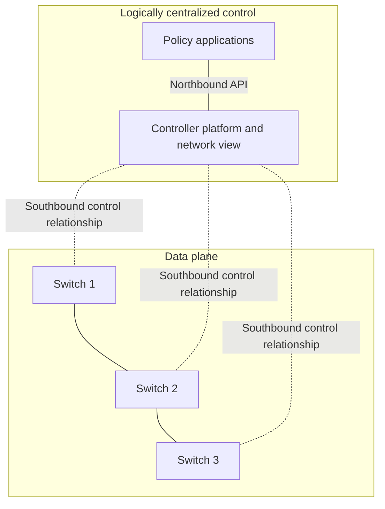
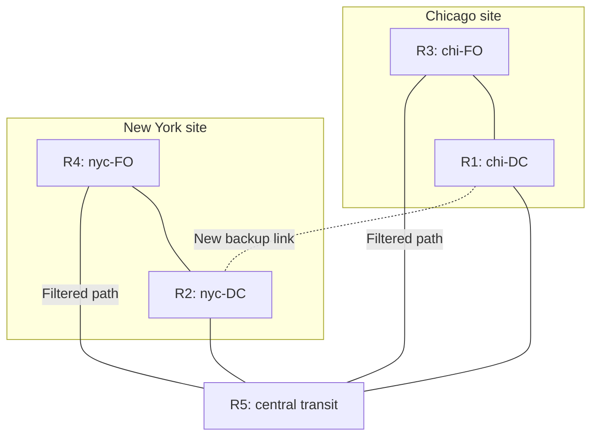
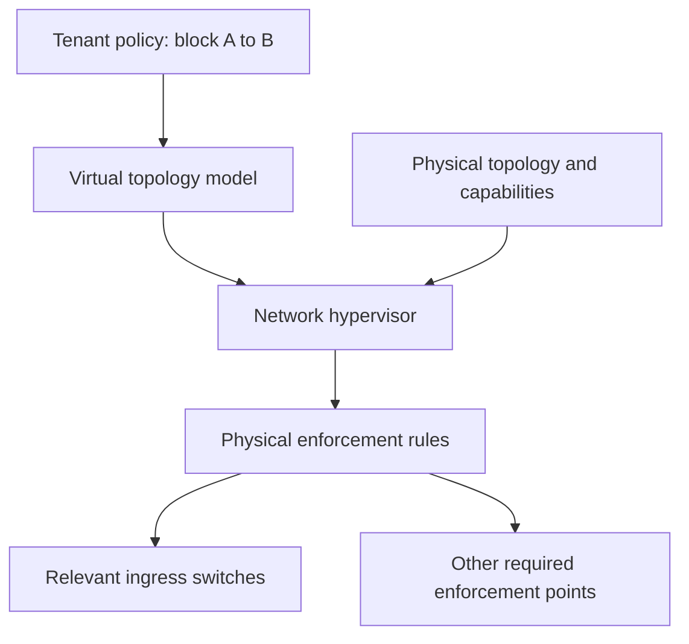
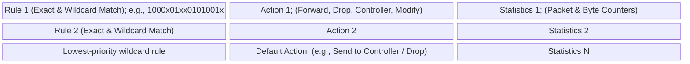
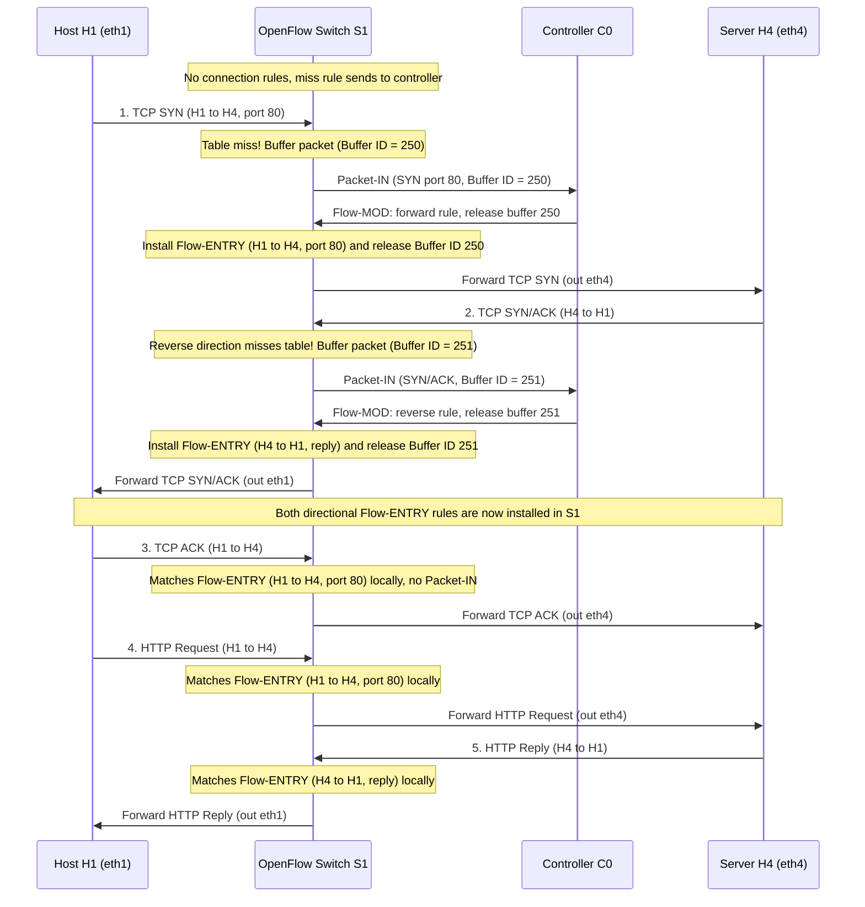

# Software-Defined Networking (SDN) and OpenFlow (EDA387; supplied guide labels DIT663)

**Revised:** 21 October 2026

**† Supplementary material:** Content identified by the supplied guide as originating exclusively from hidden slides. It may not be included in this year's examinable material. The supplied guide reports no hidden substantive slides; that classification has been retained.

## Glossary

| Term | Full name | Meaning |
|---|---|---|
| 4D | 4D Network Architecture | A mid-2000s clean-slate architecture (Princeton/CMU) separating network control into four planes (Decision, Dissemination, Discovery, Data), laying conceptual groundwork for SDN. |
| ACL | Access Control List | A list of packet-filtering rules specifying which traffic is permitted or denied across a network interface or router. |
| Active Networking | Active Networking | A 1990s research initiative that first attempted to make networks programmable by demultiplexing packets to custom software programs running on switches. |
| AS | Autonomous System | An independently operated network domain participating in inter-domain routing via BGP. |
| BGP | Border Gateway Protocol | The standard inter-domain routing protocol of the Internet, which advertises prefix reachability and path attributes under policy and exchanges routes with configured peers and propagates permitted reachability across many ASes. |
| Buffer ID | OpenFlow Packet Buffer Identifier | An identifier assigned by an OpenFlow switch to a packet temporarily stored in local switch memory while awaiting a forwarding decision from the controller. |
| Control Plane | Network Control Plane | The logic and software that computes forwarding state (routing tables, paths, failure recovery) and determines how and where packets should be forwarded. |
| Control Program | SDN Control Application | An application running on top of the Network OS (via the northbound interface) that takes a global network view as input and outputs device configurations or policy decisions. |
| Data Plane | Network Data (Forwarding) Plane | The high-speed hardware subsystem (line cards, switching fabric) that processes and delivers individual packets based on local forwarding state. |
| Dijkstra's Algorithm | Dijkstra's Shortest-Path Algorithm | Graph algorithm executed by link-state routing protocols (OSPF, IS-IS) to compute shortest-path trees from a global topology map. |
| Ethane / SANE | Ethane and SANE | Stanford/Berkeley enterprise security architectures (2006–2007) using a centralized controller to enforce flow-level access control; direct precursors to OpenFlow. |
| `Flow-MOD` | OpenFlow Modify Flow Entry Message | Control message sent by an OpenFlow controller to a switch to install, modify, or delete a `<Match, Action>` rule in the switch's flow table. |
| Flow Table | OpenFlow Switch Flow Table | Hardware/software table inside an SDN switch containing prioritized `<Rule, Action, Statistics>` entries used to process arriving packets. |
| ForCES | Forwarding and Control Element Separation | An IETF working group and standard (2003–2007) defining open interfaces between separated control and forwarding elements. |
| Hard Timeout | OpenFlow Hard Timeout | A flow-entry timer that deletes a rule from the switch's flow table after a fixed number of seconds, regardless of whether packets are matching the rule. |
| Idle Timeout | OpenFlow Idle Timeout | A flow-entry timer that deletes a rule from the switch's flow table if no packets match the rule for a specified number of seconds. |
| In-Band Control | In-Band SDN Control Plane | An SDN deployment mode in which control traffic between switches and the controller shares the same physical links and ports as regular data-plane traffic. |
| IS-IS | Intermediate System to Intermediate System | A distributed link-state interior gateway routing protocol. |
| Management Plane | Network Management Plane | The human-timescale layer responsible for configuring, tuning, provisioning devices, setting link weights for traffic engineering, and defining ACL policies. |
| `<Match, Action>` | Match-Action Forwarding Primitive | The core data-plane abstraction in OpenFlow: match supported header fields (exact or masked where supported) and perform an action (forward, drop, send to controller, rewrite header). |
| Merchant Silicon | Merchant Switching Silicon | Off-the-shelf, commercially available switching chipsets (e.g., Broadcom) sold to any hardware vendor, democratizing switch manufacturing. |
| Network Hypervisor | SDN Network Hypervisor | Software layer (such as FlowVisor or Nicira NVP) that slices or virtualizes a physical SDN infrastructure so multiple tenants can run independent virtual topologies simultaneously. |
| Network OS (NOS) | Network Operating System | A distributed software system running on SDN controller servers (e.g., NOX, ONIX, Floodlight, OpenDaylight) that maintains network-wide state with implementation-dependent freshness and consistency. |
| Northbound Interface | SDN Northbound API | The programmatic interface between the SDN Controller (Network OS) and high-level network applications (Control Programs). |
| ONF | Open Networking Foundation | Industry consortium founded by major operators and tech companies (Google, Facebook, Microsoft, Deutsche Telekom, Verizon, Yahoo, etc.) to standardize OpenFlow and promote SDN. |
| OpenFlow | OpenFlow Protocol | A southbound communication protocol and forwarding abstraction between an SDN controller (control path) and switch flow tables (hardware data path). |
| OSPF | Open Shortest Path First | A widely used distributed link-state routing protocol that floods topology updates and runs Dijkstra's algorithm on every router. |
| Out-of-Band Control | Out-of-Band SDN Control Plane | An SDN deployment mode using a physically or logically separate dedicated management network to carry control traffic between the controller and switches. |
| `Packet-IN` | OpenFlow Packet-In Message | Message sent from an OpenFlow switch to the controller when configured packet-processing rules request controller delivery, including a suitable table-miss action. |
| `Packet-OUT` | OpenFlow Packet-Out Message | Message sent from an OpenFlow controller to a switch instructing it to inject or forward a specific packet out of specified switch port(s) without installing a persistent flow rule. |
| RCP | Routing Control Platform | A 2004–2005 architecture proposing logically centralized route computation within an Autonomous System. |
| SDN | Software Defined Network | A network architecture in which the control plane is decoupled from the data plane, often on separate servers, and a single logically centralized control plane controls multiple forwarding devices. |
| Southbound Interface | SDN Southbound API | The protocol interface (such as OpenFlow) between the SDN Controller (control plane) and physical/virtual network switches (data plane). |
| TCAM | Ternary Content-Addressable Memory | High-speed hardware memory in switches that supports ternary bit matching (0, 1, or don't-care); table capacity and supported fields constrain forwarding rules. |
| Traffic Engineering | Network Traffic Engineering (TE) | The process of optimizing network performance by steering traffic across paths to balance load, minimize congestion, or meet latency goals. |

## Contents

- [1. What is Software Defined Networking (SDN)?](#1-what-is-software-defined-networking-sdn)
  - [1.1 Core Definition and Architectural Shift](#11-core-definition-and-architectural-shift)
  - [1.2 Industry Adoption and Real-World Impact](#12-industry-adoption-and-real-world-impact)
- [2. The Three Networking Planes and Traditional Network Challenges](#2-the-three-networking-planes-and-traditional-network-challenges)
  - [2.1 Data, Control, and Management Planes](#21-data-control-and-management-planes)
  - [2.2 Comparison of Operational Timescales, Tasks, and Locations](#22-comparison-of-operational-timescales-tasks-and-locations)
  - [2.3 Why Traditional Networks Are Hard to Reason About and Evolve](#23-why-traditional-networks-are-hard-to-reason-about-and-evolve)
  - [2.4 Motivating Case Study 1: Inter-Domain Routing (BGP Limitations)](#24-motivating-case-study-1-inter-domain-routing-bgp-limitations)
  - [2.5 Motivating Case Study 2: Distributed Access Control Failure](#25-motivating-case-study-2-distributed-access-control-failure)
- [3. SDN Architecture: Network OS, Control Programs, and Virtualization](#3-sdn-architecture-network-os-control-programs-and-virtualization)
  - [3.1 Vertically Integrated Appliances vs. Open Horizontal SDN Stack](#31-vertically-integrated-appliances-vs-open-horizontal-sdn-stack)
  - [3.2 The Network OS (NOS) and Control Programs](#32-the-network-os-nos-and-control-programs)
  - [3.3 Forwarding Abstraction and Network Virtualization](#33-forwarding-abstraction-and-network-virtualization)
- [4. OpenFlow Protocol Basics and Execution Walkthrough](#4-openflow-protocol-basics-and-execution-walkthrough)
  - [4.1 The <Match, Action> Primitive and Switch Flow Tables](#41-the-match-action-primitive-and-switch-flow-tables)
  - [4.2 Step-by-Step Execution Example: TCP Handshake and HTTP over OpenFlow](#42-step-by-step-execution-example-tcp-handshake-and-http-over-openflow)
  - [4.3 Out-of-Band vs. In-Band SDN Control Planes](#43-out-of-band-vs-in-band-sdn-control-planes)
- [5. Intellectual History, Industry Drivers, and Practical Challenges](#5-intellectual-history-industry-drivers-and-practical-challenges)
  - [5.1 The Road to SDN (1990s–2008)](#51-the-road-to-sdn-1990s2008)
  - [5.2 Why SDN Happened When It Did: Technical and Economic Drivers](#52-why-sdn-happened-when-it-did-technical-and-economic-drivers)
  - [5.3 Practical and Algorithmic Challenges (4D / SDN)](#53-practical-and-algorithmic-challenges-4d--sdn)
- [6. Summary and Key Takeaways](#6-summary-and-key-takeaways)
- [Glossary](#glossary)
- [Revision notes and references](#revision-notes-and-references)

## 1. What is Software Defined Networking (SDN)?

### 1.1 Core Definition and Architectural Shift

A **Software Defined Network (SDN)** is defined by two fundamental architectural properties:

1. **Separation of control and forwarding:** Control logic is decoupled from packet forwarding, commonly running on separate controller servers in the architecture studied here.
2. **Logically centralized control:** A single (**logically centralized**, though often physically distributed for reliability and scale) control plane controls multiple forwarding devices across the network.

In a traditional network, routers and switches typically combine local control software with packet forwarding, running distributed algorithms to exchange state with neighbors. In contrast, SDN extracts the control intelligence out of the individual switches and consolidates it into a **Network Operating System (Network OS)** that maintains a **Global Network Map** and exposes programmatic interfaces to high-level **Control Programs**:

Solid switch links denote data-plane connectivity; dotted links denote logical control relationships, which can share or use separate physical links. A traditional design instead places cooperating control processes in the routers themselves. Logical centralization does not require a single controller machine.

As illustrated in the canonical SDN layering model (e.g., Nencioni et al., 2017), the **Control Plane** (implemented by one or more SDN controllers) sits in the middle between two well-defined boundaries:

* **Northbound Interface:** Connects the SDN controller(s) upward to **Network Applications (Control Programs)** that define routing, security, and traffic-engineering policies.
* **Southbound Interface:** Connects the SDN controller(s) downward to the **Network Devices** in the **Data Plane** that forward packets.

### 1.2 Industry Adoption and Real-World Impact

SDN rapidly transitioned from an academic research concept at Stanford and UC Berkeley into an influential family of operational designs:

* **Production Wide-Area Backbones:** Google's B4 inter-datacenter WAN is a historical production example of centralized traffic engineering and OpenFlow-controlled forwarding. This is a claim about the published B4 architecture, not every Google network or its current implementation.
* **Commercialization:** VMware acquired SDN pioneer **Nicira** for $\$1.2\text{ billion}$ (mostly cash), validating network virtualization as a major commercial market.
* **Open Networking Foundation (ONF):** Major telecommunications providers, cloud operators, and financial institutions—including **Deutsche Telekom, Facebook, Google, Microsoft, Verizon, and Yahoo.** among the founding organizations—participated in the ONF ecosystem; the supplied guide also names Goldman Sachs and NTT Communications. Its purpose was to standardize OpenFlow and drive SDN adoption.

---

## 2. The Three Networking Planes and Traditional Network Challenges

### 2.1 Data, Control, and Management Planes

The **data plane** handles individual packets using local forwarding state. It matches headers and applies actions such as forwarding, filtering, buffering, or scheduling. A hardware router commonly implements this work in line cards and a switching fabric, while software switches implement it in code. For example, destination `1.2.3.7` can match `1.2.3.0/24 → LAN 1`; a different prefix, `5.6.7.0/24`, can map to a WAN interface.

The **control plane** computes that forwarding state. It handles routing, path selection, circuit setup, and failure recovery. In OSPF or IS-IS, routers flood descriptions of their local links within a routing scope, then independently run a shortest-path calculation on the resulting topology. The protocol is distributed even though each router can obtain a topology map.

The **management plane** defines and maintains operational intent: provisioning devices, configuring ACLs, monitoring traffic, and setting policy. In ordinary OSPF traffic engineering, an operator adjusts integer link weights to influence the paths Dijkstra selects. Weights might reflect capacity, propagation delay, or an optimization using a traffic matrix. This is indirect control: choosing weights is not the same operation as installing an explicit end-to-end path.

The boundaries overlap in practice. Traffic engineering, for example, can include management policy, control-plane computation, and data-plane enforcement.

### 2.2 Comparison of Operational Timescales, Tasks, and Locations

The planes describe responsibilities, not rigid deployment rules. These are indicative timescales; automated management and local failure recovery can operate much faster:

| Property | Data Plane | Control Plane | Management Plane |
|---|---|---|---|
| **Timescale** | **Per packet** (hardware can act at nanosecond scales) | **Event** ($10\text{ ms}$ to $\text{seconds}$) | **Policy/operations** (often seconds to hours) |
| **Core Tasks** | Forwarding, buffering, filtering, scheduling | Routing, circuit setup, failure recovery | Traffic analysis, ACL/weight configuration, provisioning |
| **Execution Location** | Line-card hardware (ASICs / TCAM) | Router software (or SDN controller) | Humans or management scripts |

### 2.3 Why Traditional Networks Are Hard to Reason About and Evolve

In conventional networks where control is tightly coupled to each router's software and distributed protocols, operators face four structural problems:

1. **(Too) many task-specific control mechanisms:** Separate, non-modular protocols exist for every narrow task (OSPF, BGP, VLANs, Spanning Tree, MPLS, ACLs), offering limited functionality and limited modularity across vendor and protocol boundaries.
2. **Indirect control:** Operators cannot directly program the paths they want. Instead, they must **invert protocol behavior** and "coax" distributed protocols into doing what they want—such as tweaking OSPF link weights by trial and error to shift traffic away from a congested link.
3. **Uncoordinated control:** Because routers run asynchronous distributed algorithms, ordinary asynchronous protocol operation does not by itself give the operator a network-wide atomic update during a topology or policy change, leading to transient forwarding loops, black holes, or security violations.
4. **Complex interacting protocols and mechanisms:** Routing, IP addressing, access control filters, and Quality of Service (QoS) interact in subtle, brittle ways.

Consequently, traditional networks are **hard to reason about, hard to evolve, and expensive to operate**.

### 2.4 Motivating Case Study 1: Inter-Domain Routing (BGP Limitations)

Today's inter-domain routing protocol, **BGP (Border Gateway Protocol)**, provides a specific set of inter-domain control mechanisms that constrains how Autonomous Systems (ASes) can route traffic:

* **Destination-only routing:** Ordinary IP forwarding based on BGP routes selects destination prefixes, making it very difficult to incorporate application-level or flow-level information.
* **Neighbor-only influence:** An AS directly controls its own policies and advertisements to BGP peers. Those advertisements can influence distant ASes, but cannot dictate their policy or install their forwarding rules.

As a result, operators struggle to implement critical real-world policies such as:

* **Application-specific peering:** Routing latency-sensitive video traffic over one peering path and bulk non-video traffic over another.
* **Blocking Denial-of-Service (DoS) traffic:** Dropping unwanted attack traffic several hops further upstream before it saturates a peering link.
* **Inbound traffic engineering:** Finely splitting incoming traffic across multiple peering links.

As explored in **Software-Defined Inter-Domain Routing** (Chen et al., IEEE ICC 2016), grouping cooperating ASes into an **SDN cluster** managed by a logically centralized controller (with separate logical **control relationships** and **data links**) can coordinate richer policies within the cooperating cluster. It does not grant control over nonparticipating ASes; deploying upstream filtering still requires cooperation.

### 2.5 Motivating Case Study 2: Distributed Access Control Failure

A routing change can create a path that bypasses an existing packet filter. The lecture example uses Chicago and New York front-office networks (`chi-FO`, `nyc-FO`), data centers (`chi-DC`, `nyc-DC`), routers R1–R4, and a central transit router R5.

**Scope of the example:** The supplied guide says all front-office traffic must be barred from all data centers, but also draws direct local front-office/data-center links without explaining their filters. Those details do not establish the broad policy. The narrower failure demonstrated below is **chi-FO gaining a bypass path to nyc-DC**; local access controls remain unspecified.

Initially, cross-site traffic is intended to traverse the filtered path through R5. The illustrated interface policy blocks front-office-source traffic on that path (`Drop chi-FO → *; Permit other traffic`, with a corresponding New York rule). These are directional interface rules, not restrictions inherent in the physical links.

All connectors represent connectivity. The dotted connection is the added backup link, not an arrow showing packet flow. After it is introduced:

1. Routing may select **R3 → R1 → R2** for chi-FO traffic to nyc-DC, depending on link costs and policy.
2. That path avoids the filter on the route through R5.
3. Reachability updates automatically, but the separately configured ACL does not automatically follow the new path.
4. The intended cross-site restriction can therefore fail while the routing protocol is behaving correctly.

SDN can express the restriction centrally and derive rules for every permitted path. This is a capability of a correctly implemented policy application, **not an automatic security guarantee from using SDN**. The controller must also handle topology discovery, rule-placement coverage, and safe update ordering.

---

## 3. SDN Architecture: Network OS, Control Programs, and Virtualization

### 3.1 Vertically Integrated Appliances vs. Open Horizontal SDN Stack

Historically, networking equipment followed a closed, vertically integrated mainframe model: each vendor bundled millions of lines of complex protocol features (`Feature`), a proprietary closed-source router OS (`OS`), and specialized `Custom Hardware` inside a single box.

SDN transforms networking into a horizontal, modular ecosystem analogous to modern computing:

| Layer | Vertically integrated model | SDN decomposition |
| --- | --- | --- |
| Policy and features | Features tied to each vendor's device software | Control applications over a network abstraction |
| Control software | Per-device router OS and protocols | Reusable controller platform |
| Forwarding interface | Often vendor-specific internal interfaces | Exposed interface such as OpenFlow |
| Hardware | Vendor-controlled appliance | Compatible physical or virtual switches, often using merchant silicon |

This is an architectural comparison, not a claim that SDN hardware must be open-source or that traditional equipment offers no APIs.

The decomposition needs three components:

1. **An open interface to packet forwarding** (such as OpenFlow), decoupling control software from vendor hardware.
2. **At least one Network OS** (and in practice many competing open- and closed-source platforms).
3. **A consistent, up-to-date global network view** exposed to control programs.

### 3.2 The Network OS (NOS) and Control Programs

#### The Network OS (NOS)
A **Network OS** is a **distributed system** running across one or more controller servers in the network that creates and maintains a **network-wide view with defined consistency and freshness properties** (a graph/database of all switches, ports, links, hosts, and traffic statistics).

* **Examples of Network OS platforms:** `NOX`, `ONIX`, `Floodlight`, `Trema`, `OpenDaylight`, `HyperFlow`, `Kandoo`, `Beehive`, `Beacon`, `Maestro`, and others.
* **Two directions of interaction via the forwarding abstraction:**
  1. **Upward (State collection):** Gathers state information, topology changes, and flow counters from forwarding elements.
  2. **Downward (Control directives):** Pushes forwarding rules and control directives down to forwarding elements.

#### The Control Program
A **Control Program** operates on top of the global network view provided by the Network OS:

* **Input:** The global network view (a graph or database of the network).
* **Output:** The desired configuration/forwarding behavior of each network device.
* **Key Software Engineering Advantage:** **The control program can be written against a centralized abstraction.** The Network OS abstraction handles much of the detail of distributed state synchronization, fault tolerance, and message passing, allowing the programmer to write a graph algorithm over the provided topology. The application must still account for stale observations, failures, and non-atomic switch updates. A controller cluster does not make those effects disappear.

### 3.3 Forwarding Abstraction and Network Virtualization

#### Purpose of the Forwarding Abstraction
Just as an instruction set architecture (ISA) like x86 or ARM abstracts CPU hardware for compilers, SDN's **forwarding abstraction** (exemplified by OpenFlow) provides a standard way of defining forwarding state:

* **Flexible:** Forwarding behavior is specified dynamically by the control plane and built from a basic set of general forwarding primitives rather than hardwired to IPv4 or Ethernet.
* **Minimal:** Streamlined for high speed and low power consumption in switch silicon.
* **Vendor-neutral:** Control programs are not tied to any specific switch vendor.

#### Translating Virtual Policies to Physical Rules
Above the Network OS, a **Network Hypervisor** can interpose an **Abstract Network View (Virtual Topology)** between the physical **Global Network View** and the **Control Program**:

Arrows show translation dependencies and rule installation, not a physical packet path. A tenant may see one virtual switch even when its traffic traverses several physical switches.

* Suppose a Control Program only cares about enforcing an access-control policy between `Host A` and `Host B`. The Network Hypervisor presents the Control Program with an **Abstract Network View** consisting of a single logical switch connecting `A` and `B`.
* The Control Program simply issues a single rule on that virtual switch: `A -> B : drop`.
* The **Network Hypervisor** translates the virtual policy into physical enforcement rules. A drop rule may only need enforcement at trusted ingress points, rather than on every switch; placement must cover all allowed paths and preserve tenant isolation.

#### Where the Complexity Goes
**Abstraction relocates and modularizes complexity.** Writing a distributed Network OS and a Network Hypervisor remains a complex systems-engineering challenge. However, SDN's main achievement—**just like a compiler**—is that it:
1. **Simplifies the interface** for user-specific control programs.
2. **Pushes the distributed systems complexity into reusable platform code** (the NOS and hypervisor) written once and shared by all applications.

---

## 4. OpenFlow Protocol Basics and Execution Walkthrough

### 4.1 The `<Match, Action>` Primitive and Switch Flow Tables

**OpenFlow** is a southbound protocol studied in this lecture linking the **Control Path** (the Network OS and Control Programs) to the **Data Path** (the hardware Flow Tables inside Ethernet switches and routers).

OpenFlow generalizes existing hardware forwarding tables (such as L2 MAC tables, L3 IP routing tables, and ACL TCAMs) into a unified **`<Match, Action>`** primitive:

The lecture groups an entry into three conceptual parts. Real entries also have priority, timers, and other metadata; later OpenFlow versions use instructions and multi-table pipelines:

1. **Rule (Match):** Matches supported fields across L2/L3/L4 packet headers using **exact bits** (`0`, `1`) and **wildcard bits** (`x` / "don't care", e.g., `1000x01xx0101001x`). This can represent several granularities, such as a five-tuple, prefix, or VLAN. Available fields and masks depend on the OpenFlow version and switch capabilities; OpenFlow is not an unrestricted arbitrary-bit parser.
2. **Action:** Specifies what to do with matching packets:
   * **Forward to port(s):** e.g., *"If header $= p$, send to port 4"* (unicast) or *"send to ports 5, 6"* (multicast/flood).
   * **Send to controller:** e.g., *"If header $= \text{?}$, encapsulate in `Packet-IN` and send to me (the controller)."*
   * **Drop:** Silently discard the packet.
   * **Header rewrite / encapsulation:** e.g., *"If header $= q$, overwrite header with $r$ (using a mask), push or pop a header $s$ (VLAN/MPLS), and send to ports 5, 6."*
   * **Rate-limit / Queue:** Select a configured output queue or use supported metering actions. Queue selection alone is not a guaranteed bit rate.
3. **Statistics:** Hardware counters tracking the number of matching packets and bytes (used by the controller for traffic monitoring and accounting).

### 4.2 Step-by-Step Execution Example: TCP Handshake and HTTP over OpenFlow

Consider an OpenFlow switch `S1` connected to an OpenFlow controller `C0` and four hosts: `H1` (on port `eth1`), `H2` (on `eth2`), `H3` (on `eth3`), and `H4` (on `eth4`). Suppose `H1` initiates HTTP over TCP port `80` to `H4`. Assume addresses and link-layer reachability are already resolved, and no rules for this connection exist. **A table-miss rule sends unmatched packets to the controller.** In OpenFlow 1.3, a completely empty table does not imply Packet-IN: without a suitable table-miss rule, unmatched packets are dropped by default.

#### Two Ways the Controller Can Respond to a Table Miss (`Packet-IN`)

When `H1` sends its initial `SYN (port 80)` packet into `S1` (`eth1`), `S1` finds no matching flow entry. In this example, `S1` supports buffering and stores the packet locally (assigning it **`Buffer ID = 250`**) and sends an OpenFlow **`Packet-IN`** message containing the packet header and `Buffer ID = 250` up to controller `C0`. A switch can instead send packet bytes with a no-buffer indication; buffering is not guaranteed.

Controller `C0` can handle this in one of two ways:

* **Option A — Stateless One-Shot Forwarding (`Packet-OUT`):** `C0` replies with a **`Packet-OUT`** message referencing `Buffer ID = 250` (or carrying the raw packet) with `Action = Forward port 4`. Switch `S1` transmits that single packet out `eth4` to `H4`, **without installing any state in its flow table** (subsequent packets of the same flow would again trigger `Packet-IN`).
* **Option B — Reactive Flow Installation (`Flow-MOD`):** `C0` replies with a **`Flow-MOD`** message containing:
  * `Match & Mask`: `H1 -> H4, TCP Dst Port 80`
  * `Buffer ID = 250` (instructing `S1` to also forward the buffered packet `#250` immediately)
  * `Idle Timeout = 20` (expire rule if no packets match for $20\text{ s}$)
  * `Hard Timeout = 60` (expire rule unconditionally after $60\text{ s}$)
  * `Action = Forward port 4`
  * `Priority = 5000`

  `S1` installs **`Flow-ENTRY (H1->H4 Port 80)`** into its hardware flow table and forwards the buffered `SYN` out `eth4` to `H4`.

#### Complete End-to-End Sequence (Reactive `Flow-MOD` Mode)

Notice the crucial transition after the `SYN` and `SYN/ACK` install the forward (`H1->H4 Port 80`) and reverse (`H4->H1 Reply`) flow entries: **subsequent matching packets can be forwarded locally while those rules remain valid. Rule expiry, a topology change, a different match, or an explicit controller action can require further control-plane involvement. Hardware capability determines actual forwarding performance.**

### 4.3 Out-of-Band vs. In-Band SDN Control Planes

How do the switches and the SDN controller physically exchange OpenFlow control messages (`Packet-IN`, `Flow-MOD`, `Packet-OUT`, heartbeats)? There are two architectural models:

| Control arrangement | Shared resources | Main trade-off |
| --- | --- | --- |
| Out-of-band | Separate management path; physical isolation depends on construction | Simpler bootstrap and fault separation, at extra infrastructure cost |
| In-band | Control and data use the same forwarding links | Reuses connectivity, but needs protected control reachability during bootstrap, congestion, and failure |

1. **Out-of-Band SDN Control:**
   * Control traffic uses a separate management path, typically through a dedicated management interface. Logical separation alone can still share physical failures and congestion with data traffic (`Controller A`).
   * **Characteristics:** Can isolate control traffic from data congestion and some failures, simplifying bootstrapping. Availability still depends on redundancy and shared failure domains. A physically separate network adds equipment and cabling cost (common in data centers, expensive in wide-area networks).

2. **In-Band SDN Control:**
   * Control traffic is **multiplexed directly alongside data-plane traffic** over the same shared physical switch ports and links (`Controller B`).
   * **Benefits:**
     * **Lower cost:** No separate physical cabling or management switch fabric required.
     * **Potential path redundancy:** Control traffic can take advantage of the rich multi-path redundancy of the data-plane topology if a link fails (though it requires self-stabilizing/fault-tolerant bootstrapping so switches can reach the controller before flow rules are installed).

---

## 5. Intellectual History, Industry Drivers, and Practical Challenges

### 5.1 The Road to SDN (1990s–2008)

As documented by Nick Feamster, Jennifer Rexford, and Ellen Zegura (*"The Road to SDN: An Intellectual History of Programmable Networks"*, ACM SIGCOMM CCR 2014), SDN evolved through three distinct eras:

| Era | Examples | Contribution |
| --- | --- | --- |
| 1990s: active networking | Packet-directed programmable processing | Explored network programmability and virtualization |
| 2003–2007: separation of control and forwarding | ForCES, RCP, 4D, SANE, Ethane | Open interfaces, network-wide decisions, and policy enforcement |
| 2008 onward: OpenFlow and controller platforms | OpenFlow, NOX | Practical forwarding abstractions and reusable control infrastructure |

The 4D architecture names four planes: **decision, dissemination, discovery, and data**. These historical research groupings are not claims that every listed protocol was standardized within exactly the same years.

### 5.2 Why SDN Happened When It Did: Technical and Economic Drivers

Why did OpenFlow and SDN succeed in 2008 after earlier efforts like Active Networking and ForCES struggled to gain widespread commercial traction? Four converging drivers explain the timing:

1. **Rise of Merchant Switching Silicon:** Previously, router vendors designed proprietary ASICs in-house. The emergence of high-speed **merchant silicon** (off-the-shelf switch chips sold to anyone) **democratized switching**, enabling new vendors and cloud operators to build inexpensive switches and unseat established incumbents.
2. **Cloud and Mega-Scale Data Centers:** Operators of massive multi-tenant cloud data centers faced acute network management and scaling problems, were extremely cost-conscious, and demanded fine-grained programmatic control over their infrastructure.
3. **The Right Balance Between Vision and Pragmatism:** Unlike Active Networking (which required running new packet-processing programmability beyond conventional forwarding), **OpenFlow was pragmatically designed to be immediately compatible with existing switch hardware** by exploiting the TCAM flow tables already present inside commercial Ethernet switches.
4. **A Commercial "Killer App" — Network Virtualization:** In a **multi-tenant data center**, thousands of customers (tenants) share the same physical servers and switches, yet each tenant wants to specify their own **isolated virtual topology** with their own IP address space, security policies, and requirements. An SDN **Network Hypervisor** takes thousands of individual tenant virtual topologies and compiles them simultaneously into physical switch configurations—something enterprises and cloud providers were willing to pay billions of dollars for (e.g., VMware's $\$1.2\text{B}$ acquisition of Nicira).

### 5.3 Practical and Algorithmic Challenges (4D / SDN)

Separating the control plane from the data plane and centralizing decisions introduces six fundamental systems and fault-tolerance challenges (central to the **4D architecture** discussion and self-stabilizing SDNs):

1. **Scalability:** How can centralized decision elements (controllers) handle the event load and flow-setup rate of thousands of switches and millions of flows?
2. **Reliability:** How does the network survive crashes or failures of decision elements (controllers), control links, and forwarding switches?
3. **Response Time (Latency):** How can the network minimize the delay incurred when a switch must consult a remote decision element (`Packet-IN` $\to$ `Flow-MOD` RTT) or react quickly to a link failure?
4. **Consistency:** When the control plane is physically distributed across multiple controller replicas for reliability and scale, what consistency model and ownership rules keep controller decisions and switch updates compatible, including during partitions?
5. **Security:** Centralizing control makes the decision elements (controllers) a high-value target; how do we protect the network from attacks aimed at the controller or the control channel?
6. **Interoperability:** How does an SDN domain interoperate cleanly with legacy non-SDN routers and neighboring BGP domains?

---

## 6. Summary and Key Takeaways

* **Core Architectural Principle:** SDN decouples the **control plane** (event-timescale software that computes forwarding state) from the **data plane** (per-packet forwarding machinery that forwards packets based on `<Match, Action>` rules), placing a **logically centralized** (but physically distributed) **Network OS** in charge of multiple switches.
* **Solving Traditional Network Pathologies:** Traditional distributed control planes suffer from indirect control (e.g., tweaking link weights to coax Dijkstra's algorithm), uncoordinated updates, and brittle interactions between routing and access control (as demonstrated when adding a backup link between data centers silently bypassed static ACL filters).
* **Compiler Analogy:** SDN does not eliminate complexity; instead, like a compiler, it pushes distributed state management into reusable platform software (**Network OS** and **Network Hypervisor**) while exposing a clean global graph abstraction to user-written **Control Programs**.
* **OpenFlow Mechanics:** Switches match packet headers against prioritized `<Rule (exact/wildcard), Action, Statistics>` entries. Under the configured miss-to-controller policy, a switch can buffer the packet (`Buffer ID`) and send a `Packet-IN`, which can inject a one-shot `Packet-OUT` or install persistent forward/reverse rules via `Flow-MOD` (with `Idle Timeout`, `Hard Timeout`, and `Priority`) so matching packets can be forwarded locally while those rules remain installed.

## Revision notes and references

The supplied guide reports no hidden slides; this revision retains that classification. It distinguishes SDN's architecture from guarantees about consistency, security, and availability; specifies the OpenFlow miss-to-controller assumption; and identifies the incomplete ACL policy in the original example. The course suffix DIT663 is retained as supplied metadata, not independently verified.

- [OpenFlow 1.3 specification](https://opennetworking.org/wp-content/uploads/2014/10/openflow-spec-v1.3.0.pdf): table-miss processing, supported matches, and controller messages. Earlier versions differ.
- [Feamster, Rexford, and Zegura, The Road to SDN](https://www.cs.princeton.edu/~jrex/papers/sdnhistory.pdf): historical framing of programmable networks.
- [Google, B4: Experience with a Globally-Deployed Software Defined WAN](https://research.google/pubs/b4-experience-with-a-globally-deployed-software-defined-wan/): historical production architecture.

**Questions for revision:** Why is logically centralized control compatible with replicated controllers? What does a controller know when its topology information is stale? Why does a forwarding rule need separate reverse-direction handling? How can an ACL remain correct after a path change? What must work before an in-band controller can install ordinary forwarding rules?
