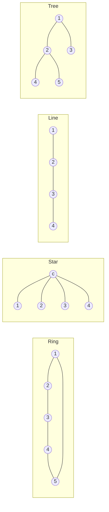
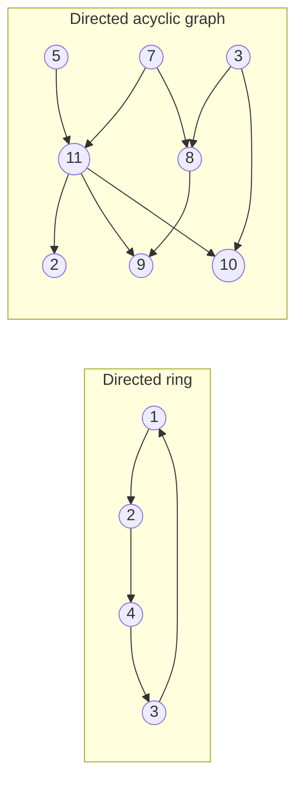
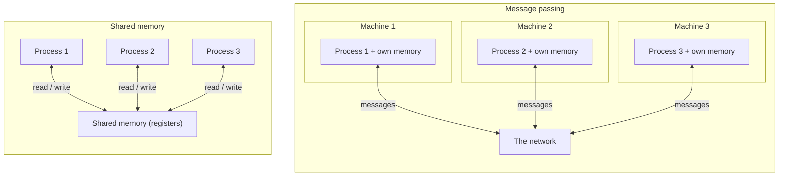
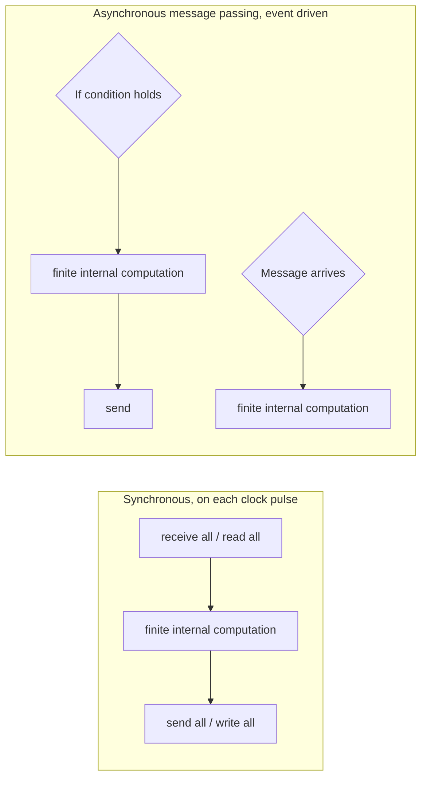
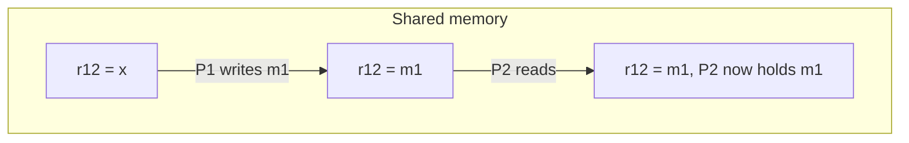
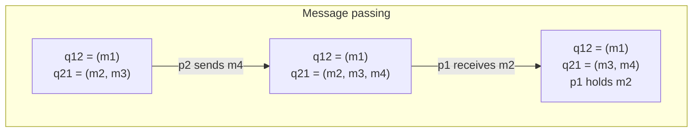
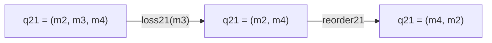
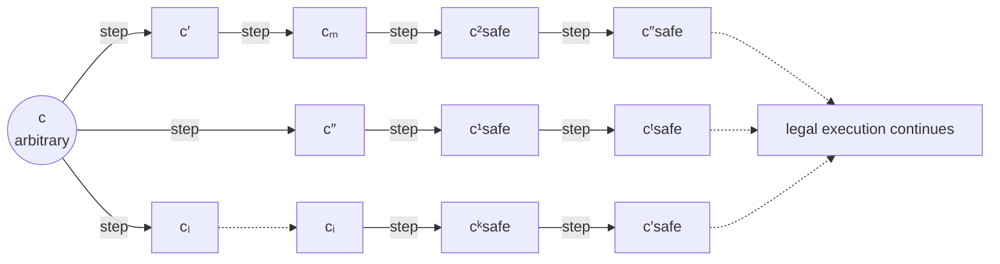
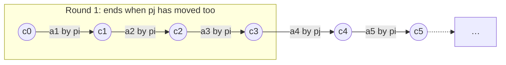

# The Analytical Framework for Self-Stabilizing Network Algorithms

**Course:** EDA387/DIT663 Computer Networks, part 2 (Fault-tolerant Algorithms for Computer Networks), lecture "Analytical Framework" (Dolev, *Self-Stabilization*, chapter 2.1–2.3)

**Generated:** 2026-10-20

**† Supplementary material:** content that comes only from hidden PowerPoint slides. It may not be part of this year's examinable material. *This lecture has no hidden slides, so nothing in this guide carries the † mark.* One visible slide does say that two topics (fault detection and Byzantine robustness) are "not covered this year"; that remark is reported where it belongs.

**How to read the boxes.** Text that starts with **Beyond the slides** adds context from the course book (Dolev) or from the course's own pre-lecture quiz. Everything else follows the lecture.

---

## Glossary

| Term | Full name | Meaning |
|---|---|---|
| Adversary | — | An imagined "enemy" that controls everything the algorithm cannot control (message loss, timing, corruption). We prove an algorithm works even against the worst adversary allowed by the model. |
| Anonymous network | — | A network where all processors run the same program and have no global names; they can still use locally unique identifiers such as port numbers. |
| Applicable step | — | A step *a* is applicable to configuration *c* if there exists a configuration *c′* with *c* →ᵃ *c′*, that is, the step can actually be taken from *c*. |
| Asynchronous cycle | — | The shortest prefix of an execution in which every processor completes at least one full iteration of its do-forever loop. |
| Asynchronous network | — | A network with no bound on communication delays and no clocks; processors take steps concurrently at their own speeds. |
| Asynchronous round | — | The shortest prefix of a fair execution in which every processor takes at least one step. The usual unit of time. |
| Byzantine failure | — | A node that behaves improperly in an arbitrary (even malicious) way, rather than just stopping. |
| Communication fairness | FC | If a message is sent infinitely often, it is received infinitely often. |
| Configuration | System state | A snapshot of the whole system: the state of every processor plus the content of every communication register or channel. Written *c*. |
| Crash | — | A processor that, eventually, stops taking steps forever. |
| CRC | Cyclic Redundancy Check | An error-detection code attached to data. The model may assume it always catches corruption, but in reality some corruption slips through. |
| DAG | Directed Acyclic Graph | A directed graph with no directed cycle. |
| Degree, Δ | — | The number of neighbours of a processor. Δ is an upper bound on the degree of every processor. |
| Distinguished processor | — | The one special processor in a semi-anonymous network that runs a different program (for example the server among many clients). |
| Do-forever loop | — | The typical shape of a self-stabilizing algorithm: read/receive, compute, write/send, and repeat forever. |
| Execution | — | An alternating sequence of configurations and steps, *E* = (*c*₀, *a*₀, *c*₁, *a*₁, …). |
| Execution fairness | Fair execution | Every step that is applicable infinitely often is executed infinitely often. |
| FIFO queue | First-In First-Out queue | A queue where the first message put in is the first one taken out; models a message channel. |
| Finite state machine | — | An abstract machine with a finite set of states that moves from state to state; the model of one network node. |
| Globally unique identifier | ID | A number ID(*i*) for processor *pᵢ* such that no other processor *pⱼ* (*j* ≠ *i*) has the same number, for example a MAC address. |
| Interleaving model | — | The convention that only one processor takes one step at a time, so an execution is a single sequence of steps. |
| Legal execution | LE | The set of executions that satisfy the task's requirements ("legal behaviour"). |
| Locally unique identifier | — | A name that is unique only locally, for example a port number on one node. |
| MAC address | Media Access Control address | A hardware address burned into a network card; an example of a globally unique identifier. |
| Message passing | — | Communication by sending and receiving messages over links. |
| Neighbours of *pᵢ* | — | The processors that can communicate directly with *pᵢ*. |
| Prefix / suffix | — | The beginning part / the remaining end part of an execution. *E* = *E′* ∘ *E″* means *E′* is a prefix and *E″* the suffix that follows it. |
| Processor, *pᵢ* | — | One of the *n* state machines in the system; *i* is just an index used for notation. |
| RDMA | Remote Direct Memory Access | A technology that lets one computer read or write another computer's memory over the network, bypassing the operating system kernel. |
| Register, *rᵢ* or *rᵢ,ⱼ* | Communication register | A shared memory cell that one processor writes and a neighbour reads. |
| Safe configuration | — | A configuration *c* such that every fair execution that starts from *c* belongs to LE. |
| Self-stabilizing algorithm | — | An algorithm for task LE such that every fair execution, from any configuration, reaches a safe configuration. |
| Semi-anonymous network | — | All processors run the same program except exactly one (the distinguished processor). |
| Shared memory | — | Communication by writing to and reading from shared registers. |
| Stabilization time | — | The number of (asynchronous) rounds until a safe configuration is reached. |
| State, *sᵢ* | Processor state | The values of all the local variables of processor *pᵢ*. |
| Step, *a* | Computation step / atomic step | One move of one processor: some internal computation plus one communication operation. |
| Synchronous network | — | All communication delays are bounded by a constant and all processors take their steps simultaneously on a common clock pulse. |
| Topology | Network topology | How the nodes and links of a network are arranged. |
| Transient fault | Arbitrary transient fault | Any temporary violation of the assumptions the system was designed under, such as undetected memory or message corruption. |

---

## Table of contents

1. [Goal of the framework](#1-goal-of-the-framework)
2. [Why networks need fault tolerance and self-stabilization](#2-why-networks-need-fault-tolerance-and-self-stabilization)
3. [Algorithms and models](#3-algorithms-and-models)
4. [Network settings](#4-network-settings)
5. [Network topology and graphs](#5-network-topology-and-graphs)
6. [Processors and identifiers](#6-processors-and-identifiers)
7. [Communication: message passing versus shared memory](#7-communication-message-passing-versus-shared-memory)
8. [Synchronous and asynchronous programming style](#8-synchronous-and-asynchronous-programming-style)
9. [States, configurations, steps and executions](#9-states-configurations-steps-and-executions)
10. [Representing failures and fairness](#10-representing-failures-and-fairness)
11. [Arbitrary transient faults](#11-arbitrary-transient-faults)
12. [Self-stabilization: legal executions and safe configurations](#12-self-stabilization-legal-executions-and-safe-configurations)
13. [Complexity measures: rounds and cycles](#13-complexity-measures-rounds-and-cycles)
14. [Recap: the chain of definitions](#14-recap-the-chain-of-definitions)

---

## 1. Goal of the framework

The goal of this part of the course is to understand **how to design self-stabilizing network protocols**. To do that we need an **analytical framework**, that is, a precise mathematical way of talking about networks. The framework must let us do three things:

1. **Define network tasks** precisely (what does "the network works correctly" mean?).
2. **Propose algorithms** that solve these tasks.
3. **Argue about the correctness** of these proposals, that is, prove they work.

Think of it like the rule book of a board game. Before you can argue whether a strategy always wins, everybody must agree on exactly what a "move" is, what the board looks like and what the opponent is allowed to do. This lecture writes that rule book. Every later algorithm (Dijkstra's token ring, spanning tree, matching, leader election) is described and proved in this language.

## 2. Why networks need fault tolerance and self-stabilization

### Perlman's vision of the Internet

**Radia Perlman** is presented as the person whose work envisioned a self-stabilizing Internet. Her MIT master's thesis transformed the Internet routing protocol RIP into a self-stabilizing one. Her work made today's **link-state routing protocols** robust, scalable and easy to manage; she made the ARPANET routing broadcast scheme self-stabilizing (Computer Networks, 1983) and gave a self-stabilizing **spanning tree construction for bridge interconnection** (Computer Networks, 1985). She is listed among the 20 most influential people in information technology (Data Communications Magazine), holds over 100 issued patents, is a member of the National Academy of Engineering, and received lifetime achievement awards from USENIX and ACM.

### Important properties of a network

Following Perlman, the lecture lists properties that a good network architecture should have, and explains why fault-tolerant algorithms are needed for each:

- **Scope.** The architecture should solve general problems and support a wide range of applications and technologies. Fault-tolerant algorithms help because their reliability is not tied to one specific use case.
- **Scalability.** Designs must work efficiently for both small and large networks. As networks grow, faults become more frequent, so fault tolerance becomes even more critical for uninterrupted service.
- **Robustness.** Even when nodes or links fail or behave improperly, the network should keep operating, reducing disruptions. Fault-tolerant algorithms are the essential components of robustness. Perlman also mentions **safety barriers**: mechanisms that stop a disruption in one part of the network from spreading everywhere, by isolating faults to specific segments.
- **Self-stabilization.** After state corruption, transient hardware malfunctions or undetected data errors, self-stabilizing algorithms bring the network back to normal operation **without human intervention**, which reduces prolonged downtime.
- **Fault detection.** Fault-tolerant algorithms often include mechanisms for detecting faults and anomalies so that faulty components can be identified.
- **Byzantine robustness.** Byzantine failures are nodes that behave improperly (possibly maliciously). Fault-tolerant algorithms can keep the network working even when some nodes are Byzantine; this matters for security.

The lecture explicitly says that **fault detection and Byzantine robustness are not covered this year**. The focus is self-stabilization.

### What self-stabilizing algorithms offer

A self-stabilizing algorithm can start from an **arbitrary, possibly incorrect state** and still recover and keep working correctly by itself. Its key characteristics are:

- **Autonomous recovery.** It reaches a correct system state without external intervention and without needing a pre-established correct state.
- **Fault tolerance.** It is inherently tolerant to transient faults such as data corruption, and converges to a consistent state.
- **Local and distributed operation.** Each node makes local decisions from what it observes about its neighbours; these local actions together stabilize the whole system.
- **Convergence.** The aim is to reach a legitimate state where all **safety** properties (the system stays correct) and **liveness** properties (progress continues) hold.
- **Minimal assumptions.** It assumes very little about the initial state and the nature of faults, so it works in many environments.

Typical uses are routing protocols, consensus, distributed databases and fault-tolerant distributed systems; for example, a routing protocol recovering after topology changes.

*Everyday example:* a thermostat does not need to be "reset correctly" by a person. Whatever temperature the room starts at, and even if someone opens a window, it keeps measuring and adjusting until the room is right again. A self-stabilizing network behaves the same way about its own internal state.

## 3. Algorithms and models

### What is an algorithm?

An **algorithm** is a step-by-step set of well-defined instructions, or a systematic procedure, for solving a specific problem or accomplishing a particular task. Its main characteristics are:

- **Precise instructions:** unambiguous, so they can be implemented in a computer program.
- **Problem-specific:** tailored to a particular task.
- **Correctness:** it must give correct results for all valid inputs; ensuring this often requires rigorous mathematical proof.
- **Efficiency:** it should use as little time and as few resources (memory, processing power) as possible.
- **Modularity:** complex problems are broken into smaller subproblems that are solved separately.
- **Optimization:** some algorithms optimize a criterion such as time or space.

In this course the efficiency measure we focus on is **the stabilization time** (Section 13).

### Why do we need models?

A **model** is a simplified, exact description of the network that keeps only what matters. Models serve several purposes:

- **Abstraction:** they distil the essential characteristics of a network, which makes analysis and algorithm design easier.
- **Task formalization:** they translate real-world problems into precise requirements.
- **Analysis:** they let us prove correctness and compute time and space costs, and predict behaviour and performance.
- **Benchmarking:** they let us compare the strengths and weaknesses of different algorithms for the same problem on equal terms.
- **Design:** they give insight into the structure of the problem.
- **Generalization:** once an algorithm is analysed in a model, its properties carry over to real systems with similar characteristics.
- **Communication:** they give researchers and engineers a common language.

## 4. Network settings

The **network settings** are the set of assumptions and characteristics on which we design and analyse protocols. Before studying any algorithm, always ask these questions:

- **Network topology:** how are the nodes and links arranged?
- **Communication:** how do nodes communicate? By datagrams, streams or shared memory? Is communication reliable, or what do we assume about delivery, ordering, delay and loss of messages?
- **Synchrony:** is the network **asynchronous** or **synchronous** (do nodes have clocks and are delays bounded)? What **fairness** do we assume about message arrival and node execution?
- **Node behaviour:** can nodes fail by crashing, by Byzantine behaviour, or do they behave benignly?
- **Failure detection:** can a node indicate that a link or node has recovered? (A later lecture shows an algorithm where a node can indicate link recovery.)
- **Resource constraints:** is memory, processing power or bandwidth limited?

The settings also include a **fault model**: which faults may happen (link failures, node failures, message loss, network partitions) and how severe they are.

When delays are unbounded and nodes have no clocks, the network is **asynchronous**, and then we must state fairness assumptions (Section 10).

## 5. Network topology and graphs

**Network topology** describes how the parts of a communication network (nodes and links) are organized, physically or logically. We draw it as a **graph**: each communicating device is a **node** (a dot) and each connection is a **link** (a line). A partial map of the real Internet is a huge, irregular graph; a network diagram in documentation is a small one.

Common topologies are rings, meshes, stars, fully connected graphs, lines, trees and buses. The diagram below shows four of them with five or six nodes each. Lines have no arrowheads because the links are two-way.

In a **fully connected** (complete) graph every node is linked to every other node; a **mesh** has many but not all such links; a **bus** connects all nodes to one shared line.

### Directed graphs

In a **directed graph** each link has a direction. A **directed ring** sends information around in one direction only. A **directed acyclic graph (DAG)** has directed links but no directed cycle: you can never follow arrows and come back to where you started.

### What does a node represent?

A node in the graph is any **computing and communication entity**. Depending on the level of abstraction it can be:

- an autonomous system (a whole organization's network on the Internet),
- an OSPF area,
- a local communication network,
- an Internet host,
- a multiprocessor computer,
- a multitasking single processor,
- a thread.

Whatever it is, **each node is modelled as a finite state machine**. There are *n* such automata in the system and we call them **processors**. The next question is how these processors communicate.

## 6. Processors and identifiers

We write *pᵢ* for the *i*-th processor. The index *i* is **only a notation** for us as observers: it does not mean that the processor itself knows a number *i*. The **neighbours** of *pᵢ* are the processors that can communicate directly with *pᵢ*, and a link *pᵢ* ↔ *pⱼ* means that *pᵢ* can communicate with *pⱼ*.

Whether processors have names that they themselves can use is an important assumption:

- **Globally unique identifiers.** ID(*i*) is a number associated with *pᵢ* such that there is no *pⱼ* with ID(*i*) = ID(*j*) and *i* ≠ *j*. Example: a MAC address.
- **Locally unique identifiers.** Names that only need to differ locally, for example **port numbers** on a switch: port 1, port 2, … on each device.
- **Anonymous networks.** All processors run **the same program** and have access only to locally unique identifiers.
- **Semi-anonymous networks.** All processors run the same program **except exactly one**, called the **distinguished processor**. Example: one server and many clients.

*Everyday example:* in a classroom with name tags, every child has a globally unique name. Without name tags, a child can still say "the kid on my left" and "the kid on my right"; that is a locally unique identifier. If the class also has one teacher who follows different rules, the class is semi-anonymous.

> **Beyond the slides (course quiz):** without global identifiers, can a sender tell its receivers apart? The quiz's answer is "it depends on our assumptions"; for example, if locally unique identifiers (ports) exist, it can. The same holds in semi-anonymous networks.

## 7. Communication: message passing versus shared memory

There are two ways to model how neighbours talk:

- **Message passing.** Each machine runs a process with its own memory, and the machines are connected by a network. Processes communicate by **sending and receiving messages**.
- **Shared memory.** Processes communicate by **writing to and reading from shared memory**.

The course **focuses on the shared-memory model**, and a later lecture shows how to **transfer an algorithm from shared memory to message passing**.

Why is shared memory relevant for networks at all? Because of **Remote Direct Memory Access (RDMA)**. With ordinary sockets, data travels from the application through the kernel's socket layer, TCP, IPv4/IPv6 and the device driver. RDMA lets an application place data directly into a remote machine's memory, bypassing the kernel ("kernel bypass") through the host channel adapter. The latency difference is large: socket-based communication is typically in the **milliseconds** range (more under congestion), while RDMA can reach the **microseconds** range, as low as 1–2 μs on technologies such as InfiniBand or RoCE. These numbers are rough and depend on hardware, software and network conditions.

> **Beyond the slides (course quiz):** the quiz gives three reasons for studying shared-memory algorithms in a networks course: they are simpler to design and prove; the course teaches a transformation to message passing; and modern networks use RDMA.

### How to represent communication channels

- **Shared memory:** *rᵢ* is the content of the communication register of processor *pᵢ*. Alternatively, *pᵢ* has a vector of registers *rᵢ,₁*, *rᵢ,₂*, …, *rᵢ,ⱼ*, … with one register per neighbour: *pᵢ* can **write** *rᵢ,ⱼ* but *pⱼ* can **only read** it.
- **Message passing:** *qᵢ,ⱼ* is a **FIFO queue** of the messages sent from *pᵢ* to *pⱼ* that have not been received yet. Sending adds a message at the tail; receiving takes the message at the head.

> **Beyond the slides (Dolev §2.1):** a bidirectional link between *pᵢ* and *pⱼ* is modelled by two queues, *qᵢ,ⱼ* and *qⱼ,ᵢ*. A register always holds only the last value written; a queue can hold many messages.

## 8. Synchronous and asynchronous programming style

How a processor's program looks depends on the timing assumption.

**Synchronous networks.** All communication delays are bounded by a constant, and all processors take their steps **simultaneously upon a clock pulse**. On every pulse each processor does:

- in message passing: **receive all** messages, do a **finite internal computation**, **send all** messages;
- in shared memory: **read all** neighbour registers, do a finite internal computation, **write all** its registers.

**Asynchronous networks.** There is **no bound on the communication delays** and there are **no clocks**; processors take steps concurrently, each at its own pace.

- In shared memory the program still looks like: read all, finite internal computation, write all, but nothing forces processors to do this at the same time.
- In message passing a processor reacts to events. Either **some condition becomes true**, and it does a finite internal computation and **sends**; or a **message arrives**, and it does a finite internal computation.

> **Beyond the slides (course quiz):** synchronous algorithms are **not** automatically faster. Synchrony is implemented with timers that must be long enough for the slowest processor and the longest delay, so everybody waits for the slowest; in an asynchronous algorithm each processor continues as soon as it can.

## 9. States, configurations, steps and executions

### Processor state

The **state** of processor *pᵢ*, written ***sᵢ***, is the set of values stored in **all of its local variables**.

### System state (configuration)

The **system configuration** (system state) is a complete snapshot of the system:

$$c = (s_1, s_2, \dots, s_n,\; r_{1,2}, r_{1,3}, \dots, r_{i,j}, \dots, r_{n,n-1})$$

where *sᵢ* is the state of *pᵢ* and *rᵢ,ⱼ* is the content of the communication channels or registers. Looking from one processor: the configuration contains **the values of all local variables** and **the values of the incoming communication channels** of every processor.

*Everyday example:* a configuration is like a photo of a chess game that also shows every note passed between players that has not yet been read. From that photo alone you can continue the game; you do not need to know the earlier moves.

### Computation steps

A **step** is one move of one processor. In the shared-memory model a step is a write or a read; in the message-passing model it is a send or a receive. The lecture's two examples, written as sequences of configurations:

Notice the FIFO rule: *p₂*'s new message *m₄* goes to the **tail** of *q₂,₁*, and *p₁* receives *m₂* from the **head**.

### State transitions

- **Every state transition of a processor is due to the execution of a communication step.**
- A step is denoted by ***a***.
- *c*₁ →ᵃ *c*₂ means that configuration *c*₂ can be reached from configuration *c*₁ by the single step *a*.
- Step *a* is **applicable** to configuration *c* if and only if ∃ *c′* : *c* →ᵃ *c′*, that is, some configuration can be reached from *c* by *a*.

> **Beyond the slides (Dolev §2.1):** a step consists of internal computation plus **exactly one** communication operation (send or receive; write or read). Local computation between two communication operations is counted as part of the second one.

### System executions

An **execution** is an alternating sequence of configurations and steps

$$E = (c_0, a_0, c_1, a_1, \dots) \quad\text{such that}\quad c_{i-1} \xrightarrow{a} c_i .$$

This way of presenting executions, one step at a time, is called the **interleaving model**. In reality processors run in parallel, but we pretend that at each moment exactly one processor takes one step. (The slide's index condition reads "(i > 1)" and the book numbers configurations from *c*₁; the meaning is simply that every configuration after the first is obtained from the previous one by one step.)

*Everyday example:* even if in real life two players move at the same instant, the score sheet of a board game writes the moves one after the other. The interleaving model is that score sheet.

## 10. Representing failures and fairness

### What the adversary can do to channels

In the **message-passing model** the adversary (the hostile environment) can cause:

- **data corruption,**
- **message omission** (loss),
- **message duplication,**
- **message reordering.**

In the **shared-memory model** the adversary can only cause **data corruption**, because a register holds a single value; there is no queue of messages to lose, duplicate or reorder.

Failures are modelled as extra environment steps. The lecture's example starts from *q*₂,₁ = (*m*₂, *m*₃, *m*₄):

The loss step removes *m*₃ from the queue. The reorder step swaps the remaining messages, so *m*₄ will now be received before *m*₂. (The slide labels the second step "reorder₂₁(*m*₃, *m*₄)", but *m*₃ has already been lost and the result shows *m*₂ and *m*₄ swapped; the result (*m*₄, *m*₂) is what matters.) Throughout, *q*₁,₂ = (*m*₁) is unchanged.

### How often can a message be omitted? Communication fairness

If messages are omitted "too often", the channel is simply broken. So what is the **maximum power** we can give the adversary to drop messages **without** letting it make the channel completely non-functional? The answer is the **communication fairness (FC)** property:

> **Communication fairness:** if a message is sent infinitely often, that message is received infinitely often.

Two consequences:

- **NB-1:** FC still holds even if an **infinite number of messages are lost** over the whole (infinite) execution.
- **NB-2:** between any two successful deliveries **only a finite number** of messages may be lost. Otherwise the channel is faulty: if FC fails, the sender can only get a finite number of messages through, after which the receiver never hears anything again; the link is broken.

*Everyday example:* throwing a ball to a friend on a windy day. Some throws are blown away, maybe infinitely many over a never-ending game, but if you keep throwing, your friend keeps catching some. The wind can never block every throw from some point on.

### Node failures: crashes, slow processors and execution fairness

A processor that, **eventually, stops taking steps forever** is said to be **crashed**.

But in an **asynchronous** network, how can we tell a **slow** processor from a **crashed** one? The lecture compares an Arduino (ATmega328 at 16 MHz) with the HP Frontier supercomputer (1.7 exaflops): for every step of the Arduino, Frontier takes more than 10¹² steps. The Arduino is extremely slow by comparison, but it is not crashed. So what is the maximum power we can give the adversary to slow processors down without making a slow processor completely non-functional? The answer is **execution fairness**:

> **Execution fairness:** every step that is applicable infinitely often is executed infinitely often.

Consequences:

- Even if Frontier takes an exponentially growing number of steps more than the Arduino, the execution is still **fair**, as long as the Arduino keeps taking steps.
- If some set of processors takes an infinite number of steps while Frontier (or the Arduino) takes **no** step, then Frontier (respectively the Arduino) is **crashed**.

> **Beyond the slides (Dolev §2.1):** message loss is modelled by an environment step loss*ᵢ,ⱼ*(*m*), applicable when *m* is in *qᵢ,ⱼ*. Fairness does **not** require loss steps to happen infinitely often, but it does require that a message sent infinitely often is received infinitely often.

## 11. Arbitrary transient faults

**Arbitrary transient faults** represent **any violation of the assumptions** under which the system and network were designed to behave. For example:

- A designer may assume that **CRC codes always detect** memory and message corruption.
- If such corruption goes **undetected**, stale information will **propagate** through the network (the lecture illustrates this with a Windows "blue screen" crash).
- An **arbitrary combination** of such failures can leave the network in an **arbitrary state**.

This raises the central question of the course: **if a network starts in an arbitrary configuration, how can the algorithm make the network present a legal behaviour, that is, satisfy the problem definition?**

> **Beyond the slides (course quiz and Dolev ch. 1):** we analyse the system **after the last transient fault**. In proofs we therefore assume that all faults happened before the execution starts, and the execution begins in whatever arbitrary configuration they left. A processor that crashes and later resumes in some random state can also be treated as a transient fault.

## 12. Self-stabilization: legal executions and safe configurations

A **self-stabilizing network** can be started in **any arbitrary configuration** and will **eventually exhibit a desired "legal" behaviour**.

The precise definitions:

- **Legal behaviour, LE.** The desired legal behaviour is a **set of legal executions**, denoted **LE**. LE is defined **for a particular system and a particular task**.
- **Suffix property.** Every execution of a self-stabilizing system has a **suffix** that appears in LE: whatever happens at the beginning, from some point on the execution is legal.
- **Safe configuration.** A configuration *c* is **safe** with regard to task LE and the algorithm if **every fair execution of the algorithm that starts from *c* belongs to LE**.
- **Self-stabilizing algorithm.** An algorithm is self-stabilizing for task LE if **every fair execution of the algorithm reaches a safe configuration** with relation to LE.

The lecture's picture shows several executions starting from the same arbitrary configuration *c*. Each takes a different path (the scheduler decides who moves), but every path eventually reaches some safe configuration, and from there on only safe configurations follow.

The dotted arrows mean "possibly many more steps". The definitions split into two parts, which is how every proof in the course is organized:

1. **Convergence:** from any configuration, every fair execution reaches a safe configuration.
2. **Closure:** once in a safe configuration, every fair execution stays legal (that is the definition of "safe").

*Example of LE (Dolev §2.2):* for mutual exclusion, LE is the set of executions in which, in every configuration, at most one processor is in the critical section, and every processor is in the critical section in infinitely many configurations.

> **Beyond the slides (Dolev §2.3):** a self-stabilizing algorithm **never terminates**. If every processor had a "terminated" state, then the configuration where all processors are terminated would have to be safe (nothing ever happens from it), so the task would be trivial and need no communication. That is why self-stabilizing code is a do-forever loop that keeps communicating with neighbours.

## 13. Complexity measures: rounds and cycles

### Asynchronous rounds

In an asynchronous system there are no clocks, so time cannot be measured in seconds. Instead we count **asynchronous rounds**, and **the number of rounds until a safe configuration is reached is the stabilization time**.

> The **first asynchronous round** in a fair execution *E* is the **shortest prefix** *E′* of *E* such that **each processor executes at least one step** in *E′*, where *E* = *E′* ∘ *E″*. The **second asynchronous round** of *E* is the first asynchronous round of *E″*, and so on.

**Worked example.** Let *P* = {*pᵢ*, *pⱼ*} and

$$E = (c_0, a^i_1, c_1, a^i_2, c_2, a^i_3, c_3, a^j_4, c_4, a^i_5, c_5, \dots)$$

where *aᵏₓ* is the *x*-th step of execution *E*, taken by processor *pₖ*. Processor *pᵢ* moves three times before *pⱼ* moves for the first time at step 4. The shortest prefix in which **both** have moved therefore ends with *aʲ₄*:

$$E' = (c_0, a^i_1, c_1, a^i_2, c_2, a^i_3, c_3, a^j_4).$$

The second round is the first round of *E″* = (*c*₄, *aⁱ*₅, *c*₅, …).

A round stretches until the **slowest** processor has moved, so speed differences are "cancelled out". (One intermediate slide writes the first round with step indices 0–3; the next slide corrects it to the version above.)

*Everyday example:* in a card game you count "turns around the table" instead of minutes. A turn is finished once every player has played at least once, no matter how slow some players are.

### Asynchronous cycles

A self-stabilizing algorithm is usually a **do-forever loop**: in message passing, receive all, finite internal computation, send all; in shared memory, read all, finite internal computation, write all. The number of steps needed to execute **one iteration** of such a loop is **O(Δ)**, where **Δ is an upper bound on the number of neighbours** of *pᵢ* (one read or receive per neighbour, plus writes or sends).

> The **first asynchronous cycle** in an execution *E* is the **shortest prefix** *E′* of *E* such that **each processor executes at least one complete iteration** of the do-forever loop in *E′*, where *E* = *E′* ∘ *E″*. The second cycle is the first cycle of *E″*, and so on.

(The slide's last line says "the second asynchronous *round*"; in this definition it means the second asynchronous **cycle**.)

> **Beyond the slides (Dolev §2.3):** each cycle spans O(Δ) rounds. A processor may start in the middle of an iteration; if an iteration takes *x* steps, it completes a full iteration within fewer than 2*x* steps. For synchronous algorithms, time complexity is the number of pulses. Space complexity is the total number of local and shared memory bits used.

## 14. Recap: the chain of definitions

Each definition is built from the one before it, and together they are the language of every proof in the rest of the course:

1. A **processor** is a state machine; its **state** *sᵢ* is all its local variables.
2. A **configuration** *c* is all processor states plus all registers or channel contents.
3. A **step** *a* moves the system from *c* to *c′*; an **execution** is the alternating sequence of configurations and steps (interleaving model).
4. **Fairness** limits the adversary: execution fairness (no processor that can move is ignored forever) and communication fairness (a message sent infinitely often is received infinitely often).
5. **Transient faults** can leave the system in any configuration.
6. **LE** describes correct behaviour; a **safe configuration** guarantees only legal executions from then on; an algorithm is **self-stabilizing** if every fair execution reaches a safe configuration.
7. **Stabilization time** is measured in **asynchronous rounds** (or **cycles**, each O(Δ) rounds).
