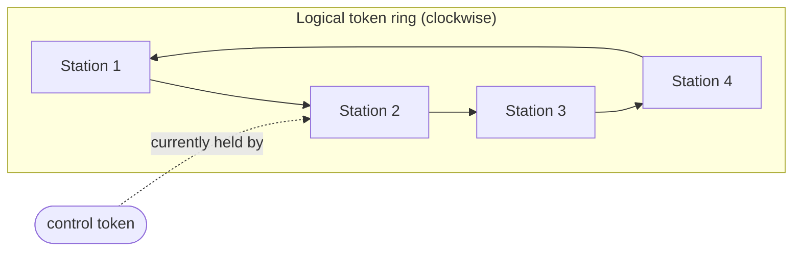
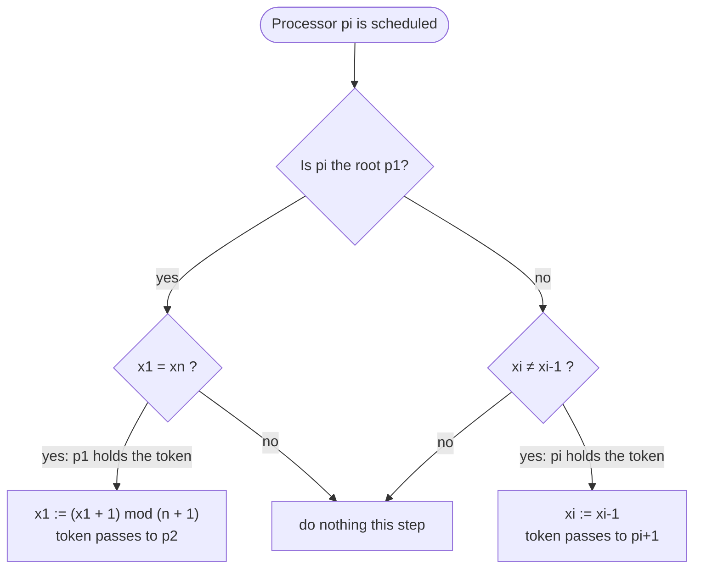
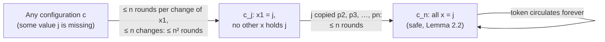

# Dijkstra's Self-Stabilizing Token Ring (Mutual Exclusion)

**Course:** EDA387/DIT663 Computer Networks, part 2 (Fault-tolerant Algorithms for Computer Networks), lecture "Dijkstra's algorithm" (Dolev, *Self-Stabilization*, §2.6)

**Generated:** 2026-10-20

**† Supplementary material:** content that comes only from hidden PowerPoint slides. It may not be part of this year's examinable material. In this lecture only one slide is hidden: the definition of legal behaviour for mutual exclusion in [Section 3.2](#32-legal-behaviour-of-mutual-exclusion-).

**How to read the boxes.** Text that starts with **Beyond the slides** adds context from the course book (Dolev) or from the course's own pre-lecture quiz. Everything else follows the lecture.

---

## Glossary

| Term | Full name | Meaning |
|---|---|---|
| Asynchronous cycle | — | The shortest stretch of an execution in which every processor completes at least one full iteration of its do-forever loop. |
| Asynchronous round | — | The shortest stretch of an execution in which every processor takes at least one step. |
| Central daemon | — | A scheduler that activates one processor at a time; the activated processor reads its neighbours and updates its own state in one step. |
| Configuration | — | Here simply the vector (*x*₁, …, *xₙ*) of all the processors' values. |
| Critical section | — | The part of a program where a processor uses a shared resource (here: the network medium). At most one processor may be in it at a time. |
| Distinguished processor | Root, special processor | The one processor, *p*₁, that runs a different program from all the others. |
| Do-forever loop | — | A loop that never ends; the usual form of self-stabilizing code. |
| Fair execution | — | An execution in which every step that is applicable infinitely often is executed infinitely often. |
| LAN | Local Area Network | A network covering a small area such as a building. |
| LE_ME | Legal executions of mutual exclusion | The set of executions that satisfy the mutual exclusion requirements. |
| MAU | Multistation Access Unit | The hub device of a Token Ring LAN; stations plug into it and it wires them into a logical ring. |
| ME | Mutual Exclusion | The task in which exactly one processor holds the privilege (token) at any time and every processor gets it infinitely often. |
| Missing value (missing label) | — | A value in {0, …, *n*} that no *x* variable holds; it always exists by the pigeonhole principle. |
| mod | Modulo | The remainder after division. (*x* + 1) mod (*n* + 1) counts 0, 1, …, *n*, 0, 1, … |
| Mutual exclusion | — | Guaranteeing that at most one participant uses a shared resource at a time. |
| Pigeonhole principle | Dirichlet's box principle | If *n* items are put into *m* < *n* containers, at least one container holds more than one item. |
| Proof by contradiction | — | Assume the statement is false and show that this leads to something impossible. |
| Safe configuration | — | A configuration from which every fair execution is legal. |
| Self-stabilizing | — | From any starting configuration, every fair execution reaches a safe configuration. |
| Token | Privilege | The right to access the shared medium. In Dijkstra's algorithm a processor "holds the token" when its if-condition is true. |
| Token ring | — | A LAN in which stations are arranged in a logical ring and a control token travels around the ring to decide who may transmit. |

---

## Table of contents

1. [Goal of the lecture](#1-goal-of-the-lecture)
2. [Background: Dijkstra's 1974 paper and token ring LANs](#2-background-dijkstras-1974-paper-and-token-ring-lans)
3. [The task: mutual exclusion on a ring](#3-the-task-mutual-exclusion-on-a-ring)
    - [3.1 The task ME](#31-the-task-me)
    - [3.2 Legal behaviour of mutual exclusion †](#32-legal-behaviour-of-mutual-exclusion-)
4. [Dijkstra's algorithm](#4-dijkstras-algorithm)
5. [Who holds the token? Counting tokens](#5-who-holds-the-token-counting-tokens)
6. [Proof of self-stabilization](#6-proof-of-self-stabilization)
    - [6.1 Lemma 2.2: all-equal configurations are safe](#61-lemma-22-all-equal-configurations-are-safe)
    - [6.2 The pigeonhole principle and Lemma 2.3: a missing value](#62-the-pigeonhole-principle-and-lemma-23-a-missing-value)
    - [6.3 Lemma 2.4: the root changes x1 at least once every n rounds](#63-lemma-24-the-root-changes-x1-at-least-once-every-n-rounds)
    - [6.4 Theorem 2.1: convergence to a safe configuration](#64-theorem-21-convergence-to-a-safe-configuration)
7. [A complete worked example](#7-a-complete-worked-example)
8. [Recap](#8-recap)

---

## 1. Goal of the lecture

We want to learn how to design self-stabilizing network protocols. After this lecture you should be able to:

1. **Define the network task of token circulation** (mutual exclusion).
2. **Propose an algorithm** that solves it.
3. **Argue about the correctness** of the proposal, that is, prove that it is self-stabilizing.

## 2. Background: Dijkstra's 1974 paper and token ring LANs

The very first self-stabilizing algorithm was published by **Edsger W. Dijkstra** in *Communications of the ACM* in **1974**. Leslie Lamport called it Dijkstra's most brilliant work: "Self-stabilization is a very important concept in fault tolerance" (PODC 1984), and later described it as the **first scientific examination of fault-tolerant systems** (Lamport 2015). Today the field has two books, a yearly conference, and several parts of the Internet have been shown to be self-stabilizing.

The setting is a **token ring LAN**. Stations are physically plugged into hub devices called MAUs, but logically they form a **ring**: data is transmitted sequentially from one station to the next, and a **control token** circulates around the ring and controls access to the medium. **A station that holds the token may access the network.** Since there is only one token, only one station transmits at a time; this is **mutual exclusion**.



The arrows show the direction in which the token travels.

*Everyday example:* a "talking stick" passed around a circle of children. Only the child holding the stick may speak, and the stick moves to the next child when they are done. The problem Dijkstra solved is: what if, through some glitch, there are suddenly three sticks in the circle, or none? His algorithm makes the circle get back to **exactly one** stick by itself.

## 3. The task: mutual exclusion on a ring

The algorithm must guarantee that **at most one station at a time** may access the medium, and also that **every station can access the medium infinitely often**.

### 3.1 The task ME

The network is a **clockwise directed ring** of *n* processors *p*₁, …, *pₙ*. The left neighbour (predecessor) of *pᵢ* is *pᵢ₋₁* for *i* > 1, and the predecessor of *p*₁ is *pₙ*. Processor *p*₁ is the **root**, also called the **distinguished processor**.

A **configuration** of the system is a **vector of *n* integer values**, one value *xᵢ* per processor.

The task **ME** is defined by the set of all configuration sequences in which:

- **exactly one processor can change its state in any configuration**, and
- **every processor can change its state in infinitely many configurations** in every sequence in ME.

"Can change its state" is the same as "holds the token". So ME says: always exactly one token, and the token visits everyone forever.

**One of the safe configurations** for ME and Dijkstra's algorithm is a configuration in which **all the *x* variables have the same value**.

> **Beyond the slides (Dolev §2.6):** this definition of ME differs from the traditional definition of mutual exclusion, which allows a processor to stay outside the critical section (possibly forever) if it does not want to enter.

### 3.2 Legal behaviour of mutual exclusion †

The set **LE_ME** includes all the executions in which **each processor may access the critical section infinitely often**. Namely, let *pᵢ* be a processor, *E* an execution in LE_ME and *E′* a suffix of *E*; then *pᵢ* may access the critical section infinitely many times in *E′*. Moreover, **while *pᵢ* is accessing the critical section, no other processor may concurrently access that critical section**.

> **Beyond the slides (course quiz):** although this slide is hidden, the pre-lecture quiz asked for exactly this description of LE_ME.

## 4. Dijkstra's algorithm

Each processor *pᵢ* holds **a single shared variable *xᵢ*** with a value in {0, 1, …, *n*} (so there are *n* + 1 possible values for *n* processors). The code is:

```text
01  p1:          do forever
02                   if x1 = xn then
03                       x1 := (x1 + 1) mod (n + 1)
04  pi (i ≠ 1):  do forever
05                   if xi ≠ xi-1 then
06                       xi := xi-1
```

In words:

- **The root changes its state if it is equal to its neighbour.** If *x*₁ equals the value of its predecessor *xₙ*, the root increments *x*₁ modulo *n* + 1.
- **Every other processor copies its neighbour's state if it is different.** If *xᵢ* differs from its predecessor's value *xᵢ₋₁*, *pᵢ* copies it.

**Holding the token.** Whenever the if-condition of line 02 (for the root) or line 05 (for the others) holds, that processor is said to **hold the token**. It **forwards the token clockwise** by executing the then-clause: after the root increments, *x*₁ ≠ *x*₂, so *p*₂ now holds the token; after *pᵢ* copies, *xᵢ₊₁* ≠ *xᵢ*, so *pᵢ₊₁* holds it.



Three properties are worth noticing, because they are typical of self-stabilizing algorithms and are often the challenge when turning a normal system into a self-stabilizing one:

- The code is a **do-forever loop**; it never terminates.
- **All variables are bounded** (values 0 to *n*); nothing grows forever.
- The algorithm is for a **semi-anonymous** system: all processors run the same code except the root.

> **Beyond the slides (Dolev §2.6):** the book assumes a **central daemon**: a scheduler that activates one processor at a time, and the activated processor reads its predecessor's value and updates its own in one step. The central daemon is assumed to be fair, activating every processor infinitely often.

## 5. Who holds the token? Counting tokens

Because "can change its state" means "holds the token", you can count the tokens in any configuration by checking each processor's condition:

- the root *p*₁ holds a token if **x₁ = xₙ**;
- every other *pᵢ* holds a token if **xᵢ ≠ xᵢ₋₁**.

A handy picture is to give each value a colour. Walking clockwise around the ring, **every place where the colour changes, the processor after the change holds a token** (if that processor is not the root). The root holds a token exactly when its colour equals the colour just before it.

**Example (n = 4, values 0–4).** Configuration (*x*₁, *x*₂, *x*₃, *x*₄) = (2, 0, 3, 0):

- *p*₁: is *x*₁ = *x*₄? 2 ≠ 0, so **no token**.
- *p*₂: is *x*₂ ≠ *x*₁? 0 ≠ 2, so **token**.
- *p*₃: is *x*₃ ≠ *x*₂? 3 ≠ 0, so **token**.
- *p*₄: is *x*₄ ≠ *x*₃? 0 ≠ 3, so **token**.

There are three tokens, so this configuration is **not** legal. Now take (3, 3, 3, 3): only the root holds a token (3 = 3), and nobody else does. That is exactly one token: a **safe** configuration.

There is **always at least one token**: if no non-root processor holds a token, then *x*₁ = *x*₂ = … = *xₙ*, so *x*₁ = *xₙ* and the root holds one.

> **Beyond the slides (course quiz):** quiz questions show coloured rings and ask how many processors can change state; count the colour boundaries as above. The quiz also says there are at least *n*(*n* + 1) different safe configurations. For each of the *n* + 1 values *y* there are *n* legitimate configurations: "all equal to *y*", plus the *n* − 1 configurations in which the first *i* processors (1 ≤ *i* ≤ *n* − 1) already hold *y* + 1 and the rest still hold *y*. That gives (*n* + 1) · *n*.

## 6. Proof of self-stabilization

The proof follows the definition from the analytical framework: show that (a) certain configurations are **safe** (closure), and (b) every fair execution **reaches** one of them (convergence). It has four parts:

- **Lemma 2.2:** a configuration in which all *x* variables are equal is a **safe configuration** for ME.
- **Lemma 2.3:** for every configuration there is at least one integer *j* such that **xᵢ ≠ j for every i** (a missing value).
- **Lemma 2.4:** for every configuration *c*, in every fair execution starting in *c*, **p₁ changes the value of x₁ at least once in every n rounds**.
- **Theorem 2.1:** for every configuration *c*, every fair execution that starts in *c* **reaches a safe configuration with relation to ME within O(n²) rounds**.

### 6.1 Lemma 2.2: all-equal configurations are safe

Suppose every *x* variable holds the same value *y*, and let *z* = (*y* + 1) mod (*n* + 1). In this configuration only the root can move (*x*₁ = *xₙ*); no other processor can, because each *xᵢ* equals *xᵢ₋₁*. By fairness, the root is eventually activated and sets *x*₁ to *z*, a value that **no other variable holds**. Now only *p*₂ can move; it copies *z*; then only *p*₃ can move, and so on. Writing the configuration at the end of each asynchronous round *r* (in the slowest case where the token advances one processor per round):

| Round *r* | Configuration |
|---|---|
| 0 | (*x*₁ = *y*, *x*₂ = *y*, …, *xᵢ* = *y*, …, *xₙ₋₁* = *y*, *xₙ* = *y*) |
| 1 | (*x*₁ = **z**, *x*₂ = *y*, …, *xᵢ* = *y*, …, *xₙ₋₁* = *y*, *xₙ* = *y*) |
| 2 | (*x*₁ = **z**, *x*₂ = **z**, …, *xᵢ* = *y*, …, *xₙ₋₁* = *y*, *xₙ* = *y*) |
| *i* | (*x*₁ = **z**, *x*₂ = **z**, …, *xᵢ* = **z**, …, *xₙ₋₁* = *y*, *xₙ* = *y*) |
| *n* − 1 | (*x*₁ = **z**, *x*₂ = **z**, …, *xᵢ* = **z**, …, *xₙ₋₁* = **z**, *xₙ* = *y*) |
| *n* | (*x*₁ = **z**, *x*₂ = **z**, …, *xᵢ* = **z**, …, *xₙ₋₁* = **z**, *xₙ* = **z**) |

In every configuration along the way **exactly one processor can change its state**, and **each processor changes its value exactly once**. At round *n* all variables are equal again (now to *z*), so the same argument repeats forever. Hence every processor changes state infinitely often and there is always exactly one token: every fair execution from an all-equal configuration is in ME. ∎

> **Beyond the slides (Dolev, proof of Lemma 2.2):** in the configuration *cᵢ* reached after *pᵢ* copies, *x*₁ = … = *xᵢ* ≠ *xᵢ₊₁* = … = *xₙ*, so the only processor that can move is *pᵢ₊₁*.

### 6.2 The pigeonhole principle and Lemma 2.3: a missing value

**Pigeonhole principle (Dirichlet's box principle).** Suppose *n* items are put into *m* < *n* containers. Then at least one container contains more than one item. The equivalent "reverse" form is what we need: if *n* items are put into *n* + 1 containers, at least one container stays **empty**.

**Lemma 2.3.** For every possible configuration *c* there exists at least one integer 0 ≤ *j* ≤ *n* such that for every 1 ≤ *i* ≤ *n*, *xᵢ* ≠ *j* in *c*.

*Proof.* There are *n* variables, so they hold **at most n distinct values**. But there are ***n* + 1 possible values** (0 to *n*). So at least one value *j* is held by no variable. ∎

The lecture illustrates this with colours: with *n* = 8 processors and 9 colours, each processor shows one colour, and colour number 9 (= *j*) is not used by anybody. This idea is called the **missing value** (or missing label) concept, and it is the heart of the proof.

*Everyday example:* 8 children each pick one of 9 hats. At least one hat is left on the shelf.

### 6.3 Lemma 2.4: the root changes x1 at least once every n rounds

**Lemma 2.4.** For every configuration *c*, in every fair execution that starts in *c*, processor *p*₁ changes the value of *x*₁ at least once in every *n* rounds.

*Proof (by contradiction).* Assume there is a configuration *c* and a fair execution starting in *c* in which *p*₁ does **not** change *x*₁ during the first *n* rounds. Call the value of *x*₁ *a*₁ (the lecture also calls it *z*).

1. Let *c*₂ be the configuration immediately after *p*₂ first takes a step in round 1. Then *x*₁ = *x*₂ in *c*₂, and this stays true for the next *n* − 1 rounds, because *x*₁ never changes and *p*₂ only copies *x*₁.
2. Let *c*₃ be the configuration immediately after *p*₃ first takes a step in round 2. Then *x*₁ = *x*₂ = *x*₃ in *c*₃.
3. The same argument repeats, until configuration *cₙ*, reached in round *n* − 1, in which ***x*₁ = *x*₂ = … = *xₙ***.
4. In round *n*, *p*₁ is activated (every processor takes a step in every round). Since *x*₁ = *xₙ*, its condition holds, so it **changes *x*₁**. This contradicts the assumption. ∎

The lecture's table shows the same thing with values (*a*₁, *a*₂, …, *aₙ*) in the initial configuration. The fixed value *a*₁ spreads one processor further each round:

| Round | Configuration |
|---|---|
| 1 | (*x*₁ = *a*₁, *x*₂ = *a*₂, …, *xᵢ* = *aᵢ*, …, *xₙ₋₁* = *aₙ₋₁*, *xₙ* = *aₙ*) |
| 2 | (*x*₁ = *a*₁, *x*₂ = ***a*₁**, …, *xᵢ* = *aᵢ*, …, *xₙ₋₁* = *aₙ₋₁*, *xₙ* = *aₙ*) |
| *i* | (*x*₁ = *a*₁, *x*₂ = ***a*₁**, …, *xᵢ* = ***a*₁**, …, *xₙ₋₁* = *aₙ₋₁*, *xₙ* = *aₙ*) |
| *n* − 1 | (*x*₁ = *a*₁, *x*₂ = ***a*₁**, …, *xᵢ* = ***a*₁**, …, *xₙ₋₁* = ***a*₁**, *xₙ* = *aₙ*) |
| *n* | (*x*₁ = *a*₁, *x*₂ = ***a*₁**, …, *xᵢ* = ***a*₁**, …, *xₙ₋₁* = ***a*₁**, *xₙ* = ***a*₁**) |

Once every value equals *a*₁, the root's condition *x*₁ = *xₙ* is true and it must move: contradiction. (The slide's last row prints *xₙ₋₁* = *aₙ₋₁*; this is a typo, since *xₙ₋₁* already equals *a*₁ in the previous row and cannot change back.)

*Everyday example:* a rumour (the root's value) passes from child to child around a circle, one child per turn. After at most *n* turns everyone has heard it, and then the first child must start a new rumour.

### 6.4 Theorem 2.1: convergence to a safe configuration

**Theorem 2.1.** For every possible configuration *c*, every fair execution that starts in *c* reaches a safe configuration with relation to ME within O(*n*²) rounds.

*Proof.*

1. **A missing value exists.** By Lemma 2.3 there is an integer 0 ≤ *j* ≤ *n* such that *xᵢ* ≠ *j* for every 1 ≤ *i* ≤ *n* in *c*.
2. **The root eventually writes j.** By Lemma 2.4, *p*₁ changes *x*₁ at least once every *n* rounds, and every change **increments *x*₁ modulo *n* + 1**. So *x*₁ goes through every possible value, and in particular it is eventually assigned *j*. This takes at most *n* changes, each within *n* rounds: at most ***n*²** rounds.
3. **Nobody else can create j.** Every processor *pᵢ* (2 ≤ *i* ≤ *n*) only copies *xᵢ₋₁* into *xᵢ*. Since *j* is missing, *xᵢ* ≠ *j* for all *i* in every configuration after *c* and before *cⱼ*, the configuration right after the first assignment of *j* to *x*₁. In *cⱼ*, **x₁ is the only variable holding j**.
4. **j sweeps around the ring.** *p*₁ does not change *x*₁ again until *xₙ* = *j*. The only possible sequence of changes to the value *j* is: *p*₂ copies *j* from *x*₁, then *p*₃ copies it, and so on, until *pₙ* sets *xₙ* := *j*. Only then can *p*₁ move again. By the reasoning of Lemma 2.4 this takes at most ***n*** more rounds (cycles).
5. **Safe.** Let *cₙ* be the configuration reached after *xₙ* := *j*. Now all *x* variables equal *j*, so by Lemma 2.2 *cₙ* is a **safe configuration**.

Adding up: ***n*² + *n* ∈ O(*n*²)** rounds. ∎

The lecture visualizes the bound as a row of coloured arrows: each arrow is "*n* asynchronous cycles for *x*₁ to change its value" (Lemma 2.4), and up to *n* such arrows are needed before *x*₁ reaches the missing value *j* (Lemma 2.3); then one more stretch of *n* cycles lets *j* reach *xₙ*.



Why does the missing value matter so much? Any "old" value that is copied around was already in the ring. A brand-new value that nobody else has, created by the root, can only travel by being copied step by step from *p*₁ to *pₙ*; on its way it **overwrites all the old values**, which removes all extra tokens.

> **Beyond the slides (Dolev §2.6):** the algorithm still stabilizes with only *n* possible values, and also with *n* − 1 values (a more careful case analysis). With *n* − 2 values it does **not**: for *n* = 5 and values mod 3, the configuration {0, 0, 2, 1, 0} with processors repeatedly activated in the order *p*₁, *p*₅, *p*₄, *p*₃, *p*₂ cycles forever without reaching a safe configuration.

## 7. A complete worked example

Take *n* = 4, so values are 0–4 and the root increments modulo 5. Start from the illegal configuration (2, 0, 3, 0), which has three tokens (*p*₂, *p*₃, *p*₄). One possible fair schedule:

| Step | Who moves | Configuration (*x*₁, *x*₂, *x*₃, *x*₄) | Token holders |
|---|---|---|---|
| start | — | (2, 0, 3, 0) | *p*₂, *p*₃, *p*₄ |
| 1 | *p*₄ copies *x*₃ | (2, 0, 3, **3**) | *p*₂, *p*₃ |
| 2 | *p*₃ copies *x*₂ | (2, 0, **0**, 3) | *p*₂, *p*₄ |
| 3 | *p*₂ copies *x*₁ | (2, **2**, 0, 3) | *p*₃, *p*₄ |
| 4 | *p*₄ copies *x*₃ | (2, 2, 0, **0**) | *p*₃ |
| 5 | *p*₃ copies *x*₂ | (2, 2, **2**, 0) | *p*₄ |
| 6 | *p*₄ copies *x*₃ | (2, 2, 2, **2**) | *p*₁ |
| 7 | *p*₁ increments | (**3**, 2, 2, 2) | *p*₂ |
| 8 | *p*₂ copies | (3, **3**, 2, 2) | *p*₃ |
| 9 | *p*₃ copies | (3, 3, **3**, 2) | *p*₄ |
| 10 | *p*₄ copies | (3, 3, 3, **3**) | *p*₁ |

After step 4 there is exactly one token, and from step 6 on the ring is in an all-equal (safe) configuration, after which the single token circulates *p*₁ → *p*₂ → *p*₃ → *p*₄ → *p*₁ forever. Notice how the tokens behave: in step 1, *p*₄ copies *x*₃ and its own token disappears; in step 2, *p*₃ copies a new value, which removes *p*₃'s token but creates a new difference at *p*₄, so the token has simply moved on. The number of tokens never increases. In this particular schedule the ring stabilized before the root needed to use the missing value; Theorem 2.1 is the guarantee for the worst schedule.

> **Beyond the slides (verification):** the number of tokens can never grow. A non-root step *xᵢ* := *xᵢ₋₁* removes *pᵢ*'s token and can at most create one token at *pᵢ₊₁* (it passes the token along). A root step removes the root's token and can at most create one at *p*₂. So each step moves or destroys a token, never creates an extra one.

## 8. Recap

- **Task ME:** in every configuration exactly one processor can change its state (holds the token), and every processor does so infinitely often.
- **Algorithm:** the root increments when *x*₁ = *xₙ*; every other processor copies its predecessor when they differ. Values range over 0–*n*.
- **Proof structure:** all-equal is safe (Lemma 2.2); a missing value always exists (Lemma 2.3, pigeonhole); the root moves at least every *n* rounds (Lemma 2.4); so within *n*² rounds the root writes the missing value, and within *n* more rounds it has swept the ring, giving a safe configuration in ***n*² + *n* ∈ O(*n*²)** rounds (Theorem 2.1).
