# Self-Stabilizing Spanning Tree Construction and Fair Composition

**Course:** EDA387/DIT663 Computer Networks, part 2 (Fault-tolerant Algorithms for Computer Networks), lecture "Spanning tree construction" (Dolev, *Self-Stabilization*, §2.5 and §2.7)

**Generated:** 2026-10-20

**† Supplementary material:** content that comes only from hidden PowerPoint slides. It may not be part of this year's examinable material. In this lecture the hidden slides contain the book's original, round-based version of the correctness proof; it appears in [Section 8.5](#85-the-book-version-of-the-proof-).

**How to read the boxes.** Text that starts with **Beyond the slides** adds context from the course book (Dolev), from the course's own pre-lecture quiz, or a short explanation of reasoning that the slides leave implicit. Everything else follows the lecture.

---

## Glossary

| Term | Full name | Meaning |
|---|---|---|
| A-projection | — | The part of a configuration (or execution) that belongs to the server algorithm only: (*a*ₚ₁, …, *a*ₚₙ). |
| Asynchronous cycle | — | The shortest stretch of an execution in which every processor completes at least one full iteration of its do-forever loop. |
| Asynchronous round | — | The shortest stretch of an execution in which every processor takes at least one step. |
| BFS | Breadth-First Search | A way of exploring a graph level by level: first all neighbours of the root, then their neighbours, and so on. |
| BFS tree (BFT) | Breadth-First Search Tree | A spanning tree in which every node's path to the root is a shortest path. |
| Broadcast storm | — | A flood of copies of a broadcast frame that keep being forwarded around a loop and congest the network. |
| CFM | Connectivity Fault Management | An Ethernet protocol for detecting and diagnosing connectivity faults. |
| Child indication | Parent field | The first field of a register *rᵢⱼ*: 1 if *pⱼ* is the parent of *pᵢ*, otherwise 0. |
| Client algorithm | — | In fair composition, the algorithm that uses the output of the server algorithm. |
| Δ (Delta) | — | The maximum number of links adjacent to a processor (maximum degree). |
| δ (delta) | — | The number of neighbours of the processor running the code. |
| Distance | — | The number of links on a shortest path from a processor to the root. |
| Euler tour | — | A walk around a tree that traverses every edge exactly twice, once down and once back up. |
| Fair composition | — | Running two (or more) self-stabilizing algorithms together, with every processor alternating steps of each, so that one uses the other's output. |
| First BFS tree | — | The unique BFS tree obtained when every node with several shortest-path neighbours picks the first one according to its fixed local ordering of links. |
| FirstFound | — | A Boolean variable in the code that ensures each processor marks exactly one parent per loop iteration. |
| Floating distance | — | A value in a register *rᵢⱼ*.dis that is smaller than the real distance of *pᵢ* from the root; a "wrong, too small" distance left by a fault. |
| IEEE 802.1D / 802.1w / 802.1s / 802.1Q | — | IEEE standards for STP, Rapid STP, Multiple STP, and bridges and bridged networks (which today incorporates the other three). |
| IS-IS | Intermediate System to Intermediate System | A link-state routing protocol; it has extensions that support Shortest Path Bridging. |
| Loop (switching loop) | — | A situation where there are several data-link layer paths between two nodes, so frames can circle forever. |
| *lrⱼᵢ* | Local register copy | The last value of register *rⱼᵢ* that processor *pᵢ* has read. |
| Proof by induction | — | A proof that shows a base case and then shows that "true for *k*" implies "true for *k* + 1". |
| Register *rᵢⱼ* | Communication register | The register that *pᵢ* writes and *pⱼ* reads. |
| Root | — | The distinguished processor; the tree is rooted there and its distance is 0. |
| RSTP | Rapid Spanning Tree Protocol | The faster successor of STP (IEEE 802.1w, 2001). |
| Server algorithm | — | In fair composition, the algorithm whose stabilized output is used by the client. |
| Smallest floating distance | — | The smallest of all floating distances in a configuration. |
| Spanning tree | — | A subgraph that connects all nodes and has no cycles; between any two nodes there is exactly one path. |
| SPB | Shortest Path Bridging | IEEE 802.1aq, a protocol that lets bridges forward over shortest paths instead of a single tree. |
| ST | Spanning Tree task | The task in which every configuration encodes the first BFS tree of the communication graph. |
| STP | Spanning Tree Protocol | The Ethernet protocol that disables some links so that the active links form a loop-free spanning tree. |
| TTL | Time To Live | A counter in IP packets that is decreased at every hop; the packet is dropped at zero. Ethernet frames have no TTL. |

---

## Table of contents

1. [Goal of the lecture](#1-goal-of-the-lecture)
2. [The problem: switching loops](#2-the-problem-switching-loops)
3. [The Spanning Tree Protocol](#3-the-spanning-tree-protocol)
4. [Breadth-first search and BFS trees](#4-breadth-first-search-and-bfs-trees)
5. [A non-self-stabilizing distributed BFS tree](#5-a-non-self-stabilizing-distributed-bfs-tree)
6. [The self-stabilizing setting: registers encode the tree](#6-the-self-stabilizing-setting-registers-encode-the-tree)
7. [The self-stabilizing first-BFS algorithm](#7-the-self-stabilizing-first-bfs-algorithm)
8. [Correctness](#8-correctness)
    - [8.1 The task ST and floating distances](#81-the-task-st-and-floating-distances)
    - [8.2 A reminder: proof by induction](#82-a-reminder-proof-by-induction)
    - [8.3 Lemma 2.1 (cycle version)](#83-lemma-21-cycle-version)
    - [8.4 From correct distances to the first BFS tree](#84-from-correct-distances-to-the-first-bfs-tree)
    - [8.5 The book version of the proof †](#85-the-book-version-of-the-proof-)
9. [Fair composition](#9-fair-composition)
10. [Example: mutual exclusion in general graphs](#10-example-mutual-exclusion-in-general-graphs)
11. [Recap](#11-recap)

---

## 1. Goal of the lecture

We want to understand how to design self-stabilizing network protocols. After this lecture you should be able to:

1. **Define the network task of spanning tree construction.**
2. **Propose an algorithm** that solves it.
3. **Argue about the correctness** of the proposal.

The lecture then shows how to combine this algorithm with Dijkstra's token ring (fair composition), which gives **token circulation in general networks that have one distinguished processor**.

## 2. The problem: switching loops

A **switching loop** occurs when there are **several data-link layer paths between two nodes**. For example, four switches S1–S4 connected in a square give two different paths between any pair of PCs attached to them.

Loops allow **broadcast storms**. When a switch receives a broadcast Ethernet frame, it forwards it **out of every port**. In a loop, the copies come back around and are broadcast again, and again: the frame is broadcast repeatedly and congests the network.

The data-link layer **does not use the TTL technique**. IP packets carry a Time-To-Live counter that kills them after a number of hops, but an Ethernet frame has no such field. So when a frame is sent into a looped topology, it **can proliferate forever**.

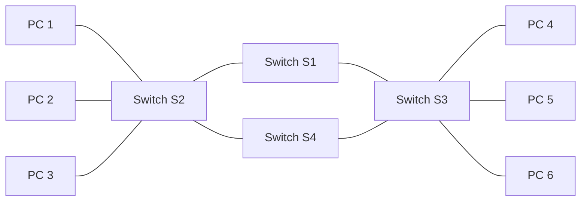

S2 and S3 are connected through S1 **and** through S4, which forms the loop S2–S1–S3–S4–S2.

*Everyday example:* four friends in a circle, each told "whenever you hear news, shout it to everybody next to you". One piece of news then bounces around the circle forever, and nobody can talk about anything else.

## 3. The Spanning Tree Protocol

The **Spanning Tree Protocol (STP)** constructs a **loop-free logical topology** for Ethernet switches:

- It creates a **spanning tree** that **enables some links and disables others**, so that there is **a single active path between any two network nodes**.
- The aim is to **avoid the broadcast storms** that result from loops.
- STP can keep **backup links** that become active when an active link fails.

The lecture's example has three switches SW1, SW2 and SW3 connected in a triangle, each with one PC (Amlendra on SW1, Arjun on SW2, Arvind on SW3). STP disables one link of the triangle (here the SW2–SW3 link, Gi0/1 on SW2), so the active links form a tree and every frame has exactly one path.

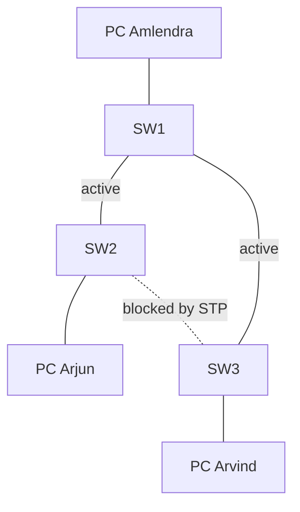

### History and related protocols

- STP was originally standardized as **IEEE 802.1D**. The **first STP algorithm is by Radia Perlman**, who wrote it for her master's thesis.
- **Rapid Spanning Tree Protocol (RSTP)** was introduced by IEEE in **2001** as **802.1w**; it reduces convergence time.
- Today the functionality of 802.1D, 802.1w and **Multiple Spanning Tree (802.1s)** is incorporated into **IEEE 802.1Q-2014**, the standard for local and metropolitan area networks (bridges and bridged networks).

Many other related protocols exist:

- **Shortest Path Bridging (IEEE 802.1aq)**: efficient, flexible forwarding for large networks.
- **Bridges and Bridged Networks (IEEE 802.1Q-2014)**: standardizes bridges, with enhancements for connectivity, reliability and scalability.
- **Connectivity Fault Management (CFM)**: detecting and diagnosing connectivity faults in Ethernet networks.
- **Equal Cost Multiple Paths in Shortest Path Bridging**: load balancing over equal-cost paths.
- **Automatic Attachment to Provider Backbone Bridging**: simplifies attaching customer networks to provider networks.
- **IS-IS Extensions Supporting Shortest Path Bridging**: lets IS-IS carry the information SPB needs.

## 4. Breadth-first search and BFS trees

**Breadth-first search (BFS)** is an algorithm for traversing a network. The starting node is called the **root**. The algorithm explores **all neighbouring nodes first**, before moving to the next-level neighbours.

The **task** here is to construct a **directed tree**, a subgraph whose edges are **directed towards the root**, such that **the directed path from every node to the root is a shortest path** in the network. Such a tree is a **BFS tree (BFT)**.

The sequential (centralized, not distributed) BFS uses a queue:

```text
function BFS(Graph, root):
    queue   = empty queue        // nodes waiting to be explored
    visited = empty set          // nodes already reached
    tree    = {}                 // the directed tree being built
    queue.enqueue(root);  visited.add(root)
    while queue is not empty:
        current = queue.dequeue()
        tree[current] = []
        for neighbor in Graph.neighbors(current):
            if neighbor not in visited:
                visited.add(neighbor)
                tree[current].append(neighbor)   // neighbor becomes a child of current
                queue.enqueue(neighbor)
    return tree
```

Because the queue is first-in first-out, all nodes at distance 1 are handled before any node at distance 2, and so on. That is exactly why every tree path is a shortest path.

### The running example

The lecture uses one example graph throughout. The numbers below are the processor names used on the lecture's register slide (*p*₁ is the root); the distance of each node from the root is given in brackets.

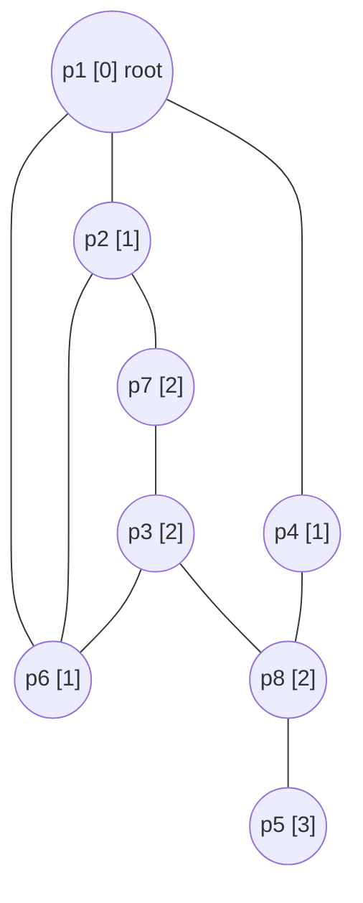

The BFS tree for this graph has the edges directed towards the root:

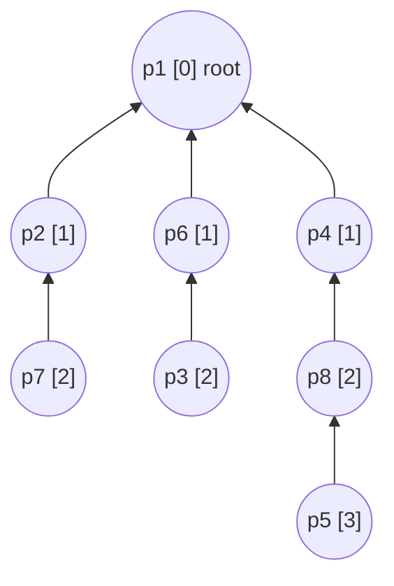

The links *p*₂–*p*₆, *p*₇–*p*₃ and *p*₃–*p*₈ exist in the graph but are not tree edges.

## 5. A non-self-stabilizing distributed BFS tree

A simple distributed (message-passing) BFS works like this:

```text
variables: distance, initially 0 for the root and ∞ for non-root processors

root:
    send distance to all neighbors

non-root:
    upon receiving <d> from pj:
        if d + 1 < distance then
            distance := d + 1
            parent   := j
            send <distance> to all neighbors
```

The root announces 0; each neighbour learns "I am at distance 1" and announces it; and so on. Every node keeps the smallest distance it has heard plus one, and the neighbour it heard it from becomes its parent.

> **Beyond the slides (reasoning):** this algorithm is **not self-stabilizing** because it depends on the **initial values** (0 at the root, ∞ elsewhere) and the root sends only once. If a transient fault leaves a non-root processor with a distance that is too small, say 0, the test "*d* + 1 < distance" can never increase it again, and the wrong value is believed forever. A self-stabilizing algorithm cannot rely on initialization; it must **recompute everything repeatedly** from the neighbours' current values.

## 6. The self-stabilizing setting: registers encode the tree

The self-stabilizing algorithm uses the **shared-memory model**:

- The system consists of *n* processors; *p*₁ is the root.
- Processor *pᵢ* communicates with its neighbour *pⱼ* by **writing in the register *rᵢⱼ*** and **reading from *rⱼᵢ***.
- **The output is the constructed tree, which the registers encode.**

**Each node has one register per neighbour**, with two fields:

> ⟨**child-indication**, **distance**⟩ — written *rᵢⱼ*.parent and *rᵢⱼ*.dis.

*rᵢⱼ*.parent = 1 means "*pⱼ* is my parent" (I am *pⱼ*'s child); 0 means it is not. *rᵢⱼ*.dis is *pᵢ*'s distance from the root.

In the running example, after stabilization:

- the root writes ⟨0, 0⟩ to all its neighbours;
- *p*₂ (distance 1) writes ⟨1, 1⟩ to *p*₁ (its parent) and ⟨0, 1⟩ to *p*₆ and *p*₇;
- *p*₇ (distance 2) writes ⟨1, 2⟩ to *p*₂ and ⟨0, 2⟩ to *p*₃;
- *p*₅ (distance 3) writes ⟨1, 3⟩ to *p*₈, its only neighbour.

The lecture's register examples: *r*₂₁ = (parent = 1, dis = 1); *r*₅₈ = (parent = 1, dis = 3); *r*₇₃ = (parent = 0, dis = 2).

### What is a first BFS tree?

Given a graph *G* = (*V*, *E*) and a root *v* ∈ *V*, **can there be more than one BFS tree rooted at *v***? Yes: whenever a node has **several shortest paths to the root**. In the lecture's version of the example graph with an extra link *p*₆–*p*₈, node *p*₈ (distance 2) has two neighbours at distance 1, *p*₄ and *p*₆. Both choices give a valid BFS tree:

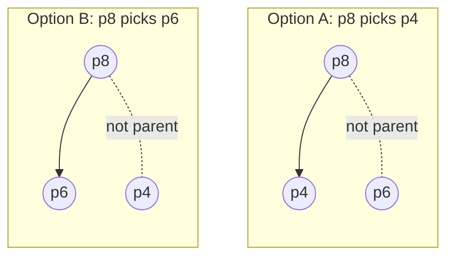

In option A, *p*₈ writes ⟨1, 2⟩ towards *p*₄ and ⟨0, 2⟩ towards *p*₆; in option B it is the other way round.

**The first-BFS tree construction selects the "first" of these paths.** Each processor decides on the order using **local identifiers**: it has a fixed, arbitrary ordering of its own links (port 1, port 2, …), and it picks the first neighbour in that ordering that has the smallest distance. So the tree is unique once the root and the local link orderings are fixed.

> **Beyond the slides (Dolev §2.5):** formally, let α*ᵢ* be the ordering of the edges incident to node *vᵢ*. The first BFS tree is uniquely defined by the root and the α orderings: a node at distance *x* + 1 with several neighbours at distance *x* connects to the first such neighbour according to α*ᵢ*.

## 7. The self-stabilizing first-BFS algorithm

The idea, from Dolev, Israeli and Moran (1993, "Self-stabilization of dynamic systems assuming only read/write atomicity", *Distributed Computing* 7(1):3–16):

- **The root informs all its neighbours that its distance is 0.**
- **A non-root processor chooses the minimal distance among its neighbours, adds one, and updates its neighbours.**
- **Correct encoding of the distances allows the correct assignment of the parent–child values.**

The code for processor *pᵢ* (δ = number of *pᵢ*'s neighbours; *i* = the writing processor; *m* = the neighbour for whom the data is written; *lrₘᵢ* = the last value of *rₘᵢ* read by *pᵢ*):

```text
01 Root:  do forever
02            for m := 1 to δ do write r_im := ⟨0, 0⟩
03        od
04 Other: do forever
05            for m := 1 to δ do lr_mi := read(r_mi)
06            FirstFound := false
07            dist := 1 + min{ lr_mi.dis | 1 ≤ m ≤ δ }
08            for m := 1 to δ
09            do
10                if not FirstFound and lr_mi.dis = dist − 1 then
11                    write r_im := ⟨1, dist⟩
12                    FirstFound := true
13                else
14                    write r_im := ⟨0, dist⟩
15            od
16        od
```

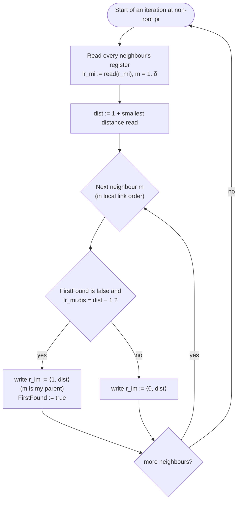

Notes on the code:

- The root is very simple: it keeps "telling" all neighbours ⟨0, 0⟩: "I am not your child, and my distance is 0".
- **FirstFound** guarantees that by the end of each pass every non-root processor marks **exactly one parent**: the **first** neighbour, in its local link order, whose distance is one less than its own.
- Everything is recomputed from scratch in every iteration, from the neighbours' current registers. Nothing depends on initial values; this is what makes it self-stabilizing.

> **Beyond the slides (Dolev §2.5):** the distance field is bounded by *N*, an upper bound on the number of processors; an attempt to write a larger value writes *N*. Non-root processors with the same number of neighbours run identical programs.

## 8. Correctness

### 8.1 The task ST and floating distances

**Task ST:** every configuration **encodes a first BFS tree** of the communication graph. (A configuration is the vector of processor states plus the vector of register values; ST is the set of configuration sequences in which every configuration encodes the BFS tree.)

**Notation:** Δ is the **maximum number of links adjacent to a processor**.

**Definitions:**

- A **floating distance** in configuration *c* is a value in *rᵢⱼ*.dis that is **smaller than the distance of *pᵢ* from the root**.
- The **smallest floating distance** in *c* is the smallest value among the floating distances.

Floating distances are the "lies" left by transient faults: a processor claiming to be closer to the root than it really is. Too-large values are harmless (the minimum in line 07 ignores them as soon as a correct, smaller value is available), but too-small values attract neighbours. The proof shows that the smallest lie keeps growing until it disappears.

### 8.2 A reminder: proof by induction

A proof by induction has three parts:

1. **Base case:** prove the statement for the smallest value (often 0 or 1).
2. **Inductive hypothesis:** assume the statement is true for some arbitrary *k*.
3. **Inductive step:** use the hypothesis to prove it for *k* + 1.

**Example:** prove 1 + 2 + … + *x* = *x*(*x* + 1)/2 for all positive integers *x*.

- Base case *x* = 1: 1 = 1·(1 + 1)/2. True.
- Hypothesis: 1 + 2 + … + *k* = *k*(*k* + 1)/2.
- Step: add *k* + 1 to both sides:

$$1 + 2 + \dots + k + (k+1) = \frac{k(k+1)}{2} + (k+1) = (k+1)\left(\frac{k}{2} + 1\right) = (k+1)\frac{k+2}{2} = \frac{(k+1)\big((k+1)+1\big)}{2}.$$

So the statement holds for *k* + 1, and therefore for every positive integer.

*Everyday example:* dominoes. If the first one falls (base case), and every domino knocks over the next (step), then all of them fall.

### 8.3 Lemma 2.1 (cycle version)

The lecture proves a version that is simpler than the one in the book, counting **asynchronous cycles**. Recall: the first asynchronous cycle of a fair execution is the shortest prefix in which every processor executes at least one complete iteration of the do-forever loop; the second cycle starts right after the first, and so on. So **in every asynchronous cycle, each processor reads the registers of all its neighbours and writes to each of its registers** (the root runs lines 01–03, the others lines 04–16).

> **Lemma 2.1.** For every *k* > 0 and for every configuration that follows **2*k* asynchronous cycles**:
>
> - **Assertion (1):** if there exists a floating distance, then the value of the smallest floating distance is **at least *k***.
> - **Assertion (2):** the value in the registers of **every processor within distance *k* from the root equals its distance** from the root.

**Base case, k = 1.**

*Claim 1:* within the first two asynchronous cycles the system reaches a configuration *c*₂ in which the dist field is **0 at the root and at least 1 at every non-root processor**.

- Distances stored in registers and internal variables are non-negative, so the smallest floating distance is at least 0 in the starting configuration.
- During the first asynchronous cycle, each non-root processor computes dist in line 07. Since dist = 1 + (a non-negative minimum), **the result is at least 1**. Let *c*₁ be the configuration reached after each processor's first computation of dist.
- During the cycle that follows *c*₁, each non-root processor writes that value (≥ 1) to all its registers. Let *c*₂ be the configuration after that cycle.

(The slide states Claim 1 as "within one asynchronous cycle", but its own proof uses the cycle up to *c*₁ plus the cycle after it.) So in every configuration after *c*₂ no non-root processor has a value below 1 in its registers: **Assertion (1) holds for *k* = 1**.

*Assertion (2) for k = 1:* the root writes distance 0 to its registers in every cycle. Let *c*₁ be the configuration after the first cycle. Every neighbour of the root reads the root's registers and, in the following cycle, writes to its own registers. In that write it assigns dist = 1 (the smallest value it can read is the root's 0, because no distance is negative). Any further read of the root's registers returns 0 again. So within **2 asynchronous cycles**, every neighbour of the root has dist = 1 in its registers.

**Inductive step, k → k + 1.** Assume the lemma holds for some *k* ≥ 1.

*Assertion (1):* let minFloat ≥ *k* be the smallest floating distance in configuration *c*₂ₖ, reached after the first 2*k* cycles. During the 2 cycles that follow, every processor that reads dist = minFloat and picks it as its smallest value computes and writes **minFloat + 1**. So in *c*₂₍ₖ₊₁₎ the smallest floating distance is at least minFloat + 1 ≥ *k* + 1.

*Assertion (2):* let *pᵢ* be a processor whose real distance from the root is *k* + 1. Look at its neighbours:

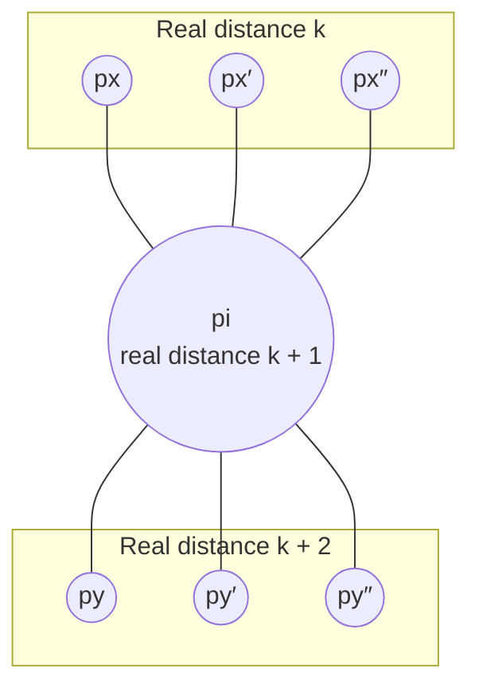

- Every neighbour at real distance *k* has **dist = *k*** in its registers, by Assertion (2) for *k*.
- Every other neighbour shows **dist ≥ *k***, by Assertion (1) (any value below *k* would be a floating distance smaller than *k*).
- So the minimum *pᵢ* reads is exactly *k*, and lines 05–14 make it write **dist = *k* + 1**. It cannot pick a neighbour with a larger distance (*k* is the minimum), and it cannot pick one with a smaller distance (none exists).

This proves Assertion (2) for *k* + 1. ∎

### 8.4 From correct distances to the first BFS tree

Once the value in the registers of every processor equals its distance from the root, each processor *pᵢ* chooses as its parent **the first neighbour, according to its internal link ordering, whose distance is smaller than its own**, which is exactly its parent in the first BFS tree.

> **Corollary 2.1.** The algorithm is self-stabilizing for ST.

> **Beyond the slides (reasoning from Lemma 2.1):** let *d* be the largest distance of any processor from the root (*d* ≤ *n* − 1). Applying Assertion (2) with *k* = *d* shows that after 2*d* cycles every register holds the correct distance. In the next cycle each processor rereads its neighbours' now-correct registers and rewrites its parent bits, so the first BFS tree is encoded within O(*d*) cycles.

### 8.5 The book version of the proof †

The book proves the same lemma while counting **rounds** instead of cycles. Since one iteration of the do-forever loop takes O(Δ) steps, **in every 2Δ successive rounds each processor reads the registers of all its neighbours and writes to each of its registers**. The lemma reads: for every *k* > 0 and every configuration that follows **Δ + 4*k*Δ rounds**, Assertions 1 and 2 hold. The proof is by induction over *k*:

- **Base case, Assertion 1:** distances are non-negative, so the smallest floating distance is at least 0 initially. During the first 2Δ rounds each non-root processor computes dist (line 07), and the result is at least 1. Let *c*₂ be the configuration after every processor's first computation of dist. During the 2Δ rounds that follow *c*₂, each non-root processor writes that value to all its registers. So after the first 4Δ rounds no non-root processor has 0 in its registers.
- **Base case, Assertion 2:** the root writes 0 to its registers in every Δ rounds. Let *c*₁ be the configuration after these Δ rounds. Each processor reads the root's registers and then writes to its own registers during the 4Δ rounds that follow *c*₁, assigning 1. Any further read of the root returns 0, so after the first Δ + 4Δ rounds every neighbour of the root holds 1.
- **Induction step:** assume correctness for *k* ≥ 0. Let *m* ≥ *k* be the smallest floating distance in the configuration *c*₄ₖ that follows the first Δ + 4*k*Δ rounds. During the 4Δ rounds that follow, each processor that reads *m* and chooses it as the smallest value writes *m* + 1, so the smallest floating distance is *m* + 1 in *c*₄₍ₖ₊₁₎ (Assertion 1). Since the smallest floating distance is *m* ≥ *k*, each processor at distance *k* + 1 reads a neighbour of distance *k* and assigns *k* + 1: it cannot choose a neighbour with a larger distance (the algorithm takes the minimum) or a smaller one (*k* is the shortest distance of any neighbour) (Assertion 2).
- The corollary follows exactly as in Section 8.4.

## 9. Fair composition

We now know two self-stabilizing algorithms: Dijkstra's token ring and the BFS tree construction. **Fair composition** lets us build bigger self-stabilizing algorithms out of smaller ones.

**The idea.** Compose self-stabilizing algorithms *AL*₁, …, *ALₖ* so that **the stabilized behaviour of *AL*₁, *AL*₂, …, *ALᵢ* is used by *ALᵢ₊₁***. *ALᵢ₊₁* **cannot detect** whether the earlier algorithms have stabilized, but it is **executed as if they have**. It is similar to network layering, where each layer uses the service of the layer below.

The technique is described for *k* = 2: two simple algorithms, a **server** and a **client**, are combined into a more complex algorithm. **The server ensures that some properties hold, and the client uses them.**

**Definitions.**

- The **server** *AL*₁ solves a task defined by a set of legal executions *T*₁; the **client** *AL*₂ solves *T*₂.
- Let *Aᵢ* be the state set of *pᵢ* in *AL*₁, and *Sᵢ* = *Aᵢ* × *Bᵢ* its state set in *AL*₂. Whenever *pᵢ* executes *AL*₂, it **modifies only the *Bᵢ* component**. (It may read the *Aᵢ* part, the server's output, but never changes it.)
- For a configuration *c* ∈ *S*₁ × … × *Sₙ*, the **A-projection** of *c* is the configuration (*a*ₚ₁, …, *a*ₚₙ) ∈ *A*₁ × … × *Aₙ*: just the server's part. The A-projection of an execution consists of the A-projection of every configuration in it.
- *AL*₂ is **self-stabilizing for task *T*₂ given task *T*₁** if every fair execution of *AL*₂ that has an A-projection in *T*₁ has a suffix in *T*₂. In words: if the server behaves legally, the client eventually behaves legally.
- *AL* is a **fair composition** of *AL*₁ and *AL*₂ if, in *AL*, **every processor executes steps of *AL*₁ and *AL*₂ alternately**.

> **Theorem 2.2.** Assume *AL*₂ is self-stabilizing for task *T*₂ given task *T*₁. If *AL*₁ is self-stabilizing for *T*₁, then the fair composition of *AL*₁ and *AL*₂ is self-stabilizing for *T*₂.

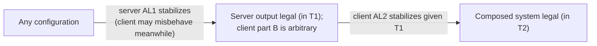

> **Beyond the slides (Dolev §2.7):** the proof is two lines: by the self-stabilization of *AL*₁, every execution has a suffix whose A-projection is in *T*₁; by the assumption on *AL*₂, that suffix has a further suffix in *T*₂. It is enough that every processor executes steps of both algorithms infinitely often, and the server does not need to reach a state where its registers never change.

## 10. Example: mutual exclusion in general graphs

Dijkstra's algorithm only works on a ring. To get token circulation on **any** connected graph with one distinguished processor, **compose the spanning tree construction (server) with the mutual exclusion algorithm (client)**.

### The Euler tour turns a tree into a ring

An **Euler tour** of a rooted tree walks around the tree, traversing every edge twice: once going down and once coming back up. Example: a root with children *A* (edge 1), *B* (edge 3) and *C* (edge 5); *A* has children *D* (edge 2) and *E* (edge 4); *D* has a child *F* (edge 6).

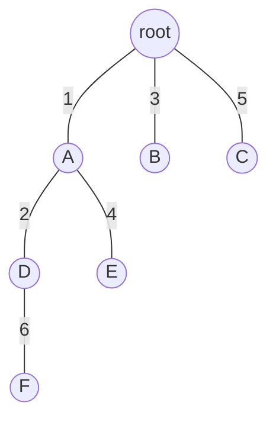

Starting at the root, the tour traverses the edges in the order **1, 2, 6, 6, 2, 4, 4, 1, 3, 3, 5, 5**. Walking this tour forever is like walking around a ring, so **an Euler tour defines a virtual ring**.

### The modified mutual exclusion algorithm

The lecture uses a version of Dijkstra's algorithm **designed to stabilize in a system where a rooted spanning tree exists and only read/write atomicity is assumed** (one read or one write per step, not the powerful central daemon).

Example: root *p*₁ with children *p*₄, *p*₂ and *p*₃ (in *p*₁'s fixed order). The virtual ring visits the registers and local copies in the order

*lr*₄,₁ → *r*₁,₂ → *lr*₁,₂ → *r*₂,₁ → *lr*₂,₁ → *r*₁,₃ → *lr*₁,₃ → *r*₃,₁ → *lr*₃,₁ → *r*₁,₄ → *lr*₁,₄ → *r*₄,₁ → (back to *lr*₄,₁).

So *p*₁ **acts as three processors** of the ring, one for each attached link. In particular it acts as the special processor using *lr*₄,₁ and *r*₁,₂: whenever *lr*₄,₁ equals *r*₁,₂, *p*₁ increments the value in *r*₁,₂ modulo 4*n* − 5.

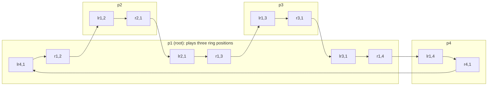

**Code for *pᵢ*.** For a non-root node, the links are ordered 1, 2, …, δ with link 1 leading to its parent; register indices *rᵢ,ₘ₊₁* are computed modulo δ.

```text
01 Root:  do forever
02            lr_1,i := read(r_1,i)
03            if lr_δ,i = r_i,1 then
04                (* critical section *)
05                write r_i,2 := (lr_1,i + 1) mod (4n − 5)
06            for m := 2 to δ do
07                lr_m,i := read(r_m,i)
08                write r_i,m+1 := lr_m,i
09            od
10        od
11 Other: do forever
12            lr_1,i := read(r_1,i)
13            if lr_1,i ≠ r_i,2 then
14                (* critical section *)
15                write r_i,2 := lr_1,i
16            for m := 2 to δ do
17                lr_m,i := read(r_m,i)
18                write r_i,m+1 := lr_m,i
19            od
20        od
```

In words: a non-root processor reads from its parent link and passes the value down its first child link; it enters the critical section only when the value read from the parent differs from what it last passed on (this is Dijkstra's "copy if different"). For each further child it copies what came back up from the previous child into the next child's register, which carries the value around the Euler tour. The root behaves like Dijkstra's special processor: when the value coming back from its last child equals what it sent, it enters the critical section and sends a new, incremented value.

(The code follows Dolev, Figure 2.5. On the lecture slide the δ subscript in line 03 is lost; line 05 is written here with explicit parentheses, (lr₁,ᵢ + 1) mod (4*n* − 5), which is its intended meaning.)

### Putting it together

- Mutual exclusion is applied to a spanning tree of the system, using the ring defined by the Euler tour.
- **The parent field of the spanning tree algorithm defines the parent of each processor in the tree** (and hence its children too).
- While the server (tree construction) has not stabilized, the client may run on a structure that is not a tree, which is an execution its designers never considered. **When the server reaches its stable state, the mutual exclusion algorithm is in an arbitrary state, and from there it converges to a safe configuration.** By Theorem 2.2, the composition is self-stabilizing.

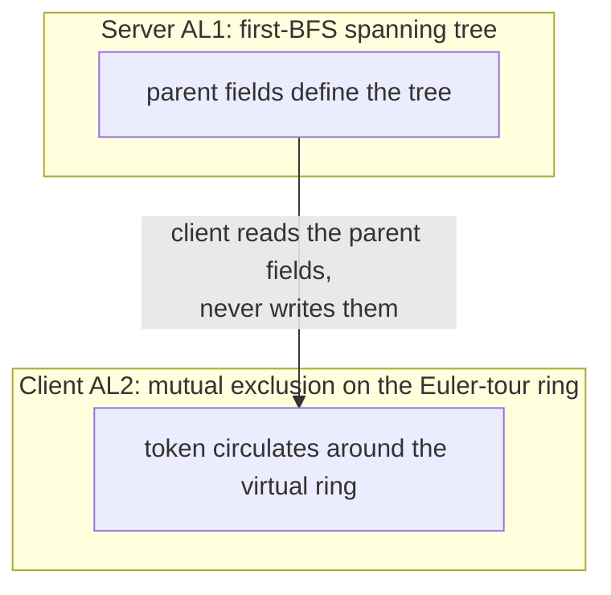

> **Beyond the slides (Dolev §2.7):** one way to implement the alternation is a binary variable turnᵢ in each processor: when turnᵢ = 0 the processor executes the next step of the tree construction, when turnᵢ = 1 a step of mutual exclusion, and then flips turnᵢ. The composed algorithm can itself be used as a server that implements a central daemon (one processor activated at a time) for other client algorithms.

## 11. Recap

- **Loops** at the data-link layer cause broadcast storms because Ethernet frames have no TTL; **STP** prevents them by building a spanning tree (first algorithm by Radia Perlman).
- The **self-stabilizing first-BFS algorithm** has the root write ⟨0, 0⟩ forever, and every other processor repeatedly set its distance to 1 + the minimum neighbour distance, marking as parent the first neighbour (in its local order) with distance one less.
- **Correctness** rests on **floating distances**: after 2*k* cycles the smallest floating distance is at least *k* and all processors within distance *k* are correct (Lemma 2.1, by induction). Hence the algorithm is self-stabilizing for ST (Corollary 2.1).
- **Fair composition** (Theorem 2.2): if the server stabilizes and the client stabilizes given the server's task, then running them alternately stabilizes. Composing the BFS tree with Dijkstra's algorithm on the **Euler-tour virtual ring** gives self-stabilizing **token circulation in general networks** with one distinguished processor.
