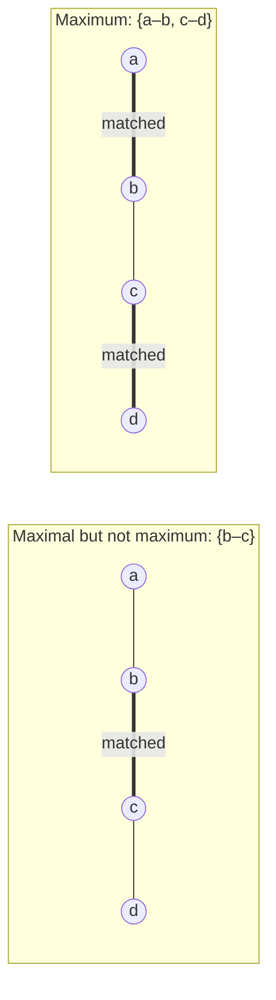
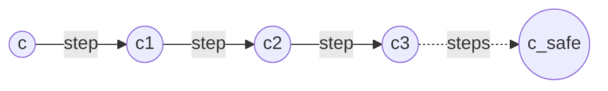
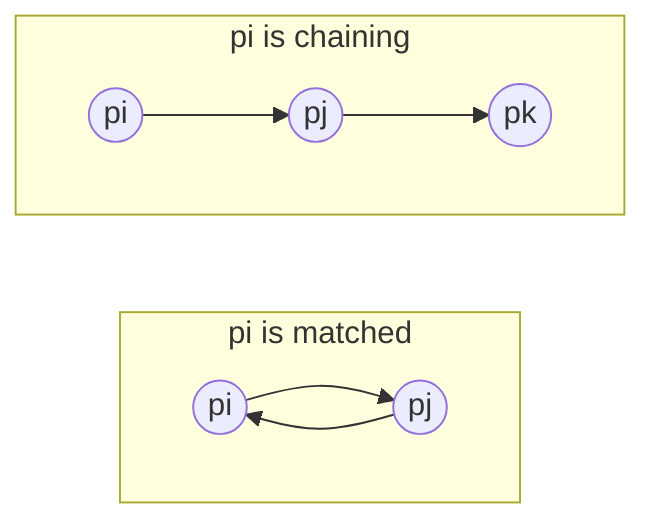
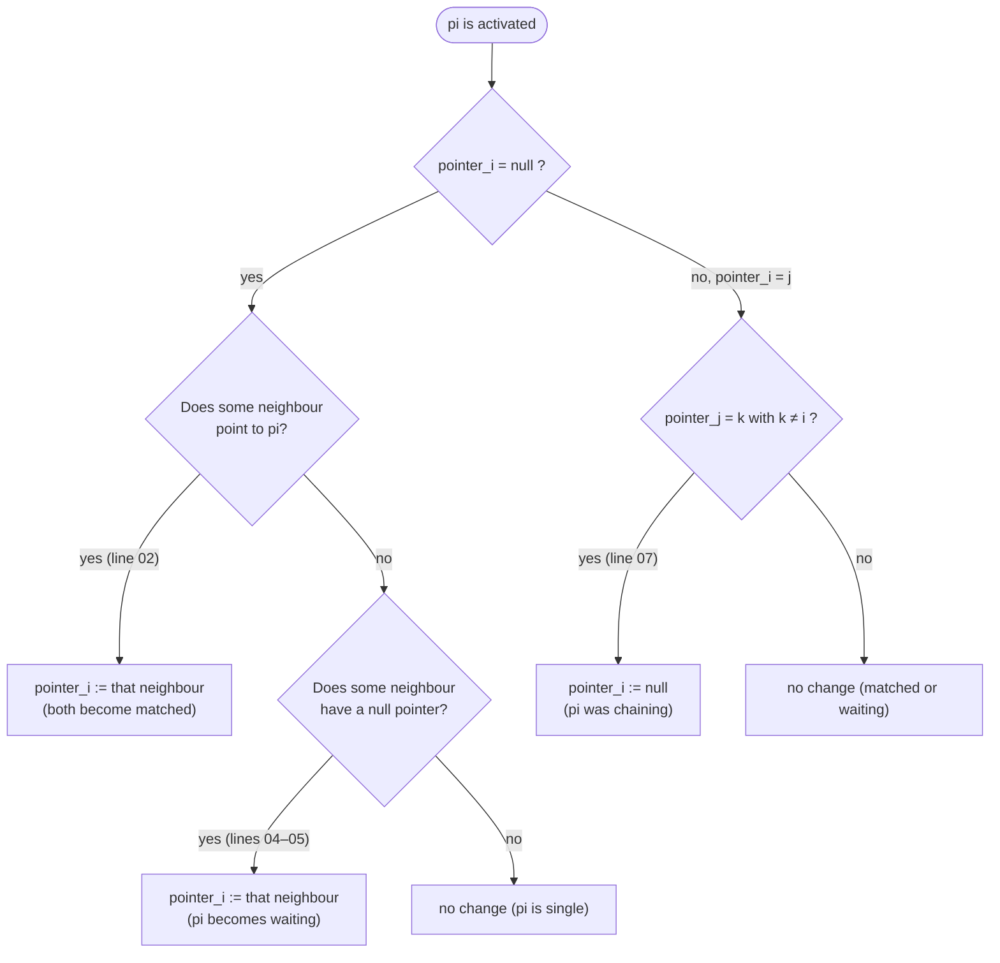
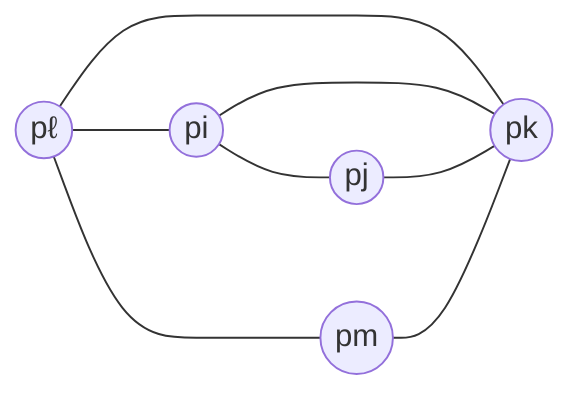

# Self-Stabilizing Maximal Matching and the Variant Function Technique

**Course:** EDA387/DIT663 Computer Networks, part 2 (Fault-tolerant Algorithms for Computer Networks), lecture "Maximal Matching" (Dolev, *Self-Stabilization*, §2.9; algorithm by Su-Chu Hsu and Shing-Tsaan Huang, "A Self-Stabilizing Algorithm for Maximal Matching", *Information Processing Letters* 43(2):77–81, 1992)

**Generated:** 2026-10-20

**† Supplementary material:** content that comes only from hidden PowerPoint slides. It may not be part of this year's examinable material. *This lecture has no hidden slides, so nothing in this guide carries the † mark.*

**How to read the boxes.** Text that starts with **Beyond the slides** adds context from the course book (Dolev), from the course's own pre-lecture quiz, or a short check of reasoning that the slides leave implicit. Everything else follows the lecture.

---

## Glossary

| Term | Full name | Meaning |
|---|---|---|
| Central daemon | Central demon | A scheduler that picks exactly one processor at a time to take an atomic step; here one step is a full iteration of the do-forever loop (read all, compute, write). |
| Chaining | — | Status of *pᵢ*: it points to a neighbour *pⱼ*, but *pⱼ* points to some third processor *pₖ*, *k* ≠ *i*. |
| D2D | Device-to-Device communication | Wireless devices talking directly to each other instead of through a base station. |
| Distributed daemon | Distributed demon | A scheduler that may let any number of processors take steps concurrently; each step is a single read or write plus local computation. |
| Free | — | Status of *pᵢ*: its pointer is null and it has at least one neighbour that is not matched. |
| Lexicographic order | Dictionary order | Comparing vectors element by element from the left, the way words are ordered in a dictionary. |
| Matched | — | Status of *pᵢ*: it points to a neighbour *pⱼ* and *pⱼ* points back to *pᵢ*. |
| Matching | Independent edge set | A set of edges *M* ⊆ *E* in which no two edges share a vertex. |
| Maximal matching | — | A matching that is not a subset of any other matching: no edge can be added. |
| Maximum matching | — | A matching with the largest possible number of edges. Every maximum matching is maximal, but not the other way round. |
| MM | Maximal Matching task | The set of executions in which all pointers are fixed and form a maximal matching. |
| *N*(*i*) | Neighbourhood of *pᵢ* | The set of neighbours of processor *pᵢ*. |
| Pointer, pointerᵢ | — | Processor *pᵢ*'s only variable: either the name of one neighbour or null. |
| Potential function | — | Another name for a variant function. |
| Single | — | Status of *pᵢ*: its pointer is null and all its neighbours are matched. |
| Variant function | VF | A bounded function of the configuration that changes monotonically with every step; used to prove convergence and to bound its time. |
| Waiting | — | Status of *pᵢ*: it points to a neighbour *pⱼ* whose pointer is null. |

---

## Table of contents

1. [Matchings: definitions](#1-matchings-definitions)
2. [Applications in computer networks](#2-applications-in-computer-networks)
3. [Proof technique: the variant function](#3-proof-technique-the-variant-function)
4. [The task and the model](#4-the-task-and-the-model)
5. [The five processor statuses](#5-the-five-processor-statuses)
6. [The algorithm](#6-the-algorithm)
7. [Central versus distributed daemons](#7-central-versus-distributed-daemons)
8. [Correctness with a variant function](#8-correctness-with-a-variant-function)
9. [A complete worked example](#9-a-complete-worked-example)
10. [Recap](#10-recap)

---

## 1. Matchings: definitions

Let *G* = (*V*, *E*) be a network topology.

- A **matching** *M* ⊆ *E* is a set of edges in which **no two edges share a vertex**. It is also called an **independent edge set**.
- A **maximal matching** is a matching that is **not a subset of any other matching** *M′*. You cannot add one more edge without breaking the matching rule.
- A **maximum matching** is a matching that contains **the largest possible number of edges**.

The difference matters. Take a path of four nodes *a*–*b*–*c*–*d*:



On the left, {*b*–*c*} is maximal: *a*–*b* and *c*–*d* both share a vertex with *b*–*c*, so nothing can be added. But it has only one edge, while the matching on the right has two. The algorithm in this lecture finds a **maximal** matching, which is easier, not necessarily a maximum one.

*Everyday example:* pairing up dance partners at a party where only people who know each other may dance together. A maximal pairing is one where no two unpaired people know each other, so nobody can be added. A maximum pairing is the one with the most couples on the floor.

## 2. Applications in computer networks

- **Matching in wireless networks.** Wireless networks consist of selfish, rational agents that seek their own benefit. Matching algorithms help pair agents with different characteristics that want to communicate.
    - **Cognitive radio networks:** licensed primary users occupy channels that unlicensed secondary users want to access; stable matchings of primary and secondary users are needed.
    - **Device-to-device (D2D) communications:** a technology to cope with the wireless capacity crunch; matching helps with interference management and resource allocation.
- **Cloud and edge computing:** **resource allocation** and **load balancing** (matching tasks to servers).

## 3. Proof technique: the variant function

The **variant function** (also called a potential function) is a technique **for proving convergence**. The idea:

1. Define a function VF over configurations whose value is **bounded**.
2. Prove that the function **changes monotonically** (always decreases, or always increases) whenever a processor executes a step.
3. Show that once the function reaches a certain **threshold**, the system is in a **safe configuration**.



Along this execution, |VF(*c*)| ≥ |VF(*c*₁)| ≥ |VF(*c*₂)| ≥ |VF(*c*₃)| ≥ … ≥ |VF(*c*_safe)| ≥ … ≥ bound (the lecture draws the decreasing version; in the matching proof below the function increases instead).

Because the function cannot change forever in one direction without passing its bound, the technique also **estimates the number of steps** needed to reach a safe configuration: at most the number of different values the function can take.

*Everyday example:* a hiker who only ever walks downhill on a mountain with a floor at sea level must eventually stop. If every step lowers the altitude by at least one metre, the number of steps is at most the starting height.

## 4. The task and the model

- **Matching** is a set of edges without common nodes.
- Each processor *pᵢ* has a single variable **pointerᵢ**, which either points to one of its neighbours or is **null**. *pᵢ* tries to find a matching neighbour.
- The algorithm should reach a configuration in which **pointerᵢ = *j* implies pointerⱼ = *i***: pointers come in mutual pairs, and those pairs are the matching edges.
- We **assume a central daemon**: one processor is activated at a time; it reads the state of all its neighbours and updates its own state before any other processor is activated.
- The set of legal executions **MM** for the maximal matching task includes **every execution in which the values of the pointers of all the processors are fixed and form a maximal matching**.

> **Beyond the slides (Dolev §2.9):** the book states the two conditions explicitly: (1) if *pᵢ* points to *pⱼ* then *pⱼ* points to *pᵢ* (the matching condition), and (2) no two neighbouring processors both have null pointers (the maximality condition: otherwise the edge between them could be added).

## 5. The five processor statuses

In a configuration, each processor *pᵢ* has exactly one of five statuses:

- **Matched:** *pᵢ* has a neighbour *pⱼ* such that pointerᵢ = *j* **and** pointerⱼ = *i*.
- **Waiting:** *pᵢ* has a neighbour *pⱼ* such that pointerᵢ = *j* and pointerⱼ = **null**. (*pᵢ* has proposed; *pⱼ* has not answered yet.)
- **Chaining:** *pᵢ* has a neighbour *pⱼ* such that pointerᵢ = *j* and pointerⱼ = *k*, **k ≠ i**. (*pᵢ* is pointing at someone who is pointing elsewhere.)
- **Free:** pointerᵢ = null and there is a neighbour *pⱼ* that is **not matched**. (*pᵢ* could still find a partner.)
- **Single:** pointerᵢ = null and **every neighbour is matched**. (*pᵢ* has no possible partner left.)

The first three describe a processor with a non-null pointer, classified by what its target does; the last two describe a processor with a null pointer, classified by its neighbours.

The lecture's example graph has five processors *pᵢ*, *pⱼ*, *pₖ*, *pℓ*, *pₘ* with links *pℓ*–*pᵢ*, *pᵢ*–*pⱼ*, *pℓ*–*pₘ*, *pℓ*–*pₖ*, *pᵢ*–*pₖ*, *pⱼ*–*pₖ* and *pₘ*–*pₖ*. Two of its pictures, drawn here with links as plain lines and pointers as arrows:



> **Beyond the slides (definition check):** the lecture slides define **free** as "pointerᵢ = null and there is a neighbour *pⱼ* with pointerⱼ = null" and **single** as "pointerᵢ = null and there is no neighbour *pⱼ* with pointerⱼ = null" (the free line also has a typo, *pᵢ* for *pⱼ*). The lecture's own speaker notes and the Dolev book use **"not matched"** / **"matched"** instead, as in the list above. The two versions differ when a neighbour is waiting or chaining (its pointer is not null, yet it is not matched). The proof below, and the "free or single" case in it, only works with the book's version, so this guide uses the book's definitions. In a safe configuration the two versions agree.

## 6. The algorithm

The program for processor *pᵢ*:

```text
01 do forever
02     if pointer_i = null and (∃ p_j ∈ N(i) | pointer_j = i) then
03         pointer_i := j
04     if pointer_i = null and (∀ p_j ∈ N(i) | pointer_j ≠ i) and
05                             (∃ p_j ∈ N(i) | pointer_j = null) then
06         pointer_i := j
07     if pointer_i = j and pointer_j = k and k ≠ i then
08         pointer_i := null
09 od
```

The three rules in plain words:

- **Lines 02–03, accept a proposal.** If I point to nobody and some neighbour points to me, I point back to it. Now we are matched.
- **Lines 04–06, make a proposal.** If I point to nobody, nobody points to me, and some neighbour also points to nobody, I point to that neighbour (I become waiting).
- **Lines 07–08, withdraw a hopeless proposal.** If I point to a neighbour that points to somebody else, I give up and set my pointer to null.



Which status triggers which line:

- a **free** processor runs line 03 (if a neighbour points to it) or line 06 (otherwise, if a neighbour has a null pointer);
- a **chaining** processor runs line 08;
- a **matched**, **waiting** or **single** processor changes nothing.

*Everyday example:* at the dance party, if someone is asking you and you are free, say yes (line 03). If nobody is asking you, ask someone who is also free (line 06). If the person you asked has already asked someone else, stop waiting for them (line 08).

## 7. Central versus distributed daemons

How many processors may run concurrently?

- Under the **central daemon** model, **exactly one** processor among all processors is selected, arbitrarily, by an adversarial scheduler, and takes a single atomic step. **Each step captures a complete iteration of the do-forever loop**: read all, finite internal computation, write all. **The proof in this lecture assumes a central daemon.**
- Under the **distributed daemon** model, **an arbitrary number of processors** are selected by an adversarial scheduler to take atomic steps **concurrently**. Each step captures **a single communication operation**, such as one read or one write, together with a finite sequence of local operations.

> **Beyond the slides (reasoning):** here is why the central daemon matters for this algorithm. Take three processors *a*, *b*, *c* connected in a triangle, all with null pointers, and let a distributed daemon activate all three at the same moment. Each sees that nobody points to it and that a neighbour is null, so each runs line 06; the adversary can make them choose *a* → *b*, *b* → *c*, *c* → *a*. Now all three are chaining, all three run line 08 together, and all pointers are null again. This can repeat forever, so the algorithm never stabilizes under that scheduler. With a central daemon only one processor moves at a time, which is exactly what the variant-function proof below counts on.

## 8. Correctness with a variant function

### The variant function

Let *m*, *s*, *w*, *f* and *c* be the total numbers of **matched**, **single**, **waiting**, **free** and **chaining** processors in a configuration. The variant function is the vector

$$VF(c) = (m + s,\; w,\; f,\; c).$$

**Values of VF are compared lexicographically**: compare the first elements; only if they are equal compare the second; and so on. For example, (5, 3, 4, 7) is greater than (5, 3, 3, 8), because the first two elements are equal and 4 > 3.

Since every processor has exactly one status, *m* + *s* + *w* + *f* + *c* = *n*.

### The proof idea

1. **VF(*c*) = (*n*, 0, 0, 0) exactly characterizes safe configurations.** Every configuration with VF = (*n*, 0, 0, 0) is safe with relation to MM and the algorithm, and every safe configuration has VF = (*n*, 0, 0, 0). In such a configuration every processor is matched or single: pointers come in mutual pairs (a matching), and every unmatched processor has only matched neighbours, so no edge can be added (maximal).
2. **Once the system reaches a safe configuration, no processor changes its pointer.** Matched and single processors have no applicable line.
3. **In every non-safe configuration, at least one processor can change its pointer** when the central daemon activates it (a waiting or chaining or free processor exists, and the analysis below shows which line applies).
4. **Every change of a pointer value increases VF** (shown below).
5. **The number of pointer changes is bounded** by the number of possible VF values, so a safe configuration is reached.

### Every pointer change increases VF

**Line 03 (accept).** *pᵢ* is free and its neighbour *pⱼ* points to it, so *pⱼ* is waiting. After pointerᵢ := *j*, both are matched. The number of free and of waiting processors each drop by 1, and the number of matched rises by 2:

$$(m+s,\; w,\; f,\; c) \;\Rightarrow\; (m+s+2,\; w-1,\; f-1,\; c).$$

**Line 06 (propose).** *pᵢ* is free and points to a neighbour with a null pointer, so *pᵢ* becomes waiting:

$$(m+s,\; w,\; f,\; c) \;\Rightarrow\; (m+s,\; w+1,\; f-1,\; c).$$

**Line 08 (withdraw).** *pᵢ* is chaining. Two cases:

- **Case 1: no processor points to *pᵢ*.** *pᵢ* becomes **free** if it has an unmatched neighbour, or **single** if all its neighbours are matched. Chaining drops by 1, and free or single rises by 1:

$$(m+s,\; w,\; f,\; c) \;\Rightarrow\; (m+s,\; w,\; f+1,\; c-1) \quad\text{or}\quad (m+s+1,\; w,\; f,\; c-1).$$

- **Case 2: at least one neighbour *pℓ* points to *pᵢ*.** Before the step, *pℓ* was chaining (it pointed to *pᵢ*, which pointed elsewhere). After the step *pᵢ* is null, so *pℓ* becomes **waiting**, and *pᵢ* becomes **free** (*pℓ* is an unmatched neighbour). Chaining drops by 2, waiting and free each rise by 1:

$$(m+s,\; w,\; f,\; c) \;\Rightarrow\; (m+s,\; w+1,\; f+1,\; c-2).$$

In every case the vector grows lexicographically: line 03 increases the first element; line 06 keeps the first element and increases the second; line 08 increases the first element (single), or keeps the first two and increases the third (case 1, free), or keeps the first and increases the second (case 2). So **every assignment increments VF**, and the system stabilizes once it reaches a configuration where no increment is possible, which is a safe configuration.

> **Beyond the slides (checking side effects):** a step can also change the status of processors other than *pᵢ* and its partner, but only in ways that keep the increase. After line 03, a neighbour that was free may become single (its last unmatched neighbour got matched), which moves it from *f* to *m* + *s* and increases the first element further; a processor that pointed to *pᵢ* or *pⱼ* without being chosen turns from waiting into chaining, which only affects later elements. In case 2 of line 08, if several neighbours point to *pᵢ*, each of them turns from chaining into waiting, so *w* grows by more than 1. None of this can make the vector smaller, because the first element that changes always increases.

### How many steps?

The number of pointer changes is bounded by the number of possible vector values. Because *m* + *s* + *w* + *f* + *c* = *n*, a rough count is: *n* + 1 possible values for *m* + *s*, *n* + 1 for *w*, and *n* + 1 for *f*; then *n* and the first three elements determine *c*. So there are O(*n*³) possible vectors, and

> **the system reaches a safe configuration within O(*n*³) pointer-value changes.**


> **Beyond the slides (course quiz):** quiz questions ask which status changes each line causes and why the bound is cubic. Remember the four transition vectors and the "*n* + 1 choices for each of the first three elements" argument.

## 9. A complete worked example

Use the lecture's graph: links *pℓ*–*pᵢ*, *pᵢ*–*pⱼ*, *pℓ*–*pₘ*, *pℓ*–*pₖ*, *pᵢ*–*pₖ*, *pⱼ*–*pₖ*, *pₘ*–*pₖ*.



Start from the corrupted configuration pointerᵢ = *j*, pointerⱼ = *k*, pointerₖ = *m*, pointerℓ = *k*, pointerₘ = null. Then *pᵢ*, *pⱼ* and *pℓ* are chaining, *pₖ* is waiting (it points to *pₘ*, which is null), and *pₘ* is free. VF = (0, 1, 1, 3).

The central daemon activates processors one at a time (activations that change nothing are skipped):

| Step | Activated | Line | New pointer | Statuses afterwards (*i*, *j*, *k*, ℓ, *m*) | VF |
|---|---|---|---|---|---|
| start | — | — | — | C, C, W, C, F | (0, 1, 1, 3) |
| 1 | *pᵢ* | 08 | pointerᵢ := null | F, C, W, C, F | (0, 1, 2, 2) |
| 2 | *pₘ* | 03 | pointerₘ := *k* | F, C, M, C, M | (2, 0, 1, 2) |
| 3 | *pℓ* | 08 | pointerℓ := null | F, C, M, F, M | (2, 0, 2, 1) |
| 4 | *pᵢ* | 06 | pointerᵢ := ℓ | W, C, M, F, M | (2, 1, 1, 1) |
| 5 | *pℓ* | 03 | pointerℓ := *i* | M, C, M, M, M | (4, 0, 0, 1) |
| 6 | *pⱼ* | 08 | pointerⱼ := null | M, S, M, M, M | (5, 0, 0, 0) |

(M = matched, S = single, W = waiting, F = free, C = chaining.)

VF increases at every step, exactly as the proof predicts. The final configuration has the matching {*pₖ*–*pₘ*, *pᵢ*–*pℓ*}, and *pⱼ* is single because both its neighbours *pᵢ* and *pₖ* are matched. No edge can be added, so the matching is maximal, and no line is applicable any more.

## 10. Recap

- A **matching** is a set of edges with no shared vertex; a **maximal** matching cannot be extended; a **maximum** matching is the largest possible.
- Each processor keeps one **pointer**. Rules: **accept** a proposal (line 03), **propose** to a neighbour with a null pointer (line 06), **withdraw** when the target points elsewhere (line 08).
- Statuses: **matched, waiting, chaining** (pointer set) and **free, single** (pointer null).
- **Variant function** VF = (*m* + *s*, *w*, *f*, *c*), compared lexicographically. Every pointer change increases it; VF = (*n*, 0, 0, 0) exactly when the configuration is safe. Under a **central daemon** the algorithm stabilizes within **O(*n*³) pointer changes**.
