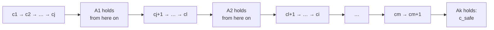
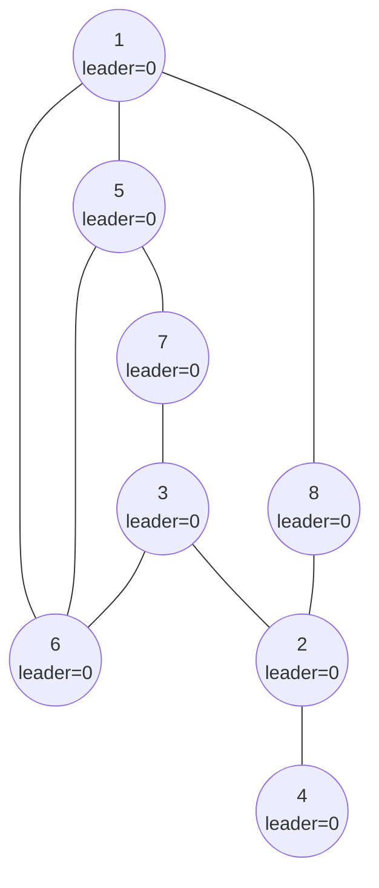
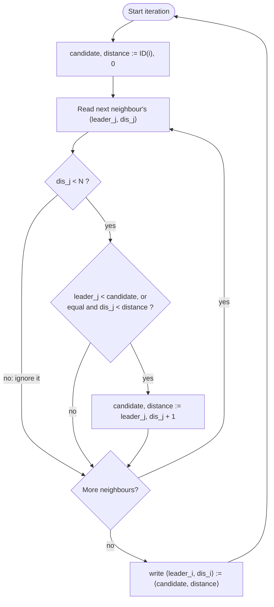
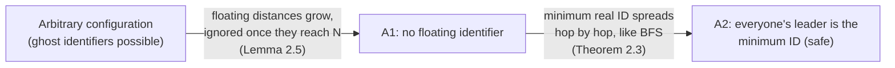

# Self-Stabilizing Leader Election in General Graphs (ID-Based Systems)

**Course:** EDA387/DIT663 Computer Networks, part 2 (Fault-tolerant Algorithms for Computer Networks), lecture "Self-stabilizing Leader Election for ID-based Systems", first part (Dolev, *Self-Stabilization*, §2.9: convergence stairs). The second part of the same lecture, leader election in complete graphs without identifiers, has its own guide.

**Generated:** 2026-10-20

**† Supplementary material:** content that comes only from hidden PowerPoint slides. It may not be part of this year's examinable material. *This part of the lecture has no hidden slides, so nothing in this guide carries the † mark.*

**How to read the boxes.** Text that starts with **Beyond the slides** adds context from the course book (Dolev), from the course's own pre-lecture quiz, or a short check of reasoning that the slides leave implicit. Everything else follows the lecture.

---

## Glossary

| Term | Full name | Meaning |
|---|---|---|
| Attractor | — | Another name for a predicate *Aᵢ* in a convergence-stairs proof: once the system reaches it, it stays in it. |
| Candidate | — | The leader that processor *pᵢ* currently believes in, together with its distance to it. |
| Convergence stairs | — | A proof technique: show that the system reaches and stays in predicate *A*₁, then in a stronger *A*₂, and so on up to *Aₖ*, which describes safe configurations. |
| Δ (Delta) | — | The maximum number of neighbours of any processor. |
| δ (delta) | — | The number of neighbours of the processor running the code. |
| Distance (dis) | — | The number of hops a processor believes separate it from its candidate leader. |
| Floating identifier | — | An identifier that appears in the initial configuration although no processor in the system has that identifier: a "ghost" leader left by a fault. |
| ID(*i*) | Identifier of *pᵢ* | A unique number in the range 1 to *N* assigned to processor *pᵢ*. |
| IoT | Internet of Things | Networks of small connected devices such as sensors and appliances. |
| Leader election | — | The task of informing every processor of the identifier of one single processor, the leader. |
| Lexicographic order | — | Comparing pairs element by element: first the identifier, and only if equal, the distance. |
| MANET | Mobile Ad hoc Network | A self-configuring wireless network of mobile devices without fixed infrastructure. |
| *N* | — | A known upper bound on the number of processors; identifiers lie in 1 to *N*. |
| OSPF | Open Shortest Path First | A link-state routing protocol in which routers elect a designated router. |
| P2P | Peer-to-peer | Networks where all participants are equal and talk directly to each other. |
| Predicate | — | A true/false statement about a configuration, for example "no floating identifier exists". |
| Refinement | — | *A*ᵢ₊₁ refines *Aᵢ* if *Aᵢ* holds whenever *A*ᵢ₊₁ holds: *A*ᵢ₊₁ is the stronger statement. |
| Safe configuration | — | A configuration from which every fair execution is legal. |

---

## Table of contents

1. [Why leader election?](#1-why-leader-election)
2. [Proof technique: convergence stairs](#2-proof-technique-convergence-stairs)
3. [The task and the assumptions](#3-the-task-and-the-assumptions)
4. [Why the naive algorithm is not self-stabilizing: floating identifiers](#4-why-the-naive-algorithm-is-not-self-stabilizing-floating-identifiers)
5. [The self-stabilizing algorithm](#5-the-self-stabilizing-algorithm)
6. [Correctness with two convergence stairs](#6-correctness-with-two-convergence-stairs)
    - [6.1 The two stairs](#61-the-two-stairs)
    - [6.2 Stair 1: Lemma 2.5, floating identifiers disappear](#62-stair-1-lemma-25-floating-identifiers-disappear)
    - [6.3 Stair 2: Theorem 2.3, the minimum identifier wins](#63-stair-2-theorem-23-the-minimum-identifier-wins)
7. [A complete worked example](#7-a-complete-worked-example)
8. [Recap](#8-recap)

---

## 1. Why leader election?

Many distributed tasks become simple once one node is chosen as a leader that can coordinate the others. Leader election is used for:

- **Coordinator election:** selecting a coordinator that acts as a central point for decisions.
- **Load balancing:** a leader distributes incoming requests or tasks evenly among nodes.
- **Cluster management:** in clusters and clouds, a leader coordinates resource allocation, scaling and maintenance.
- **Network routing:** selecting a designated router; in OSPF, an election determines a designated router (the lecture describes it as the router responsible for maintaining the routing tables; in OSPF terms, the designated router coordinates the exchange of link-state information on a shared network segment).
- **Mobile ad hoc networks (MANETs):** a temporary leader keeps a dynamic, self-configuring network organized.
- **Sensor networks:** a leader aggregates data from many sensors, saves energy by controlling sensor activity, and talks to a central server.
- **IoT:** selecting edge devices or gateways that aggregate, preprocess and forward data to the cloud.
- **Decentralized systems:** in peer-to-peer and blockchain networks, consensus algorithms decide who may create new blocks or validate transactions.
- **Resource allocation:** choosing the node that allocates limited resources fairly and efficiently.

*Everyday example:* a class that must pick one class representative. Once every pupil knows who the representative is, questions to the teacher can go through that one person.

## 2. Proof technique: convergence stairs

The **convergence stairs** technique proves that a self-stabilizing algorithm converges by climbing a staircase of predicates *A*₁, *A*₂, …, *Aₖ* (*k* > 1):

- Each *Aᵢ* is a **predicate** on configurations.
- For every 1 ≤ *i* < *k*, ***A*ᵢ₊₁ is a refinement of *Aᵢ***: *Aᵢ* holds whenever *A*ᵢ₊₁ holds. So each stair is stronger than the one below it.
- The term **attractor** is often used for each such predicate.

The proof goes stair by stair:

1. Prove that from some point of the execution, **every configuration satisfies *A*₁**.
2. Prove that an execution in which *Aᵢ* holds reaches a configuration after which **every configuration satisfies *A*ᵢ₊₁**.
3. Continue until ***Aₖ***, which is **the predicate for a safe configuration**.



*Everyday example:* climbing stairs. You first prove you can reach the first step and never fall below it; then that from the first step you can reach the second and never fall below it; and so on to the top floor, which is "safe".

## 3. The task and the assumptions

- Every processor has a **unique identifier in the range 1 to *N***, where *N* is an upper bound on the number of processors in the system.
- **The leader election task** is to **inform every processor of the identifier of a single processor in the system**; that single processor, with the elected identifier, is the **leader**. Here the processor with the **minimum identifier** is elected.

> **Beyond the slides (Dolev §2.9):** usually the processor with the minimal (or maximal) identifier is elected. Leader election is a fundamental task because a distributed task can often be performed by electing a leader and then letting it compute centrally.

## 4. Why the naive algorithm is not self-stabilizing: floating identifiers

A simple non-stabilizing algorithm: each processor starts with itself as candidate, repeatedly tells its neighbours its candidate, and switches to any smaller candidate it hears about. In a clean start this elects the minimum identifier.

But in self-stabilization the start is arbitrary. A **floating identifier** is **an identifier that appears in the initial configuration although no processor in the system has this identifier**.

The lecture's example: eight processors with identifiers 1 to 8, connected as below, and every processor's leader variable corrupted to **0**. Identifiers are in 1 to *N*, so no processor has identifier 0: it is floating.



With the naive rule "switch to the smallest candidate you hear", 0 is smaller than every real identifier, so **every processor keeps declaring 0 as the leader forever**, and the system never elects a real processor.

## 5. The self-stabilizing algorithm

The fix uses **distance variables and the bound *N*** to eliminate floating identifiers. Each processor *pᵢ* publishes a pair ⟨leaderᵢ, disᵢ⟩: its candidate and its distance from that candidate. Each processor reads its neighbours' pairs and chooses the candidate with the **lexicographically lowest pair of identifier and distance**, but **ignores any pair whose distance has reached *N***.

```text
01 do forever
02     ⟨candidate, distance⟩ := ⟨ID(i), 0⟩
03     forall p_j ∈ N(i) do
04     begin
05         ⟨leader_i[j], dis_i[j]⟩ := read ⟨leader_j, dis_j⟩
06         if (dis_i[j] < N) and ((leader_i[j] < candidate) or
07             ((leader_i[j] = candidate) and (dis_i[j] < distance))) then
08             ⟨candidate, distance⟩ := ⟨leader_i[j], dis_i[j] + 1⟩
09     end
10     write ⟨leader_i, dis_i⟩ := ⟨candidate, distance⟩
11 od
```

In words, in every iteration *pᵢ*:

1. **Starts from scratch** with itself as candidate at distance 0 (line 02). Nothing is remembered from the previous iteration, so old corrupted beliefs cannot survive by themselves.
2. **Reads each neighbour's ⟨leader, dis⟩** (line 05).
3. **Adopts a neighbour's candidate** if that neighbour's distance is **less than *N*** and its candidate is **smaller**, or **equal with a shorter distance** (lines 06–07). It then sets its distance to the neighbour's distance **plus one** (line 08).
4. **Publishes** the chosen pair (line 10).



Why does the distance help? A real leader keeps publishing itself at distance 0, so its identifier is refreshed at small distances forever. A floating identifier has **no real source**: nobody publishes it at distance 0, so every time it is copied, its distance **grows by one**. Once its distance reaches *N* everybody ignores it.

*Everyday example:* a rumour "the class representative is Zed", but there is no pupil called Zed. Each time the rumour is passed on, it gets a "heard it from someone who heard it from…" counter. If the counter is higher than the number of pupils in the school, the rumour cannot be true, so people stop believing it. A real representative keeps announcing themself, so their counter is always fresh.

## 6. Correctness with two convergence stairs

### 6.1 The two stairs

- ***A*₁: no floating identifier exists.**
- ***A*₂ (safe configuration): every processor chooses the minimum identifier of a processor in the system as the identifier of the leader.**

*A*₂ refines *A*₁: if every processor has chosen the real minimum identifier, then certainly no floating identifier is around.

**Where can a floating identifier hide?** In processor *pᵢ*'s local array leaderᵢ[1, …, δ], in its local variable candidate, and in the field leaderᵢ of its communication register. The **distance** of a floating identifier found in leaderᵢ[*j*], candidate or leaderᵢ is disᵢ[*j*], distance or disᵢ, respectively.

### 6.2 Stair 1: Lemma 2.5, floating identifiers disappear

> **Lemma 2.5.** Every fair execution that starts from any arbitrary configuration has a suffix in which no floating identifier exists.

*Proof.* We show that **as long as a floating identifier exists, the minimal distance of a floating identifier increases during any O(Δ) rounds** (O(Δ) rounds are enough for every processor to complete a full iteration of the loop, reading all of its at most Δ neighbours).

1. Let *pᵢ* be a processor that holds, in its local variables or its registers, a floating identifier with the **minimum distance**.
2. Once *pᵢ* starts executing the do-forever loop, it must choose either its **own** identifier (distance 0, which is not floating) or a candidate read from a neighbour, with **a distance at least one greater than the distance read** (line 08).
3. So if *pᵢ* chooses to assign a floating identifier to leaderᵢ, it must choose a distance **greater by one** than the distance it read, and the smallest distance it can read for a floating identifier is the current minimum. Floating identifiers can never be "refreshed" at a smaller distance, because no processor has that identifier and publishes it at distance 0.
4. So the minimum distance of any floating identifier keeps growing. **Once the minimum distance of a floating identifier reaches *N*, no processor chooses a floating identifier** (the test dis < *N* in line 06 fails).
5. Therefore all floating identifiers are eventually eliminated. ∎

The lecture's informal version: let floatIdMin be the smallest of all floating identifiers. Its distance increases within every asynchronous cycle (an induction on the distance of *pᵢ* from where floatIdMin is held). Eventually the condition in line 06 makes everybody ignore floatIdMin.

### 6.3 Stair 2: Theorem 2.3, the minimum identifier wins

After stair *A*₁, **only correct identifiers exist**, so the minimum identifier can be chosen correctly. From that point on, the argument is the same as for the BFS spanning tree learnt earlier in the course:

- The processor *p*₁ with the minimum identifier always picks itself at distance 0, because no neighbour can show a smaller real identifier.
- **The minimum identifier propagates.** The proof is by induction on the distance of *pᵢ* from the processor with the minimum identifier: processors at distance 1 adopt it with distance 1, then processors at distance 2 adopt it with distance 2, and so on, exactly like the distances in the BFS tree algorithm.
- If all processors already hold the minimum identifier, the remaining argument (correct distances) is the same as in the BFS tree construction proof.

> **Theorem 2.3.** Every fair execution that starts from an arbitrary configuration reaches a safe configuration.

**Why the first stair is essential.** If *A*₁ did not hold, we could not prove correctness: the minimum identifier *z* present in the first (arbitrary) configuration might not be the identifier of any processor in the system, and the naive argument would elect the ghost *z*.



> **Beyond the slides (reasoning):** the algorithm also computes BFS distances from the leader for free: each processor's distance converges to its real hop distance from the minimum-identifier processor, as in the worked example below.

## 7. A complete worked example

Take the floating-identifier example from Section 4 with *N* = 8: every register starts as ⟨0, 0⟩. To keep it short, suppose every processor reads all its neighbours and then writes, all in the same round (this is one particular fair schedule). Each line shows ⟨leader, dis⟩ for processors 1 to 8 after that round.

| Round | *p*₁ | *p*₂ | *p*₃ | *p*₄ | *p*₅ | *p*₆ | *p*₇ | *p*₈ |
|---|---|---|---|---|---|---|---|---|
| 0 | ⟨0,0⟩ | ⟨0,0⟩ | ⟨0,0⟩ | ⟨0,0⟩ | ⟨0,0⟩ | ⟨0,0⟩ | ⟨0,0⟩ | ⟨0,0⟩ |
| 1 | ⟨0,1⟩ | ⟨0,1⟩ | ⟨0,1⟩ | ⟨0,1⟩ | ⟨0,1⟩ | ⟨0,1⟩ | ⟨0,1⟩ | ⟨0,1⟩ |
| 2 | ⟨0,2⟩ | ⟨0,2⟩ | ⟨0,2⟩ | ⟨0,2⟩ | ⟨0,2⟩ | ⟨0,2⟩ | ⟨0,2⟩ | ⟨0,2⟩ |
| … | … | … | … | … | … | … | … | … |
| 8 | ⟨0,8⟩ | ⟨0,8⟩ | ⟨0,8⟩ | ⟨0,8⟩ | ⟨0,8⟩ | ⟨0,8⟩ | ⟨0,8⟩ | ⟨0,8⟩ |
| 9 | ⟨1,0⟩ | ⟨2,0⟩ | ⟨3,0⟩ | ⟨4,0⟩ | ⟨5,0⟩ | ⟨6,0⟩ | ⟨7,0⟩ | ⟨8,0⟩ |
| 10 | ⟨1,0⟩ | ⟨2,0⟩ | ⟨2,1⟩ | ⟨2,1⟩ | ⟨1,1⟩ | ⟨1,1⟩ | ⟨3,1⟩ | ⟨1,1⟩ |
| 11 | ⟨1,0⟩ | ⟨1,2⟩ | ⟨1,2⟩ | ⟨2,1⟩ | ⟨1,1⟩ | ⟨1,1⟩ | ⟨1,2⟩ | ⟨1,1⟩ |
| 12 | ⟨1,0⟩ | ⟨1,2⟩ | ⟨1,2⟩ | ⟨1,3⟩ | ⟨1,1⟩ | ⟨1,1⟩ | ⟨1,2⟩ | ⟨1,1⟩ |

What happens:

- **Rounds 1–8 (stair 1).** The ghost 0 is still the smallest identifier, so everybody keeps it, but its distance grows by exactly one per round, because nobody publishes 0 at distance 0.
- **Round 9.** All distances are 8 = *N*, so the test dis < *N* fails everywhere and every processor falls back to itself. *A*₁ now holds: no floating identifier exists.
- **Rounds 10–12 (stair 2).** The real minimum identifier 1 spreads hop by hop. Processors 5, 6 and 8 (neighbours of 1) get distance 1; processors 2, 3 and 7 get distance 2; processor 4 gets distance 3. From round 12 on nothing changes: this is a safe configuration, and the distances are exactly the hop distances from processor 1.

## 8. Recap

- **Convergence stairs:** prove the system reaches and stays in *A*₁, then in the stronger *A*₂, …, up to *Aₖ* = safe.
- **Leader election in ID-based general graphs:** unique identifiers in 1 to *N*; every processor must learn the identifier of one leader (the minimum).
- **Floating identifiers** (ghost identifiers from the arbitrary start) break the naive algorithm. The fix: publish ⟨candidate, distance⟩, add one to the distance when copying, and **ignore any pair with distance ≥ *N***.
- **Proof:** stair *A*₁ (Lemma 2.5): the minimum distance of a floating identifier grows every O(Δ) rounds until it reaches *N*, so floating identifiers vanish. Stair *A*₂ (Theorem 2.3): the minimum real identifier then spreads like a BFS tree, giving a safe configuration.
