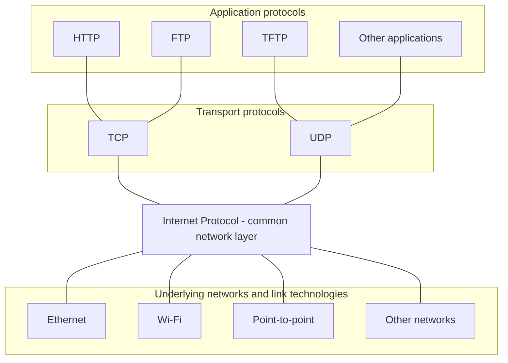

# 01. IP and Internet architecture

## Learning goals

- Explain the common IP layer and encapsulation.
- Distinguish best-effort delivery from guarantees provided at endpoints.

## Explanation

The **Internet Protocol (IP)** provides a common network layer connecting dissimilar underlying networks. A datagram can travel over Ethernet, a point-to-point link, or another local technology without requiring applications to understand those links. **Routers** connect those networks and use destination IP addresses to decide where to forward packets.

### The hourglass architecture

The Internet is described as an **hourglass** because many applications and transport protocols sit above a shared IP layer, while many different link technologies sit below it. These relationships express **layering**, not directed packet flow; the connectors therefore have **no arrowheads**.

### Encapsulation and service model

**Encapsulation** adds a protocol header as data moves down through layers. An application message becomes transport-layer data, then an IP payload, then the payload of a link-layer frame. At the receiver, each layer interprets and removes its own header. A frame header is relevant to the **current link**, whereas the destination IP address identifies the packet's destination across the internetwork.

The on-wire nesting is:

| Outer to inner | Contents |
| --- | --- |
| Link frame | Link header, IP datagram, and any link trailer |
| IP datagram | IP header and transport payload |
| TCP segment or UDP datagram | Transport header and application data |

IP is **connectionless**: routers forward each datagram independently instead of establishing a network-layer connection first. The service is **best effort**; an IP network does not promise delivery, bounded delay, unique delivery, or in-order arrival. A packet may be lost, duplicated, delayed, or reordered. Where necessary, TCP or the application provides mechanisms above IP to cope with these effects.

### Internet design principles

Routing behavior reflects broader Internet design choices. The **end-to-end principle** places functionality that needs endpoint knowledge at the edges, leaving a comparatively simple core. **Layering** and **abstraction** separate applications, transport, network, and link mechanisms so each can evolve independently. **Decentralization** lets different organizations operate their own networks, while **open standards** promote interoperability.

**Packet switching**, **connectionless/stateless forwarding**, and **best-effort delivery** allow the network to support many traffic types without guaranteeing the properties every application might need. The culture of **rough consensus and running code** encourages practical interoperable designs. A **public, evolutionary network** accommodates new technologies and users without centrally redesigning the entire system. These strengths also explain many routing problems discussed above: there is no omniscient controller, administrative trust varies, and improvements such as routing-security mechanisms succeed only when other networks adopt them.

## Practice

Assigned questions: Q001.

See the [question review](review.md) before using flagged questions for scored practice. The IDs refer to the original routing quiz; full assignments are in [manifest.json](manifest.json).

## Source

- [Lecture 01: Internet architecture and encapsulation](../../lectures/lecture_01_internet_routing.md#internet-architecture-and-encapsulation)
- [Lecture 01: Internet design principles](../../lectures/lecture_01_internet_routing.md#internet-design-principles)

[Topic overview](README.md) · [Glossary](glossary.md) · [Next lesson](02_ipv4_header.md)
