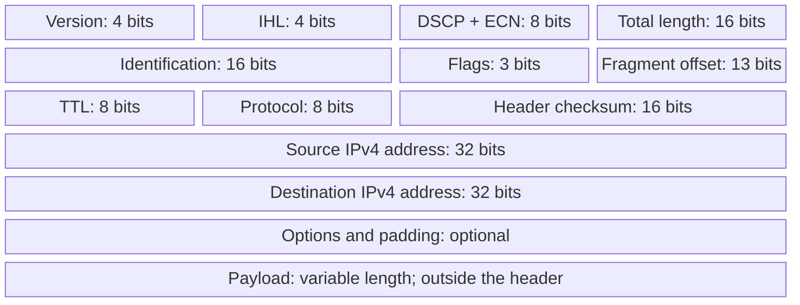

# 02. Reading an IPv4 header

## Learning goals

- Identify the roles of TTL, Protocol, checksum, and fragmentation fields.
- Interpret header length and the scope of the header checksum.

**Builds on:** [IP and Internet architecture](01_internet_architecture.md).

## Explanation

An IPv4 datagram comprises a header followed by a payload (usually a TCP segment, UDP datagram, or ICMP message). The fixed portion of the IPv4 header occupies **20 bytes**, and the optional portion can extend it. Each complete header row in the format is **32 bits**; the diagram indicates field lengths explicitly because Mermaid column widths are not bit-proportional.

**Version** is 4 for IPv4. **IHL** counts header length in units of four bytes, so a header with no options has IHL = 5. **Total Length** includes both header and payload and is encoded in 16 bits, with a maximum represented packet size of **65,535 bytes**. The source and destination addresses each occupy **32 bits**. The destination address drives forwarding.

**DSCP** identifies differentiated service treatment (for example, certain real-time voice traffic). **ECN**, when supported end to end and by the network, permits congestion signalling without necessarily dropping the packet. **TTL** decreases at each router, limiting the life of a looping datagram. **Protocol** identifies the next protocol: **ICMP = 1**, **TCP = 6**, and **UDP = 17**. The **header checksum** checks the IPv4 header, not the full payload. **Identification, Flags, and Fragment Offset** describe fragmentation and reassembly.

## Reasoning through the concepts

**Editorial clarification of the existing topic:** A TTL of 64 allows at most 64 decrements before discard; it does not grant a packet an unlimited lifetime. ECN is a feedback mechanism: a capable router can mark congestion and capable endpoints react. Endpoint support alone does not make every network path provide marking.

## Practice

Assigned questions: Q002, Q050, Q051.

See the [question review](review.md) before using flagged questions for scored practice. The IDs refer to the original routing quiz; full assignments are in [manifest.json](manifest.json).

## Source

- [Lecture 01: IPv4 header and fields](../../lectures/lecture_01_internet_routing.md#ipv4-header-and-fields)

[Topic overview](README.md) · [Glossary](glossary.md) · [Previous lesson](01_internet_architecture.md) · [Next lesson](03_fragmentation_and_pmtu.md)
