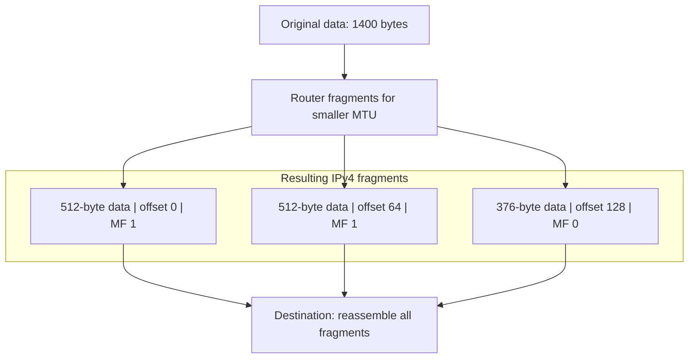

# 03. Fragmentation and path MTU

## Learning goals

- Calculate fragment offsets and explain destination reassembly.
- Explain why losing one fragment wastes work and why PMTUD needs feedback.

**Builds on:** [Reading an IPv4 header](02_ipv4_header.md).

## Explanation

Every network link has a **maximum transmission unit (MTU)**. An IPv4 datagram too large for the next link may need **fragmentation** (unless prohibited by its **DF** flag). Each fragment is its own IP datagram and carries enough header information for the **destination host** to reassemble the original. An intermediate router may fragment further, but reassembly is generally postponed until the destination.

### Fragmentation example

Suppose the original datagram contains **1,400 bytes of data**. Along a route with a smaller link, a router splits it into payloads of **512**, **512**, and **376 bytes**. These are payload sizes; each fragment also has its own IP header. Offsets are measured in **units of eight bytes**, not individual bytes.

The **Identification** field helps associate fragments from the same datagram. **MF** (*More Fragments*) is set on every fragment except the last; the last fragment has MF = 0. **DF** (*Don't Fragment*) means a router must discard a too-large packet rather than fragment it, and normally signal the problem to the sender with ICMP. For an unfragmented datagram, both MF and offset are zero; the last fragment of a fragmented datagram typically has a nonzero offset. The 13-bit offset encodes units of eight bytes, so the maximum represented starting offset is **8191 × 8 = 65,528 bytes**.

A lost fragment prevents reassembly of the complete original datagram. IP itself does **not** request missing fragments again: any retransmission comes from a higher layer or the sender. Consequently, fragmentation can waste capacity. **Path MTU Discovery** tries to identify the smallest MTU along the route, commonly using the DF flag and ICMP feedback, so that the sender can avoid fragmentation. IPv4 hosts have a minimum reassembly requirement of **576-byte** datagrams; modern hosts generally support much larger ones.

## Reasoning through the concepts

**Editorial clarification of the existing topic:** Suppose a sender uses packets larger than a downstream MTU with DF set. The router cannot fragment them, so the sender needs the ICMP size feedback to adapt. If that feedback is filtered and the sender keeps using the same size, small packets may work while large ones disappear. This is a PMTUD black hole. Packetization-layer alternatives exist; this example concerns classic IPv4 ICMP-based discovery.

## Practice

Assigned questions: Q083, Q100.

External practice: IPv6 Q012. It additionally requires [IPv6 lesson 17](../03_ipv6/17_fragmentation_and_extensions.md) to distinguish IPv6 source-only fragmentation from IPv4 router fragmentation. This lesson supplies the general all-fragments reassembly/loss reasoning; Q012 asks a qualitative risk, not a probability calculation from its 10% figure.

See the [question review](review.md) before using flagged questions for scored practice. The IDs refer to the original routing quiz; full assignments are in [manifest.json](manifest.json).

## Source

- [Lecture 01: Fragmentation and path MTU](../../lectures/lecture_01_internet_routing.md#fragmentation-and-path-mtu)

[Topic overview](README.md) · [Glossary](glossary.md) · [Previous lesson](02_ipv4_header.md) · [Next lesson](04_addressing_and_arp.md)
