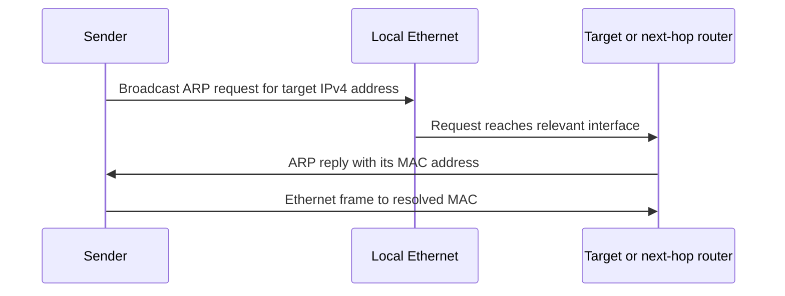
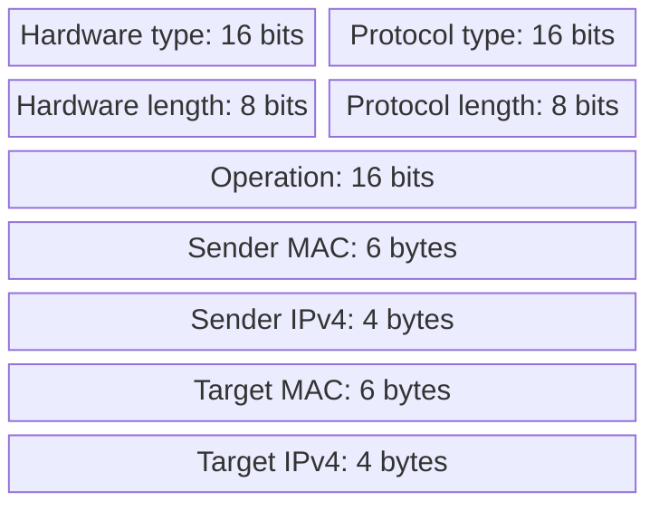

# 04. IPv4 addresses, prefixes, and ARP

## Learning goals

- Distinguish an IP destination from the MAC address of the local next hop.
- Explain an ARP cache miss for an on-link or off-link destination.

**Builds on:** [IP and Internet architecture](01_internet_architecture.md).

## Explanation

An IPv4 address is a **32-bit logical network-layer address**. Its network-prefix portion supports routing aggregation; the remaining bits identify addresses within the network. Early **classful** addressing used Class A, B, and C network sizes (traditionally /8, /16, /24). **CIDR** removes that fixed boundary: an address and a prefix length specify a range, such as `128.96.34.0/25`, whose mask is `255.255.255.128`.

### Network-layer and link-layer addressing

A router uses the **destination IP address** to select a route and the **next-hop** to choose where the packet should go next. On a local Ethernet, it must then place an appropriate **MAC address** in the outgoing frame. This is why IP addressing and local link-layer addressing have different roles: the destination IP normally remains the same across intermediate links, whereas the frame's source and destination MAC addresses change at each link. A device can also have several interfaces, each with its own link-layer address.

**ARP** maps a local IPv4 next-hop address to a link-layer address. If no suitable mapping is cached, a host broadcasts an ARP request. The target replies with its MAC address, and the sender can transmit the frame. Learned mappings are cached for a limited time rather than permanently assumed correct.

### ARP message structure

For **ARP over Ethernet/IPv4**, Hardware Type identifies Ethernet (1), Protocol Type is `0x0800` (IPv4), the hardware/protocol address lengths are **6/4 bytes**, and **Operation** distinguishes request from reply. The rest of the message gives the sender and target hardware and protocol addresses. The diagram shows field widths but not proportional byte-sized rectangles.

DNS is a **different mapping**: it translates human-readable names into records such as IP addresses. ARP resolves the IP address of a *local next hop* into a link-layer address; DNS does not replace ARP.

## Reasoning through the concepts

**Editorial clarification of the existing topic:** For host 192.0.2.10/24, destination 192.0.2.20 is on the same subnet: resolve that destination's MAC with ARP. For destination 198.51.100.20, send through a suitable gateway and resolve the gateway's local MAC instead. ARP still operates on the local link; it does not broadcast across the Internet. Variable prefix sizes also let an allocation fit a network more closely than fixed classful sizes.

## Practice

Assigned questions: Q003, Q064, Q093.

See the [question review](review.md) before using flagged questions for scored practice. The IDs refer to the original routing quiz; full assignments are in [manifest.json](manifest.json).

## Source

- [Lecture 01: IPv4 addressing, CIDR, and ARP](../../lectures/lecture_01_internet_routing.md#ipv4-addressing-cidr-and-arp)

[Topic overview](README.md) · [Glossary](glossary.md) · [Previous lesson](03_fragmentation_and_pmtu.md) · [Next lesson](05_icmp_and_diagnostics.md)
