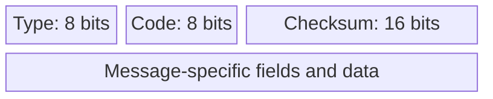
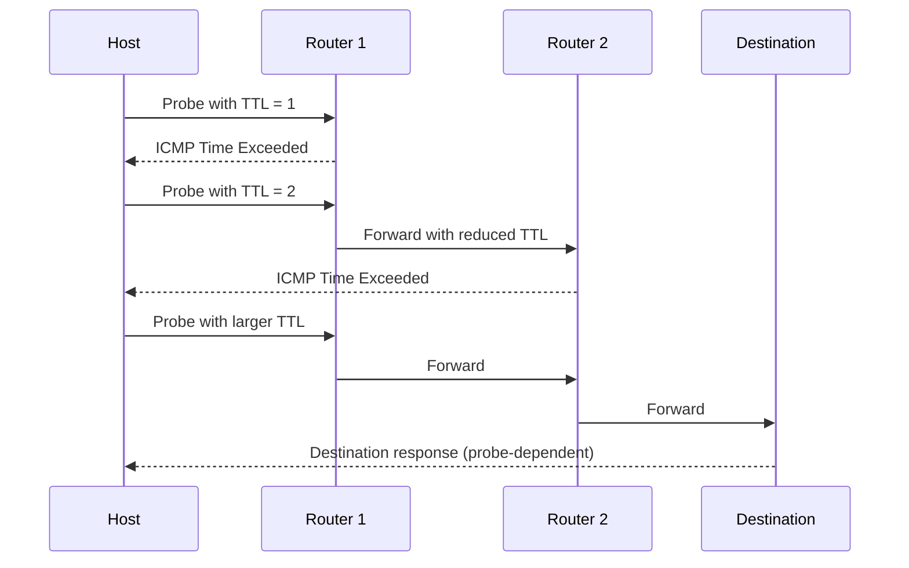
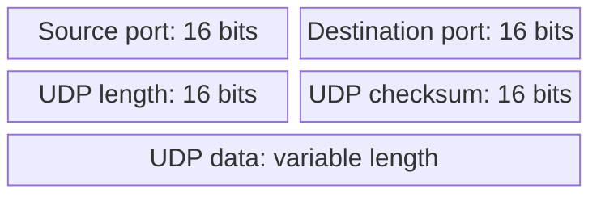

# 05. ICMP, ping, and traceroute

## Learning goals

- Explain ICMP errors and the TTL mechanism used by traceroute.
- Distinguish a missing diagnostic reply from failed packet forwarding.

**Builds on:** [Reading an IPv4 header](02_ipv4_header.md).

## Explanation

**ICMP** carries IP-related error, diagnostic, and control messages. **Echo Request/Echo Reply** support `ping`; **Time Exceeded** reports packets whose TTL expires; **Destination Unreachable** can report unreachable hosts, networks, ports, or an inability to fragment; and **Redirect** can indicate a better first-hop router. ICMP can report some IP-header parameter problems and fragment reassembly timeouts. An invalid IPv4 header checksum normally causes silent discard, rather than an ICMP checksum-error report. ICMP errors commonly quote enough of the original packet to identify which transmission caused the error.

### ICMP packet format and Time Exceeded

The ICMP message begins with a **Type**, **Code**, and **Checksum**. Type selects the broad message category; Code specifies a case within that category. For example, **Time Exceeded** uses Type 11 and commonly Code 0 for TTL expiry during transit. The remaining fields depend on the message.

`traceroute` (or Windows `tracert`) sends probes using progressively larger TTL values. Routers where probes expire may return **ICMP Time Exceeded** messages, making intermediate hops visible. A missing response (`*` or time-out) does not automatically mean forwarding failed: routers may filter or rate-limit ICMP. `ping` asks a different question: whether Echo responses return from a target, and how long the round trip takes.

The **UDP header** is exactly eight bytes, consisting of four 16-bit fields. This matters because classic ICMP error messages include the original IP header plus at least the first eight bytes of its payload, sufficient to recover the UDP port numbers when UDP was used.

## Reasoning through the concepts

**Editorial clarification of the existing topic:** A routing table describes a device's intended next hop. Traceroute obtains evidence from probes and replies along the actual forwarding path. Comparing those views can reveal a mismatch, while missing replies alone cannot identify its cause.

## Practice

Assigned questions: Q034.

See the [question review](review.md) before using flagged questions for scored practice. The IDs refer to the original routing quiz; full assignments are in [manifest.json](manifest.json).

## Source

- [Lecture 01: ICMP and network diagnostics](../../lectures/lecture_01_internet_routing.md#icmp-and-network-diagnostics)

[Topic overview](README.md) · [Glossary](glossary.md) · [Previous lesson](04_addressing_and_arp.md) · [Next lesson](06_dhcp.md)
