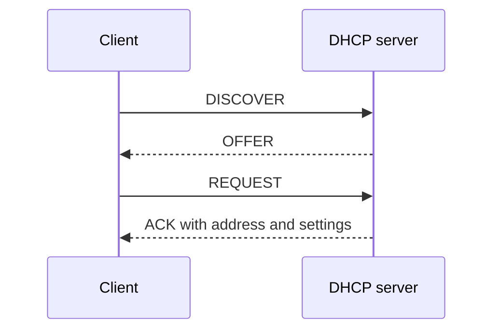

# 06. Getting configuration with DHCP

## Learning goals

- Follow the Discover, Offer, Request, Acknowledge exchange.
- Explain leases, renewal, rebinding, pools, and reservations.

**Builds on:** [IPv4 addresses, prefixes, and ARP](04_addressing_and_arp.md).

## Explanation

**DHCP** saves hosts from manually configuring every network interface. A server can supply a **leased IP address**, **subnet mask** (which destinations count as local), **default gateway** (where nonlocal traffic is sent), **DNS server**, and lease duration. Hosts with no usable IP configuration discover a DHCP server and negotiate an offer.

A client acquiring an initial lease commonly uses the four-step **DORA** exchange:

1. **Discover:** The client broadcasts a request for DHCP service.
2. **Offer:** One or more DHCP servers offer an available address and configuration. The client may not yet have accepted an offered address, so the response must be deliverable before ordinary IP configuration is established.
3. **Request:** The client selects an offer and broadcasts a request identifying its choice.
4. **Acknowledge:** The chosen server sends a DHCP ACK confirming the address and lease.

**Leases expire.** A client generally first tries **renewal** with its original DHCP server, then **rebinding** with any reachable DHCP server if renewal fails. A device may send **Release** when it no longer needs its address. A DHCP **scope** defines the server's allocatable address pool and configuration; **exclusions** reserve addresses from allocation, while **reservations** associate chosen addresses with particular clients. Larger deployments can distribute the workload among multiple DHCP servers.

## Practice

No supplied routing question is assigned here. The lesson is retained because it is part of the lecture guide.

## Source

- [Lecture 01: DHCP configuration and leasing](../../lectures/lecture_01_internet_routing.md#dhcp-configuration-and-leasing)

[Topic overview](README.md) · [Glossary](glossary.md) · [Previous lesson](05_icmp_and_diagnostics.md) · [Next lesson](07_forwarding_and_switching.md)
