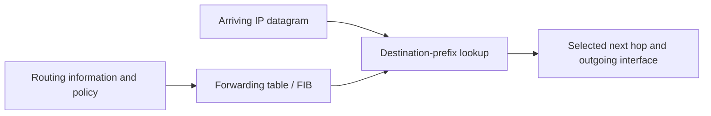

# 07. Routing, forwarding, and switching models

> The telephone-circuit subsection retains its own † marker; the rest of this lesson is unmarked in the source.

## Learning goals

- Separate control-plane route computation from data-plane forwarding.
- Compare datagrams, virtual circuits, and source routing.

**Builds on:** [IP and Internet architecture](01_internet_architecture.md), [IPv4 addresses, prefixes, and ARP](04_addressing_and_arp.md).

## Explanation

**Forwarding** is the data-plane operation of sending a received packet to a selected output interface. **Routing** is the control-plane process that calculates or learns the rules placed in a forwarding table. A router can connect different underlying link technologies and must still process relevant network-layer fields, including TTL. Destination-based IP forwarding normally chooses the entry with the **longest matching prefix**.

Communication networks can be **broadcast** or **switched**. Switched networks may provide circuits or forward packets. Within packet switching, **datagram networks** and **virtual-circuit networks** differ in what forwarding state is maintained.

### Datagram, virtual-circuit, and source routing

In a **datagram network**, no path must be installed before data transfer. Each packet carries its destination address, and routers independently select next hops using their tables. Packets between the same endpoints may follow different paths, with possible reordering. IP forwarding follows this model.

A **virtual circuit** first establishes an end-to-end logical path and installs per-circuit forwarding state in intermediate switches. Subsequent packets carry a shorter circuit identifier, and each switch maps an incoming circuit and port to an outgoing one. This can simplify forwarding and facilitate resource reservation, but setup and state management add costs; a failed path may require re-establishment.

**Source routing** places the selected route (or waypoints) in the packet itself instead of relying solely on each router's independent destination lookup. The different designs trade flexibility, setup, per-packet overhead, and router state.

| Model | Before transmission | Packet forwarding information | Main trade-off |
| --- | --- | --- | --- |
| Datagram | No per-flow path setup | Destination address | Flexible, but successive packets can take different paths |
| Virtual circuit | Install per-circuit state | Circuit identifier and input port | Compact forwarding state per packet, with setup and failure-recovery costs |
| Source routing | Sender selects route or waypoints | Route information carried in packet | Greater sender control, with extra per-packet overhead |

### Traditional telephone circuit switching — supplementary †

The traditional **Public Switched Telephone Network (PSTN)** illustrates a different idea: dialling a telephone number triggered switches to establish a **physical or dedicated circuit** between the endpoints for the duration of a call. This contrasts with IP datagrams, where different communications share packet-switched links without reserving a physical end-to-end wire.

## Reasoning through the concepts

**Editorial clarification of the existing topic:** Routing information bases hold control-plane routing information; the FIB holds actions used for packet forwarding. A packet lookup uses the installed forwarding state rather than running a routing protocol again. [RFC 3222 §5.3](https://www.rfc-editor.org/rfc/rfc3222.html#section-5.3) formalizes the distinction. This lesson does not cover router fabrics such as buses or crossbars.

## Practice

Assigned questions: Q004, Q033, Q040, Q065.

See the [question review](review.md) before using flagged questions for scored practice. The IDs refer to the original routing quiz; full assignments are in [manifest.json](manifest.json).

## Source

- [Lecture 01: Forwarding and switching models](../../lectures/lecture_01_internet_routing.md#forwarding-and-switching-models)

[Topic overview](README.md) · [Glossary](glossary.md) · [Previous lesson](06_dhcp.md) · [Next lesson](08_cidr_and_aggregation.md)
