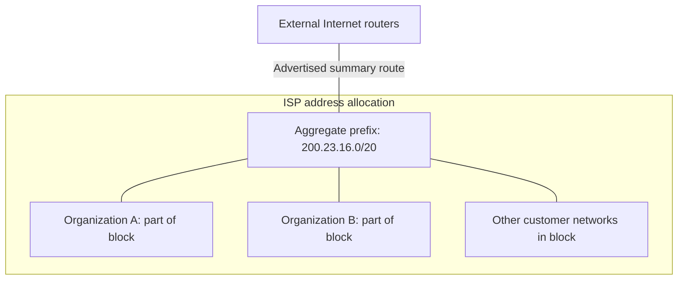

# 08. CIDR, aggregation, and longest-prefix matching

## Learning goals

- Explain subnetting and aggregation using variable-length prefixes.
- Choose the most specific matching route, including a default route.

**Builds on:** [IPv4 addresses, prefixes, and ARP](04_addressing_and_arp.md), [Routing, forwarding, and switching models](07_forwarding_and_switching.md).

## Explanation

Early Internet routing was relatively hierarchical, with a central backbone (such as **NSFNET** around 1990) and regional networks attached to it. Today's Internet has **multiple backbone providers, peering points, access providers, corporate networks, and interconnecting autonomous systems**. There is no single organization that determines all paths or operates every backbone.

### Subnetting, supernetting, and CIDR

**Subnetting** divides an organization's allocated block into smaller networks by extending the prefix into what was previously the host part of an address. A **subnet mask** makes that division explicit; internal subnet structure need not be separately visible to the whole Internet. **Supernetting (route aggregation)** works in the opposite direction: a set of **contiguous, properly aligned address blocks** is summarized by a shorter common prefix, reducing the number of routes advertised globally. CIDR prefix sizes correspond to powers of two.

For example, `128.96.34.0/25` has a 25-bit network prefix and the mask `255.255.255.128`. The prefix `128.96.33.0/24` has mask `255.255.255.0`. An ISP that owns neighboring organization prefixes may announce one aggregated prefix to its upstream providers, rather than a separate announcement for every organization.

When forwarding, a router compares the destination against its known prefixes and chooses the **longest-prefix match**, meaning the *most specific* applicable route. If no more specific entry matches, a **default route** `0.0.0.0/0` can send packets to an upstream gateway. A router with a complete global routing view may not require a default route. More specific exceptions to an aggregate can coexist with the aggregate: the longest match wins.

### From connected networks to autonomous systems

Since modern backbones and customer networks are operated by different organizations, the Internet separates **intra-AS** routing (each organization's chosen IGP and policy) from **inter-AS** routing (the common exterior protocol, BGP). Network visualizations such as **CAIDA's AS-core maps** represent the geography and connectivity of ASes, their **customer cones**, and different levels of the network: AS, point of presence, router, and IP address. Such views are inferred from measurements and BGP information rather than being a single centrally known topology.

## Reasoning through the concepts

**Editorial clarification of the existing topic:** For destination 192.0.2.130, both 192.0.2.0/24 and 192.0.2.128/25 match. The /25 is longer and wins. A shorter prefix describes a larger range: /24 has 256 address patterns and /25 has 128. Forwarding first selects the matching prefix; BGP's preference among routes for a prefix is a separate decision.

## Practice

Assigned questions: Q006, Q010, Q061.

See the [question review](review.md) before using flagged questions for scored practice. The IDs refer to the original routing quiz; full assignments are in [manifest.json](manifest.json).

## Source

- [Lecture 01: Address aggregation and Internet structure](../../lectures/lecture_01_internet_routing.md#address-aggregation-and-internet-structure)

[Topic overview](README.md) · [Glossary](glossary.md) · [Previous lesson](07_forwarding_and_switching.md) · [Next lesson](09_autonomous_systems.md)
