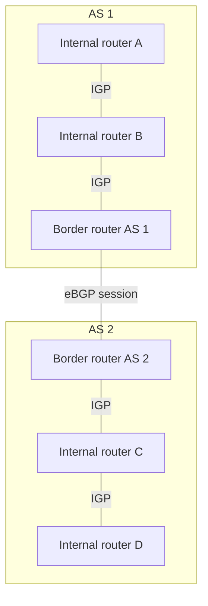

# 09. Autonomous systems and routing domains

## Learning goals

- Distinguish stub, multihomed, and transit ASes.
- Separate intra-AS routing, eBGP, and iBGP.

**Builds on:** [Routing, forwarding, and switching models](07_forwarding_and_switching.md), [CIDR, aggregation, and longest-prefix matching](08_cidr_and_aggregation.md).

## Explanation

An **Autonomous System (AS)** is an administratively controlled routing domain. Each AS has an **AS number (ASN)**, uses its own internal networking decisions, and sets policies for reachability that crosses its boundary. The original AS number space was 16-bit; BGP also supports **32-bit ASNs**. The Internet is therefore a **network of independently managed networks**, not one unified network with one shortest-path algorithm.

### Traffic and AS categories

**Local traffic** has a source or destination inside the AS. **Transit traffic** passes through an AS between other networks. Three useful AS categories are:

- **Stub AS:** connects to just one other AS and does not carry external transit traffic.
- **Multihomed AS:** connects to several ASes but does not offer transit service between them.
- **Transit AS:** connects to several ASes and does forward transit traffic, commonly as a paid provider.

### Intra-AS and inter-AS relationships

An **IGP** exchanges internal reachability information between routers *belonging to the same AS*. **BGP** exchanges policy-controlled reachability between border routers of *different ASes* (**eBGP**), while **iBGP** can disseminate external reachability within an AS. The figure encloses each AS's routers instead of misleadingly treating an AS as a single router. All links here represent **relationships/sessions**, not the one-way direction of packet travel.

Routing protocols **populate forwarding tables**; forwarding uses those tables to move individual packets. An internal routing algorithm may try to minimize cost or delay, whereas inter-domain routing may prefer a path for **commercial, political, operational, or security reasons** even if it is longer. Global algorithms assume knowledge of the topology; distributed algorithms know neighbors and learn additional information through messages.

An important routing property is **optimal substructure**: if a path from A to C through B is shortest, its relevant subpaths must also be shortest. This underlies many shortest-path calculations, but not necessarily policy-selected inter-domain routes.

## Practice

No supplied routing question is assigned here. The lesson is retained because it is part of the lecture guide.

## Source

- [Lecture 01: Autonomous systems and routing fundamentals](../../lectures/lecture_01_internet_routing.md#autonomous-systems-and-routing-fundamentals)

[Topic overview](README.md) · [Glossary](glossary.md) · [Previous lesson](08_cidr_and_aggregation.md) · [Next lesson](10_link_state.md)
