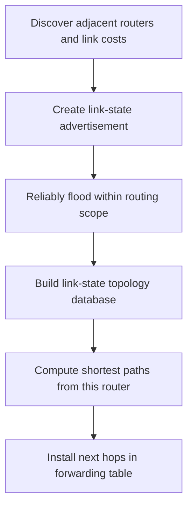

# 10. Link-state routing and shortest paths

## Learning goals

- Explain how flooding produces a topology database.
- Execute the selection and relaxation steps of Dijkstra's algorithm.

**Builds on:** [Autonomous systems and routing domains](09_autonomous_systems.md).

## Explanation

In **link-state routing**, each router learns its directly connected neighbors and associated **link costs**. It then shares that information through **reliable flooding**, so routers in the flooding scope acquire a common description of the topology. Each router separately computes shortest routes from itself to the destinations and installs the appropriate **next-hop entries**.

Flooding must control **duplicates, stale advertisements, and loss**. Routers can acknowledge updates, record sequence or age information, and forward fresh advertisements onward; topology changes cause updated advertisements. Reliable dissemination matters because independently computed paths are only consistent when routers have sufficiently consistent information about the network.

### Dijkstra's algorithm

Model the topology as a graph **G = (N, E)** whose edges have non-negative costs. If there is no direct link from u to v, its direct-link cost can be regarded as infinite. **Dijkstra's algorithm** constructs least-cost routes incrementally, tracking a set of nodes whose shortest distance is known.

1. Initialize the confirmed set with the source router; assign tentative direct-link costs to its neighbors and infinity to other nodes.
2. Choose the as-yet unconfirmed node with the **smallest tentative distance**.
3. Confirm that node and **relax** edges to its neighbors: if the path through the new node is cheaper, update the tentative cost and predecessor.
4. Repeat until the required destinations are confirmed; reconstruct paths using the recorded predecessors and choose each path's first hop.

The key idea is that a router can obtain **global topology information** but still calculate *its own* forwarding table locally. A shortest-path tree rooted at a source `u` records each destination's predecessor. Incorrect advertised link costs can mislead every router that uses those advertisements in its calculation.

### Properties and limitations

Link state makes topology reasoning and debugging relatively direct because routers know the graph, but flooding the topology costs communication and storage. **Complexity clarification:** Flooding cost depends on the number of links, not just diameter. In a simplified model, flooding one advertisement across a connected graph costs $O(|E|)$ transmissions; flooding one from each of $|V|$ routers costs $O(|V||E|)$, excluding retransmissions. Diameter helps describe propagation rounds under timing assumptions. The supplied guide's unexplained $O(n d)$ claim should not be used as a general message bound. A malfunctioning router might advertise incorrect link costs, affecting the routes computed by everyone who receives the information.

## Reasoning through the concepts

**Editorial clarification of the existing topic:** If the source has tentative distances B=2 and C=5, confirm B first. If B offers a path to C of cost 2+1=3, replace C's tentative distance with 3. "Smallest" refers to total tentative cost from the source, not merely the cheapest last edge. Faster recovery is conditional: flooding, timers, and topology still matter.

## Practice

Assigned questions: Q009, Q017.

See the [question review](review.md) before using flagged questions for scored practice. The IDs refer to the original routing quiz; full assignments are in [manifest.json](manifest.json).

## Source

- [Lecture 01: Link-state routing and shortest paths](../../lectures/lecture_01_internet_routing.md#link-state-routing-and-shortest-paths)

[Topic overview](README.md) · [Glossary](glossary.md) · [Previous lesson](09_autonomous_systems.md) · [Next lesson](11_distance_vector.md)
