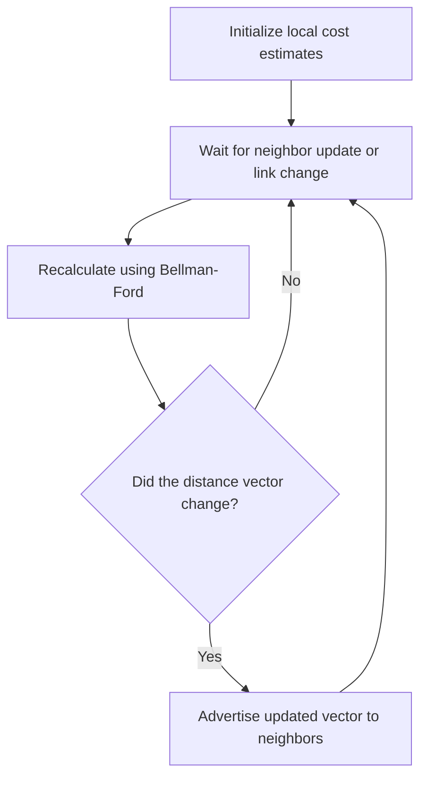

# 11. Distance-vector routing and Bellman–Ford

## Learning goals

- Calculate a route from neighbors' advertised distances.
- Compare local distance estimates with a link-state topology map.

**Builds on:** [Autonomous systems and routing domains](09_autonomous_systems.md), [Link-state routing and shortest paths](10_link_state.md).

## Explanation

**Distance-vector routing** does not require a global topology map. Each router maintains an estimate of the cost to each destination, along with the chosen next hop, and exchanges these estimates with **direct neighbors**. A router improves its own estimates using the paths reported by those neighbors. The algorithm is **distributed**, usually **asynchronous**, and reacts to link-cost changes and incoming updates.

The Bellman–Ford recurrence for router x and destination y is:

$$
D_x(y) = \min_{v \in N(x)}\big(c(x,v)+D_v(y)\big),
$$

where **N(x)** is the set of x's neighbors, **c(x,v)** is the cost of the direct link to v, and **D_v(y)** is v's current estimate to reach y. The chosen neighbor that achieves the minimum becomes the next hop.

### Distance-vector algorithm

1. **Initialize** distances from directly known links; other destinations start at infinity.
2. **Wait** for a neighbor's distance vector or a change in local link cost.
3. **Recompute** the best cost and next hop for each destination using Bellman–Ford.
4. **Advertise** the new vector to directly connected neighbors if it changed; otherwise wait for the next event.

For example, three candidate routes to a destination produce total costs **2 + 5**, **1 + 3**, and **5 + 3**. The minimum is **4**, reached through the neighbor supplying the `1 + 3` path. Each router performs the same procedure using only neighboring estimates; it need not know why a neighbor believes its distance is correct.

**Distance vector versus link state:** DV communicates estimates locally rather than flooding the full topology. It can require less topology data per router, but bad estimates can propagate through many routers, convergence time varies, and changes can create temporary routing loops. The two approaches differ not merely in implementation but in **what information each router is allowed to know**.

## Practice

Assigned questions: Q008, Q042.

See the [question review](review.md) before using flagged questions for scored practice. The IDs refer to the original routing quiz; full assignments are in [manifest.json](manifest.json).

## Source

- [Lecture 01: Distance-vector routing and Bellman–Ford](../../lectures/lecture_01_internet_routing.md#distance-vector-routing-and-bellmanford)

[Topic overview](README.md) · [Glossary](glossary.md) · [Previous lesson](10_link_state.md) · [Next lesson](12_routing_loops.md)
