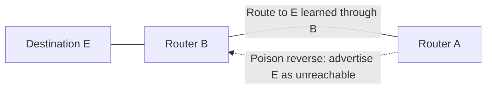

# 12. Routing loops and poison reverse

## Learning goals

- Explain count-to-infinity after a route failure.
- Distinguish loop prevention, loop mitigation, and TTL expiry.

**Builds on:** [Reading an IPv4 header](02_ipv4_header.md), [Distance-vector routing and Bellman–Ford](11_distance_vector.md).

## Explanation

A **routing loop** arises when routers forward packets around a cycle because their next-hop information is mutually inconsistent. The packet's **TTL** eventually expires, preventing indefinite circulation, but TTL does **not fix** the incorrect routing tables.

### Counting to infinity

The classic DV problem appears after a route fails but some routers still have obsolete routes pointing to one another. For example, if a path to destination E disappears, router B may hear C's stale cost and conclude E remains reachable via C. C may then believe the same about B. Advertised distances grow with each iteration until the metric reaches the protocol's designated **infinity**. This is **count-to-infinity**; if updates are slow, convergence can be slow as well.

### Loop-mitigation techniques

- **Split horizon:** do not advertise a route *back to the neighbor from which it was learned* as a usable route.
- **Poison reverse:** advertise that same route to that neighbor with an **infinite metric**, explicitly stating it must not use this router for the destination.
- **Bounded infinity:** choose a comparatively small metric value that means unreachable. This limits counting, but also limits the routes that can be represented.

The undirected links indicate network connectivity, while the dashed **directed** update indicates the actual advertisement back toward a neighbor. Split horizon and poison reverse mitigate simple two-router loops; they **do not guarantee freedom from every possible multi-router loop**. Failure chains involving nodes F, A, C, and G show how inconsistent updates can reintroduce increasingly long alternative routes.

## Reasoning through the concepts

**Editorial clarification of the existing topic:** TTL limits the lifetime of each individual packet; a routing-protocol correction repairs the tables. If the ICMP reply reporting TTL expiry is lost, the original expired packet is still discarded. The same bad table entries can loop subsequent packets until the routing state changes. See [RFC 1812 §5.3.1](https://www.rfc-editor.org/rfc/rfc1812.html#section-5.3.1).

## Practice

Assigned questions: Q007, Q016, Q091.

See the [question review](review.md) before using flagged questions for scored practice. The IDs refer to the original routing quiz; full assignments are in [manifest.json](manifest.json).

## Source

- [Lecture 01: Routing loops, split horizon, and poison reverse](../../lectures/lecture_01_internet_routing.md#routing-loops-split-horizon-and-poison-reverse)

[Topic overview](README.md) · [Glossary](glossary.md) · [Previous lesson](11_distance_vector.md) · [Next lesson](13_rip.md)
