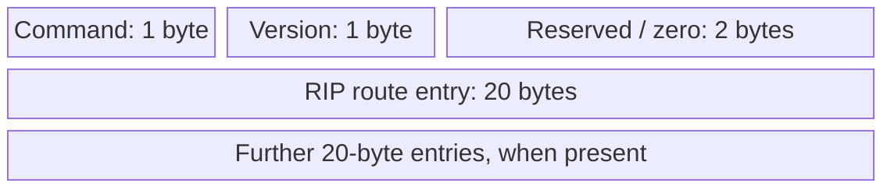
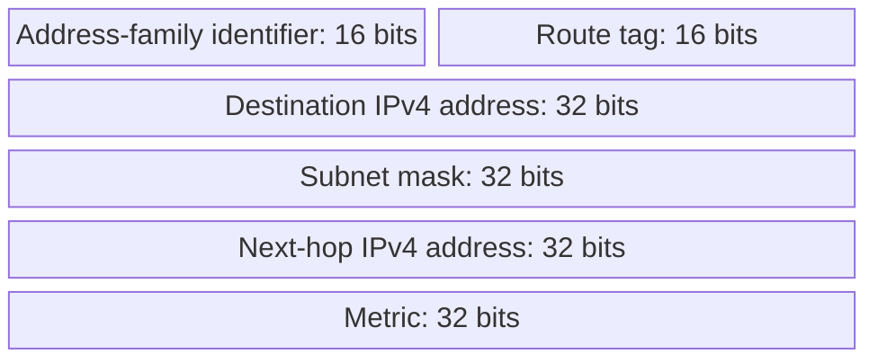

# 13. RIP and RIPv2

> **† Supplementary in the supplied guide:** identified there as material exclusively from hidden slides. Its exam status has not been independently confirmed.

## Learning goals

- Interpret RIP's hop-count metric and bounded infinity.
- Identify fields in an RIPv2 route entry.

**Builds on:** [Distance-vector routing and Bellman–Ford](11_distance_vector.md), [Routing loops and poison reverse](12_routing_loops.md).

## Explanation

**Supplementary (†).** General distance-vector routing and loop behavior remain part of the unmarked material above.

**Routing Information Protocol (RIP)** is a comparatively simple distance-vector IGP. **RIPv2**, specified in **RFC 2453**, uses **UDP port 520** and counts **hops** as its metric. Its maximum reachable distance is **15 hops**, while **16 means infinity/unreachable**. It supports split horizon and poison reverse but is subject to the distance-vector counting-to-infinity problem. Router requirements are discussed in **RFC 1812** and Radia Perlman's work on self-stabilizing routing.

### RIPv2 message format

A RIP message consists of a four-byte message header and **zero or more 20-byte route entries**. The first byte identifies the **Command** (such as request/response), the second the **Version**, followed by a reserved two-byte field set to zero.

Each RIPv2 entry encodes a route using the following fields. The **Route Tag** distinguishes routes learned inside and outside RIP's domain and should persist when the route is re-advertised; it may be used to encode external AS-related information. **Next Hop** lets an advertising router refer to another router on the same subnet that offers a better onward path.

## Practice

No supplied routing question is assigned here. The lesson is retained because it is part of the lecture guide.

## Source

- [Lecture 01: RIP and RIPv2 — supplementary †](../../lectures/lecture_01_internet_routing.md#rip-and-ripv2--supplementary-)

[Topic overview](README.md) · [Glossary](glossary.md) · [Previous lesson](12_routing_loops.md) · [Next lesson](14_ospf.md)
