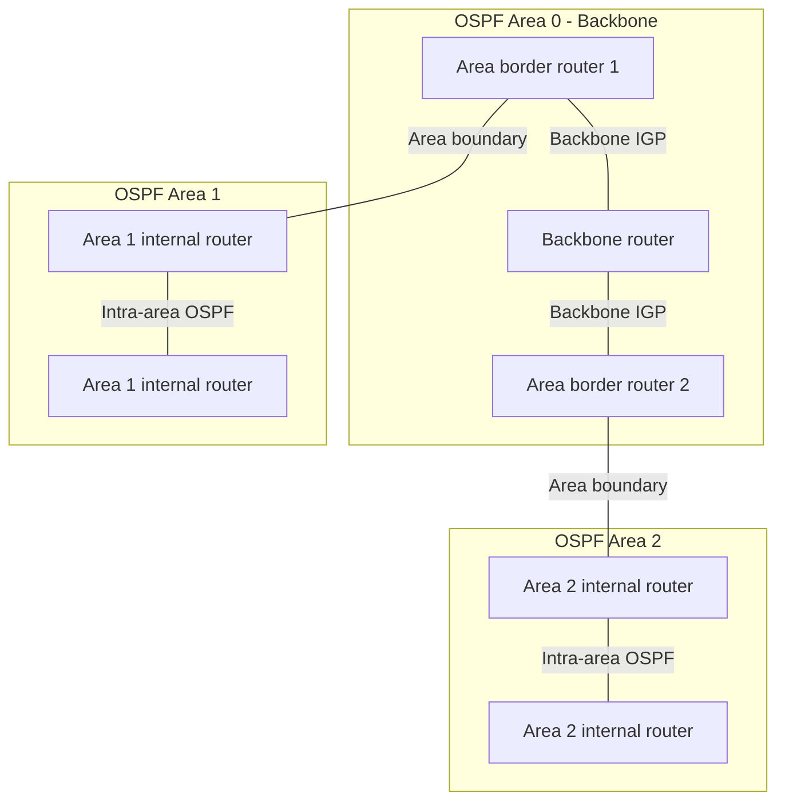
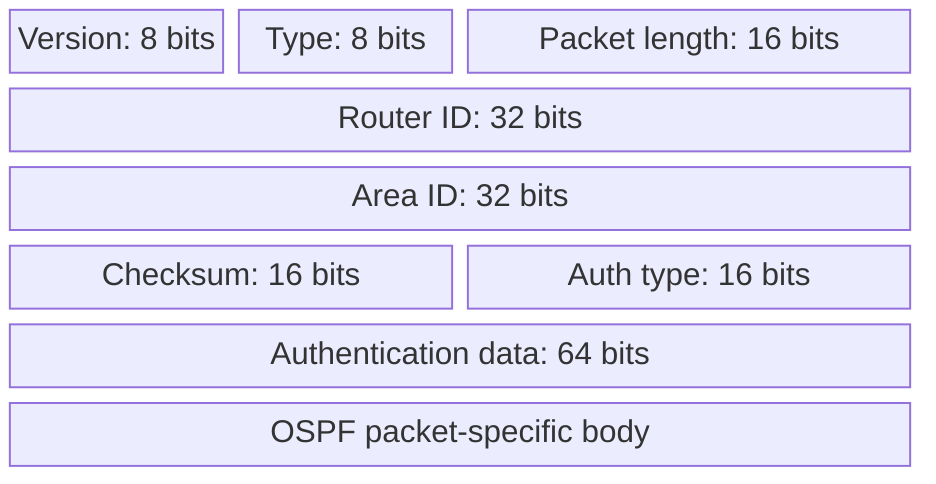
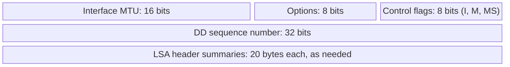

# 14. OSPF areas and protocol operation

> **† Supplementary in the supplied guide:** identified there as material exclusively from hidden slides. Its exam status has not been independently confirmed.

## Learning goals

- Explain the backbone, local areas, and area border routers.
- Follow database synchronization using the five OSPF packet types.

**Builds on:** [Link-state routing and shortest paths](10_link_state.md).

## Explanation

**Supplementary (†).** Link-state routing as a general algorithm remains unmarked in the earlier section.

**Open Shortest Path First (OSPFv2)**, specified in **RFC 2328**, is a **link-state IGP** that runs directly over IP (**protocol number 89**), not over TCP or UDP. OSPF distributes **Link-State Advertisements (LSAs)** with its own reliability mechanisms, and its packets support authentication. Routers form neighbor relationships, synchronize link-state databases, and calculate paths from their resulting topology views.

### Areas and backbone

OSPF uses a **two-level hierarchy**: a backbone (**Area 0**) and local areas. A router knows the detailed topology within its own area, but it can route to other areas using summarized reachability through **area border routers (ABRs)**. LSAs are flooded within the appropriate area/backbone scope, reducing the amount of topology information every router must manage. Inter-area traffic normally traverses Area 0, and **virtual links** can address some disconnected-backbone arrangements.

### OSPFv2 common packet header

Every OSPFv2 packet starts with a **24-byte common header**. It identifies the version, packet type, length, originating router ID, area ID, checksum, and authentication information. Packet-specific content follows.

### OSPF packet types and synchronization

The five principal packet types have distinct roles:

1. **Hello:** discover neighbors, maintain reachability, and establish compatible adjacencies.
2. **Database Description (DD):** exchange summaries of link-state database contents and coordinate synchronization.
3. **Link State Request:** request individual LSAs that are missing or outdated.
4. **Link State Update:** carry LSAs describing routers, links, and topology changes.
5. **Link State Acknowledgment:** acknowledge LSAs to support reliable dissemination.

A typical synchronization process begins with Hello discovery. Neighboring routers exchange DD summaries, request missing LSAs, and acknowledge reliably received advertisements. The resulting **Link-State Database (LSDB)** is used to compute routes. New link information triggers further flooding; LSAs also have aging/refresh behavior so old information does not persist indefinitely.

### Database Description (DD) packet

After the common OSPF header, the DD body begins with the interface MTU, options, and control flags, followed by a **DD sequence number** and summaries of LSA headers. The **I** (*Initial*) bit identifies the first packet of an exchange, **M** (*More*) indicates further packets, and **MS** (*Master/Slave*) coordinates sequence-number control between peers.

**DD exchange, in order:** One router begins with an initial DD packet indicating negotiation; the peer responds and the routers settle the master/slave role and sequence-numbering. They then exchange DD summaries, advancing the sequence and setting **M** while more descriptions remain. Missing or newer LSAs are requested and transferred using the request/update/acknowledgment packet types. DD summaries alone are **not** complete LSAs.

## Practice

Assigned questions: Q018, Q019, Q041, Q057.

See the [question review](review.md) before using flagged questions for scored practice. The IDs refer to the original routing quiz; full assignments are in [manifest.json](manifest.json).

## Source

- [Lecture 01: OSPF areas, packets, and operation — supplementary †](../../lectures/lecture_01_internet_routing.md#ospf-areas-packets-and-operation--supplementary-)

[Topic overview](README.md) · [Glossary](glossary.md) · [Previous lesson](13_rip.md) · [Next lesson](15_bgp_path_vector.md)
