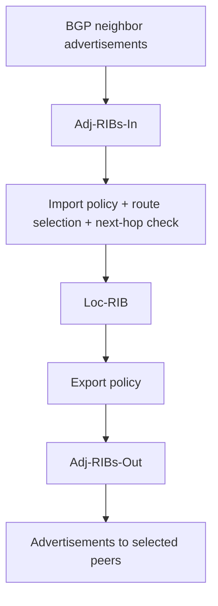
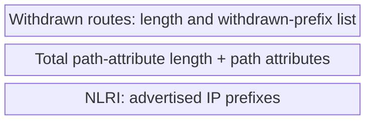

# 16. BGP messages, routing state, and next hops

## Learning goals

- Trace an advertisement through BGP's conceptual routing state.
- Explain UPDATE messages, sessions, and next-hop reachability.

**Builds on:** [Why BGP uses paths and policy](15_bgp_path_vector.md).

## Explanation

A BGP speaker conceptually maintains **three groups of routing state**. **Adj-RIBs-In** stores routing information learned from neighbors; the **Loc-RIB** holds routes selected using local policy and next-hop reachability; **Adj-RIBs-Out** represents routes approved for advertisement to each neighbor. A BGP next hop must be reachable using suitable internal routing or a static route before its external path can be used for forwarding.

### Sessions and message types

BGP peers communicate over a **long-lived TCP session on port 179**, exchanging control messages in both directions. The four basic BGP message types are:

1. **OPEN:** begin a BGP session and identify the peers' capabilities and basic parameters.
2. **UPDATE:** announce reachable prefixes with path attributes or withdraw previously advertised routes.
3. **KEEPALIVE:** maintain evidence that the BGP session remains active.
4. **NOTIFICATION:** report protocol errors and close a session.

Extensions also introduce types such as **ROUTE-REFRESH** (RFC 2918). BGP has no global coordinator: each AS independently chooses what it advertises and what information to accept, so two routers can have different views of reachable paths.

### UPDATE content and route advertisements

The key BGP message is **UPDATE**. It can carry **Withdrawn Routes** (prefixes that are no longer advertised), **Path Attributes**, and **Network Layer Reachability Information (NLRI)** (prefixes to which those attributes apply).

Important path attributes include **ORIGIN**, **AS_PATH**, **NEXT_HOP**, **LOCAL_PREF**, **MULTI_EXIT_DISC (MED)**, **ATOMIC_AGGREGATE**, and **AGGREGATOR**. Attributes are typed and length-delimited, which allows the protocol to evolve; the slides note **AS4_PATH** as an extension supporting 32-bit AS numbers. Attributes such as **communities** and **LOCAL_PREF** support traffic-engineering policy. Vendor-specific **weight** is a local selection setting, not a BGP attribute carried in UPDATE messages. A BGP UPDATE is not a promise that the advertiser will export the same route to every peer.

For example, an AS may announce that prefix `171.64.0.0/14` is reachable via a sequence of ASNs and a specified **NEXT_HOP** address. Other ASes evaluate that information using their own policies before installing or exporting a path.

## Reasoning through the concepts

**Editorial clarification of the existing topic:** A nonzero negotiated Hold Timer bounds silence: if neither qualifying UPDATE nor KEEPALIVE traffic arrives before expiry, the session fails. A link or TCP failure can reveal the problem sooner. Missing one KEEPALIVE is not necessarily immediate failure. See [RFC 4271 §6.5](https://www.rfc-editor.org/rfc/rfc4271.html#section-6.5).

## Practice

Assigned questions: Q022, Q058, Q088.

See the [question review](review.md) before using flagged questions for scored practice. The IDs refer to the original routing quiz; full assignments are in [manifest.json](manifest.json).

## Source

- [Lecture 01: BGP state, updates, and advertisements](../../lectures/lecture_01_internet_routing.md#bgp-state-updates-and-advertisements)

[Topic overview](README.md) · [Glossary](glossary.md) · [Previous lesson](15_bgp_path_vector.md) · [Next lesson](17_bgp_route_selection.md)
