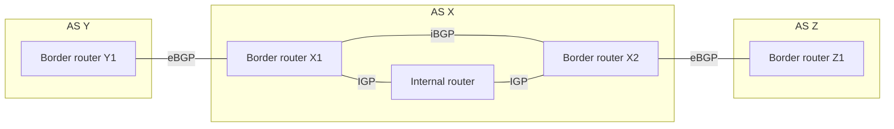

# 17. BGP route selection and internal sessions

## Learning goals

- Compare weight, LOCAL_PREF, AS_PATH, MED, and IGP cost.
- Distinguish a BGP preference decision from shortest-path forwarding.

**Builds on:** [BGP messages, routing state, and next hops](16_bgp_messages_and_state.md).

## Explanation

BGP aims to choose a **permitted and preferred route**, not necessarily the path with the fewest router hops, lowest delay, or shortest AS sequence. The exact decision procedure depends on implementation and local configuration. A common implementation-oriented sequence of selection preferences is:

1. Discard unusable paths, including those with an **unreachable next hop**.
2. Prefer the highest locally assigned **weight**, where that attribute is implemented.
3. Prefer higher **LOCAL_PREF**, which expresses preference inside the AS.
4. Prefer **locally originated** routes over comparable externally learned candidates.
5. Prefer shorter **AS_PATH** length.
6. Prefer lower **ORIGIN** type according to the protocol's ordering.
7. Prefer lower **MED**, typically when comparing routes received from the **same neighboring AS**.
8. Prefer paths learned using **eBGP** over comparable paths learned through **iBGP**.
9. Prefer the route whose egress/next hop has the lowest **internal IGP cost** (often called **hot-potato routing**).
10. Apply remaining tie-breakers, such as router ID or route age, according to the implementation.

**eBGP** exchanges information between ASes. **iBGP** distributes externally learned routes among routers *within* one AS so internal border routers can make coordinated decisions even when the AS has multiple peering points. These are BGP sessions with a direction for advertisement **messages**, but diagrams of the topology should use **undirected links** unless a specific advertisement direction is being shown.

## Reasoning through the concepts

**Editorial clarification of the existing topic:** Weight is local to one router. LOCAL_PREF distributes preference inside an AS; higher values win. MED can be advertised to a neighboring AS, where lower values can influence the choice of entry point. A higher LOCAL_PREF can therefore outweigh a lower MED. See [RFC 4271 §§5.1.4–5.1.5](https://www.rfc-editor.org/rfc/rfc4271.html#section-5.1.4). The source mentions route reflectors elsewhere, but does not teach their propagation rules; questions about those rules remain unmapped.

## Practice

Assigned questions: Q023, Q059.

See the [question review](review.md) before using flagged questions for scored practice. The IDs refer to the original routing quiz; full assignments are in [manifest.json](manifest.json).

## Source

- [Lecture 01: BGP route selection and sessions](../../lectures/lecture_01_internet_routing.md#bgp-route-selection-and-sessions)

[Topic overview](README.md) · [Glossary](glossary.md) · [Previous lesson](16_bgp_messages_and_state.md) · [Next lesson](18_bgp_export_policy.md)
