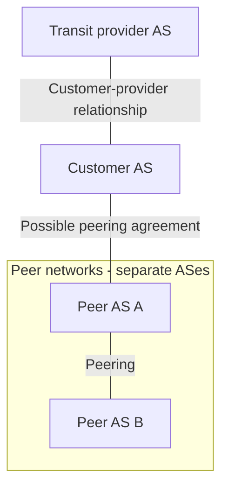

# 18. Business relationships and export policy

## Learning goals

- Apply customer, provider, and peer export rules.
- Explain how commercial policy can determine reachability.

**Builds on:** [BGP route selection and internal sessions](17_bgp_route_selection.md).

## Explanation

**Customer–provider** arrangements and **peering** agreements explain much of real-world BGP behavior. A customer pays a provider for connectivity beyond its own network; an AS may purchase service from several providers (**multihoming**). Two ASes can also peer to exchange selected traffic directly. Peering may be settlement-free, although commercial terms and imbalance clauses vary. **Tier-1** networks generally reach the rest of the Internet without buying upstream transit and exchange traffic with one another.

### Export policy and valley-free paths

A typical transit policy is to **prefer customer routes** because carrying customer traffic produces revenue. The commonly used *valley-free* export pattern distinguishes the source of a route:

- **Learned from a customer:** ordinarily exportable to other customers, peers, and providers.
- **Learned from a peer:** ordinarily exportable only to customers, not other peers or providers.
- **Learned from a provider:** ordinarily exportable only to customers, not other providers or peers.

These conventions are not guaranteed by the basic BGP protocol; they are business policies configured by operators. Exporting an unauthorized path can create a **route leak**.

### University network example

An illustrative network arrangement places **Chalmers at AS2841**, connected to **SUNET (AS1653)**, then **NORDUnet (AS2603)**, and onward to commercial Internet networks. **Göteborgs universitet (AS2842)** is shown as another customer of SUNET. SUNET peers with many networks, so paths can be influenced by peering rather than simply following the imagined upstream chain. Networks and AS-level paths can change; a current traceroute need not match this historical example.

Useful diagnostics include `traceroute -A -q 1 www.gu.se` on suitable Linux systems, `mtr -z -c 10 --report www.gu.se`, and `curl -s https://ipinfo.io/json` to inspect a public-facing ASN. macOS/BSD `traceroute` flags differ and Windows `tracert` lacks native AS display. A time-out or `*` hop can indicate **ICMP filtering**, not necessarily loss of IP connectivity; a short AS path may indicate **peering**, not physical proximity.

### A peering dispute

The **2005 Level 3–Cogent dispute** serves to demonstrate policy as a reachability constraint. After a dispute over whether one peer should pay the other, networks stopped exchanging traffic, and customers on each side could not reach some customers on the other. A subsequent agreement restored the relationship. The supplied guide does not establish the precise settlement timeline. The event shows that paths can disappear even when physical links and routing machinery exist.

## Reasoning through the concepts

**Editorial clarification of the existing topic:** An export prefix filter is an allow/deny rule controlling which destination prefixes are advertised to a neighbor. Apply it together with the relationship rules above. A valid origin does not by itself make every export appropriate: a peer-learned route may still be leaked to another peer. Peering does carry agreed traffic, usually between the peers and their customer cones.

## Practice

Assigned questions: Q024, Q025, Q026, Q027, Q044, Q063, Q072, Q073, Q079, Q080, Q094.

See the [question review](review.md) before using flagged questions for scored practice. The IDs refer to the original routing quiz; full assignments are in [manifest.json](manifest.json).

## Source

- [Lecture 01: AS business relationships and export policy](../../lectures/lecture_01_internet_routing.md#as-business-relationships-and-export-policy)

[Topic overview](README.md) · [Glossary](glossary.md) · [Previous lesson](17_bgp_route_selection.md) · [Next lesson](19_bgp_hijacks_and_leaks.md)
