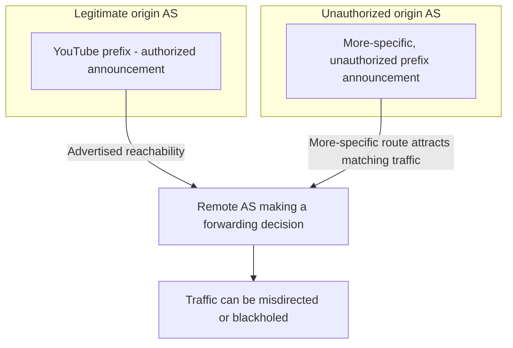

# 19. BGP hijacks and route leaks

## Learning goals

- Distinguish unauthorized origination from an inappropriate route export.
- Explain how a more-specific unauthorized prefix can attract traffic.

**Builds on:** [CIDR, aggregation, and longest-prefix matching](08_cidr_and_aggregation.md), [Business relationships and export policy](18_bgp_export_policy.md).

## Explanation

Basic BGP historically **trusted neighbors' claims about prefix origination**. A neighbor can announce reachability to a prefix without the protocol itself cryptographically proving the announcement's origin. This was workable when operators formed a smaller trust community but is dangerous on today's Internet.

A **route hijack** occurs when an AS originates an unauthorized prefix advertisement; it may attract traffic by announcing a **more-specific prefix**, because routers forward using the longest matching IP prefix. A **route leak** is different: an AS may truthfully originate no new address space but export a route beyond its permitted scope, violating commercial/export policy. **RFC 7908** categorizes several kinds of leaks. Origin validation alone cannot determine whether a genuine route was exported to the wrong neighbor.

### YouTube/Pakistan example

In **February 2008**, Pakistan Telecom's attempt to block YouTube within Pakistan caused an advertisement to escape into global routing. A more-specific announcement than YouTube's legitimate aggregate attracted traffic elsewhere on the Internet, making YouTube unreachable for many users for approximately **two hours**. The lesson is especially striking: routers could follow their normal BGP selection and longest-prefix rules while the collective outcome was wrong. The presentation also mentions hijacking unused address space for spam and misleading path advertisements.

## Practice

Assigned questions: Q031, Q043.

See the [question review](review.md) before using flagged questions for scored practice. The IDs refer to the original routing quiz; full assignments are in [manifest.json](manifest.json).

## Source

- [Lecture 01: BGP hijacks and route leaks](../../lectures/lecture_01_internet_routing.md#bgp-hijacks-and-route-leaks)

[Topic overview](README.md) · [Glossary](glossary.md) · [Previous lesson](18_bgp_export_policy.md) · [Next lesson](20_rpki.md)
