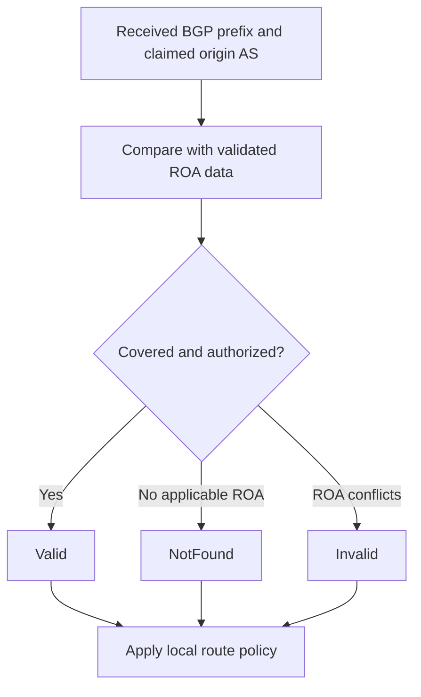

# 20. RPKI and route origin validation

## Learning goals

- Classify origins as Valid, Invalid, or NotFound using a ROA.
- Explain why a valid origin does not authenticate the whole AS path.

**Builds on:** [BGP hijacks and route leaks](19_bgp_hijacks_and_leaks.md).

## Explanation

The **Resource Public Key Infrastructure (RPKI)** binds Internet number resources to their authorized holders using certificates rooted in the **Regional Internet Registries (RIRs)** and their allocation hierarchy. A **Route Origin Authorization (ROA)** says that an identified AS is authorized to originate an identified IP prefix, with a **maxLength** specifying the most-specific prefix length allowed. For ROA profiles, see **RFC 9582** (which supersedes RFC 6482).

A ROA does **not** sign every hop of the BGP path. It expresses **origin authorization**, not proof that the entire AS_PATH was honestly propagated. Consequently, RPKI addresses an important class of hijacks while leaving room for path forgery and route leaks.

### maxLength and origin-validation outcomes

A loosely configured **maxLength** can authorize many more-specific prefixes under one ROA. A conservative approach, discussed in **RFC 9319**: minimize maxLength and, where suitable, authorize explicit prefixes instead of allowing overly broad subprefixes.

When a router compares received BGP origin information against ROAs (through an RPKI validator), **Route Origin Validation (ROV)** classifies it as:

- **Valid:** a covering ROA authorizes the claimed origin ASN and announced prefix length.
- **Invalid:** relevant ROA information exists but does not authorize the announcement's origin or prefix length.
- **NotFound:** no applicable ROA exists. **NotFound does not automatically mean malicious**.

A network then chooses a policy, such as **rejecting invalid routes** or reducing their preference. Signed objects and active filtering are different stages: a ROA protects little unless receiving networks actually validate and act on the result.

### Limits and deployment

The supplied guide reports **67.4% ROA coverage** of announced prefixes (Hurricane Electric, **29 June 2026**) and measurements of about **12.3% of ASes with full ROV protection**, with around **36.2% not validating** (RIPE Labs, **2026**). These are **source-reported, dated figures**, not independently verified measurements in this revision. Their denominators also differ: prefix coverage cannot be directly compared as a percentage with AS-level validation. Their significance is the gap between **signing** and **checking**.

For a concrete limitation, imagine prefix `192.0.2.0/24` legitimately originated by AS64500. A malicious AS64666 could advertise an AS_PATH that *claims* to lead to AS64500. Even if a ROA authorizes AS64500 as origin, **ROV examines the claimed origin only**, not the authenticity of the intermediate AS path. This is why a valid origin can coexist with a forged path.

## Practice

Assigned questions: Q032.

See the [question review](review.md) before using flagged questions for scored practice. The IDs refer to the original routing quiz; full assignments are in [manifest.json](manifest.json).

## Source

- [Lecture 01: RPKI, ROAs, and origin validation](../../lectures/lecture_01_internet_routing.md#rpki-roas-and-origin-validation)

[Topic overview](README.md) · [Glossary](glossary.md) · [Previous lesson](19_bgp_hijacks_and_leaks.md) · [Next lesson](21_aspa.md)
