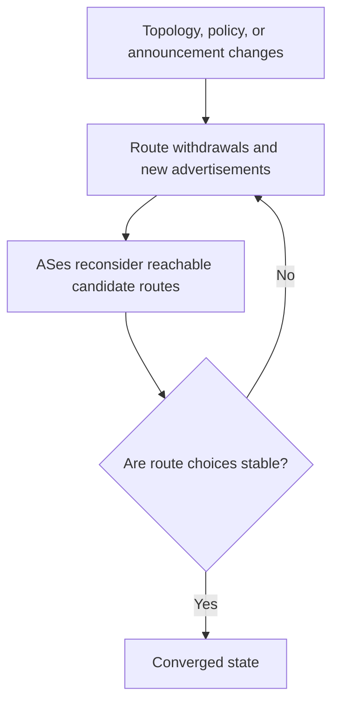

# 22. Convergence, failures, and stability

## Learning goals

- Explain how updates and independent policies affect convergence.
- Distinguish a responsive route choice from a stable route choice.

**Builds on:** [Routing loops and poison reverse](12_routing_loops.md), [BGP route selection and internal sessions](17_bgp_route_selection.md), [Business relationships and export policy](18_bgp_export_policy.md).

## Explanation

A routing system has **converged** when the affected routers have settled on a stable set of routes after a change. For BGP, the answer to “How long does convergence take?” depends on the topology, policy, and order of updates; the protocol can **oscillate** or have multiple stable outcomes. Even asking whether an arbitrary policy configuration admits a stable routing state is computationally difficult (see **Griffin, 1999**, on an NP-complete formulation).

Networks also trade **optimality against stability**. Changing repeatedly between a 50 ms path and a 500 ms path complicates management and can disrupt higher-layer algorithms such as TCP's **round-trip-time estimation**. A slightly worse but stable route may be preferable to a perpetually fluctuating one.

Failure adaptation can reveal distance-vector weaknesses even when described alongside BGP. In an example, F loses its link to G and announces G as unreachable. A, which used F as next hop, does likewise. Later A hears C claim a two-hop route to G, adopts a three-hop estimate, and tells F; F then believes it has a four-hop path through A. This is another illustration of **stale distributed estimates creating loops or worsening metrics**.

Relevant BGP operational tools and mitigations include **route reflectors** for scaling iBGP state, **AS-path prepending** for influencing inbound path selection, careful policies, and mechanisms such as graceful restart. These do not remove the fundamental challenge that different independent networks can prefer incompatible outcomes.

## Reasoning through the concepts

**Editorial clarification of the existing topic:** AS-path prepending repeats the advertising AS's own ASN, making its advertised AS path appear longer. It may discourage inbound use of that path, but a remote AS can still prefer it for stronger policy reasons. A responsive routing process reacts quickly to changes; reacting to every brief fluctuation can also create churn. Stable route selection and policy compatibility remain separate concerns.

## Practice

Assigned questions: Q015, Q038, Q039, Q071, Q098.

See the [question review](review.md) before using flagged questions for scored practice. The IDs refer to the original routing quiz; full assignments are in [manifest.json](manifest.json).

## Source

- [Lecture 01: Convergence, stability, and failures](../../lectures/lecture_01_internet_routing.md#convergence-stability-and-failures)

[Topic overview](README.md) · [Glossary](glossary.md) · [Previous lesson](21_aspa.md) · [Next lesson](23_bgp_wedgies.md)
