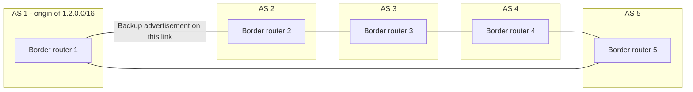

# 23. BGP wedgies: stable but unwanted routes

## Learning goals

- Distinguish oscillation from multiple stable routing outcomes.
- Explain why topology alone is insufficient to reproduce the supplied wedgie.

**Builds on:** [Convergence, failures, and stability](22_convergence.md).

## Explanation

A **BGP wedgie** is a case where a network can reach **more than one stable routing configuration** and a disruption can push it into an undesirable one. The result might persist even after the original failure disappears. Every BGP speaker can follow its configured ranking and export rules, yet the collective state may differ from the intended operating condition. See **RFC 4264** for a detailed study of persistent policy-driven states.

The example policy is common: **prefer customer-learned routes over noncustomer routes**, and then prefer a shorter AS path among comparable alternatives. The order of changes and updates can determine which stable state the network reaches; ordinary protocol convergence does not necessarily select the operator's preferred state.

**Example limitation:** The supplied topology does not include all route rankings, export rules, or update steps needed to reproduce a wedgie. It illustrates the setting; topology alone does not prove multiple stable outcomes.

The five-AS example connects an origin (**AS 1**, announcing `1.2.0.0/16`) to **AS 2** and **AS 5**, with an additional chain through **AS 3** and **AS 4**. An intentionally longer backup announcement from AS 1 and AS 3's preference for routes via AS 2 contribute to the path-choice interaction. The diagram describes **AS-level interconnections**, so each AS is explicitly grouped instead of confusing its boundary with an individual router; no arrows imply a one-way physical link.

**Convergence and correctness are distinct.** A routing system can converge to a configuration that is *stable but unwanted*. This raises the question of what extra information or mechanism would allow routers to leave such a state without manual intervention.

## Practice

No supplied routing question is assigned here. The lesson is retained because it is part of the lecture guide.

## Source

- [Lecture 01: BGP wedgies and persistent states](../../lectures/lecture_01_internet_routing.md#bgp-wedgies-and-persistent-states)

[Topic overview](README.md) · [Glossary](glossary.md) · [Previous lesson](22_convergence.md)
