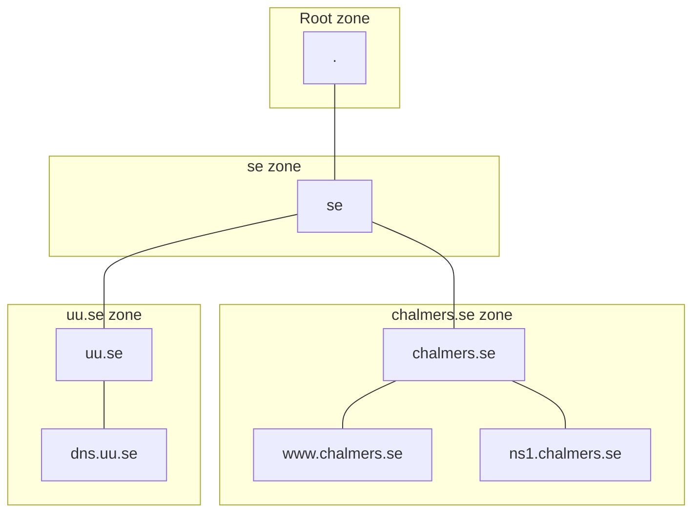
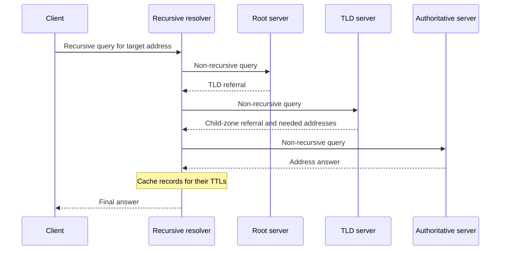

# 03. Zones, delegation, and recursive resolution

## Learning goals

- Distinguish a domain from an administrative zone.
- Trace stub-to-recursive queries and iterative referrals from root to authority.

**Builds on:** [Names, URLs, and the purpose of DNS](01_names_and_urls.md), [Why distributed naming and caching scale](02_scalable_naming.md).

## Explanation

DNS names form a tree rooted at `.`. Top-level domains include country-code domains such as `.se`, `.uk`, and `.fr`, and generic domains such as `.com`, `.org`, and `.edu`. A **domain** is a subtree of names. A **zone** is the portion administered together, excluding subtrees delegated to other zones. A dot-separated boundary does not automatically mean a new zone.

For example, `chalmers.se` can be a zone delegated by `.se`. Its administrators can further delegate a subdomain. Each zone normally has several authoritative servers containing replicated data. Parents publish NS records telling resolvers how to find child-zone servers.

The following example shows namespace relationships with undirected lines. Boxes mark separate administrative zones; lines do not represent packet flow.

The same distinction appears in the lecture's wider tree: root branches include `edu`, `com`, `gov`, `mil`, `org`, `net`, `uk`, and `fr`. Examples beneath them include Princeton and MIT, Cisco and Yahoo, NASA and NSF, ARPA and Navy, and ACM and IEEE. Within Princeton, `cs`, `ee`, and `physics` illustrate separately bounded portions, with `ux01` and `ux04` beneath `cs`. The important information is the distinction between **name hierarchy and administrative boundaries**, rather than any present-day arrangement of those organizations.

### Recursive and non-recursive queries

A **recursive query** asks a server to obtain the final result, which may be an answer or an error. A **non-recursive query** asks for information the server can supply directly, including a referral. A recursive resolver commonly performs an **iterative sequence of non-recursive queries**.

Starting with an empty relevant cache:

1. The application asks its local recursive resolver for the target name.
2. The resolver asks a root server and receives a referral to the relevant TLD.
3. It asks a TLD server and receives a referral to the domain's authoritative servers.
4. It asks an authoritative server, following any further delegations if necessary.
5. It caches the usable records and returns the result to the application.

The lecture's topology uses requesting host `cis.poly.edu`, resolver `dns.poly.edu`, and target `gaia.cs.umass.edu`, served by `dns.cs.umass.edu`. Its eight numbered arrows are the four request/response pairs above. The drawing abstracts any extra delegation steps.

Caching applies to intermediate referrals as well as final answers. After learning how to reach the relevant servers, subsequent queries under `.umass.edu` need not restart at the root while usable cached information remains. “Only the first query contacts the root” therefore depends on cache lifetime and state.

## Reasoning through the concepts

**Editorial clarification of the existing topic:** The client-side component that sends an application's DNS question to a recursive resolver is called a **stub resolver**. It delegates the iterative search rather than contacting every authority itself. A recursive query requests a final result; that result can be an answer or an error, and the server may refuse recursion. See [RFC 1034 §5.3.1](https://www.rfc-editor.org/rfc/rfc1034.html#section-5.3.1).

## Practice

Assigned DNS questions: Q005, Q013, Q018, Q029, Q031.

Consult [review.md](review.md) before scored practice. Assigned DNS questions need no additional lesson to answer the supported concepts; optional links in the manifest provide background.

## Source

- [Lecture 02: 2. Hierarchy, delegation, and resolution](../../lectures/lecture_02_dns.md#2-hierarchy-delegation-and-resolution)

[Topic overview](README.md) · [Glossary](glossary.md) · [References](references.md) · [Previous lesson](02_scalable_naming.md) · [Next lesson](04_root_hints_and_glue.md)
