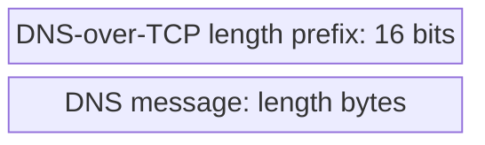
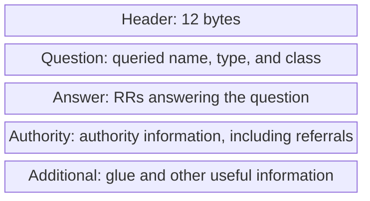

# 05. DNS transport and message sections

## Learning goals

- Explain UDP, TCP framing, EDNS, and truncation fallback.
- Identify Question, Answer, Authority, and Additional sections.

**Builds on:** [Zones, delegation, and recursive resolution](03_hierarchy_and_resolution.md).

## Explanation

### Transport and framing

Conventional DNS uses **UDP or TCP port 53**. UDP avoids establishing a stream connection for a simple exchange. The original DNS specification limits an unextended UDP DNS message to **512 bytes**. A truncated reply sets `TC`, and the client can retry using TCP.

**Technical clarification:** 512 bytes is the original DNS limit, not UDP's inherent maximum. EDNS allows a client to advertise a larger UDP payload size. Modern queries can carry an OPT pseudo-record in Additional, so the lecture's “queries have empty Answer, Authority, and Additional sections” describes a basic query rather than every modern query. See [RFC 6891](https://www.rfc-editor.org/rfc/rfc6891).

TCP supplies a byte stream, not separate messages. Each DNS message is therefore preceded by a **16-bit length**, excluding the two-byte length prefix itself.

### Message sections

Queries and replies share the following organization. Blocks show order, not proportional size.

A basic query contains its question and no answer RRs. A reply normally repeats the question and adds appropriate records. A referral can have no final Answer while still providing useful Authority and Additional records. Authority can also contain an SOA in a negative response; it is not restricted to NS records.

## Practice

Assigned DNS questions: Q008, Q024, Q025.

Consult [review.md](review.md) before scored practice. Assigned DNS questions need no additional lesson to answer the supported concepts; optional links in the manifest provide background.

## Source

- [Lecture 02: 4. DNS messages and binary encoding](../../lectures/lecture_02_dns.md#4-dns-messages-and-binary-encoding)

[Topic overview](README.md) · [Glossary](glossary.md) · [References](references.md) · [Previous lesson](04_root_hints_and_glue.md) · [Next lesson](06_headers_and_records.md)
