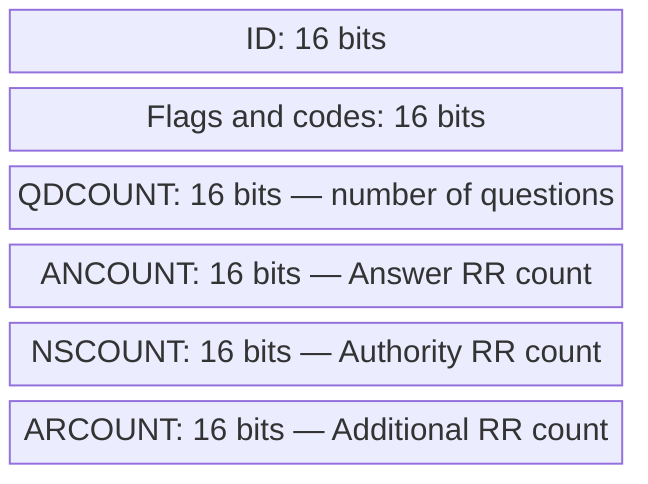
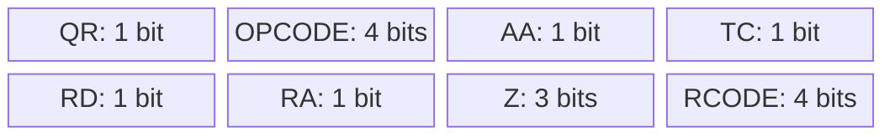
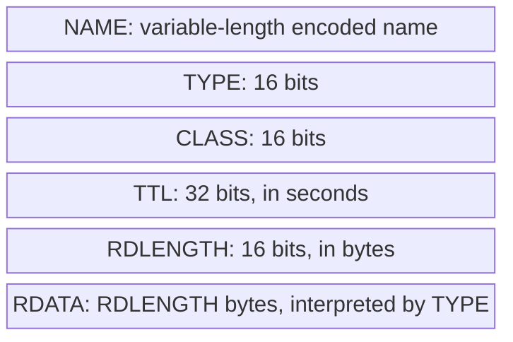

# 06. DNS headers and resource records

## Learning goals

- Interpret RD, RA, AA, TC, and the section counts.
- Read resource-record fields and distinguish RR TTL from message flags.

**Builds on:** [DNS transport and message sections](05_transport_and_sections.md).

## Explanation

### The 12-byte header

The fixed header contains six 16-bit words:



**ID** associates a reply with an outstanding query. The second word has this original RFC 1035 layout, expressed in wire order:



Read the top row left to right, then the bottom row. The visual blocks are not to scale; the stated widths sum to 16 bits.

- **QR:** `0` is a query, `1` a response.
- **OPCODE:** operation requested; `0` means a standard query.
- **AA:** authoritative answer indication.
- **TC:** message truncation indication.
- **RD:** recursion desired, set by the requester.
- **RA:** recursion available at the responding server. Requesting recursion does not guarantee it is offered.
- **Z:** originally reserved and zero.
- **RCODE:** response status, with `0` meaning no error.

**Technical clarification:** later standards assign two of the original Z bits to AD (Authenticated Data) and CD (Checking Disabled). Also, NSCOUNT counts *all RRs in Authority*, despite the suggestive field name. The diagram intentionally preserves the original header convention.

### Resource records

The textual record form is:

```text
name [TTL] [class] type rdata
```

The **owner name** identifies what the record describes. TTL gives the cache lifetime in seconds. The class supports extensibility and is normally `IN`, numeric value `1`. The type determines how to interpret the resource data. An A record holds an IPv4 address; an NS record holds a server's name.

The lecture's example is:

```dns
stanford.edu. 1800   IN A  171.67.216.14
stanford.edu. 1800   IN A  171.67.216.16
stanford.edu. 172800 IN NS Argus.stanford.edu.
```

The address TTL is 30 minutes; the NS TTL is two days. Multiple A records at the same owner name illustrate an RRset.

The binary encoding is:



Fields have explicit sizes because their visual heights are not proportional. NAME may use compression. RDLENGTH describes the encoded RDATA length, not the size of the entire record.

## Practice

Assigned DNS questions: Q006, Q009.

Consult [review.md](review.md) before scored practice. Assigned DNS questions need no additional lesson to answer the supported concepts; optional links in the manifest provide background.

## Source

- [Lecture 02: 4. DNS messages and binary encoding](../../lectures/lecture_02_dns.md#4-dns-messages-and-binary-encoding)

[Topic overview](README.md) · [Glossary](glossary.md) · [References](references.md) · [Previous lesson](05_transport_and_sections.md) · [Next lesson](07_names_and_compression.md)
