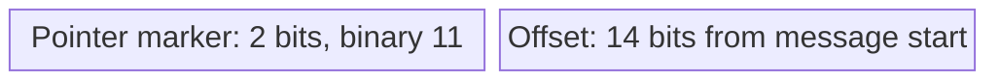

# 07. Labels, name encoding, and compression

## Learning goals

- Interpret label lengths and the root terminator.
- Decode the 14-bit offset in a two-byte compression pointer.

**Builds on:** [DNS headers and resource records](06_headers_and_records.md).

## Explanation

### Names and compression

`www.stanford.edu.` has the labels `www`, `stanford`, and `edu`, followed by the empty root label. Each ordinary label is encoded as a length byte followed by that many bytes:

```text
03 www 08 stanford 03 edu 00
```

The final `00` is the zero-length root label. A label is at most **63 octets**. For ordinary ASCII hostnames, labels use letters, digits, and hyphens, without a leading or trailing hyphen. **Technical clarification:** that hostname convention is not a restriction on every DNS owner name. Service records later use underscore labels, for example. RFC 2181 distinguishes DNS names from application-specific hostname rules.

Name comparisons are case-insensitive. Thus `www.sTANford.EDu` denotes the same name as `www.stanford.edu`. Case is preserved where possible, including the question copied into a reply; this does not require every independently stored name in every response section to adopt the question's spelling.

Repeated suffixes waste space. **Name compression** replaces a suffix with a two-byte pointer to its earlier encoding in the same DNS message:



For a 16-bit pointer value \(p\), the offset is:

\[
\operatorname{offset}=p-\mathtt{0xC000}=p\mathbin{\&}\mathtt{0x3FFF}.
\]

The test is that the first byte's **top two bits are `11`**, not that the byte must equal exactly `0xC0`. The pointer occupies two bytes total, including that first byte. For example, `www.example.com` and `mail.example.com` can share the encoded `example.com` suffix. This saves repeated suffix bytes within a message.

## Practice

Assigned DNS questions: Q010.

Consult [review.md](review.md) before scored practice. Assigned DNS questions need no additional lesson to answer the supported concepts; optional links in the manifest provide background.

## Source

- [Lecture 02: 4. DNS messages and binary encoding](../../lectures/lecture_02_dns.md#4-dns-messages-and-binary-encoding)

[Topic overview](README.md) · [Glossary](glossary.md) · [References](references.md) · [Previous lesson](06_headers_and_records.md) · [Next lesson](08_replication_and_caching.md)
