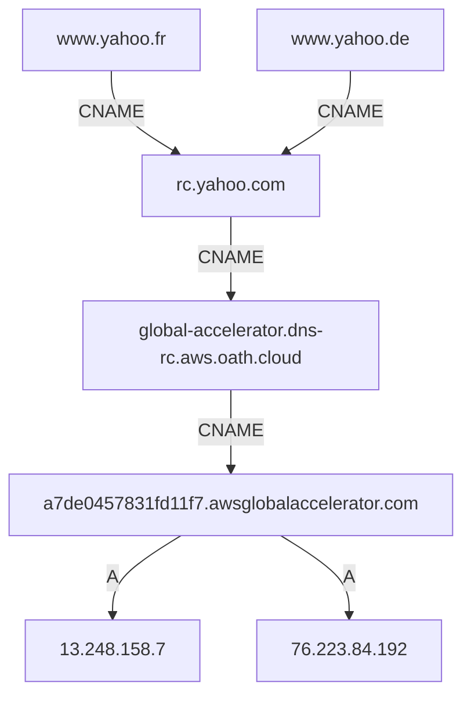

# 09. CNAME chains and alias restrictions

## Learning goals

- Follow aliases to provider-managed addresses.
- Distinguish indirection from delegation and retain supplementary CNAME/MX restrictions.

**Builds on:** [Zones, delegation, and recursive resolution](03_hierarchy_and_resolution.md), [DNS headers and resource records](06_headers_and_records.md).

**Mixed source classification:** only “† CNAME coexistence and MX restrictions” is supplementary in the supplied guide; ordinary CNAME chains are unmarked.

## Explanation

### CNAME aliases and chains

A CNAME associates an alias with a canonical name:

```text
name [TTL] [IN] CNAME canonical-name
```

When resolving ordinary data through an alias, the resolver follows the CNAME target. `getaddrinfo()` supports an `AI_CANONNAME` flag for requesting canonical-name information. The lecture gives short aliases for long hostnames:

```dns
wb.scs.stanford.edu. CNAME williamsburg-bridge.scs.stanford.edu.
mb.scs.stanford.edu. CNAME manhattan-bridge.scs.stanford.edu.
```

The Yahoo example combines many aliases with infrastructure managed elsewhere:

```dns
www.yahoo.fr. 300  IN CNAME rc.yahoo.com.
www.yahoo.de. 1800 IN CNAME rc.yahoo.com.
rc.yahoo.com. 300 IN CNAME global-accelerator.dns-rc.aws.oath.cloud.
global-accelerator.dns-rc.aws.oath.cloud. 900 IN CNAME a7de0457831fd11f7.awsglobalaccelerator.com.
a7de0457831fd11f7.awsglobalaccelerator.com. 300 IN A 13.248.158.7
a7de0457831fd11f7.awsglobalaccelerator.com. 300 IN A 76.223.84.192
```

These are historical lookup results, with whitespace artifacts in the long names normalized. The country aliases converge on `rc.yahoo.com`, and the chain then reaches the provider-managed name and its addresses.



This avoids updating more than 50 country-domain zones whenever infrastructure changes. A provider such as AWS, Cloudflare, or Akamai can change addresses behind its name without the customer hard-coding those addresses into every alias. Address selection can also support load balancing and geographical steering.

A name has a single CNAME target, while the ultimate target can have multiple A or AAAA records. **CNAME chaining is name indirection**, not an HTTP redirect and not an NS delegation of zone administration.

A response may legitimately contain a CNAME for the queried alias and A records for the **different owner name** reached at the end of the chain, as the visible Yahoo example already demonstrates.

<a id="cname-coexistence-and-mx-restrictions"></a>
### † CNAME coexistence and MX restrictions

A CNAME owner cannot also have ordinary records such as A, AAAA, or NS. For example:

```dns
david.com. CNAME david.stanford.edu.
```

is not a valid ordinary zone-apex arrangement: `david.com` also requires the zone's NS and SOA records. **Technical clarification:** DNSSEC-related metadata is an exception to the simplified “no other records” rule; see RFC 2181 and subsequent DNSSEC specifications.

An MX target must be a server name with address records, not a CNAME alias. The lecture uses `bad-mx.scs.stanford.edu` as a historical diagnostic example. Alias targets interfere with the expected retrieval of address information, including additional-section processing. Missing Additional data alone does not establish that mail delivery must fail, since a client can perform further address queries, but the alias target itself violates the DNS requirement.

## Reasoning through the concepts

**Editorial clarification of the existing topic:** Following a CNAME adds a name-resolution step, but does not necessarily add a network round trip. The same response can already contain the target address, as the Yahoo example shows, or usable target data can be cached. See [RFC 1034 §3.6.2](https://www.rfc-editor.org/rfc/rfc1034.html#section-3.6.2).

## Practice

Assigned DNS questions: Q012.

Consult [review.md](review.md) before scored practice. Assigned DNS questions need no additional lesson to answer the supported concepts; optional links in the manifest provide background.

## Source

- [Lecture 02: 6. Aliases, mail, reverse lookup, and services](../../lectures/lecture_02_dns.md#6-aliases-mail-reverse-lookup-and-services)

[Topic overview](README.md) · [Glossary](glossary.md) · [References](references.md) · [Previous lesson](08_replication_and_caching.md) · [Next lesson](10_mail_and_reverse.md)
