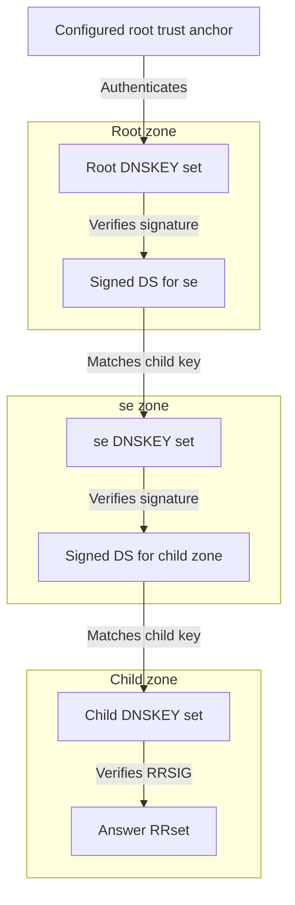

# 14. DNSSEC data authentication and deployment

## Learning goals

- Trace trust from an anchor through DS, DNSKEY, and RRSIG.
- Separate signing, validation, confidentiality, and deployment measurements.

**Builds on:** [Zones, delegation, and recursive resolution](03_hierarchy_and_resolution.md), [DNS headers and resource records](06_headers_and_records.md), [Forgery and cache poisoning](13_forgery_and_cache_poisoning.md).

## Explanation

### DNSSEC and the chain of trust

DNSSEC adds signed data and a way to connect it to a trusted starting point:

- **RRSIG** signs an RRset.
- **DNSKEY** publishes the verifying public key.
- **DS**, stored in the parent, contains a digest identifying a child's key.

A validating resolver begins with a configured **trust anchor**, normally the root trust anchor for the public DNS hierarchy. It validates the parent data, checks that the child key matches the authenticated DS, and uses the child's authenticated key set to validate child records.

The diagram abstracts the detailed signatures within each DNSKEY set. Unlike glue, which helps locate a server, a DS record helps establish trust in a child's key. Delegation provides the hierarchy for both tasks.

**DNSSEC signs; it does not encrypt.** Records remain public. It authenticates DNS data under the trusted key hierarchy, not an arbitrary server connection and not the correctness of an administrator's configuration.

**Technical clarification:** an authenticated absence of a DS can identify an **insecure** delegation, where validation does not extend to the child. A missing or invalid signature where a secure chain requires one is **bogus**, not a harmless downgrade to insecure. Simply deleting a DS from a reply must not disable validation.

### Signing and validating are separate deployment choices

Zone owners decide whether to sign. Resolver operators decide whether to validate. Signing gives little protection to clients whose resolvers never check signatures; validation cannot authenticate ordinary unsigned data. The parties bearing deployment costs and receiving benefits differ, which complicates adoption.

The lecture describes global validation as roughly one third, with a smaller share of zones signed, and presents Sweden and neighbouring countries as relatively strong adopters. **These are undated lecture estimates, not verified statistics for 2026-10-20.** APNIC's [Sweden measurement page](https://stats.labs.apnic.net/dnssec/SE) should be read with its observation period and measurement definition; its accessible page did not expose a fresh percentage during this preparation. Measured validation capability is not automatically the percentage of every DNS query worldwide.

The institutional explanation offered is early `.se` adoption, registry incentives including discounts for signed domains, a concentrated resolver market, and public-sector requirements. A few large operators' decisions can move validation rates, whereas signing requires action across many independently administered zones. The lecture compares this incentive mismatch with RPKI, citing an undated example of roughly 67% signing versus 12% enforcement. Those figures illustrate differing adoption measures, not interchangeable current statistics.

## Practice

Assigned DNS questions: Q020, Q021.

Consult [review.md](review.md) before scored practice. Assigned DNS questions need no additional lesson to answer the supported concepts; optional links in the manifest provide background.

## Source

- [Lecture 02: 8. Forgery, cache poisoning, and DNSSEC](../../lectures/lecture_02_dns.md#8-forgery-cache-poisoning-and-dnssec)

[Topic overview](README.md) · [Glossary](glossary.md) · [References](references.md) · [Previous lesson](13_forgery_and_cache_poisoning.md) · [Next lesson](15_trust_anchor_rollover.md)
