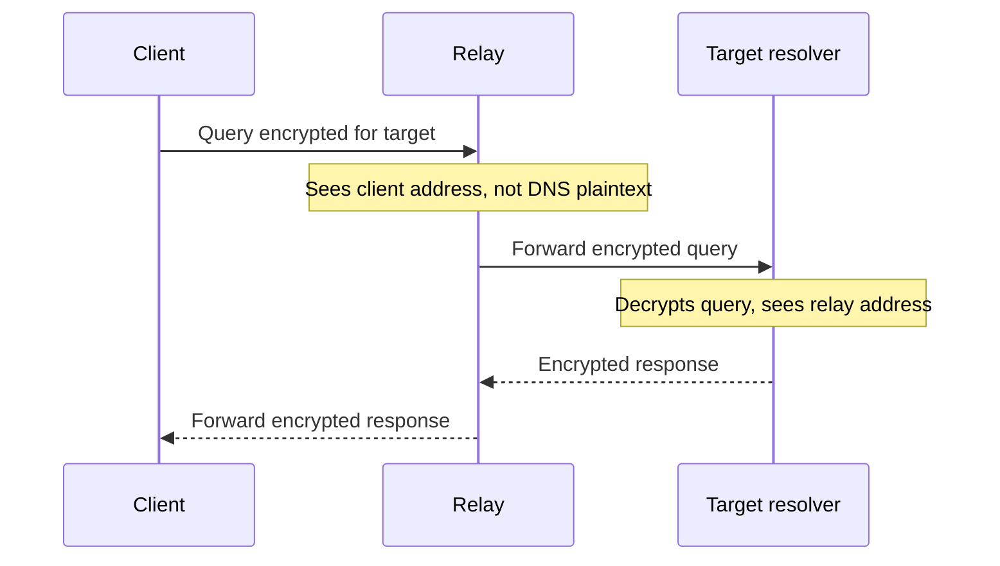

# 17. QNAME minimisation and Oblivious DoH

## Learning goals

- Explain how minimisation reduces disclosures to authoritative servers.
- Trace which information an Oblivious DoH relay and target receive.

**Builds on:** [Zones, delegation, and recursive resolution](03_hierarchy_and_resolution.md), [Encrypted DNS and resolver trust](16_encrypted_dns.md).

## Explanation

### QNAME minimisation

Traditional iterative queries can disclose the complete requested name to each server contacted, even when a server only needs one part of it to issue a referral. RFC 9156 reduces that disclosure.

For `www.example.se`, the conceptual sequence is:

1. The root receives only what is needed to find `.se`.
2. The `.se` servers receive what is needed to find `example.se`.
3. The final authoritative server receives the complete name needed for the answer.

This reduces unnecessary information at authoritative servers. **It does not hide the original full query from the recursive resolver.** The three steps describe the minimisation principle rather than every implementation's fallback behaviour.

### Oblivious DoH

Oblivious DoH separates two observations: who sent the request, and what name it requests. The client encrypts the DNS query for a target, then sends it through a relay.

The relay sees the client but cannot decrypt the DNS contents. The target decrypts the contents but receives the relay's connection. **Technical clarification:** this separation assumes the parties do not collude and does not eliminate every traffic-correlation risk. Oblivious DoH uses encryption *and* separation of information; it is not privacy without encryption. See RFC 9230.

## Practice

No questions from the supplied DNS quiz are assigned. Retain this material for study and revision.

Consult [review.md](review.md) before scored practice.

## Source

- [Lecture 02: 10. Query privacy](../../lectures/lecture_02_dns.md#10-query-privacy)

[Topic overview](README.md) · [Glossary](glossary.md) · [References](references.md) · [Previous lesson](16_encrypted_dns.md) · [Next lesson](18_anycast_and_resilience.md)
