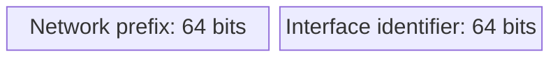

# 3. IPv6 notation, compression, and prefixes

## Learning goals

- Expand and compress IPv6 addresses without changing their value.
- Interpret prefix lengths and distinguish valid syntax from canonical form.

**Builds on:** [Why IPv6 exists](01_motivation.md).

## Explanation

An IPv6 address contains **eight 16-bit hextets**. A full representation uses four hexadecimal digits per hextet:

```text
2001:0db8:0000:1111:0000:0000:0000:0200
2001:0db8:0000:00a3:abcd:0000:0000:1234
```

The arithmetic is \(8\times16=128\) bits. Hexadecimal letters are case-insensitive, although canonical notation uses lowercase.

### Compression rules

**Rule 1: omit leading zeros within a hextet.**

| Full hextet | Short form |
|---|---|
| `01ab` | `1ab` |
| `09f0` | `9f0` |
| `0a00` | `a00` |
| `00ab` | `ab` |
| `0000` | `0` |

Trailing zeros cannot be removed: `a00` and `a` are different values. Expanding a short hextet means padding it on the **left** to four digits.

**Rule 2: replace one contiguous run of zero hextets with `::`.** For example:

```text
2001:db8:cafe:1:0:0:0:1
2001:db8:cafe:1::1
```

Use `::` at most once. To expand it, count the explicit hextets, subtract from eight, and insert that many zero hextets at its position. Two `::` gaps would leave the division of missing groups ambiguous.

Combining both rules:

```text
Full:       2001:0db8:0000:1111:0000:0000:0000:0200
Zero trim:  2001:db8:0:1111:0:0:0:200
Compressed: 2001:db8:0:1111::200
```

The second full example becomes `2001:db8:0:a3:abcd::1234`.

**Technical clarification:** valid syntax can use `::` for a single zero hextet, but **RFC 5952 canonical notation does not**. Canonical form compresses the longest zero run, chooses the leftmost in a tie, and uses lowercase. Distinguish a valid spelling from the recommended canonical spelling.

### Prefix notation

`address/p` means the leading \(p\) bits form the prefix. The length ranges from `/0` to `/128`. It is a bit count, not a count of hexadecimal digits.

An ordinary LAN normally uses `/64`:



For the `2001:db8:a::/64` example, the full prefix is `2001:0db8:000a:0000`, followed by the 64-bit IID. The blocks indicate field order and labelled sizes.

The 64-bit boundary supports ordinary SLAAC on common link types. **It is not a ban on all other IPv6 prefix lengths.** Router-to-router point-to-point links often use `/127`, while `/128` denotes a single address. Site allocations such as `/48` and `/56` are normally divided into `/64` LANs.

## Practice

Assigned IPv6 questions: Q004, Q029.

Q004 additionally requires [lesson 05](05_local_and_embedded_addresses.md) to evaluate its mixed decimal/hexadecimal notation option.

Check the [review queue](review.md) before scored practice; flagged questions retain their original keys. The [manifest](manifest.json) separates additional required lessons from optional background.

## Source

- [Lecture: 2. Writing and reading IPv6 addresses](../../lectures/lecture_03_ipv6.md#2-writing-and-reading-ipv6-addresses)

[Topic overview](README.md) · [Glossary](glossary.md) · [References](references.md) · [Previous lesson](02_regional_allocation.md) · [Next lesson](04_address_types.md)
