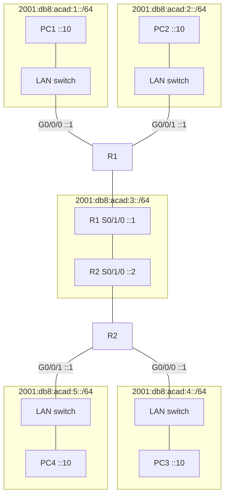

# 6. Subnetting a site allocation

## Learning goals

- Calculate the number of /64 LANs in an allocation.
- Assign subnet IDs and interpret the five-link worked topology.

**Builds on:** [IPv6 notation, compression, and prefixes](03_notation_and_prefixes.md), [Delivery types and global unicast structure](04_address_types.md).

## Explanation

With a `/48` allocation and `/64` LANs, the subnet field has:

\[
64-48=16\text{ bits},\qquad 2^{16}=65{,}536\text{ subnets}.
\]

For `2001:db8:acad::/48`, the fourth hextet is the subnet ID. The first three hextets stay fixed, and the last four are the IID:

```text
2001:db8:acad:0000::/64
2001:db8:acad:0001::/64
2001:db8:acad:0002::/64
...
2001:db8:acad:0009::/64
2001:db8:acad:000a::/64
2001:db8:acad:000b::/64
2001:db8:acad:000c::/64
...
2001:db8:acad:ffff::/64
```

Increment in **hexadecimal**, including `a` through `f`. The zero subnet is part of the available numbering space. More generally, splitting a `/p` allocation into `/64` subnets gives \(2^{64-p}\) subnets when \(p\le64\). For a `/56`, that is \(2^8=256\).

The lecture's topology needs four LANs and one router-to-router link:

| Subnet | Purpose | Router address(es) | Host example |
|---|---|---|---|
| `2001:db8:acad:1::/64` | R1 G0/0/0 LAN | R1 `2001:db8:acad:1::1` | PC1 `2001:db8:acad:1::10` |
| `2001:db8:acad:2::/64` | R1 G0/0/1 LAN | R1 `2001:db8:acad:2::1` | PC2 `2001:db8:acad:2::10` |
| `2001:db8:acad:3::/64` | R1–R2 serial link | R1 `…:3::1`, R2 `…:3::2` | — |
| `2001:db8:acad:4::/64` | R2 G0/0/0 LAN | R2 `2001:db8:acad:4::1` | PC3 `2001:db8:acad:4::10` |
| `2001:db8:acad:5::/64` | R2 G0/0/1 LAN | R2 `2001:db8:acad:5::1` | PC4 `2001:db8:acad:5::10` |

Here `…` abbreviates the unchanged `2001:db8:acad` text in the table, not valid address syntax. The example intentionally uses `/64` even on the serial link; that does not contradict the separate `/127` practice for point-to-point deployments.



Undirected lines show connectivity, not one-way packet movement. R1 and R2's serial-interface boxes represent interfaces of those routers, not additional routers.

The generous space makes address planning simpler than tightly rationed IPv4 allocations. It does not remove the need to calculate prefix boundaries, allocate consistently, and configure routes.

## Practice

No native IPv6 quiz questions are assigned. This teaching is retained for study and revision.

Check the [review queue](review.md) before scored practice; flagged questions retain their original keys. The [manifest](manifest.json) separates additional required lessons from optional background.

## Source

- [Lecture: 4. Subnetting a site allocation](../../lectures/lecture_03_ipv6.md#4-subnetting-a-site-allocation)

[Topic overview](README.md) · [Glossary](glossary.md) · [References](references.md) · [Previous lesson](05_local_and_embedded_addresses.md) · [Next lesson](07_static_configuration.md)
