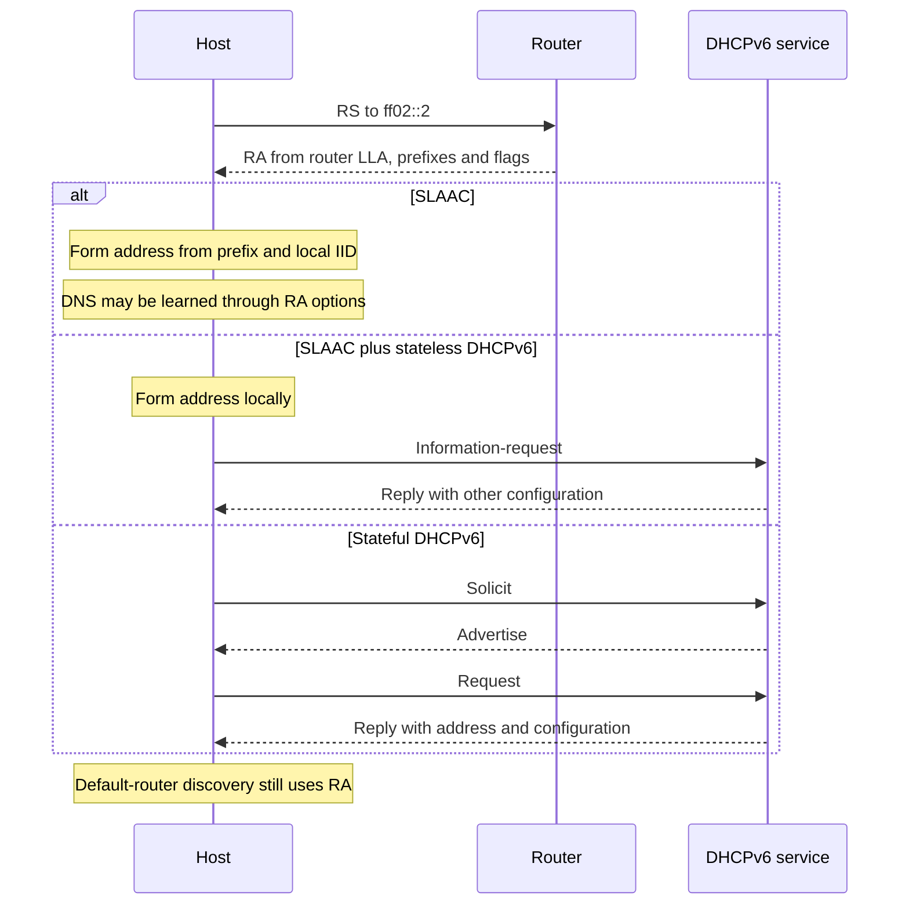

# 8. Router advertisements, SLAAC, and DHCPv6

## Learning goals

- Compare SLAAC, stateless DHCPv6, and stateful DHCPv6.
- Distinguish autonomous prefix configuration from router and DNS discovery.

**Builds on:** [Delivery types and global unicast structure](04_address_types.md), [Local scope, special addresses, and embedded IPv4](05_local_and_embedded_addresses.md).

## Explanation

Routers send **Router Advertisements (RAs)** containing prefixes and related configuration. A host can send a **Router Solicitation (RS)** instead of waiting for a periodic RA. The source address of an RA is the router's LLA. With a suitable nonzero router lifetime, that router can become a default router.

RAs can carry prefix and prefix-length information, configuration flags, and DNS-related options. The address-configuration mechanisms below are alternatives that may also coexist.

### The three configuration methods

| Method | Where the host address comes from | Other settings | Default router |
|---|---|---|---|
| SLAAC | Advertised prefix plus locally generated IID | Can come from RA options, including DNS | RA |
| SLAAC + stateless DHCPv6 | Advertised prefix plus locally generated IID | DHCPv6 provides DNS and other configuration | RA |
| Stateful DHCPv6 | DHCPv6 server allocates an address and maintains a binding | DHCPv6 may provide DNS and other settings | RA |

**SLAAC** needs no address-lease server. For a `/64`, the host combines an advertised 64-bit prefix with a 64-bit IID, then performs the appropriate address checks. The router still supplies configuration; “no server” does not mean “no network dependencies.” No DHCP address-binding database records the generated assignment, although logging and network observation can still provide accountability.

**Stateless DHCPv6** supplements SLAAC with configuration such as DNS server addresses and a domain search list. It does not allocate the host address or maintain an address lease for it. The lecture's typical combination is `M=0`, `O=1`: managed address configuration off, other configuration available.

**Stateful DHCPv6** maintains address bindings and lease information. It supports centralized assignment and records useful for auditing and incident response, at the cost of server operation and availability. A client discovers DHCPv6 service using a Solicit message to **`ff02::1:2`**, the link-local All_DHCP_Relay_Agents_and_Servers multicast group.

**Technical clarifications:**

- The **M flag** signals managed address configuration, and **O** signals other configuration. SLAAC permission comes from the **A flag in a Prefix Information Option**. `M=1` does not itself turn SLAAC off. A deliberately DHCPv6-only address policy must also avoid advertising that prefix for autonomous configuration. Host support and policy matter too.
- Ordinary DHCPv6 address assignment does **not** provide the default gateway. Router discovery supplies it. A DHCPv6 address lease also must not be treated as an IPv4-style subnet-mask lease: on-link prefix information normally comes from RAs. Delegating a prefix to a router is a separate DHCPv6 function.
- The source first says plain SLAAC cannot supply DNS, then later describes DNS in RAs. The latter reflects modern operation: **RDNSS and DNS search-list options** allow DNS configuration through RAs (RFC 8106). Stateless DHCPv6 is therefore not always necessary.
- Stateless DHCPv6 normally uses an **Information-request/Reply**, not the stateful Solicit exchange pictured beside it in the source.

The diagram shows conventional exchanges rather than every option, relay, or rapid-commit variation. DAD applies where required before normal use of assigned unicast addresses.

## Reasoning through the concepts

**Editorial clarification of the existing topic:** Address configuration and end-to-end reachability are different questions. SLAAC forms an address from prefix information and a local IID; routes and the path still matter. A local IID need not be MAC-derived: [modified EUI-64](09_eui64.md) and [privacy identifiers](10_privacy_identifiers.md) describe different choices.

## Practice

Assigned IPv6 questions: Q002, Q006, Q030.

Check the [review queue](review.md) before scored practice; flagged questions retain their original keys. The [manifest](manifest.json) separates additional required lessons from optional background.

## Source

- [Lecture: 6. Dynamic addressing and interface identifiers](../../lectures/lecture_03_ipv6.md#6-dynamic-addressing-and-interface-identifiers)

[Topic overview](README.md) · [Glossary](glossary.md) · [References](references.md) · [Previous lesson](07_static_configuration.md) · [Next lesson](09_eui64.md)
