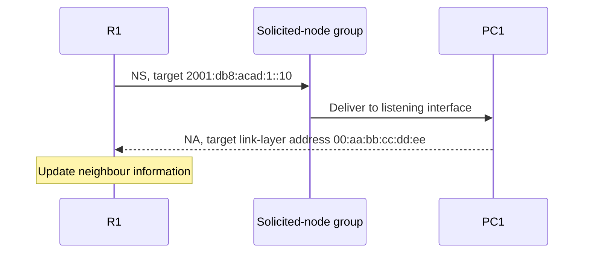

# 12. Solicited-node multicast and address resolution

## Learning goals

- Derive a solicited-node group and Ethernet destination from the target address.
- Trace NS/NA and distinguish the multicast destination from the unicast target.

**Builds on:** [Local scope, special addresses, and embedded IPv4](05_local_and_embedded_addresses.md), [ICMPv6 and router discovery](11_router_discovery.md).

## Explanation

To transmit over Ethernet to an on-link neighbour, a sender needs the neighbour's MAC address. For an off-link destination, it resolves the local next-hop router's MAC instead. IPv6 performs this through **NS/NA**, rather than ARP.

A solicited-node multicast group combines the fixed prefix **`ff02::1:ff00:0/104`** with the low **24 bits** of the target's unicast address. Its Ethernet destination is **`33:33:ff:xx:xx:xx`**, using those same final three bytes.

For the source's target `2001:db8:acad:1::10`:

```text
Low 24 bits:             00:00:10
Solicited-node group:    ff02::1:ff00:10
Ethernet multicast MAC:  33:33:ff:00:00:10
```

The NS packet's **IPv6 destination is the multicast group**; its separate **Target Address field is the unicast address being resolved**. This distinction corrects the loose description that the initial multicast solicitation is simply “sent to `2001:db8:acad:1::10`.”

The exchange proceeds as follows:

1. R1 needs the MAC for PC1 at `2001:db8:acad:1::10`.
2. R1 sends an NS to `ff02::1:ff00:10`, naming PC1's unicast address as the target.
3. PC1 recognizes its target address and replies with an NA carrying its link-layer address.
4. R1 records the neighbour information and can address Ethernet frames to PC1.



The group participant denotes multicast delivery, not an extra router. Other interfaces sharing the same low 24 bits can also belong to the group and must inspect the target field.

The Ethernet NIC can filter uninterested multicast frames before passing them to IP processing. That reduces the work compared with IPv4 broadcast ARP. It is not a guarantee that exactly one NIC receives every frame: group collisions, filtering implementation, and switch behaviour matter.

## Practice

No native IPv6 quiz questions are assigned. This teaching is retained for study and revision.

Check the [review queue](review.md) before scored practice; flagged questions retain their original keys. The [manifest](manifest.json) separates additional required lessons from optional background.

## Source

- [Lecture: 7. ICMPv6 and Neighbor Discovery](../../lectures/lecture_03_ipv6.md#7-icmpv6-and-neighbor-discovery)

[Topic overview](README.md) · [Glossary](glossary.md) · [References](references.md) · [Previous lesson](11_router_discovery.md) · [Next lesson](13_dad_and_filtering.md)
