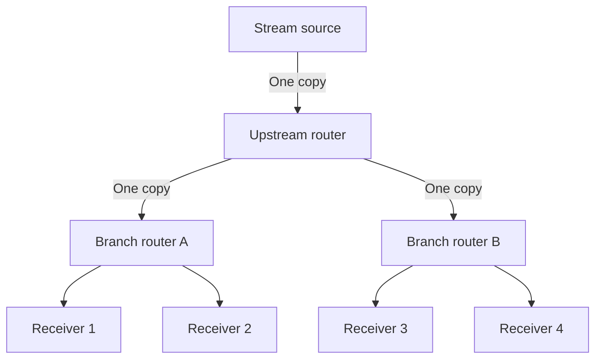

# 14. Multicast replication, membership, and scope

## Learning goals

- Explain branch replication and multicast forwarding state.
- Distinguish MLD/IGMP listener information from multicast routing.

**Builds on:** [Delivery types and global unicast structure](04_address_types.md), [Solicited-node multicast and address resolution](12_neighbor_resolution.md).

## Explanation

Suppose a source sends identical video or audio to \(n\) receivers. Sending \(n\) unicast packets can place \(n\) copies on a shared upstream link. **Multicast replicates packets where paths diverge**, so a distribution-tree link need carry only one copy of each source packet for its downstream recipients.



Arrows here show packet distribution. This shifts work from the source and shared links into routers maintaining forwarding state. Deployment across unrelated operators requires coordinated support, helping explain why the mechanism is useful without being universally available across the public Internet.

### Membership and forwarding state

A group has a multicast IP address. Hosts signal their membership to local routers using:

- **IGMP** for IPv4.
- **MLD**, carried in ICMPv6, for IPv6.

Reports and queries establish local listener information. **Technical clarification:** IGMP/MLD do not alone construct every inter-router distribution tree. Multicast routing mechanisms use membership information to establish forwarding paths.

The source's IPv4 membership example is a host requesting traffic for `239.1.1.1`. Its simplified forwarding entry is:

```text
(Source IP, Group Address) → Outgoing Interface List
(*, 239.1.1.1)             → [eth0, eth2]
```

The `*` indicates wildcard source state. Forwarding copies traffic onto the selected outgoing interfaces. This is a conceptual entry, not the entire multicast forwarding algorithm or reverse-path checks.

### IPv6 multicast addresses

IPv6 multicast addresses have prefix **`ff00::/8`**. They are destinations, **never source addresses**. The following groups are particularly important:

| Address | Membership or use |
|---|---|
| `ff02::1` | All IPv6 nodes on the link |
| `ff02::2` | All IPv6 routers on the link |
| `ff02::1:2` | DHCPv6 relay agents and servers on the link |
| `ff02::1:ffXX:XXXX` | Solicited-node group based on a target's low 24 bits |

In `ff02`, the `0` is the flags nibble and **the final `2` is the link-local scope nibble**. These groups are not forwarded beyond the link. Other multicast scopes exist.

The source focuses on well-known groups and solicited-node groups. This is a teaching classification, not a statement that every possible multicast address is one of those two fixed examples. Multicast to all nodes has reach similar to local broadcast; narrower groups reduce unnecessary processing.

## Practice

Assigned IPv6 questions: Q017, Q018.

Check the [review queue](review.md) before scored practice; flagged questions retain their original keys. The [manifest](manifest.json) separates additional required lessons from optional background.

## Source

- [Lecture: 8. Multicast delivery and membership](../../lectures/lecture_03_ipv6.md#8-multicast-delivery-and-membership)

[Topic overview](README.md) · [Glossary](glossary.md) · [References](references.md) · [Previous lesson](13_dad_and_filtering.md) · [Next lesson](15_anycast.md)
