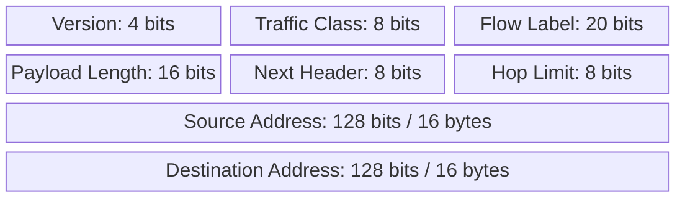

# 16. Reading the fixed IPv6 base header

## Learning goals

- Interpret Flow Label, Payload Length, Next Header, and Hop Limit.
- Calculate the 40-byte layout without confusing payload and packet lengths.

**Builds on:** [IPv6 notation, compression, and prefixes](03_notation_and_prefixes.md).

## Explanation

IPv6 has a **fixed 40-byte base header**, compared with IPv4's variable header length and inline options. Less common functions use optional extension headers linked after the base header.

The base-header layout below has two 32-bit rows followed by the source and destination addresses. Read each row from left to right; labelled widths, not visual box widths, specify the bit sizes.

- **Version:** `6`.
- **Traffic Class:** differentiated traffic handling, analogous to IPv4's type-of-service field.
- **Flow Label:** identifies packets belonging to a flow for suitable handling.
- **Payload Length:** length in bytes **after the 40-byte base header**, including any extension headers.
- **Next Header:** identifies the next extension header or upper-layer protocol.
- **Hop Limit:** decremented during forwarding, limiting the number of hops.
- **Source and Destination:** 128 bits each.

The total is:

\[
4+8+20+16+8+8+128+128=320\text{ bits}=40\text{ bytes}.
\]

**Technical clarification:** the source's short label “datagram length” is imprecise. Payload Length excludes the base header. A payload length of 1,200 therefore ordinarily means an IPv6 packet of 1,240 bytes. A jumbogram is a special extension-based case, outside the lecture's basic format.

## Practice

Assigned IPv6 questions: Q026.

Check the [review queue](review.md) before scored practice; flagged questions retain their original keys. The [manifest](manifest.json) separates additional required lessons from optional background.

## Source

- [Lecture: 10. The IPv6 header and extensibility](../../lectures/lecture_03_ipv6.md#10-the-ipv6-header-and-extensibility)

[Topic overview](README.md) · [Glossary](glossary.md) · [References](references.md) · [Previous lesson](15_anycast.md) · [Next lesson](17_fragmentation_and_extensions.md)
