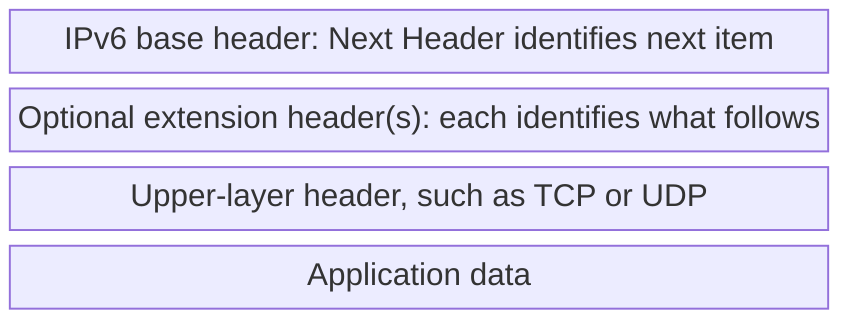

# 17. Source fragmentation and modular extension headers

## Learning goals

- Explain why IPv6 routers do not fragment and the source can use an extension.
- Trace header chaining and distinguish optional IPsec from automatic protection.

**Builds on:** [Reading the fixed IPv6 base header](16_base_header.md).

## Explanation

The base header has **no header checksum**. IPv6 avoids recalculating such a checksum at each forwarding hop and relies on protection at other layers for error detection. This does not mean every layer provides identical integrity guarantees.

It also has no inline fragmentation fields. **IPv6 routers do not fragment packets.** A source can use the Fragment extension header when appropriate; a router encountering an oversized packet can report the problem through ICMPv6. Source fragmentation and router fragmentation must not be conflated.

Each extension header identifies what follows, allowing a chain without altering the fixed base layout. As an illustrative order:

Security and authentication are available through mechanisms including **IPsec**. Their presence in the design does not automatically encrypt or authenticate ordinary IPv6 traffic. IPsec is also available for IPv4. The historical implementation requirement for IPv6 was relaxed, so “IPv6 is inherently secure” is not a valid conclusion.

## Practice

Assigned IPv6 questions: Q009, Q011, Q027.

Required support for Q012: its primary practice lesson is [routing lesson 03](../01_routing/03_fragmentation_and_pmtu.md), which teaches the fragment-loss/reassembly risk.

Check the [review queue](review.md) before scored practice; flagged questions retain their original keys. The [manifest](manifest.json) separates additional required lessons from optional background.

## Source

- [Lecture: 10. The IPv6 header and extensibility](../../lectures/lecture_03_ipv6.md#10-the-ipv6-header-and-extensibility)

[Topic overview](README.md) · [Glossary](glossary.md) · [References](references.md) · [Previous lesson](16_base_header.md) · [Next lesson](18_extension_deployment_and_srv6.md)
