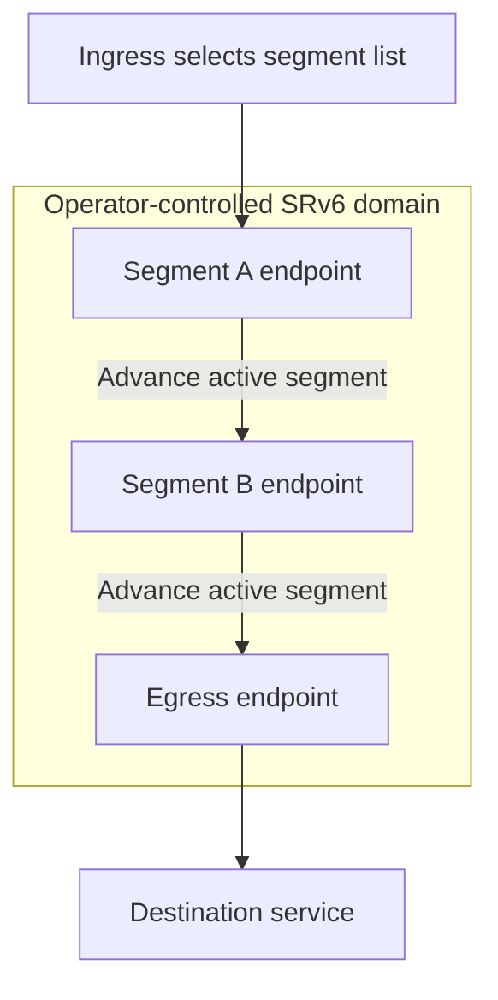

# 18. Extension-header deployment and SRv6

## Learning goals

- Distinguish a standardized extension from usability on a deployed path.
- Explain segment steering in a controlled operator domain.

**Builds on:** [Source fragmentation and modular extension headers](17_fragmentation_and_extensions.md).

## Explanation

The architecture permits extensibility, but a path may contain firewalls or other middleboxes unable or unwilling to process particular header chains. Some drop such packets, making end-to-end reliance on an extension header risky across arbitrary Internet paths. RFC 7872 reports measurements of this problem.

**Technical clarification:** the source's phrase “deployment killed extension headers” overstates the result. The evidence concerns particular extension types, paths, and measurements. It does not establish that every extension header fails everywhere. The practical lesson is to distinguish **standardized**, **implemented**, and **usable on the intended path**.

### SRv6 in a controlled domain

**Segment Routing over IPv6** uses a list of segment identifiers to steer a packet through selected endpoints or processing behaviours. An SRH carries the list, and segment processing changes the active destination as the packet progresses.

Arrows show the conceptual segment progression, not every transit hop. **Technical clarification:** a SID can identify a behaviour, not merely an ordinary host interface, and every intervening router need not process the SRH as a segment endpoint.

The operator can provision routing, endpoint behaviour, filtering, and trust boundaries within its domain. The same extension mechanism can therefore be usable there while unreliable across unrelated public networks. Deployability depends on both protocol design and the environment in which it operates.

## Practice

No native IPv6 quiz questions are assigned. This teaching is retained for study and revision.

Check the [review queue](review.md) before scored practice; flagged questions retain their original keys. The [manifest](manifest.json) separates additional required lessons from optional background.

## Source

- [Lecture: 10. The IPv6 header and extensibility](../../lectures/lecture_03_ipv6.md#10-the-ipv6-header-and-extensibility)

[Topic overview](README.md) · [Glossary](glossary.md) · [References](references.md) · [Previous lesson](17_fragmentation_and_extensions.md) · [Next lesson](19_tunnelling.md)
