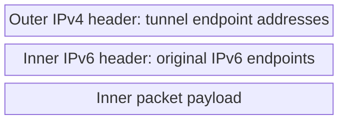
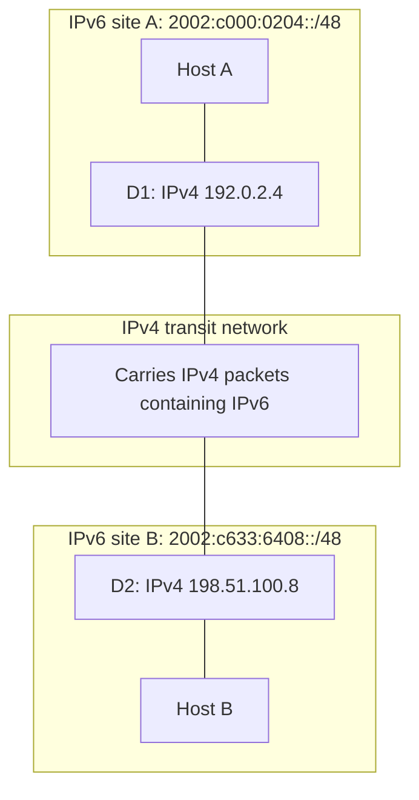

# 19. Coexistence, encapsulation, and historical 6to4

## Learning goals

- Contrast dual stack, tunnelling, and translation.
- Trace IPv6 inside IPv4 and derive a historical 6to4 prefix.

**Builds on:** [Local scope, special addresses, and embedded IPv4](05_local_and_embedded_addresses.md), [Source fragmentation and modular extension headers](17_fragmentation_and_extensions.md).

## Explanation

IPv4 and IPv6 cannot simply replace each other everywhere on one date. Three mechanisms solve different problems:

- **Dual stack:** run both protocols, maintaining both address families and associated operations.
- **Tunnelling:** carry one complete IP packet inside another, crossing a network that supports the outer family.
- **Translation:** rewrite between families so endpoints using different versions can communicate.

Native IPv6 between IPv6 endpoints avoids transition machinery where it is unnecessary. This does not make every tunnel obsolete or every translator avoidable.

### Tunnelling and the historical 6to4 example

In IPv6-over-IPv4 tunnelling, the intermediate network processes an IPv4 packet whose payload contains an IPv6 packet:



The tunnel presents the intervening path as a virtual link to the inner protocol. IPv4 routers forward based on the outer header. The remote endpoint removes it and resumes IPv6 forwarding.

The lecture's 6–4–6 example has IPv6 hosts A and B connected through dual-family tunnel endpoints D1 and D2:



Every **6to4** prefix begins `2002::/16`, followed by the 32-bit IPv4 endpoint:

```text
192.0.2.4     = c0 00 02 04 → 2002:c000:0204::/48
198.51.100.8  = c6 33 64 08 → 2002:c633:6408::/48
```

That derivation yielded a `/48` from a public IPv4 address without a separate IPv6 allocation. These particular addresses are documentation examples. Embedding the endpoint reduced configuration needs, but did not eliminate the need for functioning routing and tunnel implementation.

Automatic public relay dependence made return paths and troubleshooting unreliable. **Technical clarification:** RFC 7526 deprecates the **6to4 anycast relay mechanism**. The broad source heading “IP tunnelling now obsolete” should not be applied to encapsulation in general. Managed tunnels remain useful in other settings. A transition mechanism can lose its purpose without the underlying technique becoming invalid.

## Practice

Assigned IPv6 questions: Q007, Q008, Q025.

External routing practice: Routing Q085.

Routing Q085 additionally requires [lesson 18](18_extension_deployment_and_srv6.md) for the policy-steering part of the question.

Check the [review queue](review.md) before scored practice; flagged questions retain their original keys. The [manifest](manifest.json) separates additional required lessons from optional background.

## Source

- [Lecture: 11. Coexistence and transition mechanisms](../../lectures/lecture_03_ipv6.md#11-coexistence-and-transition-mechanisms)

[Topic overview](README.md) · [Glossary](glossary.md) · [References](references.md) · [Previous lesson](18_extension_deployment_and_srv6.md) · [Next lesson](20_nat64_and_464xlat.md)
